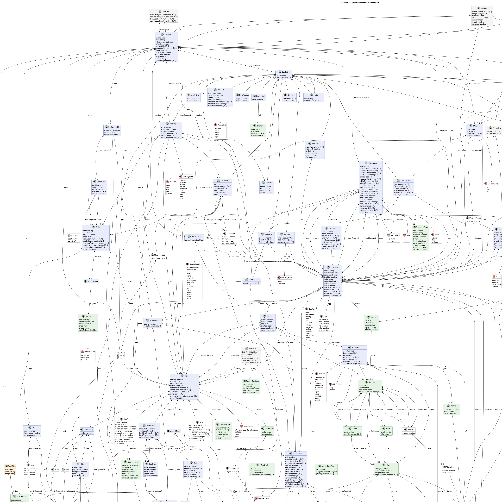

# Domänenmodell

**Dieses Diagramm führt.** Der Code folgt ihm, nie umgekehrt. Eine Änderung am Modell wird zuerst
hier gemacht, abgestimmt und dann in den Code übertragen. Das Diagramm wird nie umgezeichnet, damit
es zu dem passt, was der Code gerade tut. Solange der Code noch nicht nachgezogen hat, stehen die
Lücken unter [Wo der Code noch nicht folgt](#wo-der-code-noch-nicht-folgt).

> **Stand: Freigegeben für Version 1** (23. Oktober 2026). Änderungen nur noch auf dem oben
> beschriebenen Weg: erst hier, abgestimmt, dann im Code. Was seitdem wann freigegeben wurde,
> steht im [Verlauf der Freigaben](modell/verlauf.md).

Die Quelle ist [`domain-model.puml`](domain-model.puml) (PlantUML). Nach jeder Änderung das Bild und
alle Ausschnitte neu erzeugen mit `bash .claude/skills/domain-model/scripts/render.sh` (ohne
Argument); das Skript lädt PlantUML bei Bedarf selbst und braucht nur Java, kein Graphviz.

**Ausschnitte.** Das ganze Bild ist zu groß, um es auf einmal zu lesen. Deshalb gibt es Ausschnitte,
die aus dem Modell erzeugt werden, nie von Hand gezeichnet: je Bereich einer, mit den Klassen des
Bereichs vollständig und ihren Nachbarn aus anderen Bereichen zugeklappt, und je offener Änderung
einer, mit dem, was sie ändert. **Rot** ist, was noch nicht freigegeben ist: neue Felder rot und
fett, entfallende rot durchgestrichen, neue Pfeile rot und dick, entfallende rot gestrichelt, betroffene Klassen rot gerahmt.
Welche Klasse zu welchem Bereich gehört, sagt ihr Tag im Modell (`class Encounter $begegnung`); die
Bereiche und Änderungen stehen in [`model-views.json`](model-views.json).

| Bereich | Ausschnitt | Regeln |
|---|---|---|
| Kampagne | [views/kampagne.png](views/kampagne.png) | [modell/kampagne.md](modell/kampagne.md) |
| Charaktere | [views/charakter.png](views/charakter.png) | [modell/charakter.md](modell/charakter.md) |
| Shop, Kasse und Besitz | [views/shop.png](views/shop.png) | [modell/shop.md](modell/shop.md) |
| Charaktererschaffung und Laufbahnen | [views/erschaffung.png](views/erschaffung.png) | [modell/erschaffung.md](modell/erschaffung.md) |
| Subsektor und Welten | [views/sektor.png](views/sektor.png) | [modell/sektor.md](modell/sektor.md) |
| Oberflächenkarte | [views/oberflaeche.png](views/oberflaeche.png) | [modell/oberflaeche.md](modell/oberflaeche.md) |
| Fahrzeuge und Wege | [views/logistik.png](views/logistik.png) | [modell/logistik.md](modell/logistik.md) |
| Karte und Orakel | [views/karte.png](views/karte.png) | [modell/karte.md](modell/karte.md) |
| Probe und Verlauf | [views/probe.png](views/probe.png) | [modell/probe.md](modell/probe.md) |
| Kampf: Waffen, Angriff, Wunden, Heilung | [views/kampf.png](views/kampf.png) | [modell/kampf.md](modell/kampf.md) |
| Begegnung | [views/begegnung.png](views/begegnung.png) | [modell/begegnung.md](modell/begegnung.md) |
| Zeit und Reisen | [views/reise.png](views/reise.png) | [modell/reise.md](modell/reise.md) |
| Schiffe | [views/schiffe.png](views/schiffe.png) | [modell/schiffe.md](modell/schiffe.md) |
| Missionen | [views/mission.png](views/mission.png) | [modell/mission.md](modell/mission.md) |
| Raumkarte und Systemflug | [views/raum.png](views/raum.png) | [modell/raum.md](modell/raum.md) |
| Handel | [views/handel.png](views/handel.png) | [modell/handel.md](modell/handel.md) |

Die Änderungen, offen und freigegeben, liegen unter [`changes/`](changes/); offen ist derzeit
keine.

Das Diagramm zeigt den **gespeicherten Stand** und die Referenzdaten, auf die er verweist: Daten und
Beziehungen, keine Operationen. **Blau** ist der Spielstand, den die App speichert. **Grau mit
gestricheltem Rahmen** ist flüchtig: Es besteht zwischen zwei Eingaben und wird nie gespeichert. Es
kommt nur ins Diagramm, wenn sich ein Ablauf sonst nicht abbilden lässt. Im Code liegt es im Paket
`draft`; das Diagramm zeigt das nur durch die Farbe. **Grün** sind Referenzdaten: feste Tabellen, in
jeder Kampagne gleich. **Weiß** sind Werte und Wertelisten.

## Begriffe

Die Bezeichner im Code sind englisch, Oberfläche und Dokumentation deutsch. Diese Tabelle ist die
gemeinsame Sprache: Wer „Probe“ sagt, meint `Task`, und umgekehrt. Begriffe und Werte aus Classic
Traveller bleiben englisch, wie im Regelwerk: die Attributkürzel, die Namen der Fertigkeiten (Pilot,
Vacc Suit, Jack-of-all-Trades, …), Terms, Cr.

Begriffe der **Oberfläche** (Grundkarte, Ziehblatt, Navigationsleiste, Aktionsleiste, Würfelbühne, Globus, Raumkarte …)
stehen nicht hier, sondern im [GUI-Handbuch](gui-handbuch.md) unter „Begriffe der Oberfläche“.

| Deutsch | Code | Was |
|---|---|---|
| Kampagne | `Campaign` | Alles, was zu einem Spiel gehört; die oberste Ebene |
| Offene Kampagne | (Zustand des Controllers) | Die Kampagne, in der man gerade spielt |
| Kampagnendatei | `CampaignFile` | Eine Kampagne als JSON-Datei, zum Sichern und Weitergeben |
| Abgleich | (Ablauf im Controller) | Die Kampagnen dieses Geräts und die in OneDrive auf denselben Stand bringen |
| Schlüssel | `Campaign.key` | Woran der Abgleich eine Kampagne auf jedem Gerät wiedererkennt; zufällig, weltweit eindeutig |
| Änderungszeit | `Campaign.changedAt` | Wann der gespeicherte Stand der Kampagne zuletzt geändert wurde |
| Abgleichsmarke | (merkt sich das Gerät) | Je Kampagne: mit welcher Änderungszeit und welcher Fassung in OneDrive dieses Gerät zuletzt gleich war; je Deckplan-Platz: mit welchem Bild (`key`) und welcher Fassung (2026-11-17) |
| Konflikt | `Conflict` | Dieselbe Kampagne wurde seit dem letzten Abgleich hier und in OneDrive geändert; der Spieler wählt |
| Charakter | `Character` | Ein Spielercharakter mit seiner Charakterkarte |
| Charakter oben | `Campaign.focus` | Der Charakter, für den man Proben würfelt und mit der Waffentabelle angreift |
| Tot | `Character.dead` | Der Charakter ist in der Geschichte gestorben; er bleibt in der Kampagne |
| UPP | `Upp` | Die sechs Attributwerte |
| Attribut | `Characteristic` | STR, DEX, END, INT, EDU, SOC |
| Fertigkeit | `Skill` | Eine Fertigkeit aus der Liste, z. B. Pilot |
| Kürzel | `Skill.short` | Drei Zeichen für eine Fertigkeit, z. B. Pil für Pilot |
| Fertigkeitsstufe | `SkillLevel` | Die Stufe, die ein Charakter in einer Fertigkeit hat, z. B. Pilot-2 |
| Gegenstand | `Item` | Etwas aus der festen Liste, das man besitzen kann, mit TL, Gewicht und Preis aus den Charts |
| Art des Gegenstands | `ItemKind` | weapon, ammunition, armor, equipment, vehicle, ship, passage, membership |
| TL | `Item.tl` | Tech Level, ab dem es den Gegenstand gibt |
| Besitz | `Possession` | Ein Gegenstand mit Anzahl, z. B. 2 × Low Passage: im Gruppengepäck, an einem SC (nur Ausgerüstetes) oder bei einem NSC |
| Gruppengepäck | `Campaign.stash` | Was die Gruppe besitzt und nicht ausgerüstet hat: Magazine, Werkzeug, Beute, Jagdbeute, abgelegte Waffen und Rüstungen; wer es trägt, zählt nicht |
| Ausgerüstet | `Character.possessions` eines SC | Primärwaffe, Sekundärwaffe und getragene Rüstung eines SC; mehr hat er nicht am Körper |
| Last | `Campaign./load` | Was die Gruppe trägt, in kg: das Gepäck und die ausgerüsteten Waffen, ohne Rüstung (außer Vacc Suit) und Fahrzeuge |
| Traglast | `Campaign./capacity` | Wie viel die Gruppe ohne Belastung trägt: die Summe der STR der lebenden SC in kg, nach der Schwerkraft des Aufenthaltsorts |
| Belastung | `Campaign./burden` | 0, 1 oder 2: um so viel zählen STR, DEX und END aller SC niedriger, wenn die Last über der Traglast bzw. ihrem Doppelten liegt (Hausregel) |
| Stufe (Hoch/Mittel/Gering) | `Odds` | Wie leicht etwas ist: beim Orakel je Frage auf der Karte gewählt, bei der Probe beim Würfeln (2026-11-27) |
| Schwierigkeit (Leicht/Mittel/Schwer) | `Odds.difficulty` | Der Name der Stufe bei Proben: Leicht 6+ (Hoch), Mittel 8+, Schwer 10+ (Gering); beim Orakel heißt sie weiter Hoch, Mittel, Gering (2026-11-27) |
| Hausregeln | `HouseRules` | Die Zahlen, nach denen Proben gerechnet werden |
| Log | `LogEntry` | Ein Eintrag im Verlauf |
| Orakelantwort | `CardPick./answer` | Die Antwort des Orakels auf eine Frage; sie steht in der Kartenauswahl |
| Zufallsereignis | `Card./randomEvent`, `CardPick./randomEvent` | Der Orakelwurf ist ein Pasch bis 55 (11, 22, 33, 44, 55): Etwas Unerwartetes passiert, nach Mythic bei Chaosfaktor 5 |
| Ereignisfokus | `EventFocus` | Worum es beim Zufallsereignis geht, nach Mythic: etwa *NSC handelt*, *SC: Nachteil*, *Aktuelle Lage* |
| Antwort | `Answer` | Die sechs Antworten des Orakels: Ja!, Ja, Ja?, Nein?, Nein, Nein! |
| Orakelfeld | `Card.oracle` | Das Feld der Karte mit der Antwort für Hoch, Mittel und Gering; man wählt die Stufe, die zur Frage passt |
| Notiz | `Note` ohne `interprets` | Freier Text im Log, z. B. „Wir landen auf Regina.“ |
| Deutung | `Note` mit `interprets` | Was man aus einem Ergebnis macht, z. B. „Die Tür ist offen, aber jemand war schon hier.“ |
| Ergebnis | `DiceRoll`, `CardPick`, `TaskResult`, `AttackResult`, `DamageRoll`, `PatronRoll`, `RumorRoll` | Ein Logeintrag, den das Orakel, die Würfel oder die Karte liefert; nur ihn kann man deuten |
| Würfelwurf (2W6) | `DiceRoll` | Ein einfacher Wurf mit zwei Würfeln |
| Inspirationskarte | `Card` | Eine gezogene Karte, solange sie offen ist |
| Kartenauswahl | `CardPick` | Was man von einer Karte in den Log übernimmt, mit der Frage |
| Ausgewählter Eintrag | `PickedItem` | Ein übernommenes Feld: welches Feld, welcher Eintrag |
| Wurffeld | `CardRoll` | Ein Feld der Karte, das würfelt statt aus einer Liste zu ziehen: Glockenzahl, Streuwürfel, Kartensymbol |
| Glockenzahl | `Card.bell`, `CardPick.bell` | Eine Zahl von 1 bis 10 nach einer Glockenkurve, meist 4–7; im GMA2e der *Difficulty Generator*. Nicht zu verwechseln mit der Stufe, die für Proben die Schwierigkeit setzt |
| Streuwürfel | `Scatter` | Eine von 8 Richtungen (N, NO, O, SO, S, SW, W, NW), Volltreffer oder Fehlschlag; im GMA2e der *Scatter Die* |
| Volltreffer, Fehlschlag | `Scatter.hit`, `Scatter.miss` | Der Streuwürfel trifft genau bzw. geht ganz daneben |
| Kartensymbol | `MapIcon` | Ein Raum auf einer Ebene mit Wegen nach N, O, S, W und nach oben und unten; im GMA2e das *Map Icon* |
| Wegart | `PathKind` | Was in eine Richtung führt: kein Weg, Weg, Sackgasse, verborgener Weg, Hindernis |
| Entwurf | Paket `draft` | Was später ein Logeintrag wird, solange es noch offen ist |
| Probe | `Task` | Eine Probe, solange sie für den Charakter oben vorbereitet wird |
| Probenergebnis | `TaskResult` | Eine gewürfelte Probe |
| Waffe | `Weapon` | Die Kampfwerte einer Waffe aus den Charts (S. 4 und 6), z. B. Rifle: DEX 6 (−2) bzw. 8 (+1), 3W6, DMs gegen Rüstung und je Reichweite; dazu die Hände |
| Hände | `Weapon` *Hands* | Die Waffe, die jeder hat; sie gehört zu keinem Gegenstand |
| Art des Angriffs | `AttackKind` | Schlag (*blow*, Hände), Hieb (*swing*, Klingen) oder Schuss (*shot*, Schusswaffen) |
| Nötiges Attribut | `Weapon.required`, `requiredDm` | Darunter gibt es den DM, z. B. Cutlass unter STR 7: −2 |
| Vorteilhaftes Attribut | `Weapon.advantageous`, `advantageousDm` | Ab da gibt es den DM, z. B. Cutlass ab STR 11: +2 |
| Schaden | `Weapon.wounds` | Wie viele W6 ein Treffer verursacht, z. B. Rifle 3W6 |
| Feuerstoß | `Weapon.burst` | Automatisches Feuer: 4 Schuss auf einmal, zwei Würfe auf das Ziel und Würfe auf Nachbarn (Book 1, Book 4 S. 31); beim Automatic Rifle ein eigener Angriff neben dem Einzelschuss (2026-11-26) |
| Zweihändig | `Weapon.twoHanded` | Eine Waffe, die beide Hände braucht (Gewehre, Bögen, Armbrüste, Halberd, Pike); wer sie als Primärwaffe hat, greift nur mit ihr an (2026-11-26) |
| Einzelschuss | `Weapon.single` | Ein Schuss einer Waffe, die auch Feuerstöße kann; sie nimmt dann die Zeile einer anderen Waffe der Matrix, z. B. Automatic Rifle die des Rifle |
| Nachbar | `Weapon.neighbours`, `AttackResult./neighbour` | Ein weiterer Kämpfer aus der Partei des Ziels, den ein Feuerstoß (der darüber und der darunter in der Liste) oder ein Schrotschuss (bis 3, ausgelost) mit trifft |
| Garbe | `AttackResult.volley` | Alle Würfe eines Feuerstoßes oder Schrotschusses; die weiteren Würfe verweisen auf den ersten |
| Rüstungsklasse | `ArmorClass` | Was das Ziel trägt: Nothing, Jack, Mesh, Cloth, Reflec, Ablat, Combat |
| Reichweite | `Range` | Close, Short, Medium, Long, Very Long |
| Waffe in der Hand | `Character.wields` | Die Waffe, die ein Charakter gerade führt: Primär- oder Sekundärwaffe; keine heißt Hände |
| Primärwaffe | `Character.primary` | Die Hauptwaffe eines Charakters, im Editor festgelegt, z. B. Automatic Pistol |
| Sekundärwaffe | `Character.secondary` | Die zweite Waffe eines Charakters, im Editor festgelegt, z. B. Blade |
| Aufenthaltsort | `Campaign.location` | Der Ort, an dem die Gruppe gerade ist: die Welt, wahlweise genauer ein Oberflächenfeld oder eine Stadt; auf der Welt kauft sie ein |
| Spielzeit, Tag | `Campaign.day` | Der heutige Tag im Spiel, gezählt als Tage seit 001-0 im Imperialen Kalender |
| Datum | `Campaign./date` | Der Tag als Imperiales Datum „Tag des Jahres-Jahr“, z. B. 123-1105 |
| Wochentag | `Campaign./weekday` | Montag bis Sonntag (1–7); Tag 001 jedes Jahres ist Feiertag ohne Wochentag |
| Woche | (Regel) | Sonntag bis Samstag; „Woche beenden“ springt zum Sonntag, der die neue Woche beginnt; die erste Woche des Jahres beginnt mit dem Feiertag |
| Monat | (Regel) | Vier Wochen; ein Jahr hat 13 Monate, der erste beginnt mit dem Feiertag, der dreizehnte hat dazu Tag 365 (2026-11-17b) |
| Monatsende | (Regel) | Der Übergang in einen neuen Monat, also der Sonntag, der die 5., 9., …, 49. Woche beginnt, oder der Feiertag; dann werden die Raten fällig und die Monatsabrechnung entsteht |
| Zeit vergeht | `TimePassed` | Logeintrag: Die Gruppe lässt Tage vergehen oder beendet die Woche |
| Woche beenden | `TimePassed.week` | Springt zum nächsten Sonntag (am Sonntag eine Woche weiter) |
| Tag im Log | `LogEntry.day` | An welchem Spieltag ein Logeintrag entstand; fehlt bei Einträgen von vor der Spielzeit |
| Test (im Log) | `CheckRoll`, `CheckKind` | Ein gewürfelter Test einer Begegnungsart: random, animal, patron, rumor, legal |
| Polizei, Legal Encounter | `CheckKind.legal` | Einmal je Woche 2W6 gleich oder über der Gesetzesstufe des Aufenthaltsorts, sonst hält die Polizei die Gruppe an (SE S. 20) |
| Reise im System | `SystemJourney` | Logeintrag: Die Gruppe reist zu einer anderen Welt desselben Systems, mit Ticket oder eigenem Schiff; Dauer nach T = 2·√(D/A) (2026-11-20d) |
| Ticket | Buchung `ticket` | Der Preis der Reise im System mit fremdem Schiff: Cr 25 je Stunde und Reisendem (Hausregel, 2026-11-20d) |
| Reise | `Journey` | Logeintrag: Die Gruppe reist von einer Welt zur anderen, eine Woche im Sprung – mit Passagen oder mit dem eigenen Schiff (2026-11-16d) |
| Passagier | `Passenger` | Ein Charakter auf der Reise mit seiner Passage (High, Middle oder Low Passage) |
| Kälteschlafkoje | `LowBerth` | Ein Low-Passagier der Reise, SC oder NSC, mit Wurf zum Aufwachen und Tipp der Lotterie |
| Low Lottery | `Journey./pot`, `/winner`, `lot` | Cr 10 je Low Passage; wer die Zahl der Überlebenden am besten tippt und selbst überlebt, gewinnt |
| Gruppenkasse | `Campaign./funds` | Das gemeinsame Geld der Gruppe in Cr, die Summe aller Buchungen |
| Buchung | `Booking` | Eine Bewegung der Gruppenkasse: Einnahme, Ausgabe, Einzahlung, Auszahlung oder Kauf |
| Art der Buchung | `BookingKind` | income (Einnahme, z. B. Belohnung), expense (Ausgabe), deposit (Einzahlung eines Charakters), payout (Auszahlung an einen Charakter), purchase (Kauf), sale (Verkauf), lottery (Gewinn der Low Lottery), rent (Miete je Tag eines Fahrzeugs), fare (Fahrpreis im Linienverkehr), ship (Schiff: voller Preis, Anzahlung, Monatsrate, Treibstoff, Liegegebühr, Lebenserhaltung; welche, sagt `shipCost`) |
| Angebot | `Hex./offer` | Was man auf der Welt kaufen kann: nach TL und Gesetz der Welt |
| Shop | (`openShop`, `closeShop`) | Der Einkauf der Gruppe auf ihrem Aufenthaltsort, nur in einer Stadt |
| Kasse | (`funds`) | Stand der Gruppenkasse, freie Buchungen (Einnahme, Ausgabe, Einzahlung, Auszahlung mit einem gewählten SC) und das Kassenbuch; geht auch ohne Aufenthaltsort |
| Magazin | `Weapon.ammo` | Der Gegenstand, der eine Schusswaffe lädt, z. B. Rifle Ammo (20 rds) oder LC Power Pack |
| Bogenwaffe | `Weapon` mit `attack: shot` ohne `rounds` | Die sechs Bogenwaffen aus Supplement 4 (B4 S. 16): Schleuder, Short Bow, Long Bow, Sporting, Military und Repeating Crossbow; Schusswaffen ohne Magazin, geführt mit Bow Combat; ohne `minSoc` wie Hände und Tierwaffen, ein erzeugter NSC bekommt sie nie (2026-11-24c) |
| Schuss im Magazin | `Possession.rounds`, `Weapon.rounds` | Wie viele Schuss eine Schusswaffe gerade geladen hat bzw. voll fasst |
| Verboten ab Gesetz | `Weapon.law` | Ab dieser Gesetzesstufe ist die Waffe verboten (S. 14), z. B. Body Pistol ab 1 |
| Begegnung | `Encounter` | Eine Gruppe von NSC, auf die die Gruppe trifft, z. B. „5 Thugs“; gewürfelt nach der Random Encounter List (S. 21) |
| Art der Begegnung | `EncounterType` | Eine Zeile der Random Encounter List: Anzahl in Würfeln, Name, TL-Abweichung, Anführer (L), Schusswaffen (G), Rüstung (A), Fahrzeug (V) |
| Würfel der Anzahl | `Campaign.quantityDie`, `Encounter.quantityDie` | Der Würfel, mit dem die Anzahl der NSC gewürfelt wird: W6 nach den Regeln, W4 oder W3 zum Ausgleichen |
| Reaktion | `Encounter.reaction` | 2W6 auf die Reactions-Tabelle (S. 21): 2 sofortiger Angriff … 12 freundlich |
| NSC der Begegnung | `Encounter.npcs` (`Character`) | Ein Gegner oder Fremder in einer Begegnung: ein vollständiger Charakter, der an der Begegnung hängt, nicht an der Kampagne |
| Anführer | `Encounter.leader` | Der NSC mit der besten Ausrüstung, wenn die Begegnung einen hat (L); mit dazugenommenen NSC der erste von ihnen |
| Dazugenommener NSC | `Encounter.joined` (`Character`) | Ein dauerhafter NSC vom Aufenthaltsort, der in einer Begegnung auf der Seite der NSC mitkämpft; er bleibt in der Kampagne |
| Übernehmen | (von `Encounter.npcs` nach `Campaign.characters`) | Ein NSC der Begegnung wird in die Kampagne umgehängt, als SC oder als dauerhafter NSC |
| Dauerhafter NSC | `Character` mit `npc` | Ein Charakter, der kein SC ist; er steht in der *NSC-Liste* |
| Ort eines NSC | `Character.place` | Der Ort, an dem ein dauerhafter NSC lebt: die Welt, wahlweise genauer ein Oberflächenfeld oder eine Stadt; man trifft ihn nur auf dieser Welt |
| Ort | `Place` | Eine Welt (`world`), wahlweise genauer ein Oberflächenfeld (`cell`) oder eine Stadt (`city`) darauf |
| Ort eines Logeintrags | `LogEntry.place` | Wo etwas passiert ist; bleibt, auch wenn sich Gruppe und NSC weiterbewegen |
| Was hier geschah | (abgeleitet) | Alle Logeinträge, deren Ort auf dieser Welt, diesem Feld oder in dieser Stadt liegt |
| Patron-NSC | `Character` mit `patron` | Ein dauerhafter NSC, der als Patron entstanden ist, z. B. „Mara Voss, Smuggler“ |
| Mindest-SOC | `Weapon.minSoc` | Ab welchem SOC ein erzeugter NSC eine Waffe bekommt: billige Nahkampfwaffen 0, Pistolen und Klingen 6, Gewehre und Laser 10 (Hausregel) |
| Verbrecherisch | `Patron.criminal`, Rolle Feind | Ein NSC, für den das Gesetz eher nicht gilt: DM +2 auf den Wurf, das Gesetz zu ignorieren |
| Laufbahn eines Patrons | `Patron.career` | Die Laufbahn, in der ein Patron-NSC seine Charaktererschaffung durchläuft, z. B. Smuggler: Merchants (Hausregel) |
| Rolle eines NSC | `Character.role`, `NpcRole` | Wozu ein dauerhafter NSC da ist, aus einer festen Liste: Patron, Begegnung, Feind, Rivale, Verbündeter, Kontakt, Behörde, Händler, Makler, Captain, Crew, Passagier, Sonstige |
| NSC-Liste | (`npcs`) | Die dauerhaften NSC des Aufenthaltsorts, nach Rolle gruppiert; mit „Alle zeigen“ alle, nach Welt und darin nach Rolle |
| NSC platzieren | (`startNpcPlacing`, `placeNpcs`) | Dauerhafte NSC auf ein Feld des Globus setzen (bzw. in die Stadt darauf, `Character.place`), auch NSC von anderen Welten oder ohne Ort; oder für das Feld einen neuen NSC aus einer Laufbahn erzeugen (siehe *NSC aus einer Laufbahn*) |
| Mission | `Mission` | Ein Auftrag oder Ziel, das die Gruppe verfolgt, mit Titel, Text, Zustand, Auftraggeber und Orten (2026-11-18) |
| Zustand einer Mission | `Mission.state`, `MissionState` | offen (`open`), erledigt (`done`), gescheitert (`failed`) (2026-11-18) |
| Auftraggeber einer Mission | `Mission.client` | Der dauerhafte NSC, der die Mission vergeben hat; höchstens einer. Nicht zu verwechseln mit *Patron*, der Zeile der Patron-Liste (2026-11-18) |
| Missionsort | `MissionPlace` | Ein Ort einer Mission mit seinem Etikett: immer ein Feld der Oberfläche oder eine Stadt auf einem Feld, nie eine ganze Welt (2026-11-18) |
| Etikett | `MissionPlace.label`, `MissionPerson.label` | Kurzer freier Text, was ein Missionsort bzw. ein Beteiligter für die Mission ist, z. B. „Treffpunkt“, „Ziel“, „Opfer“, „Fahrer“; darf fehlen (2026-11-18, 2026-11-18b) |
| Beteiligter | `MissionPerson` | Ein Charakter der Kampagne (NSC oder SC), der mit einer Mission verknüpft ist, mit Etikett, z. B. das Opfer eines Mordes oder der gestellte Fahrer; nicht der Auftraggeber (2026-11-18b) |
| Handlungsfaden | offene `Mission`; `Card.thread`, `CardPick.thread` | Eine offene Mission, wie das Orakel sie sieht; bei einem Fadenfokus lost die Karte einen aus (2026-11-18) |
| Fadenfokus | `EventFocus.thread` | Ein Ereignisfokus, der zu einem Handlungsfaden gehört: Auf einen Handlungsfaden zu, Von einem Handlungsfaden weg, Ein Handlungsfaden endet (2026-11-18) |
| Getragene Rüstung | `Character.wears` | Die Rüstung, die jemand gerade anhat; sie zählt, wenn er angegriffen wird |
| Rüstungsklasse einer Rüstung | `Item.armor` | Wie eine Rüstung in der Matrix zählt, z. B. Vacc Suit als Cloth, Battle Dress als Combat |
| Wunden | `/wounds`, `Wounds` | Wie viel STR, DEX und END jemand durch Treffer verloren hat |
| Zustand | `/state`, `WoundState` | unverletzt, verwundet, bewusstlos (ein Attribut auf 0), schwer verwundet (zwei), tot (drei) |
| Waffentabelle | (Modus des Kampfs) | Die Tabelle der Waffe in der Hand mit frei gewählter Rüstung und Reichweite, ohne Begegnung |
| Kampfsimulation | (Modus des Kampfs) | Der Kampf einer laufenden Begegnung: Entfernung, Überraschung, Runden und Züge |
| Entfernung | `Distance`, `Encounter.distances` | Wie weit ein SC von der NSC-Gruppe weg ist, in Range Bands; gilt für jeden Angriff zwischen ihm und einem NSC |
| NSC-Gruppe | `Encounter.npcs`, `npcMoved`, `npcRuns` | Die NSC einer Begegnung; sie stehen zusammen und bewegen sich als Ganzes |
| Range Band | `RangeBand`, `Distance.band` | Ein Abschnitt von etwa 25 m (Book 1, S. 32; Charts S. 7): Close und Short Band 0, Medium 1–2, Long 3–10, Very Long 11–20 |
| Berührung | `Distance.close` | Close: Der SC ist auf Band 0 mit den NSC in Berührung; sonst ist Band 0 Short |
| Startband | `Encounter.startBand`, `startClose`, `bandDie` | Wo alle SC zu Beginn der Begegnung stehen; der Würfel bestimmt das Band innerhalb der gewürfelten Reichweite: Medium 1W2, Long 1W8, Very Long 1W10 |
| Entkommen | `Distance./escaped` | Mehr als 20 Bands: Der SC hat die NSC verloren (Book 1, S. 33) |
| Ausweichen | `Encounter.evading` | Ein Kämpfer greift in seinem Zug nicht an, sondern weicht aus; bis zu seinem nächsten Zug bekommt jeder Angriff auf ihn DM −1, −2 oder −4 (SR 20) |
| Gelände | `Terrain`, `Campaign.terrain` | Wo die Gruppe ist und die Begegnungen stattfinden, für alle Begegnungsarten gleich: DM auf die Entfernung (S. 5), z. B. Clear +3, City −4, und wo es Tiere gibt die DMs auf Tierart und Größe (S. 18) |
| Gelände einer Geländeart | `Landform.terrain` | Das Gelände der Begegnungen, mit dem die App vorbelegt, wenn die Gruppe auf ein Feld dieser Geländeart kommt, z. B. Gebirge → Mountain |
| Überraschung | `pcSurprise`, `npcSurprise`, `/surprise` | 1W6 je Partei mit DMs (S. 5); wer 3 oder mehr höher liegt, hat Überraschung |
| Alarm | `Encounter.alarm` | Die Runde, in der die überraschte Partei Alarm gegeben hat; danach hält die Überraschung nicht mehr (SR 20) |
| Überraschung hält | `/surprising` | Die Partei mit Überraschung, solange es keinen Alarm gab, einschließlich der Runde des Alarms |
| Schlagart | `AttackResult.strike`, `Strike` | Wie ein Schlag oder Hieb zählt: Überraschung, Combat, geschwächt oder Special (SR 22) |
| Combat-Schläge | `/blows` | Wie viele volle Schläge und Hiebe ein Kämpfer in der laufenden Begegnung noch hat: END zu Beginn der Begegnung minus die Combat-Schläge und die Läufe (beim SC seine, beim NSC die der Gruppe) |
| Lauf | `Distance.runs`, `Encounter.npcRuns` | Eine Runde, in der ein SC bzw. die NSC-Gruppe 2 Bands gelaufen ist; kostet den SC bzw. jeden NSC einen Combat-Schlag |
| Geschwächter Schlag | `Strike.weakened`, `Weapon.weakened` | Ein Schlag oder Hieb ohne volle Kraft, mit dem DM der Waffe, sobald die Combat-Schläge aufgebraucht sind; zählt nicht gegen die END |
| Parade | (Regel) | Wer mit Faust oder Klinge angegriffen wird und selbst Faust, Klinge oder ein Gewehr führt, zieht seine Stufe darin vom Wurf ab (SR 22) |
| Partei | `Side` | Die SC (`pcs`) oder die NSC der Begegnung (`npcs`) |
| Runde, Zug | `round`, `acted`, `/turn` | Eine Kampfrunde, in der jeder Kämpfer einmal dran ist; wer gerade dran ist |
| Angreifer, Ziel | `AttackResult.for`, `AttackResult.against` | Wer angreift (immer einer) und wen er angreift (höchstens einer), SC oder NSC, beides ein Charakter |
| Heilung | `Recovery` | Ein Logeintrag, der Wunden zurücknimmt: Aufwachen, Behandlung oder Ruhe (S. 7) |
| Aufwachen | `RecoveryKind.wake` | Ein Bewusstloser kommt zu sich; die Wunden gehen zur Hälfte zurück, bei einer schweren Wunde nur auf mindestens 1 |
| Behandlung | `RecoveryKind.treatment` | Ein SC mit Medical heilt die Wunden ganz: leichte mit Medical-1 und Medical Kit in 30 Minuten, schwere mit Medical-3 in einer medizinischen Einrichtung in 5W6 Tagen |
| Ruhe | `RecoveryKind.rest` | Leichte Wunden heilen ohne Behandlung in 3 Tagen ganz |
| Leichte und schwere Wunde | `/severity` | Schwer, wenn seit der letzten vollen Heilung zwei Attribute zugleich auf 0 standen; sonst leicht |
| Schaden verteilen | `Wounding` | Ein gewürfelter Schaden an einem SC, solange der Spieler die Würfel auf Attribute verteilt |
| Angriff | `Attack` | Ein Angriff, solange er für den Charakter oben vorbereitet wird |
| Angriffsergebnis | `AttackResult` | Ein gewürfelter Angriff: Treffer oder nicht |
| Schadenswurf | `DamageRoll` | Der Wurf auf den Schaden eines Treffers, z. B. 3W6 = 11 |
| Block | `DamageRoll.points`, `DamageRoll.to` | Ein Stück eines Schadenswürfels, das ganz auf ein Attribut geht; ein Würfel ist ein Block oder, wenn er ein Attribut auf 0 bringt, mehrere |
| Überlauf | (Regel) | Was ein Würfel über 0 hinaus bringt, geht als neuer Block auf ein anderes Attribut über 0 (SR 21) |
| NSC dazunehmen | (`startNpcJoining`) | Dauerhafte NSC vom Aufenthaltsort zur nächsten Zufallsbegegnung dazunehmen (`Encounter.joined`); sie würfelt dann ohne Test |
| Begegnungsart | – | Eine Art von Begegnungen nach SE S. 20 mit ihren Einstellungen und ihrem Wurf: Zufallsbegegnung, Patron, Gerücht, später Gesetz, Tiere. Nicht zu verwechseln mit der *Art der Begegnung* (`EncounterType`), einer Zeile der Random Encounter List |
| Zufallsbegegnung | (Begegnungsart) | Personen nach der Random Encounter List (S. 21); ergibt eine Begegnung (`Encounter`) |
| Patron | `Patron` | Ein Auftraggeber nach seinem Beruf, z. B. „Smuggler“: eine Zeile einer der beiden Patron-Listen (SE, Charts S. 20) |
| Patron-Liste | `Patron.list` | Liste eins oder Liste zwei der Patron Encounters Matrix, je 36 Zeilen von 11 bis 66 |
| Patron-Wurf | `PatronRoll` | Ein Wurf auf eine Patron-Liste: zwei Würfel nacheinander, jeder mit seinem DM |
| Test | (Regel, nicht gespeichert) | Der Wurf, ob es überhaupt zu einer Begegnung kommt (Encounter Checklist, SE Charts S. 20): Zufallsbegegnung täglich 5+ auf 1W6, Patron wöchentlich 5+ auf 1W6, Gerücht wöchentlich 7+ auf 2W6 |
| Gerücht | `Rumor` | Eine Art von Gerücht nach der Rumor List (SE, Charts S. 21), Buchstabe A bis Z, z. B. „F · Information leading to trap“; A bis T sind bestimmte, U bis Z allgemeine Gerüchte |
| Gerüchte-Wurf | `RumorRoll` | Ein Wurf auf die Rumors Matrix: zwei Würfel nacheinander |
| Beute | (Aktion „Beute nehmen“, `Butchering`) | Was die SC nach einem Kampf bekommen: Ausrüstung und Kredite eines NSC, Fleisch und Fell eines Tiers |
| Ausweiden | `Butchering` | Ein Tier nach dem Kampf zerlegen: Menge Fleisch (wenn die Art essbar ist) und Fell; das Fleisch macht der beste wache SC in Steward oder Medical, das Fell der beste mit einer Klinge |
| Essbar | `AnimalRow.edible` | Ob das Fleisch einer Tierart genießbar ist; einmal je Zeile der Tiertabelle gewürfelt |
| Marktwurf | `AnimalRow.market` | 3W6 je Tierart, beim Erzeugen der Tiertabelle gewürfelt; daraus mit DMs Fell- und Fleischwert |
| Jagd-DM | `Terrain.huntDm` | Wie schwer im Gelände zu jagen ist: offen ±0, mittel +1, schwer +2; erhöht Fell- und Fleischwert |
| Jagdbeute | `ItemKind.game`, `Possession.from` | Fleisch oder Fell im Gruppengepäck, in kg, mit Verweis auf die Tierart, aus der es stammt |
| Zerstört | `WoundState.destroyed` | Ein Tier, dessen Wunden das Doppelte seiner Hits erreichen: kein Fleisch, kein Fell |
| Tiertabelle | `AnimalTable` | Die Begegnungstabelle der Tiere eines Geländes einer Welt (SE 18–19): elf Zeilen, 2 bis 12 |
| Zeile der Tiertabelle | `AnimalRow` | Ein Tier mit allen Werten, z. B. „6 Chasers, 25 kg, 6/11, jack, 9 teeth+1, A0 F5 S2“, oder ein Ereignis |
| Tierart | `AnimalType` | Grazer, Chaser, Pouncer, Hijacker …; gehört zu einer Kategorie |
| Kategorie | `AnimalCategory` | Herbivore, Omnivore, Carnivore oder Scavenger |
| Besonderheit | `AnimalTrait` | Amphibian, Flyer, Swimmer oder Triphibian |
| Hits | `AnimalRow.hits` | Zwei Zahlen statt STR, DEX, END: Erreichen die Wunden die erste, ist das Tier bewusstlos, erreichen sie beide zusammen, ist es tot |
| Tierangriff | `AnimalAttack` | Eine Tierwaffe der Zeile (Claws, Teeth, Horns …) mit DM auf den Angriff und festem Schaden je Treffer |
| Verhalten | `AnimalRow.attack`, `flee`, `speed`; `Encounter./behavior` | A, F und S einer Zeile (greift bei A+ an, flieht bei F+, S-fache Geschwindigkeit); in der Begegnung, was die Tiere nach den Würfen tun |
| Ereignis | `AnimalEvent`, `AnimalRow.event` | Eine Zeile der Tiertabelle ohne Tier (Wurf 10; auf Welten ohne Leben fast alle), mit einem Ereignis aus der Liste (SR 49–50), z. B. Stampede, Sandstorm, Dust Pool |
| Ereignis-Eintrag | `EventResult` | Ein Tierwurf, der auf ein Ereignis fiel, im Log |
| Rettungswurf | `SaveRoll` | Der Wurf eines SC gegen ein Ereignis (z. B. Stampede 8+); misslingt er, folgt der Schaden des Ereignisses |
| Festgehalten | `Distance.held` | Ein SC, den ein Trapper oder eine Siren gefangen oder ein Filter eingesaugt hat; er schlägt nicht, bis er sich losreißt |
| Bereich der Karte, Themen-Tafel | `Section` | Zufallsereignis, Sinneseindrücke, …; NSC, Welt, … |
| Feld der Karte | `Slot` | Aktion, Hören, Aussehen, Name, Auslöser, … |
| Spalte | `Column` | Eine Liste von Einträgen in einem Feld; ein Feld hat eine oder zwei |
| Klangart der Namen | (Felder der Tafel NSC) | Irdisch (Namen von der Erde) oder spacig (erfunden, fremd klingend) |
| Name von der Karte | – | Vor- und Nachnamen von der Tafel NSC getrennt zur Wahl für einen Namen; kein Logeintrag |
| Paar | (zwei Einträge im `drawn` eines Feldes) | Was ein Feld mit zwei Spalten zieht: aus jeder Spalte einen Eintrag, z. B. „verraten · Technologie“ |
| Eintrag | `Entry` | Ein möglicher Text eines Feldes, z. B. „Schulden begleichen.“ |
| Charaktererschaffung | `Generation` | Ein Charakter, der gerade nach den Regeln entsteht; wird beim Abschluss zum `Character` |
| Schritt | `GenerationStep` | Was in der Erschaffung als Nächstes dran ist, z. B. Überleben würfeln |
| Lebenslauf | `Career` | Alle Würfe und Entscheidungen einer Erschaffung, der Reihe nach |
| Wurf der Laufbahn | `CareerRoll` | Ein Wurf in der Erschaffung, mit der Entscheidung, die zu ihm gehört |
| Laufbahn, Dienstzweig | `Service` | Navy, Marines, Army, Scouts, Merchants, Other und die zwölf aus *Citizens of the Imperium* (Pirate, Belter, Sailor, Diplomat, Doctor, Flyer, Barbarian, Bureaucrat, Rogue, Noble, Scientist, Hunter) |
| Musterung | `CareerRoll` mit `enlistment` | Der Wurf, um in die gewählte Laufbahn zu kommen |
| Einberufung | `CareerRoll` mit `draft` | 1W6, wenn die Musterung in einer Laufbahn mit `draft` scheitert; bestimmt die Laufbahn |
| Weiterbewerbung | (Ablauf, Schritt `service`) | Scheitert die Musterung in einer Laufbahn ohne `draft`, wählt man eine andere Laufbahn und würfelt dort neu |
| Qualifikation | `Service.needs` (`Qualification`) | Der Einstieg ohne Wurf: wer das Attribut mindestens `atLeast` hat, kommt in die Laufbahn (Adliger: SOC 10+) |
| Rangwurf | `Service.commission` (`Service.commissionTitle`) | Der Wurf, der die unterste Rangstufe der Laufbahn gibt – bei einer Laufbahn mit Standesrängen entfällt er, wenn der Stand der Person schon einen Rang gibt; ohne `commissionTitle` heißt er „Offizierspatent“, beim Bürokraten „Gehobener Dienst“ (2026-11-24b) |
| Laufausgang | `Generation.discarded` (`RunEnd`) | Was ein verworfener Lauf eines NSC gab (2026-11-24g): `dead` gestorben, `drafted` wäre eingezogen, `unqualified` Qualifikation gefehlt. Die Wartenscheibe zählt sie |
| Dienstalter | `Generation.termsGoal` | Wie viele Terms der Lauf eines NSC würfeln soll (2026-11-24f): 1 bis 7, leer = so lange er kann. Mit Dienstalter entfallen Überleben und Weiterverpflichtung, und der Lauf kann nicht sterben |
| Standesrang | `Rank.standing` | Der Stand, ab dem dieser Rang gilt (2026-11-24d): beim Adel B (11) = Knight bis F (15) = Duke; die Rangtafel nennt ihn nur dort, sonst ist er leer. Jede Beförderung auf so einen Rang gibt dem Charakter +1 Stand, höchstens 15 |
| Rangstufe | `Rank.level` | Die Stufe eines Rangs innerhalb seiner Laufbahn; eine Laufbahn muss nicht jede Stufe haben (der Barbar kennt nur 2 und 5, 2026-11-24c) |
| Term | (`Career./terms`) | Vier Jahre Dienst |
| Heimatwelt | `Character.homeworld`, `Career.homeworld` | Die Welt, von der ein Charakter stammt |
| Welt eines Terms | `Career.worlds` | Die Welt, auf der ein Charakter einen Term gedient hat |
| Offizierspatent | `CareerRoll` mit `commission` | Der Wurf auf den ersten Rang |
| Beförderung | `CareerRoll` mit `promotion` | Der Wurf auf den nächsten Rang |
| Weiterverpflichtung | `CareerRoll` mit `reenlist` | Der Wurf am Ende jedes Terms; 12 heißt: bleiben müssen |
| Abmusterung | `CareerRoll` mit `cash` oder `benefit` | Die Würfe auf Geld oder Sachwerte am Ende der Laufbahn |
| Wurf mit Zielwert | `Throw` | Ein 2W6-Wurf einer Laufbahn, z. B. Survival 5+, mit seinen DMs |
| Rang | `Rank` | Ein Rang einer Laufbahn, z. B. Lt Cmdr (Rangstufe 3 der Navy) |
| Tabelle | `Table` | Eine Fertigkeitstabelle, die Sachwerte- oder die Geldtabelle einer Laufbahn |
| Zugewinn | `Gain` | Eine Zeile einer Tabelle oder was ein Rang bringt: Fertigkeit, Attribut, Gegenstand, Waffe oder Geld |
| Kaskade | `Cascade` | Ein Sammelbegriff, aus dem man eine Fertigkeit wählt: Blade Combat, Gun Combat, Vehicle |
| Altern | `Aging` | Eine Zeile der Aging Table: ab welchem Term welches Attribut wie viel verlieren kann |
| Subsektor | (`Campaign.hexes`) | Die Karte der Kampagne: 8 × 10 Hexfelder wie auf TAS Form 6 |
| Hexfeld | `Hex` | Ein erzeugtes Feld des Subsektors, benannt nach Spalte und Zeile, z. B. 0304 |
| Nicht erzeugt | (kein `Hex`) | Ein Feld, für das noch nicht gewürfelt wurde; nur hier beginnt eine Weltenerschaffung |
| Leer | `Hex.empty` | Ein erzeugtes Feld ohne Welt: Das Vorkommen hat keine ergeben |
| Welt | `Hex` mit Welt | Ein Hexfeld mit Welt (Planet): Name, UWP, Basen, Gasriese, Handelscodes |
| Notiz zur Welt | `Hex.note` | Freier Text auf der Weltkarte einer fertigen Welt, z. B. „Halveks Werft am Südpol“; lässt sich jederzeit ändern |
| Weltenerschaffung | `Hex` mit `/step` vor `done` | Eine Welt, die gerade Wurf für Wurf entsteht |
| Wurf der Weltenerschaffung | `WorldRoll` | Ein Wurf aus der World Generation Checklist, z. B. Atmosphäre 2W6 − 7 + Größe; flüchtig, gespeichert wird nur sein Ergebnis |
| UWP | `Uwp` | Universal World Profile, z. B. A788899-C: Raumhafen, Größe, Atmosphäre, Hydrographie, Bevölkerung, Regierung, Gesetz, TL |
| Ziffer des UWP | `UwpDigit` | Eine Ziffer einer Stelle des UWP mit ihrem Text und ihrem DM auf den TL, z. B. Atmosphäre 8, Dense |
| Systeminhalt | `SystemContents` | Eine Zeile der System Contents Table: Raumhafen, Marinebasis, Scoutbasis, Gasriese |
| Handelscode | `TradeCode` | Ag, Na, In, Ni, Ri, Po, Wa, De, Va, As, Ic, mit Bedingungen an das UWP |
| Temperatur | `Hex.temperature`, `Temperature` | Wie warm eine Welt im Mittel ist: Gefroren, Kalt, Gemäßigt, Heiß oder Kochend, nach Mongoose Traveller 2e (S. 251); nicht Teil des UWP |
| Temperatur-DM | `UwpDigit.temperatureDm` | Der DM einer Atmosphäre auf den Temperaturwurf, z. B. −2 bei Atmosphäre 2 oder 3 |
| Wasser-DM | `Temperature.hydroDm` | Der DM einer Temperatur auf die Hydrographie: −2 bei Heiß, −6 bei Kochend, nicht bei Atmosphäre D |
| Oberfläche | `Surface` | Was eine spätere Oberflächenkarte braucht, nach dem *World Builder's Handbook*: Wasseranteil, Platten, Land- und Wassermassen, Leben; ohne Karte |
| Oberflächenkarte | `SurfaceMap`, `Hex.map` | Die Oberfläche einer Welt als Raster aus Oberflächenfeldern, mit Gelände, Flüssen, Straßen, Vulkanen und Städten; gezeigt als Globus. Nicht zu verwechseln mit der *Weltkarte* (der Karte mit UWP und Klartext) |
| Oberflächenfeld | `SurfaceCell`, `SurfaceMap.cells` | Ein Feld der Oberflächenkarte, etwa 250 km breit, mit Geländeart, Kleinstädten und Vulkan; die Felder stehen in der festen Reihenfolge des Rasters. Nicht zu verwechseln mit dem *Hexfeld* des Subsektors |
| Zahl der Felder | `SurfaceMap./cells` | 10 × n² + 2 mit n = 4 × Größe, z. B. 10 242 bei Größe 8 |
| Kartendreieck | (kein Feld) | Eines der 20 großen Dreiecke des Ikosaeders, aus dem das Raster entsteht; manche Regeln zählen je Kartendreieck |
| Geländeart | `Landform`, `SurfaceCell.landform` | Was ein Oberflächenfeld ist: Wasser, Eis auf Wasser, Eis auf Land, Tundra, Gebirge, zerklüftet, Wüste, Dschungel, Sumpf, offen/Wald, besiedelt. Nicht dasselbe wie das *Gelände* der Begegnungen (`Terrain`) |
| Fluss | `River` | Die Oberflächenfelder eines großen Flusses von der Quelle bis zur Mündung |
| Straße | `Road` | Die Oberflächenfelder einer wichtigen Straße zwischen zwei Städten (nur bei TL 5–10) |
| Vulkan, Vulkanfeld | `SurfaceCell.volcano`, `Volcano` | Ein großer Vulkan bzw. ein Feld mit vielen kleinen Vulkanen; liegt auf einem Oberflächenfeld, ohne dessen Geländeart zu ändern |
| Stadt | `City` | Eine Haupt- oder Nebenstadt mit Name, Bevölkerungsziffer, Multiplikator und Hafen; auf einem Oberflächenfeld oder im Orbit (ohne Feld) |
| Städtenamen | (Referenzdaten) | Die große Liste, aus der neue Städte ihren Namen bekommen |
| Hauptstadt, Nebenstadt | `CityRank` | Die Städte mit den höchsten Bevölkerungsziffern (höchstens 10) bzw. eine Ziffer darunter |
| Orbitalstadt | `City` ohne `cell` | Eine Stadt dauerhaft im Orbit |
| Hafen einer Stadt | `City.port`, `Port` | Raumhafen A–E oder Landeplatz F–H der Stadt; Y (keiner) heißt: kein Wert |
| Fahrzeug | `Vehicle`, `Item.vehicle` | Womit man sich über die Oberflächenkarte bewegt, mit seiner Tabelle der Geschwindigkeiten; zu einem Gegenstand der Art vehicle, außer *zu Fuß* |
| Zu Fuß | `Vehicle` ohne Gegenstand | Das Fahrzeug, das die Gruppe immer hat: langsam, aber fast überall |
| Geschwindigkeit eines Fahrzeugs | `VehicleSpeed`, `Vehicle.speeds` | Eine Zeile der Tabelle: auf welcher Geländeart (`on`) oder entlang welchem Weg (`along`) das Fahrzeug wie viele km/h fährt; ohne Zeile fährt es dort nicht |
| Weg | `Way` | Was ein Oberflächenfeld über seine Geländeart hinaus befahrbar macht: Straße, Fluss, Siedlung (Stadt oder Kleinstadt) |
| Mindestatmosphäre | `Vehicle.atmosphere` | Ab welcher Atmosphäre der Welt ein Fahrzeug geht, z. B. 4 für Flugzeuge und Hovercraft; ohne Wert überall |
| Fluggeschwindigkeit | `Vehicle.flight` | Wie schnell ein Fluggerät in km/h geradeaus fliegt; nur Fluggeräte haben sie |
| Landepunkt | `Vehicle.landsOn`, `Vehicle.landsAt` | Wo ein Fluggerät starten und landen kann: auf seinen Geländearten (`landsOn`, Hubschrauber) oder in einer Stadt, deren Hafen in seiner Liste steht (`landsAt`, Linienmaschine nur an Raumhäfen und Flughäfen, Doppeldecker auf Landeplätzen) |
| Fahrt | `Trip`, `Campaign.trip` | Die geplante Route der Gruppe über die Oberfläche einer Welt, die Tag für Tag abgefahren wird; höchstens eine zur Zeit |
| Abschnitt | `Leg`, `Trip.legs` | Ein Stück der Fahrt mit einem Fahrzeug, gemietet oder nicht, über eine Folge von Oberflächenfeldern |
| Fahrstunden | `Trip.hours`, `TripDay.hours` | Wie viele Stunden die Fahrt schon gefahren ist bzw. an einem Reisetag; ein Reisetag hat höchstens die Fahrstunden je Tag (Hausregel) |
| Reisetag | `TripDay` | Der Logeintrag für einen Tag der Fahrt oder das letzte Stück bis zur Ankunft |
| Miete | `BookingKind.rent`, `Leg./rent` | Was ein gemietetes Fahrzeug je Tag kostet: 1 % seines Kaufpreises (Hausregel) |
| Linienverkehr, Linienflug | `Vehicle.fare` | Ein Fahrzeug, das man nicht kauft oder mietet, sondern mit Fahrpreis benutzt; zurzeit nur der Linienflug |
| Fahrpreis | `Vehicle.fare`, `Leg./fare`, `TripDay.fare`, `BookingKind.fare` | Was der Linienverkehr kostet: je Person und Fahrstunde (Linienflug Cr100), für alle lebenden SC; gebucht am Reisetag, an dem der Abschnitt beginnt |
| TL eines Fahrzeugs | `Vehicle.tl` | Ab welchem TL der Welt es ein Fahrzeug ohne Gegenstand gibt, z. B. den Linienflug ab TL 6 |
| Abgestelltes Fahrzeug | `Possession.parked` | Ein eigenes Fahrzeug, das nicht mitgefahren ist und an einem Ort steht, bis die Gruppe es dort wieder abholt |
| Kleinstadt | `SurfaceCell.towns` | Ob auf einem Oberflächenfeld ohne Stadt eine Kleinstadt liegt (1) oder nicht (0); höchstens eine je Feld, ohne Namen |
| Bevölkerungsmultiplikator | `Hex.populationMultiplier` | Die erste Ziffer der Einwohnerzahl, 1–9: Die Welt hat Multiplikator × 10^Bevölkerung Einwohner |
| Wasseranteil | `Surface.water` | Wie viel Prozent der Oberfläche Wasser ist, 0 bis 100 |
| Tektonische Platten | `Surface.plates` | Wie viele große Platten die Kruste hat; an ihren Grenzen entstehen später Gebirge |
| Große und kleine Kontinente | `Surface.majorContinents`, `Surface.minorContinents` | Landmassen mit mindestens bzw. unter 15 % der Landfläche |
| Große Inseln, Archipele | `Surface.majorIslands`, `Surface.archipelagos` | Inseln von etwa einem Hex Land bzw. Inselgruppen von etwa einem halben |
| Große und kleine Ozeane | `Surface.majorOceans`, `Surface.minorOceans` | Wassermassen mit mindestens bzw. unter 15 % der Wasserfläche |
| Kleine Meere, verstreute Seen | `Surface.smallSeas`, `Surface.scatteredLakes` | Gewässer von etwa einem Hex bzw. einem halben |
| Einheimisches Leben | `Surface.life` | Ob auf der Welt eigenes Leben entstanden ist; ohne Leben ist das Land später Wüste |
| Kontinente- und Ozeane-Tabelle | `SurfaceRow`, `SurfaceTable` | Die beiden Tabellen des *World Builder's Handbook* (S. 70), aus denen die Land- bzw. Wassermassen kommen |
| Würfelausdruck | `DiceExpr` | Wie viele W6 plus welcher DM, z. B. 2W6 + 1 oder 3W6 − 3; mit `less` abgezogene W6 (3D−1D) und mit `times` ein Faktor (3D×5) (2026-11-27) |
| Reisezone | `Hex.travelZone`, `TravelZone` | Amber oder Red, von Hand gesetzt; ohne Zone ist das System grün (2026-11-27) |
| Ware | `TradeGood` | Eine Zeile der Trade and Speculation Table (SE 22): Wurf, Name, Grundpreis, Menge, Purchase und Resale DMs je Handelscode (`TradeDm`); Stückwaren mit Tonnen je Stück (2026-11-27) |
| Grundpreis | `TradeGood.basePrice` | Der feste Wert einer Ware je Tonne bzw. Stück; Kauf- und Verkaufspreis sind Prozente davon (2026-11-27) |
| Actual Value Table | `ActualValue` | Prozent des Grundpreises nach dem modifizierten 2W6-Wurf (SE 22) (2026-11-27) |
| Markt | `Market` | Was eine Welt in einer Woche bietet: Ware, Fracht- und Passagierangebote; verfällt am Wochenende (2026-11-27) |
| Warenwurf | `GoodsRoll` | Logeintrag: welche Ware in welcher Menge an einer Welt zu haben ist (2026-11-27) |
| Preiswurf | `PriceRoll` | Logeintrag: Kauf- oder Verkaufspreis mit Würfeln und DMs (Handelscodes, Fertigkeit, Makler) (2026-11-27) |
| Makler | `PriceRoll.brokerDm` | Hilft beim Verkauf mit DM +1 bis +4 gegen 5 % je +1 vom gewürfelten Erlös (2026-11-27) |
| Ladung | `Cargo`, `Ship.hold` | Was im Laderaum liegt: eigene Ware oder fremde Fracht mit Ziel (2026-11-27) |
| Frachtangebot | `FreightOffer`, `FreightLot` | Die Haupt-, Neben- und Gelegenheitsladungen, die an einer Welt auf ein Ziel warten (2026-11-27) |
| Passagierangebot | `PassengerOffer` | Wie viele Passagiere je Klasse an einer Welt zu einem Ziel reisen wollen und wie viele davon mitfliegen (2026-11-27, 2026-11-27c) |
| Fahrgast | `Fare`, `Ship.fares` | Zahlende Passagiere an Bord, je Herkunft und Ziel mit der Zahl je Klasse; sie zahlen bei Ankunft am Ziel (2026-11-27c) |
| Postvertrag | `Ship.mailContract`, `Journey.mail` | Das Schiff führt Post: 5 t Laderaum reserviert, Cr25.000 je Sprung, wenn es bewaffnet ist und ein Gunner auf Posten steht (2026-11-27) |
| Private Botschaft | `MessageOffer`, `Cargo` mit `kind` message | Eine Nachricht an eine Stelle im Zielsystem, 0 t, Honorar bei Lieferung (2026-11-27) |
| Ziel eines Auftrags | `Cargo.to`, `Fare.to`, `FreightOffer.to`, `PassengerOffer.to`, `MessageOffer.to` | Das System, in das Fracht, Fahrgäste oder eine Botschaft sollen; das Schiff kann Aufträge zu mehreren Zielen zugleich haben (2026-11-27c; vorher ein angekündigtes Ziel `Ship.destination`) |
| Schiff | `Ship`, `Campaign.ships`, `Campaign./ship` | Das eine Schiff der Gruppe als Basis: Entwurf, Name, Treibstoff und Fracht in Tonnen, offene Restschuld. Die Kampagne hält alle ihre Schiffe (auch die ausgeblendeten, 2026-11-16c); `/ship` ist das nicht ausgeblendete, wie `focus` beim Charakter; die Schiffs-Id (s1, s2, …) ist wie bei Charakteren nicht gezeichnet |
| Schiffsentwurf | `ShipDesign` | Referenzdaten eines Standardentwurfs (Scout/Courier, Free Trader, …): Rumpf, Antriebe, Treibstofftank, Computer, Kabinen, Niedrigbetten, Hardpoints, Laderaum, Crewbedarf, Bauzeit; siehe [`regeln-schiffe.md`](regeln-schiffe.md) unter *Standardentwürfe* |
| Art des Entwurfs | `ShipDesign.kind`, `ShipKind` | Ob ein Entwurf ein Schiff (`starship`, 100 t und mehr) oder ein Small Craft (`smallCraft`, unter 100 t, ohne Sprungantrieb, SR 33) ist (2026-11-21b) |
| Small Craft | `ShipDesign` mit `kind` = `smallCraft`; `Ship` mit diesem Entwurf | Ein kleines Raumfahrzeug unter 100 t ohne Sprungantrieb aus SR 33–35 (Launch, Ship's Boat, Pinnace, Cutter, Shuttle, Fighter …); im Gespräch auch **Beiboot**, wenn es zu einem Mutterschiff gehört (2026-11-21b) |
| Beiboote eines Entwurfs | `ShipDesign.craft` | Die Small Craft, die ein Standardentwurf an Bord trägt (Yacht: ein Ship's Boat; Mercenary Cruiser: zwei Modular Cutter) (2026-11-21b) |
| Mutterschiff | `Ship.mother` | Das Schiff, zu dem ein Small Craft gehört und in dessen Hangar es Platz hat (2026-11-21b) |
| An Bord | `Ship.aboard` | Das Small Craft liegt im Hangar seines Mutterschiffs und ist dort, wo das Mutterschiff ist (2026-11-21b) |
| In der Umlaufbahn | `Ship.inOrbit` | Das Schiff kreist um die Welt seines Orts, statt auf ihr zu stehen; so bleibt ein Mutterschiff oben, während die Gruppe mit dem Beiboot gelandet ist (2026-11-21b) |
| Im Laderaum | `Ship.inHold` | Ein zugekauftes Beiboot hat keinen Platz im Hangar des Entwurfs und belegt so viele Tonnen Laderaum seines Mutterschiffs wie sein Rumpf (2026-11-21c) |
| Eigenständiges Small Craft | `Ship` mit Small-Craft-Entwurf ohne `mother` | Ein Small Craft, das der Gruppe allein gehört, ohne Mutterschiff; hat sie kein Schiff, ist es ihr aktives Schiff (2026-11-21c) |
| Einheit der Gruppe | `SystemFlight.party` | Die Einheit im Systemflug, in der die Gruppe sitzt; nur sie kann landen und eine Reise beenden (2026-11-21b) |
| Grundpreis | `ShipDesign.basePrice` | Was ein neues Schiff dieses Entwurfs nach SR 35–37 kostet; ein fester Wert, weil sich Rumpf, Antriebe, Energiewerk und Computer ohne die Tabellen aus *Charts and Tables* nicht einzeln bepreisen lassen |
| Preis | `Ship.price` | Was dieses eine Schiff tatsächlich gekostet hat; beim Erwerb gleich dem Grundpreis seines Entwurfs, kann aber abweichen (z. B. gebrauchtes Schiff, später) |
| Kreditsumme | `Ship.initialLoan` | Was bei der Bankfinanzierung eines Schiffs insgesamt finanziert wurde (200 % des Preises); bleibt stehen, auch wenn sich der Preis des Entwurfs später ändert |
| Restschuld | `Ship.loanBalance` | Was von der Kreditsumme noch offen ist; fehlt, wenn das Schiff schuldenfrei ist |
| Monatsrate | `Ship./monthlyPayment` | Ein Vierhundertachtzigstel der Kreditsumme, immer gleich hoch |
| Nächste Rate | `Ship.nextPaymentDay` | Das Monatsende, an dem die nächste Monatsrate fällig wird; die erste frühestens vier Wochen nach dem Kauf (2026-11-17b) |
| Schiffskosten | `Booking.shipCost`, `ShipCost` | Wofür eine Buchung der Art `ship` ist: price (voller Preis oder Anzahlung), rate (Monatsrate), fuel (Treibstoff), berthing (Liegegebühr), lifeSupport (Lebenserhaltung) (2026-11-17b), armament (Bewaffnung, 2026-11-21g), repair (Reparatur, 2026-11-21h) |
| Raumkampf | `SpaceBattle`, `SpaceAttack`, `SpaceBattleEnd` | Ein Systemflug mit einem fremden Schiff, das nicht nur zuschaut: Laserfeuer je Raumrunde bis zum Ende des Raumkampfs (2026-11-21h) |
| Fremdes Schiff | `SpaceUnit.design`, `SpaceUnit.name` | Eine Einheit des Systemflugs ohne `ship`: ein Standardentwurf mit Namen und eigenem Schaden, gesteuert von der App (2026-11-21h) |
| Absicht | `SpaceUnit.intent`, `Intent` | Was ein fremdes Schiff will: angreifen, fliehen oder nichts (ignorieren); danach wählt die App seinen Schub (2026-11-21h) |
| Gefeuert | `SpaceUnit.firedTurrets` | Die Hardpoints (`Ship.turrets`), die in dieser Raumrunde schon gefeuert haben; die Bewegung setzt sie leer – jeder Hardpoint feuert je Raumrunde einmal (2026-11-21i als `fired`, 2026-11-23a je Hardpoint) |
| Andockflug | `SpaceUnit.docking` | Das Small Craft steuert in der nächsten Bewegung den Ort an, an dem sein Mutterschiff stehen wird, und dockt dort an; wer selbst einen Schub setzt, gibt ihn auf (2026-11-23c) |
| Phase der Raumrunde | `SystemFlight.phase`, `BattlePhase` | `thrust` = Schub wählen, `fire` = feuern. Im Raumkampf rückt die Raumrunde erst mit „End Turn“ weiter; ohne Angabe die Schubphase (2026-11-23a) |
| Schaden am Schiff | `ShipDamage`, `Ship.damage`, `SpaceUnit.damage` | Die Treffer eines Schiffs in der Reihenfolge, in der sie kamen, und die ausgefallenen Turrets; am eigenen Schiff bleibt er bis zur Reparatur (2026-11-21h) |
| Trefferzone | `HitZone` | Wohin ein Treffer geht (SE 12, *Hit Locations* und *Critical Hits*) (2026-11-21h) |
| Ausgang | `SpaceBattleEnd.outcome`, `BattleOutcome` | Wie ein Raumkampf endete: zerstört, kampfunfähig, entkommen, abgebrochen, verloren (2026-11-21h); abgereist: das eigene Schiff ist aus dem Systemflug gesprungen oder im System weitergereist (2026-11-22b) |
| Anlass | `SpaceBattle.occasion`, `EncounterOccasion` | Warum auf der Starship Encounter Table gewürfelt wurde: beim Start von der Welt (`departure`) oder bei der Ankunft (`arrival`); fehlt bei der Schiffsbegegnung von Hand (2026-11-22b) |
| Begegnungswurf | `Journey.departureRoll`, `arrivalRoll`, `SystemJourney.departureRoll`, `arrivalRoll` | Die 2W6 auf der Starship Encounter Table bei Abreise bzw. Ankunft, wenn kein Schiff kam; kam eines, stehen sie am `SpaceBattle` (2026-11-22b) |
| Begegnungsprüfung | `EncounterCheck` (flüchtig) | Der Dialog vor dem Begegnungswurf bei Abreise oder Ankunft: Zielwert, „Würfeln“ und „Abbrechen“ (lang drücken lässt den Wurf ausfallen); danach, bei einer Sichtung, die Frage „Zur Raumkarte“ oder „Weiter“ (2026-11-22b) |
| Unterwegs | `Voyage`, `Campaign.voyage` | Eine Reise, die begonnen hat und noch nicht angekommen ist; die Gruppe lässt ihre Tage mit „Weiterreisen“ selbst vergehen (2026-11-22c) |
| Reisetage | `Voyage.days`, `/left` | Wie viele Tage der Reise schon vergangen sind bzw. noch fehlen (2026-11-22c) |
| Sichtung | `EncounterCheck.sighting` | Ein fremdes Schiff, das die Gruppe bei Abreise oder Ankunft ignoriert (2026-11-22b) |
| Weiterreise | `SpaceBattle.jumpTo`, `travelTo`, `SystemFlight.departure` | Die Reise, die beim Start von der Welt durch eine Begegnung unterbrochen wurde; aus dem Systemflug geht sie weiter („Springen nach …“ bzw. „Reisen nach …“, 2026-11-22b) |
| Turret | `Turret`, `Ship.turrets` | Ein Waffenturm auf einem Hardpoint des eigenen Schiffs, mit seinen Waffen; höchstens so viele, wie der Entwurf Hardpoints hat (2026-11-21g) |
| Turmart | `TurretType` | Referenzdaten: Single, Double oder Triple Turret mit 1, 2 oder 3 Plätzen für Waffen und Preis (SE 10, 2026-11-21g) |
| Schiffswaffe | `ShipWeapon` | Referenzdaten: Pulse Laser, Beam Laser, Missile Rack, Sandcaster mit Preis (SE 10, 2026-11-21g) |
| Turret des Entwurfs | `DesignTurret`, `ShipDesign.turrets` | Referenzdaten: womit ein Standardentwurf aus der Werft kommt, etwa der leere Doppelturm des Scout (SR 35–37, 2026-11-21g) |
| Bewaffnung eines Small Craft | `Turret` der Turmart `weaponry` (`TurretType.smallCraft`) | Statt Hardpoints und Türmen hat ein Small Craft eine Bewaffnung: eine Tonne mit bis zu drei Waffen (SR 34, *Small Craft Weaponry*); im Modell ein Turret einer eigenen Turmart (2026-11-22) |
| Laser eines Small Craft | `ShipDesign.lasers` | Wie viele Laser ein Small-Craft-Typ höchstens tragen darf (SR 34–35: Launch 0, Pinnace 2, Fighter 1 …) (2026-11-22) |
| Bewaffnung | `Ship.turrets` | Alle Turrets eines Schiffs mit ihren Waffen; umgerüstet in der Werft (2026-11-21g) |
| Laufende Kosten | `ShipCost` ohne price | Was ein Schiff kostet, solange man es hat: Rate, Treibstoff, Liegegebühren, Lebenserhaltung; später die Heuer der Crew |
| Monatsabrechnung | `MonthEnd` | Der Logeintrag am Monatsende: verweist auf die Buchungen mit laufenden Kosten seit dem letzten Monatsende (`costs`), mit Summe (`/total`) und Nummer des abgerechneten Monats (`/month`, 1–13) |
| Liegegebühr | `ShipCost.berthing` | Cr100 für die ersten sechs Tage in einem Raumhafen, danach Cr100 je weiteren Tag (SR 31) |
| Im Hafen seit | `Ship.berthedSince` | Der Tag, an dem das Schiff in den Hafen gekommen ist, in dem es liegt; Grundlage der Liegegebühr |
| Doppelbelegung | (Regel) | Zwei Reisende der Gruppe in einer Kabine; erlaubt zur Not, Gäste brauchen eine Kabine für sich (Hausregel, 2026-11-17b) |
| Lebenserhaltung | `ShipCost.lifeSupport` | Cr2.000 je Reisendem und Sprung mit dem eigenen Schiff (SR 30: je Kabine und Reise; Doppelbelegung verdoppelt die Kosten) |
| Ship-Vorteil der Abmusterung | `Gain.ship`, `Gain.shipDebtFree` | Eine Zeile der Mustering-out-Tabelle, die ein Schiff gibt: schuldenfrei (Scout) oder als Anteil an einer Restschuld (Merchant) |
| Schiffswahl | `CareerRoll.shipChoice`, `ShipChoice` | Nur gesetzt, wenn die Kampagne beim Würfeln des Ship-Vorteils schon ein anderes Schiff hat: behalten oder wechseln (das alte Schiff wird ausgeblendet, seine Restschuld behält es nur für sich) |
| Ausgedientes Schiff | `Ship.retired` | Ein altes Schiff, worauf noch Buchungen zeigen: ausgeblendet, bleibt aber in der Kampagne |
| Treibstoff je Sprung | `ShipDesign./jumpFuel` | Tonnen, die ein Sprung dieses Entwurfs verbraucht: Tankinhalt durch Sprungzahl, gerundet (Hausregel, 2026-11-16d) |
| Schiffsreise | `Journey.ship` | Das Schiff, das eine Reise getragen hat; mit ihm reist niemand als Passagier – ohne Passagen, Kojen und Lotterie |
| Sprungwurf | `Journey.jump` | 2W6 je Sprung mit eigenem Schiff, an der Reise im Log |
| Fehlsprung | `Journey./misjump` | Aus dem Sprungwurf gefolgt: Summe plus DM 13 oder mehr (SR 28); was daraus folgt, entscheidet der Owner |
| DM des Sprungwurfs | `Journey.jumpDm` | Der DM, mit dem der Sprungwurf damals zählte: +1, wenn der Sprung unraffinierten Treibstoff verbrauchte, sonst 0 (SR 28, 2026-11-21f) |
| Unraffinierter Treibstoff | `Ship.unrefined` | Die Tonnen im Tank, die aus einem Gasriesen geschöpft sind (höchstens `Ship.fuel`); ein Sprung verbraucht sie zuerst (2026-11-21f) |
| Schöpfen | `Skimming` | Logeintrag: Das Schiff taucht im Systemflug in einen Gasriesen ein und füllt den Tank mit unraffiniertem Treibstoff, kostenlos (SR 32, 2026-11-21f) |
| Stromlinienform | `ShipDesign.streamlined` | Der Entwurf ist stromlinienförmig (*streamlined*, SR 32) und kann an Gasriesen schöpfen |
| Software (Programm) | `Software` | Ein Programm der Software-Liste (SR 38–39, SE 13): Platzbedarf in Space, Preis, Wirkung; Art nach `SoftwareKind` (offensiv, defensiv, routine) |
| Rechnermodell | `ComputerModel` | Modell 1 bis 7 (je mit „bis“): Preis, Tonnen, CPU und Storage in Space, TL; die Modellzahl ist die höchste Sprungzahl und der Wert des Softwarepakets in MCr (SE 10) |
| Software an Bord | `ShipSoftware` | Ein Programm, das ein konkretes Schiff dabeihat; beim Kauf aus dem Softwarepaket des Computers gewählt |
| Platz eines Programms | `ShipSoftware.slot`, `SoftwareSlot` | Wo ein Programm an Bord liegt: in der **CPU** (es läuft und wirkt), im **Speicher** (Storage, bereit zum Umstecken) oder im **Archiv** (an Bord, aber nicht im Rechner) (2026-11-22d) |
| Umstecken | (Ändern von `ShipSoftware.slot`) | Ein Programm in einen anderen Platz legen; im Raumkampf nur zwischen CPU und Speicher, solange das eigene Schiff in der Raumrunde noch nicht gefeuert hat (Reprogramming-Phase der SR) (2026-11-22d) |
| Schiffsposition | `CrewPost`, `CrewRole`, `Ship.crew` | Ein Posten an Bord nach SR 33 (Pilot, Navigator, Engineer, Steward, Medic, Gunner je Turret), besetzt mit einem SC oder NSC (2026-11-22d) |
| Fertigkeit auf dem Posten | `CrewPost./skill` | Die Stufe der passenden Fertigkeit des Charakters auf seinem Posten, mit −1, wenn er zwei Posten hat (SE 11) (2026-11-22d) |
| Antriebsbuchstabe | `ShipDesign.maneuverDrive`, `jumpDrive`, `powerPlant` | Der Buchstabe von Maneuver Drive, Jump Drive und Power Plant (A–Z, SE 10); seine Leistung folgt aus dem Drive Potential (2026-11-22d) |
| Drive Potential | `DrivePotential` | Referenzdaten: Leistung eines Antriebsbuchstabens in einem Rumpf (G, Sprungzahl oder Energiewerkszahl, SE 10) (2026-11-22d) |
| Schadenskontrolle | `DamageControl`, `ShipDamage.patched` | Logeintrag: Der Engineer flickt im Raumkampf einen Treffer, 2W6 + Engineering, 9+ (SR 42); geflickt wirkt der Treffer nicht mehr, kostet in der Werft aber weiter (2026-11-22d) |
| Reparaturversuch | `ShipRepair` | Logeintrag: Ein Charakter repariert einen Treffer außerhalb des Kampfs; unterwegs flickt er ihn (10+, einmal je Woche), in der Werft repariert er ihn ganz (8+, gegen Material oder Gebühr) (2026-11-27d) |
| Ausweichen | `SpaceUnit./evading` | In der CPU läuft Maneuver/Evade oder Auto-Evade: Verteidigungs-DM gegen Laser, dafür 1 G weniger Schub (Mayday) (2026-11-22d) |
| Rückfeuer | `SpaceUnit.returned`, `SpaceAttack.returnFire` | Mit dem Programm Return Fire feuert eine beschossene Einheit einmal je Raumrunde zurück, auch wenn sie schon gefeuert hat (2026-11-22d) |
| Deckplan | `DeckPlan` | Der Plan eines Schiffsentwurfs als Bild: bis zu drei eigene, als PNG hochgeladen oder fotografiert; über Kampagnen hinweg gehalten und mit OneDrive abgeglichen (2026-11-17), der Export nimmt sie nicht mit |
| Deckplan-Platz | `DeckPlan.name` | Deck A, Deck B oder Deck C: der Platz eines Plans an seinem Entwurf, zugleich sein Name |
| Systemflug | `SystemFlight`, `Campaign.flight` | Was auf der Raumkarte einer Welt Raumrunde für Raumrunde läuft: in Stufe 1 nur das eigene Schiff, später mit Gegnern, Waffen und Small Craft; so heißt es immer, auch wenn gekämpft wird (Owner, 18. November 2026) |
| Raumkampf | (Teil des `SystemFlight`) | Ein Systemflug mit Gegnern: Waffen, Raketen, Schaden; kommt ab Stufe 2. Kein eigener Begriff im Modell (2026-11-18c) |
| Raumrunde | `SystemFlight.round` | Eine Runde des Systemflugs: 1.000 Sekunden (SR 39); nicht zu verwechseln mit der *Runde* des Personenkampfs (2026-11-18c) |
| Dauer des Systemflugs | `SystemFlight./elapsed` | Sekunden seit Beginn des Systemflugs: (Raumrunde − 1) × 1.000, in der Feuerphase plus 1.000 für die Bewegung, die dann schon gelaufen ist; je volle 24 Stunden vergeht ein Tag (2026-11-18c, Feuerphase 2026-11-23a) |
| Raumband | (Regel) | 10.000 km (SR 39); Maß für Entfernungen und DMs im Raumkampf: Entfernung ÷ 10.000 km, aufgerundet (2026-11-18c) |
| Einheit | `SpaceUnit` | Was sich auf der Raumkarte frei bewegt und von der Simulation geschoben wird; in Stufe 1 nur das eigene Schiff, später auch fremde Schiffe, Small Craft, Raketen, Sand (2026-11-18c) |
| Ort, Geschwindigkeit | `SpaceUnit.position`, `.velocity` (`Vec`) | Wo eine Einheit ist (km) und wie schnell in welche Richtung sie fliegt (km/s), in der Ebene mit der Welt in der Mitte (2026-11-18c) |
| Schubvektor | `SpaceUnit.thrust` | Richtung und Stärke des Schubs für die laufende Raumrunde, in G; fest im Raum, höchstens `/maxG` lang, stufenlos in 0,1 G; nach jeder Raumrunde wieder leer (2026-11-18c) |
| Höchster Schub | `SpaceUnit./maxG` | Die G des Maneuver Drive des Schiffs (`ShipDesign.maneuver`) (2026-11-18c) |
| Bahnvorschau | (abgeleitet, View) | Die Bahn der laufenden Raumrunde mit dem gesetzten Schubvektor und gestrichelt die nächsten fünf Raumrunden ohne Schub; gerechnet, nicht gespeichert (2026-11-18c) |
| Spur | `SpaceUnit.track` (`TrackPoint`) | Wo eine Einheit am Ende jeder vergangenen Raumrunde war, mit ihrer Geschwindigkeit dort (2026-11-18c) |
| Himmelskörper | (abgeleitet aus `Hex`) | Ein Körper mit Schwerkraft auf der Raumkarte; in Stufe 1 nur die Welt, mit Radius und Masse aus ihrer Größe (2026-11-18c) |
| Aufschlag | `SpaceUnit.crashed` | Eine Einheit ist unter die Oberfläche eines Himmelskörpers geraten; sie bewegt sich nicht mehr (2026-11-18c) |
| Sternsystem | `StarSystem`, `Hex.system` | Die Sterne einer Welt, die höchste Bahn, die Bahn der Hauptwelt, ihre Monde und die Gasriesen des Systems nach Book 6; einmal gewürfelt, wenn die Raumkarte der Welt zum ersten Mal aufgeht (2026-11-18d) |
| Stern | `Star`, `StarSystem.stars` | Ein Stern des Systems: Typ (O bis M), Zehntel (0 oder 5, bei weißen Zwergen keins) und Größe (Ia bis VI, D); der erste ist der Hauptstern, weitere sind Begleiter mit Bahn, nah oder fern (2026-11-18d) |
| Bahn (um den Stern) | `StarSystem.worldOrbit`, `GasGiant.orbit`, `Star.orbit` | Die Nummer einer Bahn um den Hauptstern nach Book 6 (0 bis 15 und weiter), mit festem Abstand, z. B. Bahn 3 = 1 AU (2026-11-18d) |
| Höchste Bahn | `StarSystem.maxOrbits` | Die äußerste Bahn, die der Hauptstern hat (2026-11-18d) |
| Zone | `Zone`, `StarSystem./worldZone`, `GasGiant./zone` | Innen, bewohnbar oder außen: wie warm es auf einer Bahn ist; aus der Table of Zones (2026-11-18d) |
| Zonen eines Sterns | `StarZones` | Referenzdaten: je Typ, Zehntel und Größe die erste verfügbare und die bewohnbare Bahn; dazwischen innen, darüber außen (Book 6, Table of Zones, verdichtet) (2026-11-18d) |
| Mond | `Satellite` | Ein Körper, der um die Hauptwelt oder einen Gasriesen kreist, nach Book 6: ein Mond mit Größe, eine kleine Welt (S) oder ein Ring (R); mit Bahn, Startwinkel und den sichtbaren Stellen des UWP (2026-11-18d) |
| Art des Mondes | `SatelliteKind` | moon (Mond mit Größe 1 oder mehr), small (kleine Welt S, 500 bis 1.500 km Durchmesser), ring (Ring R) (2026-11-18d) |
| Bahn eines Mondes | `Satellite.orbit`, `StarSystem.hostOrbit` | Abstand von der Mitte des Körpers, um den er kreist, in dessen Radien (Book 6, *Satellite Orbits*) (2026-11-18d) |
| Startwinkel | `Satellite.angle`, `StarSystem.hostAngle` | Wo auf seiner Bahn ein Mond am Kampagnentag 0 stand, in Grad; von dort läuft er gegen den Uhrzeigersinn (2026-11-18d) |
| Welt (des Systems) | `World`, `Hex.worlds` | Ein Körper eines Systems mit seinen Werten: die Hauptwelt, ein weiterer Planet, ein Planetoidengürtel, ein Gasriese, eine kleine Welt, ein Mond oder ein Ring; getrennt vom Hexfeld (2026-11-20b) |
| Hauptwelt | `Hex.main`, `World./main` | Die eine Welt des Systems, die die Weltenerschaffung nach dem UWP erzeugt und die auf der Sektorkarte steht (2026-11-20b) |
| Art der Welt | `WorldKind` | world (Welt mit Größe), small (kleine Welt S mit Durchmesser), belt (Asteroiden- oder Planetoidengürtel), giant (Gasriese: groß oder klein, Radius, Dichte ein Fünftel der Erde), ring (Ring um eine Welt) (2026-11-20b) |
| Mond von | `World.moonOf` | Die Welt, um die ein Mond (oder Ring) kreist; ohne sie kreist die Welt um den Hauptstern (2026-11-20b) |
| Bahn einer Welt | `World.orbit` | Um den Hauptstern die Nummer der Bahn nach Book 6 (bei eingefangenen Welten mit Nachkomma, z. B. 5,4); bei einem Mond der Abstand in Radien der Welt, die er umkreist (2026-11-20b) |
| Eingefangene Welt | `World.captured` | Eine Welt auf einer Zwischenbahn außerhalb der Standardbahnen (Book 6) (2026-11-20b) |
| Leere Bahn | `StarSystem.emptyOrbits` | Eine verfügbare Bahn, auf der nichts liegt (Book 6) (2026-11-20b) |
| Gasriese (Körper) | `World` der Art giant | Ein Gasriese des Systems: groß oder klein, Radius in km, Bahn um den Stern, mit Monden und einer eigenen Raumkarte; nur, wenn das System welche hat (`Hex.gasGiant`) (2026-11-18d, seit 2026-11-20b eine Welt) |
| Raumhafen einer Nebenwelt | `World.spaceport`, `Spaceport` | Der Spaceport einer Welt außer der Hauptwelt nach Book 6: F gut, G schlecht, H einfachste Einrichtungen, Y keiner; den Starport (A–E, X) hat nur die Hauptwelt (2026-11-20c) |
| Basis einer Nebenwelt | `World.bases`, `BaseKind` | Ein Marinestützpunkt oder eine Scoutbasis auf einer Welt außer der Hauptwelt (B6 37); die Basen der Hauptwelt stehen am Hexfeld (2026-11-20c) |
| Einrichtung | `World.facilities`, `Facility` | Warum es auf einer Nebenwelt eine Siedlung gibt (B6 38): Farming (Landwirtschaft), Mining (Bergbau), Colony (Kolonie), Research Laboratory (Forschung), Military Base (Militärbasis) (2026-11-20c) |
| Landeplatz | `Campaign.location`, `Ship.place` | Das Feld oder die Stadt, an der die Gruppe nach einer Ankunft steht; mit eigenem Schiff steht auch das Schiff dort (2026-11-21) |
| Gastgeber | `StarSystem.host` | Der Gasriese (eine Welt der Art giant, 2026-11-20b), um den die Hauptwelt kreist, wenn sie in seiner Bahn liegt (Book 6); dann ist sie ein Mond und hat selbst keine Monde (2026-11-18d) |
| Am Gasriesen | `SystemFlight.at` | Der Gasriese (eine Welt der Art giant, 2026-11-20b), auf dessen Raumkarte ein Systemflug läuft; ohne ihn läuft er an der Welt (2026-11-18d) |
| Asteroidenfeld | (abgeleitet, View) | Was die Raumkarte bei einer Welt der Größe 0 statt eines Planeten zeigt: Brocken aus dem Weltschlüssel, nicht gespeichert, ohne Schwerkraft (2026-11-18d) |
| Sprunggrenze | (abgeleitet) | 10 und 100 Durchmesser der Welt; innerhalb davon DM +15 bzw. +5 auf den Fehlsprung (SR 28); als Ringe auf der Raumkarte (2026-11-18c) |
| Schlüssel des Deckplans | `DeckPlan.key` | Woran der Abgleich ein Bild auf jedem Gerät wiedererkennt; zufällig, weltweit eindeutig; ein Plan ändert sich nie, ein neues Bild ist ein neuer Plan mit neuem Schlüssel (2026-11-17) |

## Regeln, die das Bild nicht zeigt

Die Regeln stehen je Bereich in einer eigenen Datei unter [`modell/`](modell/), neben dem Ausschnitt
des Bereichs (siehe die Tabelle oben). Hier stehen nur die, die für alle Bereiche gelten.

- **Was draußen bleibt.** Was nicht gespeichert wird, gehört nicht ins Modell, außer der offenen
  Karte, der Probe und dem Angriff in Vorbereitung. Der Controller hält, welcher Screen offen ist, ob das
  Würfelbühne zu sehen ist und welche Weltkarte offen ist. Ob die Charakterleiste
  eingeklappt ist, merkt sich das Gerät über einen Neustart hinweg, wie die offene Kampagne; zum
  Spielstand gehört das nicht. Reine Darstellung bleibt in der View: wie Felder und Tafeln angeordnet sind, ob das Menü offen ist, der
  Text in einem Feld während des Tippens, Farben, die Hex-Schreibweise der UPP und das Format der
  Uhrzeit.
- **Entwürfe.** Im Paket `draft` liegen die Entwürfe eines Logeintrags: die offene Karte (`Card`,
  wird beim Bestätigen zum `CardPick`) die Probe in Vorbereitung (`Task`, wird beim Würfeln zum
  `TaskResult`) und der Angriff in Vorbereitung (`Attack`, wird beim Würfeln zum `AttackResult`).
  Je Kampagne gibt es höchstens eine offene Karte, höchstens eine Probe und höchstens einen Angriff. Pfeile
  führen nur aus `draft` heraus, nie hinein: Der gespeicherte Stand weiß nichts von seinen
  Entwürfen. Entwürfe werden nie gespeichert; beendet das Handy die App, sind sie weg. Ebenso flüchtig ist der Wurf
  der Weltenerschaffung (`WorldRoll`, siehe dort): Gespeichert wird nur, was er ins Hexfeld einträgt.
- **Nicht in Version 1.** Szenen (der Log läuft ohne Gliederung durch; Szenen kommen mit Mythics
  Szenenstruktur), die Feinjustierung des Zielwerts um ±1, eigene Fertigkeiten und
  Hausregeln, die man in der App einstellt.
- **Der Log verweist, er kopiert nicht.** Ein Logeintrag hält nur fest, was allein ihm gehört: Frage,
  Text einer Notiz oder Deutung, Zeitpunkt und Würfel, bei der Antwort des Orakels dazu die Chance, bei einer Probe DM und Zielwert (siehe
  *Orakel auf der Karte* und *Probe*). Alles andere ist ein
  Verweis: auf die Stufe, den Charakter, die Fertigkeitsstufe, die Attribute, auf Feld und Eintrag
  der Karte. Die Werte der Wurffelder hält die Kartenauswahl selbst (siehe [Wurffelder der Karte](modell/karte.md#wurffelder-der-karte)). Logeinträge werden angehängt und nie geändert, außer dem Text einer Notiz oder Deutung (siehe [Deutungen und Notizen](modell/karte.md#deutungen-und-notizen)). Ein einzelner Eintrag lässt sich löschen,
  dann ist er endgültig weg; die übrigen behalten ihre Reihenfolge. Die Reihenfolge ist die
  Reihenfolge der Ereignisse; dass das Neueste unten steht, ist Sache der Anzeige.
- **Worauf der Log verweist, wird nie gelöscht.** Ein Charakter, der im Log vorkommt, bleibt in der
  Kampagne, solange ein Eintrag auf ihn verweist, ebenso seine Fertigkeitsstufen; Stufen, Felder und Einträge der Referenzdaten haben eine
  feste Id und bleiben in den Daten. Ändert sich etwas daran (ein Charakter heißt anders, lernt
  Pilot-3), zeigen auch alte Logeinträge den neuen Stand. Das Ergebnis einer Orakelfrage oder Probe
  ändert sich dadurch nicht, weil Chance bzw. DM und Zielwert festgehalten sind.
- **Würfe stehen im Log, nicht nur ihr Ergebnis.** Gespeichert werden die einzelnen Würfel (`dice`,
  `oracle`); Summe, Antwort und Erfolg (`/total`, `/answer`, `/success`) folgen daraus.
- **Referenzdaten sind Daten.** Stufen, Hausregeln, Fertigkeiten, Gegenstände, Laufbahnen, die Tabellen der Weltenerschaffung, Bereiche, Felder und Einträge
  stehen als Dateien unter `src/data/` und werden beim Start geprüft. Man ändert sie nur dort, nicht
  in der App. Pfeile führen nur aus Spielstand
  und Entwürfen in die Referenzdaten, nie zurück. Die Einträge sind eigene Inhalte oder stammen aus
  Mythic GME 2e (Lizenz CC BY-NC, ins Deutsche übersetzt), nie aus den Texten des GMA-Decks.

## Wo der Code noch nicht folgt

Der Code für Version 1 liegt unter `src/` (siehe [ARCHITECTURE.md](../ARCHITECTURE.md)). Er folgt dem
Diagramm mit diesen Ausnahmen:

- **Handel** (2026-11-27, 2026-11-27b, 2026-11-27c, [`modell/handel.md`](modell/handel.md)) ist
  gebaut (`model/trade.ts`, Tabellen in `src/data/trade.json`, Markt und Aufträge in
  `view/trade/TradeScreen.tsx`, Laderaum in `view/ship/HoldTab.tsx`). Abweichungen:
  - Der Markt verweist auf Waren- und Preiswürfe mit ihren **Stellen im Log** (wie der
    Lotteriegewinn); darum lassen sich diese Einträge nicht löschen. Er hält zusätzlich, welche
    Ladungen an ihm aus welchem Warenwurf gekauft wurden (`Market.bought`, nur im Code), für die
    Restmenge einer Partie und die Sperre „Verkauf am Kaufort“.
  - Die Würfel der **Menge** würfelt die App gleich mit dem Warenwurf und zeigt sie erst beim
    Antippen der Ware (wie beim Kälteschlaf: gewürfelt früher, bekannt später); so bleibt der Log
    nur angehängt.
  - Frachtlose und `FreightOffer.dice` (je Größe die Würfel, `null`, wenn es die Größe nicht gibt)
    sind im Code ohne eigene Id: Abgewählte Fracht geht als gleich große Fracht von hier dorthin
    von Bord (gleiche Lose sind gleichwertig).
  - Waren-, Preis- und Auftragswürfe laufen **nicht über die Würfelbühne**; die Ergebnisse stehen
    sofort in der Liste und im Log.
  - Treffer im Laderaum ziehen die Tonnen von der zuletzt geladenen Ladung ab (⚑, siehe `TODO.md`).
- **Small Craft** (2026-11-21b) sind gebaut (`model/ship.ts`, `model/flight.ts`, `model/landing.ts`,
  `model/system-journey.ts`, Entwürfe in `src/data/ships.json`). Abweichungen: `Ship.aboard` und
  `Ship.inOrbit` stehen nur im Spielstand, wenn sie wahr sind (fehlt heißt falsch), ebenso
  `Ship.inHold` (2026-11-21c). Hat die Gruppe nur ein eigenständiges Small Craft und kauft ein
  weiteres, ersetzt das neue das alte wie ein Schiff (das Modell sagt dazu nichts; ein Small Craft
  trägt keine Beiboote);
  `SystemFlight.party` verweist mit der Id des Schiffs auf seine Einheit (Stände von vorher: die erste
  Einheit). Beiboote lassen sich noch nicht umbenennen (der Stift im Bereich Schiff gilt dem aktiven
  Schiff), und der Globus zeichnet nur das aktive Schiff, nicht ein dort gelandetes Beiboot.
- **Systemflug** (2026-11-18c) ist gebaut (`model/flight.ts`, Raumkarte in `view/space/`, Yacht der
  Demo-Kampagne). Abweichungen: Der Schubvektor, den der Finger gerade zieht, liegt flüchtig im
  Zustand des Controllers (`OpenSpace.aim`) und wird erst beim Loslassen gesetzt; ebenso die Orte
  der letzten Raumrunde für die Wiedergabe. Das Schiff startet oberhalb der Welt, damit das
  Ziehblatt es nicht verdeckt.
- **Welten getrennt vom Hexfeld** (2026-11-20b) ist gebaut (`World` in `model/sector.ts`). Die
  Hauptwelt hat im Code die Id ihres Feldes (0405), weitere Welten die Id des Feldes mit Nummer
  (0405-3); so zeigen alle bestehenden Verweise ohne Umschreiben auf die Hauptwelt. Spielstände und
  Kampagnendateien von vorher werden beim Laden umgewandelt (`hexFromFlat`). `/offer`, `/trade`,
  `/zone`, `/gravity` und `/main` rechnen Funktionen (`offerOf`, `tradeCodesOf`, `zoneOf`,
  `gravityOf`, `Hex.main`).
- **Sternsystem** (2026-11-18d, 2026-11-20, 2026-11-20b) ist gebaut (`model/star-system.ts`, die
  Tabellen aus Book 6 in `src/data/stars.json`). Abweichungen und Lücken:
  - **Welten ohne Sternsystem** bekommen es beim Öffnen der Kampagne mit Würfen, die aus dem
    Schlüssel der Kampagne und dem Feld entstehen, nicht aus dem Zufall des Geräts: So entsteht auf
    jedem Gerät dasselbe System, und der Abgleich hat keinen Konflikt. Die Demo-Kampagne bekommt so
    immer dasselbe System (Kessra ist darin Mond eines kleinen Gasriesen).
  - **`StarZones`** liegt als Tabelle in den Daten; Ia und Ib zählen wie II, O wie B (beide kommen
    ohne DM nicht vor). Eingefangene Welten gehören zur Zone der nächsten Bahn.
  - **Raumkarte, wenn die Welt ein Mond ist**: Gerechnet wird wie im Bild um den Gasriesen in der
    Mitte; gezeichnet wird aber alles von der Welt aus gesehen, die Welt bleibt in der Mitte, und
    Gasriese, übrige Monde und die Bahnvorschau bewegen sich um sie (sonst läge sie beim Start eine
    Million km neben dem Bild, und die Bahn des Schiffs wäre eine Schleifenkurve). Ebenso sind
    Geschwindigkeit, Höhe und die Marken prograd/retrograd auf die Welt bezogen.
  - Gürtel, die nicht die Hauptwelt sind, bekommen eine Bevölkerung wie weitere Welten (2W6 − 2 mit
    den DMs der Zone); ein Gasriese, für den keine Bahn frei ist, bekommt eine neue außerhalb der
    bewohnbaren Bahn (nie innen).
  - Die DMs nach dem Sterntyp für das einheimische Leben (World Builder's Handbook) gibt es weiter
    nicht; die Oberfläche entsteht vor dem Sternsystem.
  - **Reise im System und Nebenwelten mit Globus** (2026-11-20d) sind gebaut
    (`model/system-journey.ts`, `withSurfaceMapOf`, `rollWorldSurface`, `renameWorld`). Die
    Weltkarte hängt im Controller an Feld und, für Nebenwelten, an der Id der Welt
    (`OpenWorld.id`). Eine Nebenwelt ohne Namen heißt in Log und Dialog nach der Hauptwelt mit ihrer
    Nummer („Kessra 3“). Das Ticket ist eine Buchung mit Text, nicht mit Anzahl und Ort (die haben
    nur Kauf und Verkauf).
  - **Nebenwelten** (2026-11-20c) sind gebaut (`rollSubordinates`). Systeme von davor bekommen die
    Werte beim Öffnen der Kampagne mit Würfen aus Schlüssel und Feld; bis dahin lässt die Prüfung
    Nebenwelten ohne Raumhafen zu, aber nur alle zusammen.
- **Unterwegs** (2026-11-22c) ist gebaut (`model/voyage.ts`; „Weiterreisen“ ist `voyageDay`, im
  Controller `travelOn()`, der Tag-Knopf der Aktionsleiste des Logs `oneDay()`). Abweichungen:
  - **`Voyage → Journey : jump`** und **`Voyage → SystemJourney : inSystem`** sind im Code ein Feld
    `entry`, die Stelle des Logeintrags (wie `won`); Löschen davor rückt die Stelle nach.
  - Ein **Beiboot**, mit dem die Gruppe im System reist, ist unterwegs nicht mehr an Bord seines
    Mutterschiffs (wie vorher bei der Ankunft).
- **Schiffsbegegnungen bei Abreise und Ankunft** (2026-11-22b) sind gebaut (`model/ship-encounter.ts`,
  `model/draft/ship-check.ts`, Wurf in `model/space-combat.ts`). Abweichungen:
  - **`EncounterCheck`** heißt im Code `ShipEncounterCheck`, weil `EncounterCheck` schon der Test der
    Encounter Checklist ist (`model/encounter-check.ts`). `/column`, `/dm` und `/shipOn` rechnen
    `checkColumn` und `checkShipOn`; der Wurf selbst liegt in der Prüfung als `result`.
  - **`SystemFlight → SpaceBattle : departure`** ist im Code das Ziel selbst (`departure` mit
    `jumpTo` bzw. `travelTo`), nicht der Verweis auf den Logeintrag.
  - Eine **Reise im System mit Beiboot** würfelt noch nicht, nur die mit dem eigenen Schiff.
- **Raumkampf, Stufe 2** (2026-11-21h) ist gebaut (`model/space-combat.ts`), auf Wunsch des Owners
  schon vor der Freigabe des Bilds. Abweichungen: Gefeuert wird von der Einheit der Gruppe
  (`SystemFlight.party`, 2026-11-21b) aus, und fremde Schiffe zielen auf sie; andere eigene Einheiten
  (ein Mutterschiff ohne Gruppe) nehmen am Raumkampf nicht teil. Ein fremdes Schiff bekommt beim Auftauchen eine Spur so lang wie die Raumrunden
  (lauter Punkte an seinem Startort), damit sie zur Raumrunde passt.
- **Reparatur außerhalb des Kampfs** (2026-11-27d) ist gebaut (`model/ship-repair.ts`, Detailseite
  *Schaden* in `view/ship/ShipScreen.tsx`). Abweichungen:
  - Die Takte (einmal je Woche unterwegs, ein Treffer je Tag oder ein kritischer je Woche in der
    Werft) liest der Code aus den `ShipRepair`-Einträgen im Log; ein eigenes Feld gibt es nicht.
  - Wer repariert, wählt man unter allen lebenden Charakteren (wie bei den Schiffspositionen); ob er
    gerade beim Schiff ist, prüft die App nur über die Gruppe.
  - Der Wurf läuft auf der Würfelbühne der Proben, als Probe auf Engineering mit dem Zielwert.
- **Raumkampf, Stufe 2b** (2026-11-22d) ist gebaut: Schiffspositionen (`model/crew.ts`), Programme
  (`model/software.ts`), Antriebsbuchstaben mit `DrivePotential` (Tabelle in `src/data/ships.json`)
  und Schadenskontrolle (`model/space-combat.ts`). Abweichungen:
  - Ob eine Einheit in dieser Raumrunde schon geflickt hat, liest der Code aus dem Log
    (`DamageControl` dieses Flugs mit ihrem Namen und der Raumrunde); ein eigenes Feld gibt es nicht.
  - `ShipDamage.patched` steht nur im Spielstand, wenn etwas geflickt ist (fehlt heißt keins).
  - **Corsair** und **Seeker** (Begegnungsschiffe außerhalb von SR 35–37) haben keine Buchstaben;
    sie verlieren wie in Stufe 2 je Treffer 1 G bzw. einen Sprung. Das Modell sagt dazu nichts.
  - Gewählt wird im Blatt des Raumkampfs unter den Hardpoints: je Treffer, der sich flicken lässt,
    ein Knopf (wie die Hardpoints); der Wurf rollt im Vordergrund wie die Laserschüsse.
- **Bewaffnung der Small Craft** (2026-11-22) ist gebaut (`model/armament.ts`, `model/space-combat.ts`,
  Referenzdaten in `src/data/ships.json`), auf Wunsch des Owners schon vor der Freigabe des Bilds.
- **Bewaffnung** (2026-11-21g) ist gebaut (`model/armament.ts`, Referenzdaten in
  `src/data/ships.json`). Auf einer Welt ohne Globus gibt es keine Städte; dort zählt für die Werft
  der Raumhafen des UWP (A oder B). Dateien von vorher bekommen beim Laden die Turrets des Entwurfs.
- **Treibstoff schöpfen** (2026-11-21f) ist gebaut (`model/flight.ts`, `skim`). Abweichungen:
  **`Skimming → World : at`** heißt im Code `giant`, weil `at` schon der Zeitstempel jedes
  Logeintrags ist. **`Journey.jumpDm`** fehlt im Code wie `jump` bei Reisen mit Passage und bei
  Reisen von vorher (zählt als 0). Die Spur hält für die 22 Raumrunden des Schöpfens je einen Punkt
  an der Stelle des Eintauchens (sie muss so lang sein wie die Raumrunden); andere Einheiten treiben
  in dieser Zeit ballistisch weiter.
- **Monat und Monatsabrechnung** (2026-11-17b) sind gebaut (`model/upkeep.ts`, Monate in
  `model/time.ts`). **`MonthEnd → Booking : costs`** ist im Code der Bereich der Buchungen von
  `costsFrom` bis ausschließlich `costsTo`; gezählt werden darin die laufenden Kosten. Das geht,
  weil Buchungen nie gelöscht werden.

- **Ort eines Logeintrags von Hand ändern** (*Orte*, 2026-11-14j): Im Code bekommt ein Eintrag
  seinen Ort nur beim Anlegen; ändern oder entfernen lässt er sich noch nicht. Alles Übrige an
  Oberflächenkarte und Orten ist gebaut (`model/surface-map.ts`, `model/place.ts`).

- **Fahrzeuge und Fahrt** (2026-11-15) sind gebaut (`model/vehicle.ts`, `model/trip.ts`, Daten in
  `src/data/vehicles.json`), mit diesen Lücken:
  - **`TripDay.fare`** ist im Code optional: Reisetage von vor dem Linienflug haben keinen und zählen
    als 0; neue Reisetage haben immer einen. Die Buchung `fare` verweist wie die Miete mit `rentFor`
    auf ihren Reisetag.
  - Ein eigenes Fahrzeug nimmt die Suche nur dort, wo es zu Beginn steht (mit der Gruppe am Start
    oder abgestellt); stellt die Gruppe es unterwegs ab, holt die Suche es auf derselben Fahrt nicht
    wieder ab. Fluggeräte fliegen nur einmal je Abschnitt und landen nur in Siedlungen, am Ziel, am
    Start und bei abgestellten eigenen Fahrzeugen.
  - Gemietet wird nur, was die Kasse wenigstens für einen Tag hergibt. Eine Route hat höchstens einen
    Flug, und ein Fluggerät landet nur am Ziel, in den 30 Siedlungen nahe am Ziel, am Start und bei
    abgestellten eigenen Fahrzeugen (sonst dauert die Suche auf großen Karten zu lange).
  - **`Leg → Vehicle : by`** und **`Booking → TripDay : rentFor`** sind im Code die Id des Fahrzeugs
    bzw. die Stelle des Reisetags im Log, wie bei `won`; Löschen rückt die Stelle nach.
  - **`Trip → SurfaceCell : /at`**, `/totalHours`, `/days`, `Leg./hours` und `Leg./rent` rechnet
    `trip.ts`; gespeichert sind nur `hours` und die Abschnitte.

- **`Conflict → Campaign : local`** ist im Code kein eigenes Feld: Der Stand von hier ist die
  Kampagne des Geräts mit dem Schlüssel des Konflikts (`localOf`), damit man in ihr weiterspielen
  kann, ohne dass der Konflikt einen veralteten Stand hält. Die abgeleiteten Felder
  (`/localChangedAt`, `/localLogCount`, …) rechnet der Snapshot (`ConflictView`).

- **`Gain` in den Daten.** Im Bild bringt eine Zeile ein Attribut über einen Verweis (`changes`);
  in `src/data/services.json` steht das Attribut als Feld `characteristic` neben `change`, weil
  `Characteristic` eine Werteliste ist. Ebenso stehen die DMs eines `Throw` als `characteristic`,
  `atLeast`, `dm`. In `src/data/weapons.json` stehen die DMs einer Waffe (`vsArmor`, `atRange`) knapp
  als Liste in der Reihenfolge der Matrix, „no“ als `null`; das Schema macht daraus beim Laden
  `ArmorDm` bzw. `RangeDm` mit Rüstungsklasse bzw. Reichweite, wie im Bild.
- **`Note → LogEntry : interprets`** ist im Code die Stelle des gedeuteten Ergebnisses im Log (eine
  Zahl), weil Logeinträge keine eigene Id haben. Löschen rückt die Stellen nach, sodass jede Deutung
  weiter auf ihr Ergebnis zeigt; damit ist der Verweis erfüllt. Ebenso ist **`DamageRoll →
  AttackResult : of`** die Stelle des Treffers im Log und **`AttackResult → AttackResult : volley`**
  die Stelle des ersten Wurfs der Garbe.
- **`Card → Campaign : in`, `Task → Campaign : in` und `Attack → Campaign : in`** sind im Code
  kein Feld. Der Controller hält höchstens eine offene Karte, höchstens eine Probe und höchstens
  einen Angriff, alle immer zur offenen Kampagne; beim Wechsel der Kampagne verfallen sie. Damit ist die Multiplizität erfüllt.
- **Beute**: `Butchering.of` und `for` sind Ids von Tier bzw. SC; die Arbeiter (wer das Fleisch
  macht, wer das Fell abzieht) hält nur die Anzeige gleich nach dem Ausweiden fest, der Log nur ihre
  Stufen. Jagdbeute verkauft man im Shop nach kg mit einem Erlös für die ganze Menge (`sellGame`);
  vorgeschlagen ist der halbe Listenpreis, abgerundet, mindestens 1 Cr. Beute nehmen nimmt dem NSC
  alles auf einmal ab; Gegenstände, die man nur einmal haben kann und die der SC schon hat, bleiben
  beim NSC. Erbeutete Waffen werden nicht von selbst Primär- oder Sekundärwaffe.
- **Schaden aus einem Ereignis** verteilt im Code immer die App (beim ersten Treffer auf ein
  zufälliges Attribut, sonst jeden Block zufällig), auch bei einem SC nach seinem ersten Treffer;
  das Verteilen von Hand gibt es nur für Treffer. `SaveRoll./success` folgt aus Würfeln, Zielwert und
  der Art des Rettungswurfs des Ereignisses (Zahl: mindestens, Attribut: höchstens).
- **Festgehalten** gilt im Code nur, solange eines der Tiere der Begegnung noch kämpfen kann; sind
  alle außer Gefecht, ist jeder frei, auch wenn `held` noch gesetzt ist. Das Einsaugen des Filters
  ist ein Angriffsergebnis mit Zielwert 6, der Schaden danach eines mit Zielwert 2 (von selbst).
- **Verweise der Tiere** sind im Code Schlüssel statt Objektverweise: `Encounter.animal` ist der
  Wurf 2–12 in der Tiertabelle der Welt `in` im Gelände `terrain`; `Character.animal` ist Welt,
  Gelände und Wurf; `EventResult → AnimalRow : of` ist Welt, Gelände und die Summe von `tableDice`.
  Tiertabellen werden nie neu erzeugt, also bleiben die Verweise gültig. `AnimalRow.event` und
  `type` sind die Ids von Ereignis und Tierart.
- **`AnimalType.speed`** hat im Code dazu `speedMin`: die Geschwindigkeit ist mindestens so hoch (SE
  19, „mindestens 0/1/2“), was `DiceExpr` nicht ausdrückt.
- **Tierwaffen** stehen in `src/data/weapons.json` wie jede Waffe, ohne Gegenstand im Shop; Fertigkeit
  und Attribut (`required` 0, `advantageous` 99) wirken bei ihnen nie.
- **`PatronRoll → Patron : of`** ist im Code die Liste (`list`, 1 oder 2); die Zeile der Liste folgt
  aus Würfeln und DMs (`patronOfRoll`). Damit ist der Verweis erfüllt, ohne den Wurf doppelt zu
  speichern. Die Listen stehen in `src/data/encounters.json` als `patrons`.
- **`Recovery.kind`** heißt im Code `how`, weil `kind` bei Logeinträgen schon die Art des Eintrags
  ist (`'recovery'`).
- **Demo-Kampagne.** Die allererste Kampagne auf einem Gerät heißt „Demo-Kampagne“ und ist nicht
  leer, damit man gleich etwas ausprobieren kann: Sie beginnt mit Kira Vant und Jonas Reyl aus der
  README (`src/data/examples.json`) und der festen Startwelt Kessra (0405, A766754-A, Scoutbasis,
  Gasriese, gemäßigt; `src/data/demo-world.json`), einer fertigen Welt, auf der die Gruppe steht
  (`location`), und Cr 5.000 in der Gruppenkasse, gebucht als Einnahme „Startkapital“, damit sich im
  Shop gleich etwas kaufen lässt. Seit 2026-11-21b hat die Gruppe dazu eine
  schuldenfreie Yacht „Kestrel“ mit vollem Tank (50 t) und ihrem Ship's Boat „Beiboot 1“ an Bord,
  Preis wie der Grundpreis, ohne Kredit; sie liegt ab Tag 1 im Hafen von Kessra (von 2026-11-18c bis
  dahin ein Scout/Courier). Das Modell sagt dazu nichts; die Welt prüft das Model wie jedes Hexfeld. Die beiden
  Charaktere lassen sich löschen, solange der Log nicht auf sie verweist. Jede weitere Kampagne
  beginnt leer, wie unter *Mehrere Kampagnen*; bestehende Kampagnen bekommen nichts nachgetragen.
  Kira hat die Automatic Pistol, Jonas die Blade als Primärwaffe; in der Hand haben beide zu Beginn
  die Hände.
- **`RangeBand` in den Daten** steht in `src/data/encounters.json` als `bands`, je Reichweite mit
  `from` und `to`, wie im Bild. Begegnungen von vor den Range Bands haben nur eine Reichweite
  (`range`); beim Laden bekommen sie deren erstes Band (Close: Band 0 mit Berührung, Short 0,
  Medium 1, Long 3, Very Long 11) und keinen `bandDie`.
- **Laufbahnen** (2026-11-24a, 2026-11-24c) folgen dem Modell (`model/career.ts`,
  `model/generation.ts`, `data/schema.ts`, Daten in `src/data/services.json`): die sechs des
  Regelwerks und die zwölf aus Supplement 4.
- **Der Rang des Adligen aus dem Stand** (2026-11-24d) folgt dem Modell: `Rank.standing` in den
  Daten, `standingRank()` setzt die Person bei der Musterung auf den Rang des Stands, und die
  Beförderung auf so einen Rang gibt +1 Stand (`model/career.ts`).
