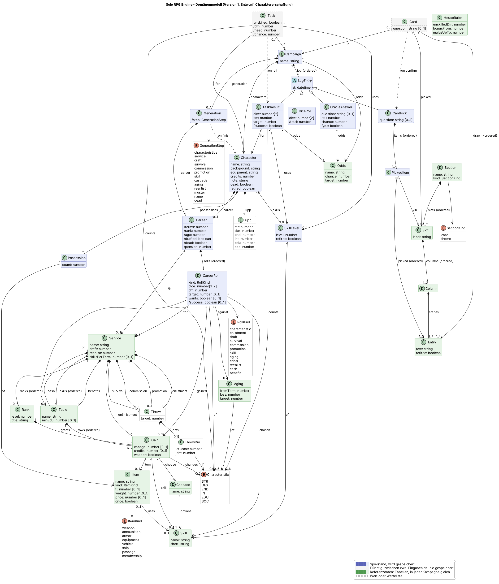

# Domänenmodell

**Dieses Diagramm führt.** Der Code folgt ihm, nie umgekehrt. Eine Änderung am Modell wird zuerst
hier gemacht, abgestimmt und dann in den Code übertragen. Das Diagramm wird nie umgezeichnet, damit
es zu dem passt, was der Code gerade tut. Solange der Code noch nicht nachgezogen hat, stehen die
Lücken unter [Wo der Code noch nicht folgt](#wo-der-code-noch-nicht-folgt).

> **Stand: Freigegeben für Version 1** (23. Oktober 2026). Änderungen nur noch auf dem oben
> beschriebenen Weg: erst hier, abgestimmt, dann im Code. Seitdem freigegeben: `Entry.retired`
> (24. Oktober 2026, siehe *Einträge austauschen*); ausgeblendete Felder und Bereiche (ebenso);
> Spalten und Paare (24. Oktober 2026, siehe *Karte ziehen*, *Paare aus Mythic*).
> Am 25. Oktober 2026 freigegeben: mehrere Kampagnen mit Namen, Export und Import als Datei,
> Logeinträge löschen (siehe *Mehrere Kampagnen*, *Kampagnendatei*, *Der Log verweist, er kopiert
> nicht*), dafür ändert sich das Bild nicht: `Campaign` war schon die oberste Ebene und hat schon
> einen Namen. Neu im Bild: `Character.dead` (siehe *Tot*).
>
> **Entwurf, noch nicht abgestimmt** (25. Oktober 2026): Charaktererschaffung nach den Regeln von
> Classic Traveller, mit Lebenslauf am Charakter (siehe *Charaktererschaffung* und *Offene Fragen*).
> Neu im Bild: `Generation`, `Career`, `CareerRoll`, `Character.career`, Gegenstände
> (`Item`, `Possession`, siehe *Gegenstände*) und die Laufbahnen als Referenzdaten (`Service`,
> `Throw`, `Rank`, `Table`, `Gain`, `Cascade`, `Aging`).
>
> **Zurzeit** hat die Karte nur die Felder mit Einträgen aus Mythic, alle als Paar: Aktion und
> Beschreibung des Zufallsereignisses, Hören und Riechen sowie die Themen-Tafeln NSC, NSC-Aktionen,
> Welt (mit Schiff), Wesen und Handlung mit Mythics Elements-Tabellen. Alle übrigen Felder und Bereiche sind ausgeblendet, bis es
> Einträge für sie gibt.

Die Quelle ist [`domain-model.puml`](domain-model.puml) (PlantUML). Nach jeder Änderung das Bild neu
erzeugen mit `bash .claude/skills/domain-model/scripts/render.sh docs/domain-model.puml`; das Skript
lädt PlantUML bei Bedarf selbst und braucht nur Java, kein Graphviz.

Das Diagramm zeigt den **gespeicherten Stand** und die Referenzdaten, auf die er verweist: Daten und
Beziehungen, keine Operationen. **Blau** ist der Spielstand, den die App speichert. **Grau mit
gestricheltem Rahmen** ist flüchtig: Es besteht zwischen zwei Eingaben und wird nie gespeichert. Es
kommt nur ins Diagramm, wenn sich ein Ablauf sonst nicht abbilden lässt. Im Code liegt es im Paket
`draft`; das Diagramm zeigt das nur durch die Farbe. **Grün** sind Referenzdaten: feste Tabellen, in
jeder Kampagne gleich. **Weiß** sind Werte und Wertelisten.

## Begriffe

Die Bezeichner im Code sind englisch, Oberfläche und Dokumentation deutsch. Diese Tabelle ist die
gemeinsame Sprache: Wer „Probe“ sagt, meint `Task`, und umgekehrt. Begriffe und Werte aus Classic
Traveller bleiben englisch, wie im Regelwerk: die Attributkürzel, die Namen der Fertigkeiten (Pilot,
Vacc Suit, Jack-of-all-Trades, …), Terms, Cr.

| Deutsch | Code | Was |
|---|---|---|
| Kampagne | `Campaign` | Alles, was zu einem Spiel gehört; die oberste Ebene |
| Offene Kampagne | (Zustand des Controllers) | Die Kampagne, in der man gerade spielt |
| Kampagnendatei | `CampaignFile` | Eine Kampagne als JSON-Datei, zum Sichern und Weitergeben |
| Charakter | `Character` | Ein Spielercharakter mit seiner Charakterkarte |
| Tot | `Character.dead` | Der Charakter ist in der Geschichte gestorben; er bleibt in der Kampagne |
| UPP | `Upp` | Die sechs Attributwerte |
| Attribut | `Characteristic` | STR, DEX, END, INT, EDU, SOC |
| Fertigkeit | `Skill` | Eine Fertigkeit aus der Liste, z. B. Pilot |
| Kürzel | `Skill.short` | Drei Zeichen für eine Fertigkeit, z. B. Pil für Pilot |
| Fertigkeitsstufe | `SkillLevel` | Die Stufe, die ein Charakter in einer Fertigkeit hat, z. B. Pilot-2 |
| Gegenstand | `Item` | Etwas aus der festen Liste, das man besitzen kann, mit TL, Gewicht und Preis aus den Charts |
| Art des Gegenstands | `ItemKind` | weapon, ammunition, armor, equipment, vehicle, ship, passage, membership |
| TL | `Item.tl` | Tech Level, ab dem es den Gegenstand gibt |
| Besitz | `Possession` | Ein Gegenstand, den ein Charakter hat, mit Anzahl, z. B. 2 × Low Passage |
| Stufe (Hoch/Mittel/Gering) | `Odds` | Die eine Auswahl für Orakel und Proben |
| Hausregeln | `HouseRules` | Die Zahlen, nach denen Proben gerechnet werden |
| Log | `LogEntry` | Ein Eintrag im Verlauf |
| Orakelantwort | `OracleAnswer` | Ja oder Nein auf eine Frage |
| Würfelwurf (2W6) | `DiceRoll` | Ein einfacher Wurf mit zwei Würfeln |
| Inspirationskarte | `Card` | Eine gezogene Karte, solange sie offen ist |
| Kartenauswahl | `CardPick` | Was man von einer Karte in den Log übernimmt, mit der Frage |
| Ausgewählter Eintrag | `PickedItem` | Ein übernommenes Feld: welches Feld, welcher Eintrag |
| Entwurf | Paket `draft` | Was später ein Logeintrag wird, solange es noch offen ist |
| Probe | `Task` | Eine Probe, solange sie im Charakter-Screen vorbereitet wird |
| Probenergebnis | `TaskResult` | Eine gewürfelte Probe |
| Bereich der Karte, Themen-Tafel | `Section` | Zufallsereignis, Sinneseindrücke, …; NSC, Welt, … |
| Feld der Karte | `Slot` | Aktion, Hören, Aussehen, Name, Auslöser, … |
| Spalte | `Column` | Eine Liste von Einträgen in einem Feld; ein Feld hat eine oder zwei |
| Paar | (zwei Einträge im `drawn` eines Feldes) | Was ein Feld mit zwei Spalten zieht: aus jeder Spalte einen Eintrag, z. B. „verraten · Technologie“ |
| Eintrag | `Entry` | Ein möglicher Text eines Feldes, z. B. „Schulden begleichen.“ |
| Charaktererschaffung | `Generation` | Ein Charakter, der gerade nach den Regeln entsteht; wird beim Abschluss zum `Character` |
| Schritt | `GenerationStep` | Was in der Erschaffung als Nächstes dran ist, z. B. Überleben würfeln |
| Lebenslauf | `Career` | Alle Würfe und Entscheidungen einer Erschaffung, der Reihe nach |
| Wurf der Laufbahn | `CareerRoll` | Ein Wurf in der Erschaffung, mit der Entscheidung, die zu ihm gehört |
| Laufbahn, Dienstzweig | `Service` | Navy, Marines, Army, Scouts, Merchants, Other |
| Musterung | `CareerRoll` mit `enlistment` | Der Wurf, um in die gewählte Laufbahn zu kommen |
| Einberufung | `CareerRoll` mit `draft` | 1W6, wenn die Musterung scheitert; bestimmt die Laufbahn |
| Term | (`Career./terms`) | Vier Jahre Dienst |
| Offizierspatent | `CareerRoll` mit `commission` | Der Wurf auf den ersten Rang |
| Beförderung | `CareerRoll` mit `promotion` | Der Wurf auf den nächsten Rang |
| Weiterverpflichtung | `CareerRoll` mit `reenlist` | Der Wurf am Ende jedes Terms; 12 heißt: bleiben müssen |
| Abmusterung | `CareerRoll` mit `cash` oder `benefit` | Die Würfe auf Geld oder Sachwerte am Ende der Laufbahn |
| Wurf mit Zielwert | `Throw` | Ein 2W6-Wurf einer Laufbahn, z. B. Survival 5+, mit seinen DMs |
| Rang | `Rank` | Ein Rang einer Laufbahn, z. B. Lt Cmdr (Rang 3 der Navy) |
| Tabelle | `Table` | Eine Fertigkeitstabelle, die Sachwerte- oder die Geldtabelle einer Laufbahn |
| Zugewinn | `Gain` | Eine Zeile einer Tabelle oder was ein Rang bringt: Fertigkeit, Attribut, Gegenstand, Waffe oder Geld |
| Kaskade | `Cascade` | Ein Sammelbegriff, aus dem man eine Fertigkeit wählt: Blade Combat, Gun Combat, Vehicle |
| Altern | `Aging` | Eine Zeile der Aging Table: ab welchem Term welches Attribut wie viel verlieren kann |

## Regeln, die das Bild nicht zeigt

- **Was draußen bleibt.** Was nicht gespeichert wird, gehört nicht ins Modell, außer der offenen
  Karte und der Probe in Vorbereitung. Der Controller hält, welcher Screen offen ist und ob das
  Ergebnis-Popup zu sehen ist. Reine Darstellung bleibt in der View: wie Felder und Tafeln angeordnet sind, der
  Text im Fragefeld während des Tippens, Farben, die Hex-Schreibweise der UPP und das Format der
  Uhrzeit.
- **Entwürfe.** Im Paket `draft` liegen die Entwürfe eines Logeintrags: die offene Karte (`Card`,
  wird beim Bestätigen zum `CardPick`) und die Probe in Vorbereitung (`Task`, wird beim Würfeln zum
  `TaskResult`). Je Kampagne gibt es höchstens eine offene Karte und höchstens eine Probe. Pfeile
  führen nur aus `draft` heraus, nie hinein: Der gespeicherte Stand weiß nichts von seinen
  Entwürfen. Entwürfe werden nie gespeichert; beendet das Handy die App, sind sie weg.
- **Mehrere Kampagnen.** Die Kampagne ist die oberste Ebene: Alles, was gespeichert wird, hängt an
  genau einer Kampagne, und Kampagnen wissen nichts voneinander. Es gibt immer mindestens eine;
  die letzte lässt sich nicht löschen. Jede hat einen Namen, der nicht leer ist und sich ändern
  lässt; zwei Kampagnen dürfen gleich heißen. Gespielt wird immer in genau einer, der **offenen
  Kampagne**. Welche das ist, merkt sich das Gerät über einen Neustart hinweg; zum Spielstand gehört
  das nicht. Wechselt man die Kampagne, sind offene Karte und Probe in Vorbereitung weg. Eine neue
  Kampagne beginnt leer: ohne Charaktere, ohne Log, mit der Stufe Mittel. Eine Kampagne löschen
  löscht alles, was an ihr hängt, endgültig.
- **Kampagnendatei.** Eine Kampagne lässt sich als Datei exportieren und wieder importieren. Die
  Datei enthält alles, was an der Kampagne hängt (Name, Stufe, Charaktere mit ausgeblendeten, Log),
  aber keine Entwürfe und keine Referenzdaten: Verweise bleiben Ids. Beim Import wird die Datei
  gegen die Regeln dieses Modells geprüft, auch jeder Verweis in die Referenzdaten und auf die
  eigenen Charaktere; ist etwas falsch, wird nichts importiert. Ein Import legt immer eine neue
  Kampagne an, auch wenn es dieselbe schon gibt, und überschreibt nie eine bestehende.
- **Nicht in Version 1.** Szenen (der Log läuft ohne Gliederung durch; Szenen kommen mit Mythics
  Szenenstruktur), die Feinjustierung des Zielwerts um ±1, eigene Fertigkeiten und
  Hausregeln, die man in der App einstellt.
- **Eine Auswahl für Orakel und Proben.** Die Kampagne hat immer genau eine gewählte Stufe (`odds`).
  Die drei Stufen sind Referenzdaten: Hoch (75 %, 6+), Mittel (50 %, 8+), Gering (25 %, 10+), in
  dieser Reihenfolge, leicht links. Die Auswahl bleibt stehen, bis man sie ändert, auch über einen
  Neustart der App hinweg. Orakel und Probe lesen sie, keiner von beiden hat eine eigene.
- **Der Log verweist, er kopiert nicht.** Ein Logeintrag hält nur fest, was allein ihm gehört: Frage,
  Zeitpunkt und Würfel, beim Orakel dazu die Chance, bei einer Probe DM und Zielwert (siehe
  *Orakel* und *Probe*). Alles andere ist ein
  Verweis: auf die Stufe, den Charakter, die Fertigkeitsstufe, die Attribute, auf Feld und Eintrag
  der Karte. Logeinträge werden angehängt und nie geändert. Ein einzelner Eintrag lässt sich löschen,
  dann ist er endgültig weg; die übrigen behalten ihre Reihenfolge. Die Reihenfolge ist die
  Reihenfolge der Ereignisse; dass das Neueste unten steht, ist Sache der Anzeige.
- **Worauf der Log verweist, wird nie gelöscht.** Ein Charakter, der im Log vorkommt, bleibt in der
  Kampagne, solange ein Eintrag auf ihn verweist, ebenso seine Fertigkeitsstufen; Stufen, Felder und Einträge der Referenzdaten haben eine
  feste Id und bleiben in den Daten. Ändert sich etwas daran (ein Charakter heißt anders, lernt
  Pilot-3), zeigen auch alte Logeinträge den neuen Stand. Das Ergebnis einer Orakelfrage oder Probe
  ändert sich dadurch nicht, weil Chance bzw. DM und Zielwert festgehalten sind.
- **Würfe stehen im Log, nicht nur ihr Ergebnis.** Gespeichert werden die einzelnen Würfel (`dice`,
  `roll`); Summe, Ja/Nein und Erfolg (`/total`, `/yes`, `/success`) folgen daraus.
- **Orakel.** Ein Wurf von 1 bis 100; Ja, wenn er höchstens die Chance der gewählten Stufe ist. Die
  `OracleAnswer` verweist auf die Stufe und hält die Chance zum Zeitpunkt des Wurfs fest (`chance`);
  Ja oder Nein (`/yes`: `roll` ≤ `chance`) folgt allein daraus, nie aus dem heutigen Stand der Stufe.
  Die Frage ist freiwillig. „Außergewöhnlich Ja/Nein“, Chaosfaktor und Zufallsereignisse nach Mythic
  kommen erst nach Version 1.
- **Karte ziehen.** Ziehen legt eine `Card` an: für jedes Feld aller Bereiche aus jeder seiner
  Spalten einen nicht ausgeblendeten Eintrag zufällig (`drawn`), die Themen-Tafeln eingeschlossen,
  in der Reihenfolge der Bereiche, Felder und Spalten. Ein Feld mit zwei Spalten zieht so ein
  **Paar**. Ausgeblendete Felder übergeht es (siehe *Einträge austauschen*).
  Eine gestellte Frage geht auf die Karte über. Der Bereich *Namen* hat drei Felder mit je eigenen
  Einträgen (eher weiblich, eher männlich, neutral bzw. Genre-Name), wie auf der GMA-Karte; so sind
  die drei Namen immer verschieden.
- **Die Karte ist offen, bis man sie bestätigt oder verwirft.** Antippen nimmt ein gezogenes Feld
  in die Auswahl (`picked`) auf oder wieder heraus, mit allem, was es gezogen hat: Ein Paar nimmt
  man immer ganz, nie einen Begriff allein. Ausgewählt sein kann nur ein Feld, das gezogen wurde. *Verwerfen* schließt die Karte ohne Logeintrag. *Neu ziehen* ersetzt sie durch eine neue;
  die Auswahl geht verloren, die Frage bleibt.
- **Bestätigen** geht erst, wenn mindestens ein Feld ausgewählt ist; ohne Auswahl bleibt nur
  Verwerfen. Es legt einen `CardPick` mit der Frage der Karte an und darin je ausgewähltem Feld
  ein `PickedItem`, in der Reihenfolge der Karte; danach ist die Karte zu. Das `PickedItem` verweist
  auf die gezogenen Einträge des Feldes, beim Paar auf beide in der Reihenfolge der Spalten; das
  Feld (`/in`) folgt daraus, weil jeder Eintrag zu genau einer Spalte und jede Spalte zu genau
  einem Feld gehört. Ältere `PickedItem`s mit nur einem Eintrag bleiben gültig.
- **Probe.** Es gilt: 2W6 + Fertigkeit + gewählte Attribute ≥ Zielwert.
  - Zuerst wählt man die Fertigkeit: eine Fertigkeitsstufe des Charakters (DM = Stufe) oder „ohne
    Fertigkeit“ (DM aus den Hausregeln, −3). Solange keine gewählt ist, gibt es keine Probe zu
    würfeln.
  - Erst danach lassen sich Attribute dazuwählen. Ein gewähltes Attribut gibt +1 ab `bonusFrom` (9),
    −1 bis `malusUpTo` (5), sonst ±0. Attribute mit ±0 sind nicht wählbar.
  - Der Zielwert kommt aus der gewählten Stufe. Der nötige Wurf ist Zielwert minus DM, die
    Wahrscheinlichkeit wird exakt aus den 36 Kombinationen von 2W6 gezählt: Bis 2 ist sie sicher,
    über 12 unmöglich. Auch eine unmögliche Probe darf man würfeln; sie misslingt immer und steht
    trotzdem im Log.
  - Die Probe in Vorbereitung ist eine `Task`. Sie verweist auf den Charakter, auf eine seiner
    Fertigkeitsstufen (`uses`) oder ist `unskilled`, nie beides; keins von beiden heißt: noch keine
    Fertigkeit gewählt. Wechselt man den Charakter, beginnt eine neue Probe.
  - Gewürfelt wird eine Probe als `TaskResult` in den Log übernommen. Es verweist auf Charakter,
    Fertigkeitsstufe (keine heißt „ohne Fertigkeit“), die gewählten Attribute und die Stufe, und es
    hält die zwei Würfel sowie DM (`dm`) und Zielwert (`target`) zum Zeitpunkt des Wurfs fest. Der
    Erfolg (`/success`: Würfel + `dm` ≥ `target`) folgt allein daraus, nie aus dem heutigen Stand von
    Charakter, Hausregeln oder Stufe. Die Verweise sagen, wer und womit gewürfelt hat.
  - Bei `Task` und `TaskResult` gehört die Fertigkeitsstufe (`uses`) immer dem Charakter, auf den sie
    verweisen (`for`), und der Charakter immer zur Kampagne.
- **Charakter.** Charaktere legt man in der App an und bearbeitet sie, von Hand oder über die
  Charaktererschaffung (siehe dort). Die sechs UPP-Werte liegen zwischen 0 und 15. Eine
  Fertigkeit kommt bei einem Charakter höchstens einmal vor, ihre Stufe ist 0 oder mehr; Fertigkeiten
  kommen nur aus der festen Liste der Referenzdaten. Jede Fertigkeit hat ein Kürzel aus genau drei Zeichen,
  das in der Liste nur einmal vorkommt (Pil für Pilot, JoT für Jack-of-all-Trades). Es dient der
  knappen Anzeige; der Log zeigt den vollen Namen. Ausrüstung, Herkunft (`background`, z. B.
  „Ex-Scout · 4 Terms · 34 Jahre“) und Notiz sind in Version 1 freier Text, Credits eine
  ganze Zahl.
- **Gegenstände.** Was ein Charakter besitzt, steht als Besitz (`possessions`) an ihm: je Gegenstand
  aus der festen Liste höchstens ein Eintrag, mit einer Anzahl von 1 oder mehr (3 × Low Passage,
  2 × Free Trader für zwei abbezahlte Raten). Ein Gegenstand mit `once` hat immer die Anzahl 1. Im
  Editor lässt sich Besitz hinzufügen, zählen und entfernen wie Fertigkeiten; entfernt wird er
  wirklich, weil der Log nicht auf ihn verweist.
  - **Die Liste** kommt aus den Charts der Starter Edition: *Personal Equipment and Vehicles* (S. 23:
    Ausrüstung, Kommunikatoren, Geräte, Sichthilfen, Werkzeug, Unterkünfte, Fahrzeuge, Small Craft,
    Waffen mit Munition und Energiezellen, Rüstungen), dazu die Passagen (Ship Revenues, S. 9: High
    Cr 10.000, Middle Cr 8.000, Low Cr 1.000), die Schiffe aus der Abmusterung (Standard Ship
    Designs, S. 11: Scout MCr 29,43, Free Trader MCr 37,08) und die Travellers' Aid Society. Jede
    Klinge und Schusswaffe nutzt genau ihre Fertigkeit (`uses`).
  - **TL, Gewicht und Preis** (`tl`, `weight`, `price`) stehen, wie in den Charts angegeben. Das
    Gewicht ist immer in kg (S. 4 nennt Gramm, S. 23 bei Fahrzeugen Tonnen = 1000 kg), der Preis
    immer in Cr (KCr und MCr umgerechnet). Was die Charts nicht angeben, fehlt (Club und die
    Travellers' Aid Society haben keinen Preis, Passagen und Mitgliedschaft kein Gewicht). Bei Schiffen und Small Craft sind „tons“
    Verdrängung, kein Gewicht; sie haben deshalb keins. Gibt es einen Gegenstand in mehreren TL
    (Vacc Suit TL 8 bis 13), ist jede Zeile ein eigener Gegenstand mit eigener Id. Was eine Zeile
    „10 % of price“ kostet (Accessories), ist kein Gegenstand.
  - **Später**, mit Kampf und Handel: Kampfwerte der Waffen und Rüstungen (S. 4: Länge, nötige
    Stärke, DMs, Reichweite), Kaufen und Verkaufen, Gesamtgewicht. Schiffe sind vorerst nur ein
    Gegenstand; Schiffskarten kommen später. Alles, was nicht in der Liste steht, bleibt freier Text
    in der Ausrüstung (`equipment`).
- **Löschen und Ausblenden.** Ein Charakter oder eine Fertigkeitsstufe, auf die kein Logeintrag
  verweist, wird wirklich gelöscht. Verweist der Log darauf, wird sie stattdessen ausgeblendet
  (`retired`): Sie verschwindet aus dem Charakter-Screen und lässt sich nicht mehr für Proben wählen,
  bleibt aber gespeichert, und der Log zeigt sie weiter. Ein ausgeblendeter Charakter lässt sich
  wieder einblenden. Sind die Logeinträge gelöscht, die auf ihn verwiesen, lässt er sich auch
  löschen.
- **Tot.** Im Editor lässt sich ein Charakter als tot markieren (`dead`) und, falls das ein Irrtum
  war, wieder zurück. Ein toter Charakter bleibt in der Kampagne und im Charakter-Screen, aber
  getrennt von den Lebenden unter „Verstorben“, nur mit Namen und Herkunft. Für Proben ist er nicht
  wählbar; war gerade eine Probe für ihn vorbereitet, endet sie. Tot und ausgeblendet sind
  unabhängig: Auch einen toten Charakter kann man löschen bzw. ausblenden, nach denselben Regeln.
  Der Log zeigt ihn weiter wie bisher; alte Proben ändern sich dadurch nicht, weil DM und Zielwert
  festgehalten sind. Die Kampagnendatei enthält auch die Toten.
- **Charaktererschaffung.** Neben dem Anlegen von Hand lässt sich ein Charakter nach den Regeln von
  Classic Traveller erschaffen (Starter Edition, *Charts and Tables* S. 2–3). Jeder Wert wird einzeln
  gewürfelt, jede Entscheidung trifft der Spieler. Je Kampagne gibt es höchstens eine Erschaffung
  (`generation`); sie wird gespeichert und übersteht einen Neustart. Wechselt man die Kampagne, bleibt
  sie in ihrer Kampagne liegen.
  - **Lebenslauf statt Zwischenstand.** Eine Erschaffung hält nur ihren Lebenslauf (`Career`): die
    Würfe der Reihe nach, jeder mit der Entscheidung, die zu ihm gehört. Alles andere folgt daraus:
    UPP, Fertigkeiten, Laufbahn (`/in`), Terms, Rang, Alter (18 + 4 je Term), ob eingezogen, ob tot,
    Pension, Geld, Gegenstände und welcher Schritt dran ist (`/step`). Würfe werden nur angehängt.
  - **Was ein Wurf festhält.** Jeder `CareerRoll` hält seine Art (`kind`), die Würfel (`dice`, einer
    oder zwei) und den DM fest, bei Würfen mit Zielwert auch den Zielwert (`target`); Erfolg
    (`/success`: Würfel + `dm` ≥ `target`) folgt allein daraus. Was er sonst braucht, je Art:

    | Art | Würfel | Verweist auf | Entscheidung |
    |---|---|---|---|
    | `characteristic` | 2 | das Attribut (`of`) | – |
    | `enlistment` | 2 | die gewählte Laufbahn (`for`) | welche Laufbahn, vor dem Wurf |
    | `draft` | 1 | die Laufbahn, in die man kommt (`for`) | – |
    | `survival`, `commission`, `promotion` | 2 | – | – |
    | `skill` | 1 | die Tabelle (`on`), die Zeile (`gained`), bei einer Kaskade die Fertigkeit (`chosen`) | welche Tabelle vor dem Wurf, welche Fertigkeit danach |
    | `aging`, `crisis` | 2 | das Attribut (`of`), beim Altern die Zeile der Aging Table (`against`) | – |
    | `reenlist` | 2 | – | ob man bleiben will (`wants`), vor dem Wurf |
    | `cash`, `benefit` | 1 | die Zeile (`gained`), bei einer Waffe die Fertigkeit (`chosen`) | Geld oder Sachwerte, vor dem Wurf; welche Waffe danach |

    Die Zeile wird festgehalten, nicht aus dem Würfel neu gesucht; so ändert eine spätere Korrektur
    der Tabellen keinen alten Lebenslauf.
  - **Ablauf** (die Schritte in `GenerationStep`):
    1. *Attribute*: STR, DEX, END, INT, EDU, SOC, in dieser Reihenfolge je 2W6.
    2. *Laufbahn*: Man wählt eine der sechs Laufbahnen und würfelt die Musterung (2W6 + DMs ≥
       Zielwert). Scheitert sie, folgt die *Einberufung*: 1W6 bestimmt die Laufbahn (`draft`). Wer
       eingezogen wurde, darf im ersten Term kein Offizierspatent versuchen. Was eine Laufbahn bei
       der Musterung mitgibt (Marines Cutlass-1, Army Rifle-1, Scouts Pilot-1), kommt sofort dazu.
    3. *Term*, jedes Mal in dieser Reihenfolge: Überleben (`survival`); misslingt es, ist der
       Charakter tot und die Erschaffung zu Ende (`dead`). Ohne Rang und in einer Laufbahn mit Rängen:
       Offizierspatent, das gibt Rang 1. Mit Rang unter 6: Beförderung, einmal je Term, auch im Term
       des Patents. Dann die Fertigkeiten: im ersten Term 2, danach 1, bei den Scouts immer 2
       (`skillsPerTerm`); +1 für Patent, +1 für Beförderung. Für jede wählt man eine Tabelle; die
       vierte (`minEdu` 8) nur mit EDU 8+, gemessen vor dem Wurf. Ein Rang bringt, was in ihm steht
       (`grants`, z. B. Navy Captain +1 SOC).
    4. *Altern* ab dem Ende des 4. Terms: je Attribut der Aging Table ein Wurf nach der Zeile mit dem
       größten `fromTerm`, der den Term nicht übersteigt (INT erst ab dem 12. Term);
       unter dem Zielwert sinkt das Attribut um `loss`. Fällt ein Attribut dadurch unter 1, folgt eine
       *Krise* (`crisis`, 2W6, 8+): gelingt sie, steht das Attribut auf 1, sonst ist der Charakter tot.
    5. *Weiterverpflichtung*: Man sagt, ob man bleiben will (`wants`), dann wird immer gewürfelt. Eine
       12 heißt bleiben, egal was man wollte. Sonst bleibt, wer will und den Zielwert schafft, außer
       nach dem 7. Term: dann nur mit 12. Wer bleibt, beginnt den nächsten Term (3.), alle anderen
       mustern ab.
    6. *Abmusterung*: so viele Würfe wie Terms, dazu +1 bei Rang 1–2, +2 bei Rang 3–4, +3 bei Rang
       5–6. Je Wurf wählt man Geld oder Sachwerte; Geld höchstens dreimal. DM +1 auf Geld mit
       Gambling, DM +1 auf Sachwerte ab Rang 5. Ein Gegenstand mit `once` (Travellers' Aid Society,
       Scout Ship) kommt nur einmal; ein zweites Mal bringt nichts. Eine Waffe (Blade, Gun) ist eine
       Kaskade mit `weapon`: Man wählt eine Fertigkeit daraus und bekommt den Gegenstand, der sie
       nutzt (`uses`), statt der Fertigkeit. Wählt man eine Waffe, die man schon aus der Abmusterung
       hat, steigt stattdessen die Fertigkeit darin um 1. Nach mindestens 5 Terms gibt es eine Pension (Cr 4000
       bei 5 Terms, je Term mehr Cr 2000).
    7. *Name*: Zum Schluss gibt man den Namen ein und schließt ab.
  - **Zugewinne.** Eine Zeile (`Gain`) bringt genau eins: eine Fertigkeit +1 (`skill`), eine Wahl aus
    einer Kaskade (`choose`, mit `weapon` die Waffe statt der Fertigkeit), ein Attribut ± `change`
    (`changes`), einen Gegenstand (`item`) oder Geld (`credits`); eine leere Zeile (Scouts und Other, 7 auf der Sachwertetabelle) bringt nichts.
    Attribute bleiben zwischen 0 und 15. Eine Kaskade bietet Fertigkeiten an (`options`); die Wahl
    gehört zum Wurf (`chosen`). Vehicle bietet die einzelnen Fahrzeuge an, Aircraft und Watercraft
    sind darin schon aufgefächert.
  - **Abschließen** legt einen Charakter an (`on finish`): Name, UPP und Fertigkeiten wie zuletzt,
    Credits aus dem Geld, Besitz aus den Gegenständen (gleiche zusammengezählt), Herkunft aus Laufbahn, Rang, Terms und
    Alter („Ex-Navy · Commander · 5 Terms · 38 Jahre“), die Pension in der Notiz. Der Lebenslauf zieht
    mit um (`Character.career`) und bleibt danach unverändert; den Charakter bearbeitet man wie jeden
    anderen. Von Hand angelegte Charaktere haben keinen Lebenslauf. Danach ist die Erschaffung zu.
  - **Verwerfen** geht jederzeit und löscht die Erschaffung ohne Spur. Ein Toter lässt sich nur
    verwerfen, nicht übernehmen.
  - Die Erschaffung steht nicht im Log; ihr Lebenslauf ist ihr Verlauf.
  - Die Kampagnendatei enthält die offene Erschaffung und die Lebensläufe; beim Import wird jeder
    Lebenslauf von vorn nachgespielt und gegen diese Regeln geprüft.
- **Referenzdaten sind Daten.** Stufen, Hausregeln, Fertigkeiten, Gegenstände, Laufbahnen, Bereiche, Felder und Einträge
  stehen als Dateien unter `src/data/` und werden beim Start geprüft. Man ändert sie nur dort, nicht
  in der App. Pfeile führen nur aus Spielstand
  und Entwürfen in die Referenzdaten, nie zurück. Die Einträge sind eigene Inhalte oder stammen aus
  Mythic GME 2e (Lizenz CC BY-NC, ins Deutsche übersetzt), nie aus den Texten des GMA-Decks.
- **Paare aus Mythic.** Mythic zieht aus seinen Bedeutungstabellen immer zwei Begriffe, die man
  zusammen deutet. Jede Mythic-Tabelle ist deshalb ein Feld mit zwei Spalten:
  - *Actions* und *Descriptions* haben selbst zwei Spalten. Im Zufallsereignis werden sie zu den
    Feldern *Aktion* (Verb · Substantiv) und *Beschreibung* (Adverb · Adjektiv).
  - Eine *Elements*-Tabelle hat eine Spalte, aus der Mythic zweimal zieht. Ihr Feld hat zwei
    Spalten mit demselben Inhalt, jede mit eigenen Einträgen, sodass jeder Eintrag zu genau einer
    Spalte gehört. Die beiden Begriffe können gleich ausfallen.

  In den Daten steht jede Tabelle nur einmal (`src/data/mythic-tables.json`); die Spalten entstehen
  beim Laden.
- **Einträge austauschen.** Ein Eintrag, der nicht mehr gezogen werden soll, wird nicht gelöscht und
  seine Id nicht neu vergeben, sondern ausgeblendet (`retired`): Ziehen übergeht ihn, alte
  Logeinträge zeigen ihn weiter mit seinem Text. Ob ein Log auf ihn verweist, weiß nur das jeweilige
  Gerät; deshalb wird jeder ausgetauschte Eintrag ausgeblendet. Hat eine Spalte nur ausgeblendete
  Einträge, ist ihr Feld ausgeblendet: Ziehen übergeht es, die Karte zeigt es nicht, und ein
  Bereich ohne sichtbares Feld fehlt auf der Karte ganz. Der Log zeigt alte Einträge daraus weiter.
  Mindestens ein Feld hat einen Eintrag, der nicht ausgeblendet ist.

## Offene Fragen

Zur Charaktererschaffung und zu den Gegenständen; das Bild zeigt jeweils die empfohlene Antwort.

1. **Erschaffung speichern?** Empfehlung: ja, als Teil der Kampagne (blau). Eine Erschaffung dauert
   einige Minuten; schließt das Handy die App, wäre sie sonst weg, und man könnte durch Neuladen neu
   würfeln. Alternative: flüchtig wie die Probe (grau), dann fällt sie aus der Kampagnendatei.
2. **Lebenslauf am Charakter behalten?** Empfehlung: ja (`Character.career`), die Details der
   Charakterkarte zeigen ihn knapp. Alternative: nur die Werte übernehmen; dann entfällt `Career` am
   Charakter, und der Lebenslauf ist nach dem Abschluss weg.
3. **Tod beim Überlebenswurf.** Empfehlung: wie im Regelwerk tot, die Erschaffung endet und lässt sich
   nur verwerfen. Alternative (verbreitete Hausregel): verletzt, die Laufbahn endet nach diesem Term,
   abmustern wie sonst. Dann käme in `CareerRoll` nichts hinzu, aber die Regel *Term* ändert sich.
4. **Welche Laufbahnen?** Empfehlung: die sechs aus dem Regelwerk (Navy, Marines, Army, Scouts,
   Merchants, Other). Das Vorbild hat 17 (aus *Citizens of the Imperium*); sie ließen sich später als
   Daten ergänzen, ohne das Modell zu ändern.
5. **Wie viel von der Liste der Gegenstände jetzt?** Empfehlung: alles von S. 23 und dazu Passagen,
   Schiffe und TAS (siehe *Gegenstände*), damit man im Editor gleich jede Ausrüstung als Besitz
   eintragen kann. Alternative: nur, was die Abmusterung bringen kann; der Rest bliebe freier Text.

Dazu ohne Frage, nur zur Kenntnis: In die Liste der Fertigkeiten kommen Brawling, Forgery und die
einzelnen Fahrzeuge (Grav, Tracked, Wheeled, Prop-driven und Jet-driven Fixed Wing, Helicopter, Large
und Small Watercraft, Hovercraft, Submersible). Vehicle bleibt für Charaktere von Hand. Krise beim
Altern und „nach dem 7. Term nur mit 12“ stehen nicht in den Charts, aber im Regelwerk bzw. im
Vorbild; sie sind oben übernommen.

## Wo der Code noch nicht folgt

Der Code für Version 1 liegt unter `src/` (siehe [ARCHITECTURE.md](../ARCHITECTURE.md)). Er folgt dem
Diagramm mit diesen Ausnahmen:

- **Charaktererschaffung** (`Generation`, `Career`, `CareerRoll`, `Character.career` und die
  Laufbahnen in den Referenzdaten) sowie Gegenstände und Besitz gibt es im Code noch nicht (Entwurf, siehe *Charaktererschaffung*).

- **`Card → Campaign : in` und `Task → Campaign : in`** sind im Code kein Feld. Der Controller hält
  höchstens eine offene Karte und höchstens eine Probe, beide immer zur offenen Kampagne; beim
  Wechsel der Kampagne verfallen sie. Damit ist die Multiplizität erfüllt.
- **Beispielcharaktere.** Die allererste Kampagne auf einem Gerät beginnt mit Kira Vant und Jonas
  Reyl aus der README (`src/data/examples.json`), damit man gleich etwas ausprobieren kann. Das
  Modell sagt dazu nichts; die beiden lassen sich löschen, solange der Log nicht auf sie verweist.
  Jede weitere Kampagne beginnt leer.
