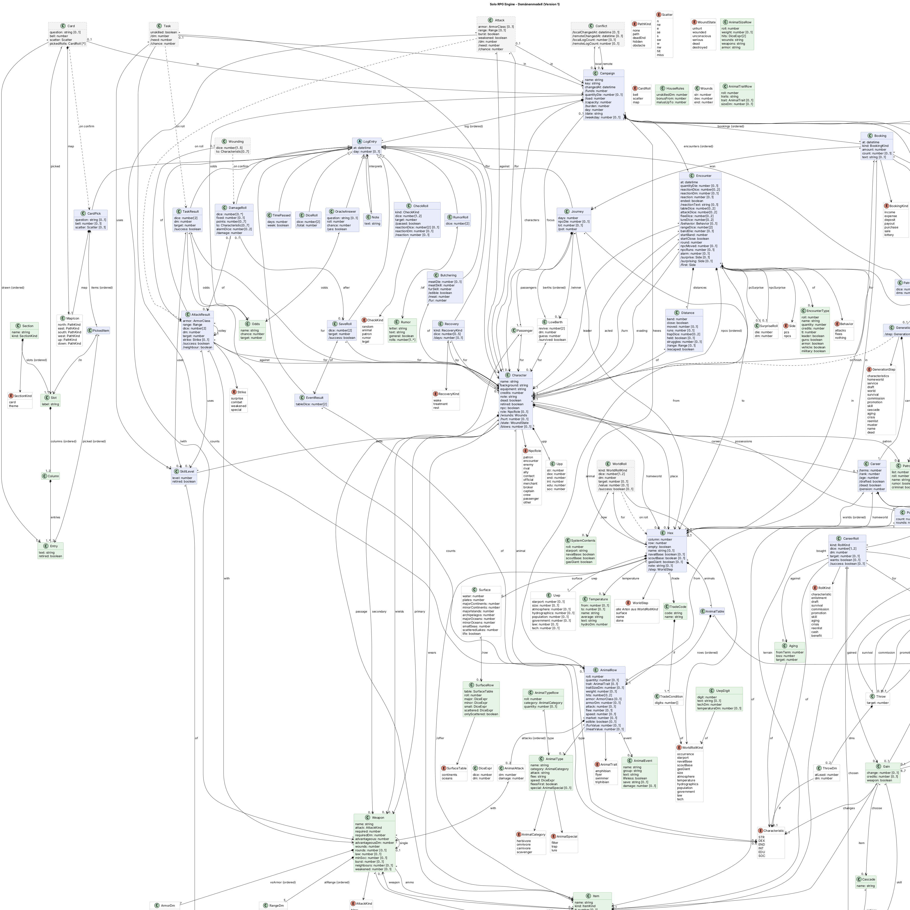

# Domänenmodell

**Dieses Diagramm führt.** Der Code folgt ihm, nie umgekehrt. Eine Änderung am Modell wird zuerst
hier gemacht, abgestimmt und dann in den Code übertragen. Das Diagramm wird nie umgezeichnet, damit
es zu dem passt, was der Code gerade tut. Solange der Code noch nicht nachgezogen hat, stehen die
Lücken unter [Wo der Code noch nicht folgt](#wo-der-code-noch-nicht-folgt).

> **Stand: Freigegeben für Version 1** (23. Oktober 2026). Änderungen nur noch auf dem oben
> beschriebenen Weg: erst hier, abgestimmt, dann im Code. Seitdem freigegeben: `Entry.retired`
> (24. Oktober 2026, siehe *Einträge austauschen*); ausgeblendete Felder und Bereiche (ebenso);
> Spalten und Paare (24. Oktober 2026, siehe *Karte ziehen*, *Paare aus Mythic*).
> Am 25. Oktober 2026 freigegeben: mehrere Kampagnen mit Namen, Export und Import als Datei,
> Logeinträge löschen (siehe *Mehrere Kampagnen*, *Kampagnendatei*, *Der Log verweist, er kopiert
> nicht*), dafür ändert sich das Bild nicht: `Campaign` war schon die oberste Ebene und hat schon
> einen Namen. Neu im Bild: `Character.dead` (siehe *Tot*).
>
> Ebenfalls am 25. Oktober 2026 freigegeben: Jack-of-all-Trades zählt in Proben als Stufe 0 und
> ersetzt „ohne Fertigkeit“ (siehe *Probe*); das Bild ändert sich dadurch nicht. Am 27. Oktober 2026
> ergänzt: Jack-of-all-Trades zeigt keine Stufe, und ein zweites JoT in der Erschaffung gibt einen
> weiteren Fertigkeitswurf (siehe *Zugewinne*); auch das ändert das Bild nicht.
>
> Ebenfalls am 25. Oktober 2026 freigegeben: Charaktererschaffung nach den Regeln von Classic
> Traveller, mit Lebenslauf am Charakter (siehe *Charaktererschaffung*), und Gegenstände mit Besitz
> (siehe *Gegenstände*).
> Neu im Bild: `Generation`, `Career`, `CareerRoll`, `Character.career`, Gegenstände
> (`Item`, `Possession`, siehe *Gegenstände*) und die Laufbahnen als Referenzdaten (`Service`,
> `Throw`, `Rank`, `Table`, `Gain`, `Cascade`, `Aging`).
>
> Am 27. Oktober 2026 freigegeben: Namen auf der Karte als Paar aus Vor- und Nachname (siehe
> *Namen*); das Bild ändert sich dadurch nicht.
>
> Am 31. Oktober 2026 freigegeben: der Subsektor mit Weltenerschaffung (siehe *Subsektor* und
> *Weltenerschaffung*).
>
> Am 1. November 2026 freigegeben: Ein Hexfeld speichert die Werte seiner Welt, nicht ihre Würfe.
>
> Ebenfalls am 1. November 2026 freigegeben: Heimatwelt und Welten der Terms (siehe *Heimatwelt
> und Welten der Terms*); Durchlaufen lassen (siehe *Durchlaufen*), auf ausdrücklichen Wunsch des
> Owners, das Bild ändert sich dadurch nicht. Neu im Bild: `Character.homeworld`, `Career.homeworld`,
> `Career.worlds` und die Schritte `homeworld` und `world`. Neu im Bild: `Uwp`, die Felder `empty`, `navalBase`, `scoutBase`, `gasGiant` am
> `Hex`; `WorldRoll` ist flüchtig. Neu im Bild: `Hex`, `WorldRoll`, `Campaign.hexes`,
> `WorldStep`, `WorldRollKind` und als Referenzdaten `SystemContents`, `UwpDigit`, `TradeCode`.
>
> Am 2. November 2026 freigegeben: der Charakter oben im Orakel-Screen (siehe
> *Charakter oben*). Proben würfelt man dort statt im Charakter-Screen; der Charakter-Screen dient
> nur noch der Verwaltung. Neu im Bild: `Campaign.focus`; `Task.for` ist jetzt abgeleitet
> (`/for`). Der UI-Entwurf dazu liegt unter [`ui-entwurf/charakter-leiste/`](ui-entwurf/charakter-leiste/).
>
> Am 2. November 2026 freigegeben: die Temperatur als zusätzlicher Wurf der
> Weltenerschaffung nach Mongoose Traveller 2e, nach der Atmosphäre und vor der Hydrographie, die
> bei heißen Welten einen Malus bekommt (siehe *Weltenerschaffung*, Schritt 4 und 5). Neu im Bild:
> `Hex.temperature`, `WorldRollKind.temperature`, `UwpDigit.temperatureDm` und als Referenzdaten
> `Temperature` mit `hydroDm`.
>
> Ebenfalls am 2. November 2026 freigegeben: die **Oberfläche** einer Welt nach dem
> *World Builder's Handbook* (DGP), als Vorarbeit für eine spätere Oberflächenkarte (siehe
> *Weltenerschaffung*, Schritt 6, und *Oberfläche*). Neu im Bild: `Surface` am `Hex`, der Schritt
> `surface` und als Referenzdaten `SurfaceRow` mit `SurfaceTable` und `DiceExpr`.
> Nach einer Probe mit 20.000 Welten ergänzt (ebenfalls 2. November 2026 freigegeben): höchstens
> 6 große Kontinente, und die Weltkarte nennt „nur Archipele“ bzw. „nur Seen“ ohne die große
> Zahl (siehe *Oberfläche*). Das Bild ändert sich dadurch nicht.
>
> Am 3. November 2026 freigegeben: Deutungen und Notizen im Log (siehe *Deutungen und Notizen*).
> Neu im Bild: `Note` mit `text` und dem Verweis `interprets`. Der UI-Entwurf dazu liegt unter
> [`ui-entwurf/deutung/`](ui-entwurf/deutung/).
>
> Ebenfalls am 3. November 2026 auf ausdrücklichen Wunsch des Owners freigegeben: Deutungen und
> Notizen auch in der Charaktererschaffung (siehe *Deutungen und Notizen*) und eine Notiz zu jeder
> fertigen Welt (siehe *Notiz zur Welt*). Neu im Bild: `Hex.note`.
>
> Ebenfalls am 3. November 2026 freigegeben: drei **Wurffelder** auf der Karte nach dem GMA2e:
> die **Glockenzahl** (1–10, meist 4–7), der **Streuwürfel** (8 Richtungen, Volltreffer,
> Fehlschlag) und das **Kartensymbol** (ein Raum mit Wegen nach N, O, S, W und nach oben und
> unten, je Weg eine Wegart); siehe *Wurffelder der Karte*. Neu im Bild: `Card.bell`,
> `Card.scatter`, `Card.pickedRolls`, `Card.map`, `CardPick.bell`, `CardPick.scatter`,
> `CardPick.map`, die Werte `MapIcon`, `PathKind`, `Scatter`, `CardRoll`; ein `CardPick` braucht
> keinen `PickedItem` mehr (`items` jetzt `*`). Dazu die **Namen auf der Tafel NSC** (sechs Felder,
> je weiblich, männlich und neutral, einmal irdisch und einmal spacig; siehe *Namen*) und **Name
> von der Karte** beim Benennen von Charakteren und Welten (siehe dort); dafür ändert sich das Bild
> nicht. Damit alles auf einen Bildschirm passt, fallen auf der Tafel *Handlung* *Gegenstand* und
> *Fund* weg (ausgeblendet). Der UI-Entwurf dazu liegt unter
> [`ui-entwurf/kartensymbol/`](ui-entwurf/kartensymbol/).
>
> Ebenfalls am 3. November 2026 freigegeben: der **Angriff** im neuen Reiter *Kampf* (siehe
> *Waffen*, *Angriff* und *Schaden*). Neu im Bild: als Referenzdaten `Weapon` mit `ArmorDm` und
> `RangeDm`, die Werte `AttackKind`, `ArmorClass` und `Range`, `Item.weapon`; `Item.uses` ist jetzt
> abgeleitet (`/uses`, aus der Waffe). Am Charakter die Waffe in der Hand (`Character.wields`),
> flüchtig der Angriff in Vorbereitung (`Attack`), im Log das Angriffsergebnis (`AttackResult`)
> und der Schadenswurf (`DamageRoll`).
>
> Ebenfalls am 3. November 2026 auf ausdrücklichen Wunsch des Owners freigegeben: Die Begegnung hält
> die Würfel ihrer Reaktion (`reactionDice`), damit die App sie zeigen kann; nach dem Würfeln zeigt
> sie, wer kommt (siehe *Begegnung*).
>
> Ebenfalls am 3. November 2026 freigegeben: **Kampfsimulation** getrennt von der
> **Waffentabelle** (siehe *Zwei Modi im Reiter Kampf* und *Kampfsimulation*). Neu im Bild: an der
> `Encounter` Entfernung (`rangeDice`, `range`, `terrain`), Überraschung (`pcSurprise`,
> `npcSurprise`, `/surprise`, `/first`), Runde und Zug (`round`, `acted`, `/turn`); `Side`,
> `SurpriseRoll`, als Referenzdaten `Terrain`, `EncounterRange` und `EncounterType.military`.
>
> Ebenfalls am 3. November 2026 freigegeben: **Heilung** (siehe *Heilung*). Neu im Bild:
> der Logeintrag `Recovery` mit `RecoveryKind` (Aufwachen, Behandlung, Ruhe), Patient (`for` bzw.
> `npc`) und Behandelnder (`by`).
>
> Ebenfalls am 3. November 2026 freigegeben: **Begegnungen mit NSC, Angriffe in beide Richtungen
> und Wunden** (siehe *Begegnung*, *NSC*, *Wunden*, *Getragene Rüstung*). Neu im Bild:
> `Encounter`, `Npc`, `Wounds`, `WoundState`, als Referenzdaten `EncounterType`, flüchtig
> `Wounding`; `Character.npc`, `Character.wears`, `Character./wounds`, `Character./state`,
> `Item.armor`, `DamageRoll.to`; der Angriff kennt Angreifer und Ziel als SC oder NSC (`for`/`by`,
> `against`/`victim`).
>
> Ebenfalls am 3. November 2026 freigegeben: **Verkaufen** im Shop (siehe *Shop*). Neu im Bild: die Buchungsart `sale` und der Verweis `Booking.sold`.
>
> Ebenfalls am 3. November 2026 freigegeben: **Aufenthaltsort, Gruppenkasse, Shop und Munition**
> (siehe dort), mit dem neuen Reiter *Shop*. Neu im Bild: `Campaign.location`, `Campaign./funds`, `Booking` mit
> `BookingKind`, `Hex./offer`, `Possession.rounds` und an der Waffe `rounds`, `law` und `ammo`.
>
> **Zurzeit** hat die Karte nur die Felder mit Einträgen aus Mythic und die Namen, alle als Paar: Aktion und
> Beschreibung des Zufallsereignisses, Hören und Riechen, dazu die drei Wurffelder sowie die Themen-Tafeln NSC
> (mit den sechs Namen), NSC-Aktionen, Welt (mit Schiff), Wesen und Handlung mit Mythics Elements-Tabellen. Alle übrigen Felder und Bereiche sind ausgeblendet, bis es
> Einträge für sie gibt.

> Am 4. November 2026 freigegeben: **Primär- und Sekundärwaffe** (siehe
> dort, *Waffe in der Hand*, *Kauf einer Waffe*), damit die Leiste im Kampf kompakt wird (siehe
> *Angriff*). Neu im Bild: `Character.primary` und `Character.secondary`. Der UI-Entwurf dazu
> liegt unter [`ui-entwurf/waffen-leiste/`](ui-entwurf/waffen-leiste/).
>
> Am 4. November 2026 freigegeben: die **Entfernung in Range Bands** (siehe
> *Kampfsimulation*). Neu im Bild: an der `Encounter` statt `range` das Band (`band`), die Berührung
> (`close`), der Würfel für das Startband (`bandDie`), abgeleitet die Reichweite (`/range`) und
> `/escaped`; als Referenzdaten `RangeBand`. Der UI-Entwurf dazu (freigegeben am 4. November 2026)
> liegt unter [`ui-entwurf/range-bands/`](ui-entwurf/range-bands/).
>
> Am 6. November 2026 freigegeben: der **Würfel für die Anzahl** einer
> Begegnung, W6 nach den Regeln oder W4 bzw. W3 zum Ausgleichen, statt einer festen Anzahl; dazu der
> **DM +1 auf die Reaktion** für 5 oder mehr Terms in Army, Navy, Scouts oder Marines (siehe
> *Begegnung*). Neu im Bild: `Campaign.quantityDie`, `Encounter.quantityDie` und
> `Encounter.reactionDm`. Dazu begrenzt die Reaktion wie in der Quelle auf 3 bis 12 statt 3 bis 11.
> Der Ausschnitt dazu liegt unter
> [`changes/2026-11-06-wuerfel-der-anzahl.png`](changes/2026-11-06-wuerfel-der-anzahl.png).
>
> Am 7. November 2026 freigegeben: **Überraschung bis zum Alarm, Ausdauer (mit Laufen) und Parade**
> nach dem Regelheft (SR 20–22; siehe *Kampfsimulation*, *Ausdauer*, *Parade*). Im Bild:
> `Encounter.alarm` und `/surprising`, `Encounter.pcRuns` und `npcRuns`, `DamageRoll.alarmDice`, `AttackResult.strike` mit `Strike`,
> `Attack.weakened`, `Weapon.weakened` und `/blows` an `Character` und `Npc`. Der Ausschnitt dazu
> liegt unter
> [`changes/2026-11-07-ueberraschung-ausdauer-parade.png`](changes/2026-11-07-ueberraschung-ausdauer-parade.png).
>
> Am 12. November 2026 freigegeben: der **Patron** (Kennzeichen 2026-11-12; siehe *Patron*). Im
> Reiter Begegnung würfelt man in einem eigenen kleinen Bereich unter dem für NSC-Begegnungen einen
> Patron nach der Patron Encounters Matrix (SE, Charts S. 20). Neu im Bild: der Logeintrag
> `PatronRoll` und als Referenzdaten `Patron`. Der Ausschnitt dazu liegt unter
> [`changes/2026-11-12-patron.png`](changes/2026-11-12-patron.png).
>
> Ebenfalls am 12. November 2026 freigegeben: das **Gerücht** (Kennzeichen 2026-11-12b; siehe
> *Gerücht*, *Test*), eine weitere Begegnungsart im Reiter Begegnung: der Wurf auf die Rumors Matrix
> (SE, Charts S. 21). Neu im Bild: der Logeintrag `RumorRoll` und als Referenzdaten `Rumor`. Der
> Ausschnitt dazu liegt unter [`changes/2026-11-12-geruecht.png`](changes/2026-11-12-geruecht.png).
> Dazu, ohne Änderung am Bild: der **Test** vor jeder Begegnungsart und die Liste des Patrons per
> Würfel.
>
> Ebenfalls am 13. November 2026 freigegeben: die **Beute** (Kennzeichen 2026-11-13; siehe *Beute*):
> Überlebensausrüstung und Kredite der NSC, Beute nehmen, zerstörte Tiere, Ausweiden mit Fleisch und
> Fell als Jagdbeute, Preise aus Marktwurf und DMs. Neu im Bild: der Logeintrag `Butchering`,
> `EncounterType.credits`, `Terrain.huntDm`, `AnimalRow.market`, `edible`, `/furValue`, `/meatValue`,
> `WoundState.destroyed`, `ItemKind.game` und `Possession.from`. Der Ausschnitt dazu liegt unter
> [`changes/2026-11-13-beute.png`](changes/2026-11-13-beute.png).
>
> Am 13. November 2026 freigegeben: die **Tiere** (Kennzeichen 2026-11-12c; siehe *Tiere*,
> *Gelände*): Tiertabellen je Welt und Gelände, bei Bedarf erzeugt; die Tierbegegnung würfelt auf
> ihnen und wird eine Begegnung mit Kampfsimulation, mit besonderen Angriffen, Geschwindigkeit und
> Ereignissen mit Rettungswurf. Ein Gelände für alle Begegnungsarten, gespeichert an der Kampagne.
> Neu im Bild: `AnimalTable`, `AnimalRow`, `AnimalAttack`, `AnimalTrait`, `AnimalCategory`,
> `AnimalSpecial`, `Behavior`, die Logeinträge `EventResult` und `SaveRoll`, als Referenzdaten
> `AnimalType`, `AnimalTypeRow`, `AnimalTraitRow`, `AnimalSizeRow`, `AnimalEvent`; dazu
> `Campaign.terrain`, `Terrain.typeDm`, `sizeDm`, `traits`, `/animals`, `Hex.animals`,
> `Character.animal` und `/hurt`, `Encounter.animal`, `tableDice`, `attackDice`, `fleeDice`,
> `lureDice`, `/behavior`, `Distance.trapDice`, `held`, `struggles`, `DamageRoll.fixed` und `after`.
> `Encounter.of`, `reaction`, `reactionDice`, `DamageRoll.dice` und `DamageRoll.of` dürfen fehlen.
> Der Ausschnitt dazu liegt unter [`changes/2026-11-12-tiere.png`](changes/2026-11-12-tiere.png).
>
> Am 8. November 2026 freigegeben: **NSC der Begegnung als vollständige Charaktere** (Kennzeichen
> 2026-11-08c; siehe *Begegnung*, *NSC*, *Angriff in beide Richtungen*, *Heilung*). Es gibt nur noch
> eine Klasse für alle, die kämpfen: Die NSC einer Begegnung werden beim Würfeln als vollständige
> `Character` erzeugt (UPP, Fertigkeit als echte Stufe, Waffe und Rüstung im Besitz, Primärwaffe,
> Waffe in der Hand, getragene Rüstung) und hängen an der Begegnung (`Encounter.npcs`), nicht an der
> Kampagne. Im Bild: `Npc` entfällt mit allen Pfeilen; neu `Encounter.npcs`, `leader`, `acted` und `/turn` als
> Verweise auf `Character`; Angriff und Angriffsergebnis verweisen nur noch auf Angreifer (`for`,
> immer einer) und Ziel (`against`) statt auf vier Arten; die Heilung nur noch auf einen Charakter
> (`for`); `became` entfällt, Übernehmen heißt Umhängen. NSC zählen jetzt Munition wie SC (geladen
> und 1W4 Magazine); dafür ändert sich das Bild nicht. Der Ausschnitt dazu liegt unter
> [`changes/2026-11-08-nsc-als-charaktere.png`](changes/2026-11-08-nsc-als-charaktere.png).
>
> Am 8. November 2026 freigegeben (Kennzeichen 2026-11-08d), mit dem UI-Entwurf unter
> [`ui-entwurf/entfernung-je-sc/`](ui-entwurf/entfernung-je-sc/): **Entfernung je SC, NSC als Gruppe,
> Ausweichen** nach SR 20 (siehe *Kampfsimulation*, *Range Bands*, *Bewegen*, *Ausweichen*). Jeder SC
> hat seine eigene Entfernung zur NSC-Gruppe und bewegt sich in seinem Zug für sich; die NSC bleiben
> zusammen als fester Bezugspunkt auf Band 0, bewegt werden nur die SC: Ein Schritt der Gruppe
> verschiebt alle SC zugleich um ein Band. Wer am Zug
> ist, kann statt anzugreifen ausweichen. Im Bild: neu `Distance` (je SC `band`, `close`, `moved`,
> `runs`, `/range`, `/escaped`) mit `Encounter.distances` und `Distance.of`, neu `Encounter.evading`;
> an der `Encounter` werden `band` und `close` zum Startband (`startBand`, `startClose`), und
> `/range`, `/escaped`, `pcMoved` und `pcRuns` entfallen. Der Ausschnitt dazu liegt unter
> [`changes/2026-11-08-abstand-je-sc.png`](changes/2026-11-08-abstand-je-sc.png).
>
> Am 8. November 2026 freigegeben: **Überraschung als erster Wurf im Kampf** (siehe
> *Kampfsimulation*, *Überraschung*). Sie wird nicht mehr beim Anlegen der Begegnung gewürfelt,
> sondern zu Beginn des Kampfs, als eigener Wurf mit zwei Würfeln (SC weiß, NSC schwarz) und ihren
> DMs. Im Bild: `pcSurprise` und `npcSurprise` sind `0..1` (fehlen, bis gewürfelt ist). Der
> Ausschnitt dazu liegt unter
> [`changes/2026-11-08-ueberraschung-als-erster-wurf.png`](changes/2026-11-08-ueberraschung-als-erster-wurf.png).
>
> Am 8. November 2026 auf ausdrücklichen Wunsch des Owners freigegeben: zwei Korrekturen nach dem
> Regelheft und der Errata zu *The Traveller Book* (siehe *Angriff in beide Richtungen* und
> *Wunden*): Im laufenden Kampf zählen für die DMs STR und DEX ohne dessen Wunden, und die Regel für
> den ersten Treffer gilt in jeder Begegnung neu. Das Bild ändert sich dadurch nicht.
>
> Am 8. November 2026 auf ausdrücklichen Wunsch des Owners freigegeben: Nach dem **Laufen** zieht
> die Partei von selbst weiter (siehe *Kampfsimulation*, *Bewegen*): Ihre Kämpfer setzen aus, ein
> NSC mit leerer Waffe und Magazin lädt nach; nur ein SC, der nachladen könnte, bleibt am Zug. Das
> Bild ändert sich dadurch nicht.
>
> Am 7. November 2026 auf ausdrücklichen Wunsch des Owners freigegeben: die **Ausrüstung der NSC**
> nach SR 50 (siehe *Begegnung*): Ein Anführer trägt immer eine Schusswaffe und Rüstung, Combat Armor
> und Battle Dress tragen nur Soldaten und Anführer. Das Bild ändert sich dadurch nicht.
>
> Am 7. November 2026 freigegeben: der **Überlauf der Wunden** nach SR 21 (siehe
> *Wunden*). Was über 0 hinausgeht, verfällt nicht mehr, sondern geht auf die anderen Attribute
> über, bei jedem Treffer. Im Bild: `DamageRoll.to` hält nicht mehr ein Attribut je Würfel, sondern
> je **Block** (`to`, dazu die Punkte `points`); `Wounding.to` ebenso. Der Ausschnitt dazu liegt unter
> [`changes/2026-11-07-ueberlauf-der-wunden.png`](changes/2026-11-07-ueberlauf-der-wunden.png).

> Am 7. November 2026 freigegeben: **Flächenschaden** mit Feuerstoß (Automatic Rifle,
> Submachinegun) und Schrotflinte (siehe *Feuerstoß und Schrot*); beim Feuerstoß treffen die
> Nachbarn darüber und darunter in der Liste, die Schrotflinte lost sie aus. Neu im Bild:
> an der Waffe `burst`, `neighbours` und der Verweis `single`; am Angriff in Vorbereitung `burst`;
> am Angriffsergebnis der Verweis `volley` und abgeleitet `/neighbour`. Der Ausschnitt dazu liegt
> unter [`changes/2026-11-07-flaechenschaden.png`](changes/2026-11-07-flaechenschaden.png).
>
> Ebenfalls am 7. November 2026 auf ausdrücklichen Wunsch des Owners freigegeben, nach seinen
> Antworten: **Bewegung nach den Regeln**, je Partei und Runde 1 Band gehend oder 2 laufend, Laufen
> statt Angriff; langes Drücken auf die Entfernung setzt sie frei (siehe *Kampfsimulation*,
> *Bewegen*). Dazu tragen die Beispiel-Charaktere ihre Rüstung, und nach dem Kauf einer Rüstung
> fragt die App, ob man sie anlegt (siehe *Getragene Rüstung*, *Kauf einer Rüstung*). Neu im Bild:
> `Encounter.pcMoved` und `Encounter.npcMoved`. Der Ausschnitt dazu liegt unter
> [`changes/2026-11-07-bewegung-und-ruestung.png`](changes/2026-11-07-bewegung-und-ruestung.png).
>
> Am 13. November 2026 freigegeben, nach den Antworten des Owners:
> **Gruppengepäck** (siehe *Gruppengepäck und Traglast*). Die Gegenstände der SC liegen im Gepäck
> der Gruppe; am SC bleibt nur, was er ausgerüstet hat (Primärwaffe, Sekundärwaffe, Rüstung). Die
> Traglast ist die Summe der STR der lebenden SC; ist das Gepäck schwerer, sind alle SC belastet
> (Hausregel). Im Shop rüstet der gewählte SC eine gekaufte Waffe oder Rüstung gleich aus, was er
> vorher hatte, kommt ins Gepäck. Neu im Bild: `Campaign.stash`, `Campaign./load`,
> `Campaign./capacity`, `Campaign./burden`; entfallen: `Butchering.for` (die Jagdbeute geht ins
> Gepäck). Der Ausschnitt dazu liegt unter
> [`changes/2026-11-13-gruppengepaeck.png`](changes/2026-11-13-gruppengepaeck.png).
>
> Am 13. November 2026 freigegeben: **Abgleich mit OneDrive** (siehe *Abgleich mit
> OneDrive*). Nach den Antworten des Owners: automatisch, im App-Ordner, bei einem Konflikt fragt
> die App, auf Wunsch bleiben beide Stände. Neu im Bild: `Campaign.key`, `Campaign.changedAt` und der flüchtige `Conflict`. Der
> Ausschnitt dazu liegt unter
> [`changes/2026-11-13-abgleich-onedrive.png`](changes/2026-11-13-abgleich-onedrive.png).

> Am 13. November 2026 freigegeben (Kennzeichen 2026-11-13d): **Zeit und Reisen** (siehe *Spielzeit*, *Zeit
> vergehen lassen*, *Test*, *Reise*, *Low Passage*, *Low Lottery*). Nach den Antworten des Owners:
> Imperialer Kalender mit Wochentagen, „Woche beenden“ springt zum nächsten Sonntag; Reise mit
> High, Middle oder Low Passage bis Sprung 2, immer eine Woche; Low Lottery mit 1W6 NSC; Zeit und
> Begegnungen getrennt, aber die Tests stehen im Log, damit die Knöpfe zählen können. Neu im Bild:
> `Campaign.day`, `/date`, `/weekday`, `LogEntry.day`, die Logeinträge `TimePassed`, `CheckRoll`
> (mit `CheckKind`, auch dem neuen Test **Polizei** `legal`) und `Journey` (mit `Passenger` und `LowBerth`), die Buchungsart `lottery` und
> der Verweis `Booking.won`. Der Ausschnitt dazu liegt unter
> [`changes/2026-11-13-zeit-und-reisen.png`](changes/2026-11-13-zeit-und-reisen.png).

> Am 14. November 2026 freigegeben (Kennzeichen 2026-11-14): **NSC am Ort** (siehe *Patron als NSC*, *Ort
> eines NSC*, *Reiter NSC*). Zu einem gewürfelten Patron entsteht auf Knopfdruck ein zufälliger
> dauerhafter NSC; jeder dauerhafte NSC hat eine Welt, auf der er lebt, und ein eigener Reiter
> **NSC** zeigt die NSC des Aufenthaltsorts, nach Rolle gruppiert. Neu im Bild: das Feld
> `Character.role` mit der Werteliste `NpcRole`, die Verweise `Character.place` (auf `Hex`) und
> `Character.patron` (auf `Patron`), als Referenzdaten Fertigkeiten und Ausrüstung je Patron
> (`Patron.skills` mit `PatronSkill`, `Patron.gear`; Inhalt als Hausregel in
> [`patron-nsc.md`](patron-nsc.md); feste Werte als Startpunkt, später ein richtiger NSC-Generator). Der Ausschnitt dazu liegt unter
> [`changes/2026-11-14-nsc-am-ort.png`](changes/2026-11-14-nsc-am-ort.png).

> Am 14. November 2026 freigegeben (Kennzeichen 2026-11-14b): **Patron-NSC mit Laufbahn** (siehe *Patron als
> NSC*). Statt fester Fertigkeiten und Ausrüstung je Beruf verweist jeder Patron auf eine Laufbahn
> (`Patron.career`), und der Patron-NSC entsteht durch eine zufällig durchlaufene
> Charaktererschaffung in dieser Laufbahn. Im Bild entfallen `PatronSkill`, `Patron.skills` und
> `Patron.gear`; neu ist `Patron → Service : career`. Die Zuordnung der Patrons zu den sechs
> Laufbahnen steht in [`patron-nsc.md`](patron-nsc.md). Der Ausschnitt dazu liegt unter
> [`changes/2026-11-14-patron-mit-laufbahn.png`](changes/2026-11-14-patron-mit-laufbahn.png).

Die Quelle ist [`domain-model.puml`](domain-model.puml) (PlantUML). Nach jeder Änderung das Bild und
alle Ausschnitte neu erzeugen mit `bash .claude/skills/domain-model/scripts/render.sh` (ohne
Argument); das Skript lädt PlantUML bei Bedarf selbst und braucht nur Java, kein Graphviz.

**Ausschnitte.** Das ganze Bild ist zu groß, um es auf einmal zu lesen. Deshalb gibt es Ausschnitte,
die aus dem Modell erzeugt werden, nie von Hand gezeichnet: je Bereich einer, mit den Klassen des
Bereichs vollständig und ihren Nachbarn aus anderen Bereichen zugeklappt, und je offener Änderung
einer, mit dem, was sie ändert. **Rot** ist, was noch nicht freigegeben ist: neue Felder rot und
fett, entfallende rot durchgestrichen, neue Pfeile rot und dick, entfallende rot gestrichelt, betroffene Klassen rot gerahmt.
Welche Klasse zu welchem Bereich gehört, sagt ihr Tag im Modell (`class Encounter $begegnung`); die
Bereiche und Änderungen stehen in [`model-views.json`](model-views.json).

| Bereich | Ausschnitt |
|---|---|
| Kampagne | [views/kampagne.png](views/kampagne.png) |
| Charaktere | [views/charakter.png](views/charakter.png) |
| Shop, Kasse und Besitz | [views/shop.png](views/shop.png) |
| Charaktererschaffung und Laufbahnen | [views/erschaffung.png](views/erschaffung.png) |
| Subsektor und Welten | [views/sektor.png](views/sektor.png) |
| Karte und Orakel | [views/karte.png](views/karte.png) |
| Probe und Verlauf | [views/probe.png](views/probe.png) |
| Kampf: Waffen, Angriff, Wunden, Heilung | [views/kampf.png](views/kampf.png) |
| Begegnung | [views/begegnung.png](views/begegnung.png) |
| Zeit und Reisen | [views/reise.png](views/reise.png) |

Die Änderungen, offen und freigegeben, liegen unter [`changes/`](changes/); offen ist zurzeit
keine.

Das Diagramm zeigt den **gespeicherten Stand** und die Referenzdaten, auf die er verweist: Daten und
Beziehungen, keine Operationen. **Blau** ist der Spielstand, den die App speichert. **Grau mit
gestricheltem Rahmen** ist flüchtig: Es besteht zwischen zwei Eingaben und wird nie gespeichert. Es
kommt nur ins Diagramm, wenn sich ein Ablauf sonst nicht abbilden lässt. Im Code liegt es im Paket
`draft`; das Diagramm zeigt das nur durch die Farbe. **Grün** sind Referenzdaten: feste Tabellen, in
jeder Kampagne gleich. **Weiß** sind Werte und Wertelisten.

## Begriffe

Die Bezeichner im Code sind englisch, Oberfläche und Dokumentation deutsch. Diese Tabelle ist die
gemeinsame Sprache: Wer „Probe“ sagt, meint `Task`, und umgekehrt. Begriffe und Werte aus Classic
Traveller bleiben englisch, wie im Regelwerk: die Attributkürzel, die Namen der Fertigkeiten (Pilot,
Vacc Suit, Jack-of-all-Trades, …), Terms, Cr.

| Deutsch | Code | Was |
|---|---|---|
| Kampagne | `Campaign` | Alles, was zu einem Spiel gehört; die oberste Ebene |
| Offene Kampagne | (Zustand des Controllers) | Die Kampagne, in der man gerade spielt |
| Kampagnendatei | `CampaignFile` | Eine Kampagne als JSON-Datei, zum Sichern und Weitergeben |
| Abgleich | (Ablauf im Controller) | Die Kampagnen dieses Geräts und die in OneDrive auf denselben Stand bringen |
| Schlüssel | `Campaign.key` | Woran der Abgleich eine Kampagne auf jedem Gerät wiedererkennt; zufällig, weltweit eindeutig |
| Änderungszeit | `Campaign.changedAt` | Wann der gespeicherte Stand der Kampagne zuletzt geändert wurde |
| Abgleichsmarke | (merkt sich das Gerät) | Je Kampagne: mit welcher Änderungszeit und welcher Fassung in OneDrive dieses Gerät zuletzt gleich war |
| Konflikt | `Conflict` | Dieselbe Kampagne wurde seit dem letzten Abgleich hier und in OneDrive geändert; der Spieler wählt |
| Charakter | `Character` | Ein Spielercharakter mit seiner Charakterkarte |
| Charakter oben | `Campaign.focus` | Der Charakter, der oben im Orakel-Screen steht; für ihn würfelt man Proben |
| Tot | `Character.dead` | Der Charakter ist in der Geschichte gestorben; er bleibt in der Kampagne |
| UPP | `Upp` | Die sechs Attributwerte |
| Attribut | `Characteristic` | STR, DEX, END, INT, EDU, SOC |
| Fertigkeit | `Skill` | Eine Fertigkeit aus der Liste, z. B. Pilot |
| Kürzel | `Skill.short` | Drei Zeichen für eine Fertigkeit, z. B. Pil für Pilot |
| Fertigkeitsstufe | `SkillLevel` | Die Stufe, die ein Charakter in einer Fertigkeit hat, z. B. Pilot-2 |
| Gegenstand | `Item` | Etwas aus der festen Liste, das man besitzen kann, mit TL, Gewicht und Preis aus den Charts |
| Art des Gegenstands | `ItemKind` | weapon, ammunition, armor, equipment, vehicle, ship, passage, membership |
| TL | `Item.tl` | Tech Level, ab dem es den Gegenstand gibt |
| Besitz | `Possession` | Ein Gegenstand mit Anzahl, z. B. 2 × Low Passage: im Gruppengepäck, an einem SC (nur Ausgerüstetes) oder bei einem NSC |
| Gruppengepäck | `Campaign.stash` | Was die Gruppe besitzt und nicht ausgerüstet hat: Magazine, Werkzeug, Beute, Jagdbeute, abgelegte Waffen und Rüstungen; wer es trägt, zählt nicht |
| Ausgerüstet | `Character.possessions` eines SC | Primärwaffe, Sekundärwaffe und getragene Rüstung eines SC; mehr hat er nicht am Körper |
| Last | `Campaign./load` | Was die Gruppe trägt, in kg: das Gepäck und die ausgerüsteten Waffen, ohne Rüstung (außer Vacc Suit) und Fahrzeuge |
| Traglast | `Campaign./capacity` | Wie viel die Gruppe ohne Belastung trägt: die Summe der STR der lebenden SC in kg, nach der Schwerkraft des Aufenthaltsorts |
| Belastung | `Campaign./burden` | 0, 1 oder 2: um so viel zählen STR, DEX und END aller SC niedriger, wenn die Last über der Traglast bzw. ihrem Doppelten liegt (Hausregel) |
| Stufe (Hoch/Mittel/Gering) | `Odds` | Die eine Auswahl für Orakel und Proben |
| Hausregeln | `HouseRules` | Die Zahlen, nach denen Proben gerechnet werden |
| Log | `LogEntry` | Ein Eintrag im Verlauf |
| Orakelantwort | `OracleAnswer` | Ja oder Nein auf eine Frage |
| Notiz | `Note` ohne `interprets` | Freier Text im Log, z. B. „Wir landen auf Regina.“ |
| Deutung | `Note` mit `interprets` | Was man aus einem Ergebnis macht, z. B. „Die Tür ist offen, aber jemand war schon hier.“ |
| Ergebnis | `OracleAnswer`, `DiceRoll`, `CardPick`, `TaskResult`, `AttackResult`, `DamageRoll`, `PatronRoll`, `RumorRoll` | Ein Logeintrag, den das Orakel, die Würfel oder die Karte liefert; nur ihn kann man deuten |
| Schreibzeile | (Fragefeld) | Das eine Textfeld über den Knöpfen; was der Text wird, entscheidet der Knopf |
| Desktop-Modus | (View, media query) | Das Layout ab 1024 px Bildschirmbreite: Unter der Reiterzeile mit den fünf Bereichen (ohne Orakel, beim Start Sektor) stehen drei Spalten: links das Orakel mit Log, Schreibzeile und Knöpfen, daneben die Charakterspalte, rechts der gewählte Bereich, höchstens 960 px breit, die Sektor-Karte in die Höhe eingepasst; darunter gilt das mobile Layout. Gleiche Screens, gleiche Komponenten |
| Charakterspalte | (View, Desktop-Modus) | Die Spalte mit allen lebenden Charakteren untereinander, immer mit Attributen und Fertigkeiten für Proben; dazu, was der Bereich daneben braucht: im Kampf Rüstung, Waffen und Heilen, im Shop Credits und was er ausgerüstet hat. Die Karte des Charakters oben ist hervorgehoben, ein Klick auf eine andere holt sie nach oben, eine Fertigkeit darauf zugleich mit Probe. Entfällt im Bereich Charaktere und in der Kampfsimulation |
| Würfelwurf (2W6) | `DiceRoll` | Ein einfacher Wurf mit zwei Würfeln |
| Inspirationskarte | `Card` | Eine gezogene Karte, solange sie offen ist |
| Kartenauswahl | `CardPick` | Was man von einer Karte in den Log übernimmt, mit der Frage |
| Ausgewählter Eintrag | `PickedItem` | Ein übernommenes Feld: welches Feld, welcher Eintrag |
| Wurffeld | `CardRoll` | Ein Feld der Karte, das würfelt statt aus einer Liste zu ziehen: Glockenzahl, Streuwürfel, Kartensymbol |
| Glockenzahl | `Card.bell`, `CardPick.bell` | Eine Zahl von 1 bis 10 nach einer Glockenkurve, meist 4–7; im GMA2e der *Difficulty Generator*. Nicht zu verwechseln mit der Stufe, die für Proben die Schwierigkeit setzt |
| Streuwürfel | `Scatter` | Eine von 8 Richtungen (N, NO, O, SO, S, SW, W, NW), Volltreffer oder Fehlschlag; im GMA2e der *Scatter Die* |
| Volltreffer, Fehlschlag | `Scatter.hit`, `Scatter.miss` | Der Streuwürfel trifft genau bzw. geht ganz daneben |
| Kartensymbol | `MapIcon` | Ein Raum auf einer Ebene mit Wegen nach N, O, S, W und nach oben und unten; im GMA2e das *Map Icon* |
| Wegart | `PathKind` | Was in eine Richtung führt: kein Weg, Weg, Sackgasse, verborgener Weg, Hindernis |
| Entwurf | Paket `draft` | Was später ein Logeintrag wird, solange es noch offen ist |
| Probe | `Task` | Eine Probe, solange sie für den Charakter oben vorbereitet wird |
| Probenergebnis | `TaskResult` | Eine gewürfelte Probe |
| Waffe | `Weapon` | Die Kampfwerte einer Waffe aus den Charts (S. 4 und 6), z. B. Rifle: DEX 6 (−2) bzw. 8 (+1), 3W6, DMs gegen Rüstung und je Reichweite; dazu die Hände |
| Hände | `Weapon` *Hands* | Die Waffe, die jeder hat; sie gehört zu keinem Gegenstand |
| Art des Angriffs | `AttackKind` | Schlag (*blow*, Hände), Hieb (*swing*, Klingen) oder Schuss (*shot*, Schusswaffen) |
| Nötiges Attribut | `Weapon.required`, `requiredDm` | Darunter gibt es den DM, z. B. Cutlass unter STR 7: −2 |
| Vorteilhaftes Attribut | `Weapon.advantageous`, `advantageousDm` | Ab da gibt es den DM, z. B. Cutlass ab STR 11: +2 |
| Schaden | `Weapon.wounds` | Wie viele W6 ein Treffer verursacht, z. B. Rifle 3W6 |
| Feuerstoß | `Weapon.burst`, `Attack.burst` | Automatisches Feuer: 4 Schuss auf einmal, zwei Würfe auf das Ziel und Würfe auf Nachbarn (Book 1, Book 4 S. 31) |
| Einzelschuss | `Weapon.single` | Ein Schuss einer Waffe, die auch Feuerstöße kann; sie nimmt dann die Zeile einer anderen Waffe der Matrix, z. B. Automatic Rifle die des Rifle |
| Nachbar | `Weapon.neighbours`, `AttackResult./neighbour` | Ein weiterer Kämpfer aus der Partei des Ziels, den ein Feuerstoß (der darüber und der darunter in der Liste) oder ein Schrotschuss (bis 3, ausgelost) mit trifft |
| Garbe | `AttackResult.volley` | Alle Würfe eines Feuerstoßes oder Schrotschusses; die weiteren Würfe verweisen auf den ersten |
| Rüstungsklasse | `ArmorClass` | Was das Ziel trägt: Nothing, Jack, Mesh, Cloth, Reflec, Ablat, Combat |
| Reichweite | `Range` | Close, Short, Medium, Long, Very Long |
| Waffe in der Hand | `Character.wields` | Die Waffe, die ein Charakter gerade führt: Primär- oder Sekundärwaffe; keine heißt Hände |
| Primärwaffe | `Character.primary` | Die Hauptwaffe eines Charakters, im Editor festgelegt, z. B. Automatic Pistol |
| Sekundärwaffe | `Character.secondary` | Die zweite Waffe eines Charakters, im Editor festgelegt, z. B. Blade |
| Aufenthaltsort | `Campaign.location` | Die Welt, auf der die Gruppe gerade ist; dort kauft sie ein |
| Spielzeit, Tag | `Campaign.day` | Der heutige Tag im Spiel, gezählt als Tage seit 001-0 im Imperialen Kalender |
| Datum | `Campaign./date` | Der Tag als Imperiales Datum „Tag des Jahres-Jahr“, z. B. 123-1105 |
| Wochentag | `Campaign./weekday` | Montag bis Sonntag (1–7); Tag 001 jedes Jahres ist Feiertag ohne Wochentag |
| Woche | (Regel) | Sonntag bis Samstag; „Woche beenden“ springt zum Sonntag, der die neue Woche beginnt; die erste Woche des Jahres beginnt mit dem Feiertag |
| Zeit vergeht | `TimePassed` | Logeintrag: Die Gruppe lässt Tage vergehen oder beendet die Woche |
| Woche beenden | `TimePassed.week` | Springt zum nächsten Sonntag (am Sonntag eine Woche weiter) |
| Tag im Log | `LogEntry.day` | An welchem Spieltag ein Logeintrag entstand; fehlt bei Einträgen von vor der Spielzeit |
| Test (im Log) | `CheckRoll`, `CheckKind` | Ein gewürfelter Test einer Begegnungsart: random, animal, patron, rumor, legal |
| Polizei, Legal Encounter | `CheckKind.legal` | Einmal je Woche 2W6 gleich oder über der Gesetzesstufe des Aufenthaltsorts, sonst hält die Polizei die Gruppe an (SE S. 20) |
| Reise | `Journey` | Logeintrag: Die Gruppe reist mit Passagen von einer Welt zur anderen, eine Woche im Sprung |
| Passagier | `Passenger` | Ein Charakter auf der Reise mit seiner Passage (High, Middle oder Low Passage) |
| Kälteschlafkoje | `LowBerth` | Ein Low-Passagier der Reise, SC oder NSC, mit Wurf zum Aufwachen und Tipp der Lotterie |
| Low Lottery | `Journey./pot`, `/winner`, `lot` | Cr 10 je Low Passage; wer die Zahl der Überlebenden am besten tippt und selbst überlebt, gewinnt |
| Gruppenkasse | `Campaign./funds` | Das gemeinsame Geld der Gruppe in Cr, die Summe aller Buchungen |
| Buchung | `Booking` | Eine Bewegung der Gruppenkasse: Einnahme, Ausgabe, Einzahlung, Auszahlung oder Kauf |
| Art der Buchung | `BookingKind` | income (Einnahme, z. B. Belohnung), expense (Ausgabe), deposit (Einzahlung eines Charakters), payout (Auszahlung an einen Charakter), purchase (Kauf), sale (Verkauf), lottery (Gewinn der Low Lottery) |
| Angebot | `Hex./offer` | Was man auf der Welt kaufen kann: nach TL und Gesetz der Welt |
| Shop | (Reiter „Shop“) | Der Screen für Kasse und Einkauf auf dem Aufenthaltsort |
| Magazin | `Weapon.ammo` | Der Gegenstand, der eine Schusswaffe lädt, z. B. Rifle Ammo (20 rds) oder LC Power Pack |
| Schuss im Magazin | `Possession.rounds`, `Weapon.rounds` | Wie viele Schuss eine Schusswaffe gerade geladen hat bzw. voll fasst |
| Verboten ab Gesetz | `Weapon.law` | Ab dieser Gesetzesstufe ist die Waffe verboten (S. 14), z. B. Body Pistol ab 1 |
| Begegnung | `Encounter` | Eine Gruppe von NSC, auf die die Gruppe trifft, z. B. „5 Thugs“; gewürfelt nach der Random Encounter List (S. 21) |
| Art der Begegnung | `EncounterType` | Eine Zeile der Random Encounter List: Anzahl in Würfeln, Name, TL-Abweichung, Anführer (L), Schusswaffen (G), Rüstung (A), Fahrzeug (V) |
| Würfel der Anzahl | `Campaign.quantityDie`, `Encounter.quantityDie` | Der Würfel, mit dem die Anzahl der NSC gewürfelt wird: W6 nach den Regeln, W4 oder W3 zum Ausgleichen |
| Reaktion | `Encounter.reaction` | 2W6 auf die Reactions-Tabelle (S. 21): 2 sofortiger Angriff … 12 freundlich |
| NSC der Begegnung | `Encounter.npcs` (`Character`) | Ein Gegner oder Fremder in einer Begegnung: ein vollständiger Charakter, der an der Begegnung hängt, nicht an der Kampagne |
| Anführer | `Encounter.leader` | Der NSC mit der besten Ausrüstung, wenn die Begegnung einen hat (L) |
| Übernehmen | (von `Encounter.npcs` nach `Campaign.characters`) | Ein NSC der Begegnung wird in die Kampagne umgehängt, als SC oder als dauerhafter NSC |
| Dauerhafter NSC | `Character` mit `npc` | Ein Charakter, der kein SC ist; er steht im Reiter NSC |
| Ort eines NSC | `Character.place` | Die Welt, auf der ein dauerhafter NSC lebt; man trifft ihn nur dort |
| Patron-NSC | `Character` mit `patron` | Ein dauerhafter NSC, der als Patron entstanden ist, z. B. „Mara Voss, Smuggler“ |
| Laufbahn eines Patrons | `Patron.career` | Die Laufbahn, in der ein Patron-NSC seine Charaktererschaffung durchläuft, z. B. Smuggler: Merchants (Hausregel) |
| Rolle eines NSC | `Character.role`, `NpcRole` | Wozu ein dauerhafter NSC da ist, aus einer festen Liste: Patron, Begegnung, Feind, Rivale, Verbündeter, Kontakt, Behörde, Händler, Makler, Captain, Crew, Passagier, Sonstige |
| Reiter NSC | (Reiter „NSC“) | Der Screen mit den dauerhaften NSC des Aufenthaltsorts, nach Rolle gruppiert; mit „Alle zeigen“ alle, nach Welt und darin nach Rolle |
| Getragene Rüstung | `Character.wears` | Die Rüstung, die jemand gerade anhat; sie zählt, wenn er angegriffen wird |
| Rüstungsklasse einer Rüstung | `Item.armor` | Wie eine Rüstung in der Matrix zählt, z. B. Vacc Suit als Cloth, Battle Dress als Combat |
| Wunden | `/wounds`, `Wounds` | Wie viel STR, DEX und END jemand durch Treffer verloren hat |
| Zustand | `/state`, `WoundState` | unverletzt, verwundet, bewusstlos (ein Attribut auf 0), schwer verwundet (zwei), tot (drei) |
| Waffentabelle | (Modus des Reiters Kampf) | Die Tabelle der Waffe in der Hand mit frei gewählter Rüstung und Reichweite, ohne Begegnung |
| Kampfsimulation | (Modus des Reiters Kampf) | Der Kampf einer laufenden Begegnung: Entfernung, Überraschung, Runden und Züge |
| Entfernung | `Distance`, `Encounter.distances` | Wie weit ein SC von der NSC-Gruppe weg ist, in Range Bands; gilt für jeden Angriff zwischen ihm und einem NSC |
| NSC-Gruppe | `Encounter.npcs`, `npcMoved`, `npcRuns` | Die NSC einer Begegnung; sie stehen zusammen und bewegen sich als Ganzes |
| Range Band | `RangeBand`, `Distance.band` | Ein Abschnitt von etwa 25 m (Book 1, S. 32; Charts S. 7): Close und Short Band 0, Medium 1–2, Long 3–10, Very Long 11–20 |
| Berührung | `Distance.close` | Close: Der SC ist auf Band 0 mit den NSC in Berührung; sonst ist Band 0 Short |
| Startband | `Encounter.startBand`, `startClose`, `bandDie` | Wo alle SC zu Beginn der Begegnung stehen; der Würfel bestimmt das Band innerhalb der gewürfelten Reichweite: Medium 1W2, Long 1W8, Very Long 1W10 |
| Entkommen | `Distance./escaped` | Mehr als 20 Bands: Der SC hat die NSC verloren (Book 1, S. 33) |
| Ausweichen | `Encounter.evading` | Ein Kämpfer greift in seinem Zug nicht an, sondern weicht aus; bis zu seinem nächsten Zug bekommt jeder Angriff auf ihn DM −1, −2 oder −4 (SR 20) |
| Gelände | `Terrain`, `Campaign.terrain` | Wo die Gruppe ist und die Begegnungen stattfinden, für alle Begegnungsarten gleich: DM auf die Entfernung (S. 5), z. B. Clear +3, City −4, und wo es Tiere gibt die DMs auf Tierart und Größe (S. 18) |
| Überraschung | `pcSurprise`, `npcSurprise`, `/surprise` | 1W6 je Partei mit DMs (S. 5); wer 3 oder mehr höher liegt, hat Überraschung |
| Alarm | `Encounter.alarm` | Die Runde, in der die überraschte Partei Alarm gegeben hat; danach hält die Überraschung nicht mehr (SR 20) |
| Überraschung hält | `/surprising` | Die Partei mit Überraschung, solange es keinen Alarm gab, einschließlich der Runde des Alarms |
| Schlagart | `AttackResult.strike`, `Strike` | Wie ein Schlag oder Hieb zählt: Überraschung, Combat, geschwächt oder Special (SR 22) |
| Combat-Schläge | `/blows` | Wie viele volle Schläge und Hiebe ein Kämpfer in der laufenden Begegnung noch hat: END zu Beginn der Begegnung minus die Combat-Schläge und die Läufe (beim SC seine, beim NSC die der Gruppe) |
| Lauf | `Distance.runs`, `Encounter.npcRuns` | Eine Runde, in der ein SC bzw. die NSC-Gruppe 2 Bands gelaufen ist; kostet den SC bzw. jeden NSC einen Combat-Schlag |
| Geschwächter Schlag | `Strike.weakened`, `Weapon.weakened`, `Attack.weakened` | Ein Schlag oder Hieb ohne volle Kraft, mit dem DM der Waffe; zählt nicht gegen die END |
| Parade | (Regel) | Wer mit Faust oder Klinge angegriffen wird und selbst Faust, Klinge oder ein Gewehr führt, zieht seine Stufe darin vom Wurf ab (SR 22) |
| Partei | `Side` | Die SC (`pcs`) oder die NSC der Begegnung (`npcs`) |
| Runde, Zug | `round`, `acted`, `/turn` | Eine Kampfrunde, in der jeder Kämpfer einmal dran ist; wer gerade dran ist |
| Angreifer, Ziel | `AttackResult.for`, `AttackResult.against` | Wer angreift (immer einer) und wen er angreift (höchstens einer), SC oder NSC, beides ein Charakter |
| Heilung | `Recovery` | Ein Logeintrag, der Wunden zurücknimmt: Aufwachen, Behandlung oder Ruhe (S. 7) |
| Aufwachen | `RecoveryKind.wake` | Ein Bewusstloser kommt zu sich; die Wunden gehen zur Hälfte zurück, bei einer schweren Wunde nur auf mindestens 1 |
| Behandlung | `RecoveryKind.treatment` | Ein SC mit Medical heilt die Wunden ganz: leichte mit Medical-1 und Medical Kit in 30 Minuten, schwere mit Medical-3 in einer medizinischen Einrichtung in 5W6 Tagen |
| Ruhe | `RecoveryKind.rest` | Leichte Wunden heilen ohne Behandlung in 3 Tagen ganz |
| Leichte und schwere Wunde | `/severity` | Schwer, wenn seit der letzten vollen Heilung zwei Attribute zugleich auf 0 standen; sonst leicht |
| Schaden verteilen | `Wounding` | Ein gewürfelter Schaden an einem SC, solange der Spieler die Würfel auf Attribute verteilt |
| Angriff | `Attack` | Ein Angriff, solange er für den Charakter oben vorbereitet wird |
| Angriffsergebnis | `AttackResult` | Ein gewürfelter Angriff: Treffer oder nicht |
| Schadenswurf | `DamageRoll` | Der Wurf auf den Schaden eines Treffers, z. B. 3W6 = 11 |
| Block | `DamageRoll.points`, `DamageRoll.to` | Ein Stück eines Schadenswürfels, das ganz auf ein Attribut geht; ein Würfel ist ein Block oder, wenn er ein Attribut auf 0 bringt, mehrere |
| Überlauf | (Regel) | Was ein Würfel über 0 hinaus bringt, geht als neuer Block auf ein anderes Attribut über 0 (SR 21) |
| Kampf | (Reiter „Kampf“) | Der Screen für Angriffe: ohne Begegnung die Waffentabelle, mit Begegnung die Kampfsimulation |
| Reiter Begegnung | (Reiter „Begegnung“) | Der Screen mit der Liste der Begegnungsarten, darüber der Aufenthaltsort |
| Begegnungsart | (Karte im Reiter Begegnung) | Eine Art von Begegnungen nach SE S. 20 mit ihren Einstellungen und ihrem Wurf: Zufallsbegegnung, Patron, Gerücht, später Gesetz, Tiere. Nicht zu verwechseln mit der *Art der Begegnung* (`EncounterType`), einer Zeile der Random Encounter List |
| Zufallsbegegnung | (Begegnungsart) | Personen nach der Random Encounter List (S. 21); ergibt eine Begegnung (`Encounter`) |
| Patron | `Patron` | Ein Auftraggeber nach seinem Beruf, z. B. „Smuggler“: eine Zeile einer der beiden Patron-Listen (SE, Charts S. 20) |
| Patron-Liste | `Patron.list` | Liste eins oder Liste zwei der Patron Encounters Matrix, je 36 Zeilen von 11 bis 66 |
| Patron-Wurf | `PatronRoll` | Ein Wurf auf eine Patron-Liste: zwei Würfel nacheinander, jeder mit seinem DM |
| Test | (Regel, nicht gespeichert) | Der Wurf, ob es überhaupt zu einer Begegnung kommt (Encounter Checklist, SE Charts S. 20): Zufallsbegegnung täglich 5+ auf 1W6, Patron wöchentlich 5+ auf 1W6, Gerücht wöchentlich 7+ auf 2W6 |
| Gerücht | `Rumor` | Eine Art von Gerücht nach der Rumor List (SE, Charts S. 21), Buchstabe A bis Z, z. B. „F · Information leading to trap“; A bis T sind bestimmte, U bis Z allgemeine Gerüchte |
| Gerüchte-Wurf | `RumorRoll` | Ein Wurf auf die Rumors Matrix: zwei Würfel nacheinander |
| Beute | (Aktion „Beute nehmen“, `Butchering`) | Was die SC nach einem Kampf bekommen: Ausrüstung und Kredite eines NSC, Fleisch und Fell eines Tiers |
| Ausweiden | `Butchering` | Ein Tier nach dem Kampf zerlegen: Menge Fleisch (wenn die Art essbar ist) und Fell; das Fleisch macht der beste wache SC in Steward oder Medical, das Fell der beste mit einer Klinge |
| Essbar | `AnimalRow.edible` | Ob das Fleisch einer Tierart genießbar ist; einmal je Zeile der Tiertabelle gewürfelt |
| Marktwurf | `AnimalRow.market` | 3W6 je Tierart, beim Erzeugen der Tiertabelle gewürfelt; daraus mit DMs Fell- und Fleischwert |
| Jagd-DM | `Terrain.huntDm` | Wie schwer im Gelände zu jagen ist: offen ±0, mittel +1, schwer +2; erhöht Fell- und Fleischwert |
| Jagdbeute | `ItemKind.game`, `Possession.from` | Fleisch oder Fell im Gruppengepäck, in kg, mit Verweis auf die Tierart, aus der es stammt |
| Zerstört | `WoundState.destroyed` | Ein Tier, dessen Wunden das Doppelte seiner Hits erreichen: kein Fleisch, kein Fell |
| Tiertabelle | `AnimalTable` | Die Begegnungstabelle der Tiere eines Geländes einer Welt (SE 18–19): elf Zeilen, 2 bis 12 |
| Zeile der Tiertabelle | `AnimalRow` | Ein Tier mit allen Werten, z. B. „6 Chasers, 25 kg, 6/11, jack, 9 teeth+1, A0 F5 S2“, oder ein Ereignis |
| Tierart | `AnimalType` | Grazer, Chaser, Pouncer, Hijacker …; gehört zu einer Kategorie |
| Kategorie | `AnimalCategory` | Herbivore, Omnivore, Carnivore oder Scavenger |
| Besonderheit | `AnimalTrait` | Amphibian, Flyer, Swimmer oder Triphibian |
| Hits | `AnimalRow.hits` | Zwei Zahlen statt STR, DEX, END: Erreichen die Wunden die erste, ist das Tier bewusstlos, erreichen sie beide zusammen, ist es tot |
| Tierangriff | `AnimalAttack` | Eine Tierwaffe der Zeile (Claws, Teeth, Horns …) mit DM auf den Angriff und festem Schaden je Treffer |
| Verhalten | `AnimalRow.attack`, `flee`, `speed`; `Encounter./behavior` | A, F und S einer Zeile (greift bei A+ an, flieht bei F+, S-fache Geschwindigkeit); in der Begegnung, was die Tiere nach den Würfen tun |
| Ereignis | `AnimalEvent`, `AnimalRow.event` | Eine Zeile der Tiertabelle ohne Tier (Wurf 10; auf Welten ohne Leben fast alle), mit einem Ereignis aus der Liste (SR 49–50), z. B. Stampede, Sandstorm, Dust Pool |
| Ereignis-Eintrag | `EventResult` | Ein Tierwurf, der auf ein Ereignis fiel, im Log |
| Rettungswurf | `SaveRoll` | Der Wurf eines SC gegen ein Ereignis (z. B. Stampede 8+); misslingt er, folgt der Schaden des Ereignisses |
| Festgehalten | `Distance.held` | Ein SC, den ein Trapper oder eine Siren gefangen oder ein Filter eingesaugt hat; er schlägt nicht, bis er sich losreißt |
| Bereich der Karte, Themen-Tafel | `Section` | Zufallsereignis, Sinneseindrücke, …; NSC, Welt, … |
| Feld der Karte | `Slot` | Aktion, Hören, Aussehen, Name, Auslöser, … |
| Spalte | `Column` | Eine Liste von Einträgen in einem Feld; ein Feld hat eine oder zwei |
| Klangart der Namen | (Felder der Tafel NSC) | Irdisch (Namen von der Erde) oder spacig (erfunden, fremd klingend) |
| Name von der Karte | (Knopf „Karte“ neben einem Namensfeld) | Zeigt Vor- und Nachnamen von der Tafel NSC getrennt zur Wahl und schreibt den gewählten Namen ins Feld; kein Logeintrag |
| Paar | (zwei Einträge im `drawn` eines Feldes) | Was ein Feld mit zwei Spalten zieht: aus jeder Spalte einen Eintrag, z. B. „verraten · Technologie“ |
| Eintrag | `Entry` | Ein möglicher Text eines Feldes, z. B. „Schulden begleichen.“ |
| Charaktererschaffung | `Generation` | Ein Charakter, der gerade nach den Regeln entsteht; wird beim Abschluss zum `Character` |
| Schritt | `GenerationStep` | Was in der Erschaffung als Nächstes dran ist, z. B. Überleben würfeln |
| Lebenslauf | `Career` | Alle Würfe und Entscheidungen einer Erschaffung, der Reihe nach |
| Wurf der Laufbahn | `CareerRoll` | Ein Wurf in der Erschaffung, mit der Entscheidung, die zu ihm gehört |
| Laufbahn, Dienstzweig | `Service` | Navy, Marines, Army, Scouts, Merchants, Other |
| Musterung | `CareerRoll` mit `enlistment` | Der Wurf, um in die gewählte Laufbahn zu kommen |
| Einberufung | `CareerRoll` mit `draft` | 1W6, wenn die Musterung scheitert; bestimmt die Laufbahn |
| Term | (`Career./terms`) | Vier Jahre Dienst |
| Heimatwelt | `Character.homeworld`, `Career.homeworld` | Die Welt, von der ein Charakter stammt |
| Welt eines Terms | `Career.worlds` | Die Welt, auf der ein Charakter einen Term gedient hat |
| Offizierspatent | `CareerRoll` mit `commission` | Der Wurf auf den ersten Rang |
| Beförderung | `CareerRoll` mit `promotion` | Der Wurf auf den nächsten Rang |
| Weiterverpflichtung | `CareerRoll` mit `reenlist` | Der Wurf am Ende jedes Terms; 12 heißt: bleiben müssen |
| Abmusterung | `CareerRoll` mit `cash` oder `benefit` | Die Würfe auf Geld oder Sachwerte am Ende der Laufbahn |
| Wurf mit Zielwert | `Throw` | Ein 2W6-Wurf einer Laufbahn, z. B. Survival 5+, mit seinen DMs |
| Rang | `Rank` | Ein Rang einer Laufbahn, z. B. Lt Cmdr (Rang 3 der Navy) |
| Tabelle | `Table` | Eine Fertigkeitstabelle, die Sachwerte- oder die Geldtabelle einer Laufbahn |
| Zugewinn | `Gain` | Eine Zeile einer Tabelle oder was ein Rang bringt: Fertigkeit, Attribut, Gegenstand, Waffe oder Geld |
| Kaskade | `Cascade` | Ein Sammelbegriff, aus dem man eine Fertigkeit wählt: Blade Combat, Gun Combat, Vehicle |
| Altern | `Aging` | Eine Zeile der Aging Table: ab welchem Term welches Attribut wie viel verlieren kann |
| Subsektor | (`Campaign.hexes`) | Die Karte der Kampagne: 8 × 10 Hexfelder wie auf TAS Form 6; in der App der Reiter „Sektor“ |
| Hexfeld | `Hex` | Ein erzeugtes Feld des Subsektors, benannt nach Spalte und Zeile, z. B. 0304 |
| Nicht erzeugt | (kein `Hex`) | Ein Feld, für das noch nicht gewürfelt wurde; nur hier beginnt eine Weltenerschaffung |
| Leer | `Hex.empty` | Ein erzeugtes Feld ohne Welt: Das Vorkommen hat keine ergeben |
| Welt | `Hex` mit Welt | Ein Hexfeld mit Welt (Planet): Name, UWP, Basen, Gasriese, Handelscodes |
| Notiz zur Welt | `Hex.note` | Freier Text auf der Weltkarte einer fertigen Welt, z. B. „Halveks Werft am Südpol“; lässt sich jederzeit ändern |
| Weltenerschaffung | `Hex` mit `/step` vor `done` | Eine Welt, die gerade Wurf für Wurf entsteht |
| Wurf der Weltenerschaffung | `WorldRoll` | Ein Wurf aus der World Generation Checklist, z. B. Atmosphäre 2W6 − 7 + Größe; flüchtig, gespeichert wird nur sein Ergebnis |
| UWP | `Uwp` | Universal World Profile, z. B. A788899-C: Raumhafen, Größe, Atmosphäre, Hydrographie, Bevölkerung, Regierung, Gesetz, TL |
| Ziffer des UWP | `UwpDigit` | Eine Ziffer einer Stelle des UWP mit ihrem Text und ihrem DM auf den TL, z. B. Atmosphäre 8, Dense |
| Systeminhalt | `SystemContents` | Eine Zeile der System Contents Table: Raumhafen, Marinebasis, Scoutbasis, Gasriese |
| Handelscode | `TradeCode` | Ag, Na, In, Ni, Ri, Po, Wa, De, Va, As, Ic, mit Bedingungen an das UWP |
| Temperatur | `Hex.temperature`, `Temperature` | Wie warm eine Welt im Mittel ist: Gefroren, Kalt, Gemäßigt, Heiß oder Kochend, nach Mongoose Traveller 2e (S. 251); nicht Teil des UWP |
| Temperatur-DM | `UwpDigit.temperatureDm` | Der DM einer Atmosphäre auf den Temperaturwurf, z. B. −2 bei Atmosphäre 2 oder 3 |
| Wasser-DM | `Temperature.hydroDm` | Der DM einer Temperatur auf die Hydrographie: −2 bei Heiß, −6 bei Kochend, nicht bei Atmosphäre D |
| Oberfläche | `Surface` | Was eine spätere Oberflächenkarte braucht, nach dem *World Builder's Handbook*: Wasseranteil, Platten, Land- und Wassermassen, Leben; ohne Karte |
| Oberflächenkarte | (noch nicht im Modell) | Die Karte der Oberfläche einer Welt aus 20 Dreiecken mit Hexen; kommt später, siehe [Konzept](konzept-oberflaechenkarte.md). Nicht zu verwechseln mit der *Weltkarte* (der Karte mit UWP und Klartext) |
| Wasseranteil | `Surface.water` | Wie viel Prozent der Oberfläche Wasser ist, 0 bis 100 |
| Tektonische Platten | `Surface.plates` | Wie viele große Platten die Kruste hat; an ihren Grenzen entstehen später Gebirge |
| Große und kleine Kontinente | `Surface.majorContinents`, `Surface.minorContinents` | Landmassen mit mindestens bzw. unter 15 % der Landfläche |
| Große Inseln, Archipele | `Surface.majorIslands`, `Surface.archipelagos` | Inseln von etwa einem Hex Land bzw. Inselgruppen von etwa einem halben |
| Große und kleine Ozeane | `Surface.majorOceans`, `Surface.minorOceans` | Wassermassen mit mindestens bzw. unter 15 % der Wasserfläche |
| Kleine Meere, verstreute Seen | `Surface.smallSeas`, `Surface.scatteredLakes` | Gewässer von etwa einem Hex bzw. einem halben |
| Einheimisches Leben | `Surface.life` | Ob auf der Welt eigenes Leben entstanden ist; ohne Leben ist das Land später Wüste |
| Kontinente- und Ozeane-Tabelle | `SurfaceRow`, `SurfaceTable` | Die beiden Tabellen des *World Builder's Handbook* (S. 70), aus denen die Land- bzw. Wassermassen kommen |
| Würfelausdruck | `DiceExpr` | Wie viele W6 plus welcher DM, z. B. 2W6 + 1 oder 3W6 − 3 |

## Regeln, die das Bild nicht zeigt

- **Was draußen bleibt.** Was nicht gespeichert wird, gehört nicht ins Modell, außer der offenen
  Karte, der Probe und dem Angriff in Vorbereitung. Der Controller hält, welcher Screen offen ist, ob das
  Ergebnis-Popup zu sehen ist und welche Weltkarte offen ist. Ob die Leiste mit dem Charakter oben
  eingeklappt ist, merkt sich das Gerät über einen Neustart hinweg, wie die offene Kampagne; zum
  Spielstand gehört das nicht. Reine Darstellung bleibt in der View: wie Felder und Tafeln angeordnet sind, ob das Menü offen ist, der
  Text im Fragefeld während des Tippens, Farben, die Hex-Schreibweise der UPP und das Format der
  Uhrzeit.
- **Entwürfe.** Im Paket `draft` liegen die Entwürfe eines Logeintrags: die offene Karte (`Card`,
  wird beim Bestätigen zum `CardPick`) die Probe in Vorbereitung (`Task`, wird beim Würfeln zum
  `TaskResult`) und der Angriff in Vorbereitung (`Attack`, wird beim Würfeln zum `AttackResult`).
  Je Kampagne gibt es höchstens eine offene Karte, höchstens eine Probe und höchstens einen Angriff. Pfeile
  führen nur aus `draft` heraus, nie hinein: Der gespeicherte Stand weiß nichts von seinen
  Entwürfen. Entwürfe werden nie gespeichert; beendet das Handy die App, sind sie weg. Ebenso flüchtig ist der Wurf
  der Weltenerschaffung (`WorldRoll`, siehe dort): Gespeichert wird nur, was er ins Hexfeld einträgt.
- **Mehrere Kampagnen.** Die Kampagne ist die oberste Ebene: Alles, was gespeichert wird, hängt an
  genau einer Kampagne, und Kampagnen wissen nichts voneinander. Es gibt immer mindestens eine;
  die letzte lässt sich nicht löschen. Jede hat einen Namen, der nicht leer ist und sich ändern
  lässt; zwei Kampagnen dürfen gleich heißen. Gespielt wird immer in genau einer, der **offenen
  Kampagne**. Welche das ist, merkt sich das Gerät über einen Neustart hinweg; zum Spielstand gehört
  das nicht. Wechselt man die Kampagne, sind offene Karte, Probe und Angriff in Vorbereitung weg. Eine neue
  Kampagne beginnt leer: ohne Charaktere (also ohne Charakter oben), ohne Log, ohne Hexfelder, mit der Stufe Mittel. Eine Kampagne löschen
  löscht alles, was an ihr hängt, endgültig.
- **Kampagnendatei.** Eine Kampagne lässt sich als Datei exportieren und wieder importieren. Die
  Datei enthält alles, was an der Kampagne hängt (Name, Stufe, Charakter oben, Charaktere mit ausgeblendeten, Log,
  Hexfelder), aber keine Entwürfe und keine Referenzdaten: Verweise bleiben Ids. Beim Import wird die Datei
  gegen die Regeln dieses Modells geprüft, auch jeder Verweis in die Referenzdaten und auf die
  eigenen Charaktere; ist etwas falsch, wird nichts importiert. Ein Import legt immer eine neue
  Kampagne an, auch wenn es dieselbe schon gibt, und überschreibt nie eine bestehende.
- **Abgleich mit OneDrive** (2026-11-13c). Wer sich in der Kampagnenwahl bei
  Microsoft anmeldet, hat seine Kampagnen auf jedem Gerät, auf dem er das auch tut. Ohne Anmeldung
  bleibt alles wie bisher: nur auf dem Gerät.
  - *Wo.* Im App-Ordner des OneDrive (`Apps/Solo RPG Engine`), je Kampagne eine Kampagnendatei, die
    nach dem Schlüssel heißt (`<key>.json`). Die App darf nur diesen Ordner lesen und schreiben.
    Die Datei dort enthält zusätzlich Schlüssel und Änderungszeit.
  - *Schlüssel.* Jede Kampagne bekommt beim Anlegen einen zufälligen, weltweit eindeutigen
    `key`. Die Id einer Kampagne (`k1`, `k2`, …) gilt nur auf dem Gerät und taugt dafür nicht: Zwei
    Geräte haben beide eine `k1`. Ein Import legt weiter eine neue Kampagne an, mit neuem Schlüssel.
    Kampagnen von vor dieser Regel bekommen beim Laden einen Schlüssel; die Demo-Kampagne zweier
    Geräte sind danach zwei Kampagnen.
  - *Änderungszeit.* Jede Änderung am gespeicherten Stand der Kampagne setzt `changedAt` auf jetzt
    (auch Umbenennen und der Charakter oben; Entwürfe und was sich nur das Gerät merkt nicht).
    Kampagnen von vor dieser Regel bekommen die Zeit ihres letzten Logeintrags, ohne Log die des
    Ladens. Die Änderungszeit entscheidet nie, welcher Stand gewinnt (Uhren gehen verschieden); sie
    sagt nur, ob sich hier etwas geändert hat, und der Spieler liest sie im Konflikt.
  - *Abgleichsmarke.* Je Kampagne merkt sich das Gerät, mit welcher Änderungszeit und welcher
    Fassung der Datei in OneDrive es zuletzt gleich war, und ob die Kampagne seither hier gelöscht
    wurde. Zum Spielstand gehört das nicht, wie die offene Kampagne; es steht nicht im Bild. *Hier
    geändert* heißt: Die Änderungszeit ist eine andere als in der Marke. *Dort geändert* heißt:
    OneDrive hat eine andere Fassung als in der Marke.
  - *Wann.* Beim Start der App, wenn sie wieder in den Vordergrund kommt, und kurz nach jeder
    Änderung. Ohne Netz spielt man weiter; der nächste Abgleich holt nach.
  - *Was der Abgleich je Kampagne tut:*

    | Hier | In OneDrive | Folge |
    |---|---|---|
    | neu, ohne Marke | fehlt | hochladen |
    | fehlt, ohne Marke | neu | herunterladen |
    | geändert | unverändert | hochladen |
    | unverändert | geändert | herunterladen; der Stand hier wird ersetzt |
    | gelöscht | unverändert | in OneDrive löschen |
    | unverändert | gelöscht | hier löschen |
    | geändert oder gelöscht | geändert oder gelöscht, und nicht beide gelöscht | **Konflikt** |

    Wird die offene Kampagne ersetzt, sind offene Karte, Probe und Angriff in Vorbereitung weg, wie
    beim Wechseln. Wird sie gelöscht, öffnet sich die erste nach Namen. Die letzte Kampagne des
    Geräts wird nie gelöscht; sie bleibt und wird wieder hochgeladen.
  - *Konflikt.* Der Abgleich ändert an dieser Kampagne nichts und fragt. Der `Conflict` hält beide
    Stände (`local`, `remote`; einer fehlt, wenn die Kampagne auf der Seite gelöscht ist) und zeigt
    je Stand Änderungszeit und Zahl der Logeinträge. Der Spieler wählt **„Dieses Gerät“** (der
    Stand hier gilt und wird hochgeladen) oder **„OneDrive“** (der Stand dort gilt und ersetzt den
    hier). Sind beide Stände da, gibt es als Drittes **„Beide behalten“**: Der Stand aus OneDrive
    kommt unter dem bisherigen Schlüssel herunter, und der Stand hier wird eine eigene Kampagne
    mit neuem Schlüssel und dem Namen „<Name> (Kopie)“, die hochgeladen wird. So sehen andere
    Geräte, die mit OneDrive gleich waren, keine Änderung an ihrer Kampagne, nur eine neue daneben.
    War die Kampagne offen, bleibt der Stand von hier offen, also die Kopie. Solange er nicht wählt, spielt er hier weiter, und die Kampagne wird nicht abgeglichen.
    Der Konflikt ist flüchtig: Nach einem Neustart findet ihn der Abgleich wieder.
  - *Abmelden* lässt die Kampagnen auf dem Gerät und in OneDrive, wie sie sind, und löscht die
    Abgleichsmarken.
- **Kampagnendatei, ältere Fassungen.**
  - *Dateien und Spielstände von vor 2026-11-08c* (NSC der Begegnung als Charaktere) werden beim
    Laden umgeschrieben: Jeder NSC wird ein Charakter der Begegnung mit derselben Id, wie unter
    *Begegnung* beschrieben (Fertigkeit als Stufe, Waffe und Rüstung im Besitz, eine Schusswaffe
    voll geladen mit zwei Magazinen, fest, damit das Laden nicht würfelt), der Anführer zum
    Verweis `leader`. Ein schon übernommener NSC (`became`) fällt aus der Begegnung, und alle
    Verweise des Logs auf ihn zeigen auf den Charakter, der er wurde; dieser hat damit die Wunden
    aus dem Kampf, wie es jetzt beim Übernehmen ist. Im Angriffsergebnis wird `by` zu `for` und
    `victim` zu `against`, in der Heilung `npc` zu `for`.
- **Nicht in Version 1.** Szenen (der Log läuft ohne Gliederung durch; Szenen kommen mit Mythics
  Szenenstruktur), die Feinjustierung des Zielwerts um ±1, eigene Fertigkeiten und
  Hausregeln, die man in der App einstellt.
- **Eine Auswahl für Orakel und Proben.** Die Kampagne hat immer genau eine gewählte Stufe (`odds`).
  Die drei Stufen sind Referenzdaten: Hoch (75 %, 6+), Mittel (50 %, 8+), Gering (25 %, 10+), in
  dieser Reihenfolge, leicht links. Die Auswahl bleibt stehen, bis man sie ändert, auch über einen
  Neustart der App hinweg. Orakel und Probe lesen sie, keiner von beiden hat eine eigene.
- **Der Log verweist, er kopiert nicht.** Ein Logeintrag hält nur fest, was allein ihm gehört: Frage,
  Text einer Notiz oder Deutung, Zeitpunkt und Würfel, beim Orakel dazu die Chance, bei einer Probe DM und Zielwert (siehe
  *Orakel* und *Probe*). Alles andere ist ein
  Verweis: auf die Stufe, den Charakter, die Fertigkeitsstufe, die Attribute, auf Feld und Eintrag
  der Karte. Die Werte der Wurffelder hält die Kartenauswahl selbst (siehe *Wurffelder der Karte*). Logeinträge werden angehängt und nie geändert. Ein einzelner Eintrag lässt sich löschen,
  dann ist er endgültig weg; die übrigen behalten ihre Reihenfolge. Die Reihenfolge ist die
  Reihenfolge der Ereignisse; dass das Neueste unten steht, ist Sache der Anzeige.
- **Worauf der Log verweist, wird nie gelöscht.** Ein Charakter, der im Log vorkommt, bleibt in der
  Kampagne, solange ein Eintrag auf ihn verweist, ebenso seine Fertigkeitsstufen; Stufen, Felder und Einträge der Referenzdaten haben eine
  feste Id und bleiben in den Daten. Ändert sich etwas daran (ein Charakter heißt anders, lernt
  Pilot-3), zeigen auch alte Logeinträge den neuen Stand. Das Ergebnis einer Orakelfrage oder Probe
  ändert sich dadurch nicht, weil Chance bzw. DM und Zielwert festgehalten sind.
- **Würfe stehen im Log, nicht nur ihr Ergebnis.** Gespeichert werden die einzelnen Würfel (`dice`,
  `roll`); Summe, Ja/Nein und Erfolg (`/total`, `/yes`, `/success`) folgen daraus.
- **Orakel.** Ein Wurf von 1 bis 100; Ja, wenn er höchstens die Chance der gewählten Stufe ist. Die
  `OracleAnswer` verweist auf die Stufe und hält die Chance zum Zeitpunkt des Wurfs fest (`chance`);
  Ja oder Nein (`/yes`: `roll` ≤ `chance`) folgt allein daraus, nie aus dem heutigen Stand der Stufe.
  Die Frage ist freiwillig. „Außergewöhnlich Ja/Nein“, Chaosfaktor und Zufallsereignisse nach Mythic
  kommen erst nach Version 1.
- **Deutungen und Notizen.** Was in der Schreibzeile steht, wird je nach Knopf eine Frage (Ja/Nein,
  Karte ziehen), eine Deutung oder eine Notiz; einen Modus gibt es nicht. Beide sind ein `Note` mit
  Text, der nicht leer ist (Leerraum am Rand fällt weg).
  - Eine **Deutung** verweist auf genau ein Ergebnis (`interprets`): eine Orakelantwort, einen Wurf,
    eine Kartenauswahl, eine Probe, einen Angriff oder einen Schadenswurf, nie auf eine Notiz oder Deutung, und immer auf einen
    früheren Eintrag. Vorgeschlagen ist das neueste Ergebnis; Antippen eines anderen Ergebnisses im
    Log macht es zum Ziel. Ein Ergebnis kann mehrere Deutungen haben.
  - Eine **Notiz** verweist auf nichts; sie steht für sich im Log.
  - Wie jeder Logeintrag wird ein `Note` angehängt und nie geändert. Wer sich verschrieben hat,
    löscht ihn und schreibt neu.
  - Der Log zeigt eine Deutung direkt unter ihrem Ergebnis, im selben Kasten, auch wenn sie später
    geschrieben wurde; ihre eigene Zeit behält sie. Das ist Sache der Anzeige: Die Reihenfolge im Log
    bleibt die der Ereignisse.
  - **Ein Ergebnis löschen löscht seine Deutungen mit.** Die Rückfrage sagt das („Eintrag mit
    1 Deutung endgültig löschen?“). Eine Deutung allein lässt sich löschen, ihr Ergebnis bleibt. Außer
    dem Schadenswurf (siehe *Angriff*) ist das die einzige Stelle, an der ein Logeintrag auf einen
    anderen verweist; die Regel *Worauf der
    Log verweist, wird nie gelöscht* gilt für Charaktere und Referenzdaten, nicht für den Log selbst.
  - Die **Kampagnendatei** enthält Deutungen und Notizen; beim Import muss jede Deutung auf ein
    früheres Ergebnis derselben Datei verweisen, sonst wird nichts importiert.
  - Auch die Leiste der Charaktererschaffung hat *Deuten* und *Notiz*. Weil sie den Log nicht
    zeigt, gilt eine Deutung dort immer dem neuesten Ergebnis; die Leiste sagt, welchem.
- **Karte ziehen.** Ziehen legt eine `Card` an: für jedes Feld aller Bereiche aus jeder seiner
  Spalten einen nicht ausgeblendeten Eintrag zufällig (`drawn`), die Themen-Tafeln eingeschlossen,
  in der Reihenfolge der Bereiche, Felder und Spalten. Ein Feld mit zwei Spalten zieht so ein
  **Paar**. Ausgeblendete Felder übergeht es (siehe *Einträge austauschen*).
  Eine gestellte Frage geht auf die Karte über. Die Namen stehen auf der Themen-Tafel *NSC* in
  sechs Feldern; jedes zieht ein Paar aus Vor- und Nachname (siehe *Namen*).
- **Die Karte ist offen, bis man sie bestätigt oder verwirft.** Antippen nimmt ein gezogenes Feld
  in die Auswahl (`picked`) auf oder wieder heraus, mit allem, was es gezogen hat: Ein Paar nimmt
  man immer ganz, nie einen Begriff allein. Ausgewählt sein kann nur ein Feld, das gezogen wurde. *Verwerfen* schließt die Karte ohne Logeintrag. *Neu ziehen* ersetzt sie durch eine neue;
  die Auswahl geht verloren, die Frage bleibt.
- **Bestätigen** geht erst, wenn mindestens ein Feld ausgewählt ist; ohne Auswahl bleibt nur
  Verwerfen. Es legt einen `CardPick` mit der Frage der Karte an und darin je ausgewähltem Feld
  ein `PickedItem`, in der Reihenfolge der Karte; danach ist die Karte zu. Das `PickedItem` verweist
  auf die gezogenen Einträge des Feldes, beim Paar auf beide in der Reihenfolge der Spalten; das
  Feld (`/in`) folgt daraus, weil jeder Eintrag zu genau einer Spalte und jede Spalte zu genau
  einem Feld gehört. Ältere `PickedItem`s mit nur einem Eintrag bleiben gültig.
- **Probe.** Es gilt: 2W6 + Fertigkeit + gewählte Attribute ≥ Zielwert.
  - Zuerst wählt man die Fertigkeit: eine Fertigkeitsstufe des Charakters (DM = Stufe) oder „ohne
    Fertigkeit“ (DM aus den Hausregeln, −3). Solange keine gewählt ist, gibt es keine Probe zu
    würfeln.
  - **Jack-of-all-Trades** zählt in jeder Probe als Stufe 0: DM ±0, egal welche Stufe der Charakter
    darin hat. Wer es hat (nicht ausgeblendet), nimmt es für alles, wofür ihm die Fertigkeit fehlt;
    „ohne Fertigkeit“ gibt es für ihn nicht. Weil seine Stufe nichts ändert, zeigt die App sie
    nicht: auf der Karte „JoT“, in der Probe „Jack-of-all-Trades ±0“.
  - Erst danach lassen sich Attribute dazuwählen. Ein gewähltes Attribut gibt +1 ab `bonusFrom` (9),
    −1 bis `malusUpTo` (5), sonst ±0. Attribute mit ±0 sind nicht wählbar.
  - Der Zielwert kommt aus der gewählten Stufe. Der nötige Wurf ist Zielwert minus DM, die
    Wahrscheinlichkeit wird exakt aus den 36 Kombinationen von 2W6 gezählt: Bis 2 ist sie sicher,
    über 12 unmöglich. Auch eine unmögliche Probe darf man würfeln; sie misslingt immer und steht
    trotzdem im Log.
  - Die Probe in Vorbereitung ist eine `Task`. Sie gilt immer dem Charakter oben (`/for`, siehe
    *Charakter oben*) und verweist auf eine seiner Fertigkeitsstufen (`uses`) oder ist `unskilled`,
    nie beides; keins von beiden heißt: noch keine Fertigkeit gewählt. Wechselt der Charakter oben,
    endet die Probe; für den neuen beginnt keine, bis man eine Fertigkeit wählt.
  - Gewürfelt wird eine Probe als `TaskResult` in den Log übernommen. Es verweist auf Charakter,
    Fertigkeitsstufe (keine heißt „ohne Fertigkeit“), die gewählten Attribute und die Stufe, und es
    hält die zwei Würfel sowie DM (`dm`) und Zielwert (`target`) zum Zeitpunkt des Wurfs fest. Der
    Erfolg (`/success`: Würfel + `dm` ≥ `target`) folgt allein daraus, nie aus dem heutigen Stand von
    Charakter, Hausregeln oder Stufe. Die Verweise sagen, wer und womit gewürfelt hat.
  - Bei `Task` und `TaskResult` gehört die Fertigkeitsstufe (`uses`) immer dem Charakter, auf den sie
    verweisen (`for`), und der Charakter immer zur Kampagne.
- **Waffen.** Die Kampfwerte der Waffen sind Referenzdaten (`Weapon`), aus den Charts der Starter
  Edition: *Weapons and Equipment* (S. 4) und *Weapons and Range Matrix* (S. 6).
  - Je Waffe: die Art des Angriffs (`attack`), das nötige und das vorteilhafte Attribut mit ihren
    DMs (`required`, `requiredDm`, `advantageous`, `advantageousDm`), der Schaden in W6 (`wounds`),
    je Rüstungsklasse ein DM (`vsArmor`, sieben, in der Reihenfolge der Matrix) und je Reichweite
    ein DM (`atRange`, fünf). Steht in der Matrix „no“, hat die Reichweite keinen DM: Auf diese
    Reichweite geht mit der Waffe kein Angriff (Body Pistol auf Long, alle Klingen ab Medium).
  - Bei Schlägen und Hieben (Hände, Klingen) zählt STR, bei Schüssen DEX.
  - Jeder Gegenstand der Art *weapon* hat genau eine Waffe (`Item.weapon`), und jede Waffe gehört
    zu höchstens einem Gegenstand. Dazu kommen die **Hände** (*Hands*), die zu keinem Gegenstand
    gehören und die jeder hat.
  - Jede Waffe nutzt genau eine Fertigkeit (`uses`): Klingen und Schusswaffen ihre eigene aus Blade
    bzw. Gun Combat, Hände und Club Brawling. Die Fertigkeit eines Gegenstands folgt aus seiner
    Waffe (`Item./uses`); die Abmusterung findet darüber weiter den Gegenstand zu einer Waffe aus
    Blade oder Gun Combat.
  - Tierwaffen (Claws, Teeth, Horns, …), Zubehör (Sights, Stocks, Silencer), Länge und Munition
    kommen später.
- **Gruppengepäck und Traglast.** Die Gruppe hat ein gemeinsames Gepäck
  (`Campaign.stash`), Besitz wie bisher am Charakter: je Gegenstand höchstens ein Eintrag mit
  Anzahl.
  - **Am SC bleibt nur, was er ausgerüstet hat**: seine Primärwaffe, seine Sekundärwaffe und die
    Rüstung, die er trägt, je mit Anzahl 1. Alles andere liegt im Gepäck: Magazine, Werkzeug,
    Medical Kit, Passagen, Fahrzeuge, Beute, Jagdbeute, abgelegte Waffen und Rüstungen. NSC behalten
    ihren eigenen Besitz (man nimmt ihn als Beute).
  - **Ausrüsten und ablegen**: Eine Waffe aus dem Gepäck oder von einem anderen SC wird Primär- oder
    Sekundärwaffe eines SC, eine Rüstung seine getragene Rüstung. Sie wandert dabei an ihn (Anzahl im
    Gepäck − 1); was er an dieser Stelle vorher hatte, kommt ins Gepäck. Ablegen legt sie ins Gepäck.
    Für die Waffe in der Hand gilt die Regel unter *Waffe in der Hand*. In der Ansicht geht das per
    Ziehen auf die Stelle (Maus oder Finger) oder per Auswählen.
  - **Schuss**: Eine Schusswaffe nimmt ihre Schuss mit (`rounds`). Liegt dieselbe Schusswaffe
    mehrfach im Gepäck, gilt die Zahl für die zuletzt abgelegte; rüstet man eine aus, hat sie diese
    Zahl.
  - **Last** (`/load`, kg): das Gewicht von allem im Gepäck und aller ausgerüsteten Waffen der
    lebenden SC. Nicht dazu zählen Rüstungen (außer dem Vacc Suit, getragen oder im Gepäck), der
    Dagger, Fahrzeuge, Small Craft, Schiffe, Passagen und Mitgliedschaften (SR 22, SE 5); Gegenstände
    ohne Gewicht zählen 0.
  - **Traglast** (`/capacity`, kg): die Summe der STR (UPP, ohne Wunden) aller lebenden SC, mal dem
    Anteil für die Größe des Aufenthaltsorts (SE 5: Größe 8 = 100 %, je Stufe darunter +12,5 %,
    darüber −12,5 %); ohne Aufenthaltsort oder ohne Welt 100 %.
  - **Belastung** (`/burden`, Hausregel nach SE 5 und SR 22, für die ganze Gruppe statt je Person):
    0 bis zur Traglast; 1 bis zum Doppelten; 2 darüber. Belastete SC zählen STR, DEX und END um die
    Belastung niedriger (mindestens 1), wie verwundete Werte, für Wunden und Bewusstlosigkeit; die Ansicht zeigt
    Last und Traglast als Balken. Wer tot ist oder ausgeschieden, trägt nichts.
  - **Ältere Spielstände**: Alles, was ein SC besitzt und nicht ausgerüstet hat, kommt ins Gepäck;
    gleiche Gegenstände zählen zusammen.
- **Rüstungsklasse und Reichweite.** Die sieben Rüstungsklassen (`ArmorClass`) sind die Spalten der
  Matrix: Nothing, Jack, Mesh, Cloth, Reflec, Ablat, Combat. Vacc Suit zählt als Cloth, Battle
  Dress als Combat (S. 4). Die fünf Reichweiten (`Range`) sind Close (Berührung), Short (1–5 m),
  Medium (6–50 m), Long (51–250 m) und Very Long (251–500 m), nach S. 7.
- **Primär- und Sekundärwaffe.** Im Editor legt man für jeden Charakter höchstens eine
  Primärwaffe (`primary`) und höchstens eine Sekundärwaffe (`secondary`) fest. Infrage kommt nur die
  Waffe eines Gegenstands aus seinem Besitz; die beiden sind verschieden, und die Hände sind keine
  davon, weil man sie immer hat. Ändern lassen sie sich nur im Editor. Entfernt man den Gegenstand
  aus dem Besitz (im Editor oder durch Verkauf), entfällt er als Primär- bzw. Sekundärwaffe.
  Ältere Spielstände bekommen die Waffe in der Hand als Primärwaffe.
- **Waffe in der Hand.** Jeder Charakter führt gerade höchstens eine Waffe (`wields`); keine heißt:
  Hände. Infrage kommen nur seine Primär- und seine Sekundärwaffe. Sie wird gespeichert,
  übersteht also einen Neustart und steht in der Kampagnendatei. Im Kampf wechselt man zwischen
  Primärwaffe, Sekundärwaffe und Händen. Ist die Waffe in der Hand nach einer Änderung im Editor
  oder einem Verkauf keine der beiden mehr, nimmt der Charakter seine Primärwaffe in die Hand; hat
  er keine, die Hände.
- **Kauf einer Waffe.** Kauft man eine Waffe für einen SC, wird sie seine
  Primärwaffe und er nimmt sie in die Hand; seine bisherige Primärwaffe kommt ins Gepäck, die
  Sekundärwaffe bleibt. Weitere Stück derselben Waffe gehen ins Gepäck.
- **Kauf einer Rüstung.** Kauft man eine Rüstung für einen SC, trägt er sie
  gleich (`wears`); seine bisherige Rüstung kommt ins Gepäck. Die Frage „anlegen?“ entfällt.
  Weitere Stück gehen ins Gepäck.
- **Angriff.** Es gilt: 2W6 + DM ≥ 8 (*Basic Throw to Hit*, S. 6), mit
  DM = Fertigkeit + Rüstung + Reichweite + Attribut.
  - *Fertigkeit*: die Stufe in der Fertigkeit der Waffe. Ohne diese Fertigkeit zählt Stufe 0, also
    ±0: In allen Waffen hat jede Figur Stufe 0 (siehe README). „Ohne Fertigkeit“ mit −3 gibt es
    hier nicht, und Jack-of-all-Trades ändert nichts.
  - *Rüstung*: der DM der Waffe gegen die Rüstungsklasse des Ziels, z. B. Rifle gegen Jack +3,
    gegen Reflec +2, gegen Combat −5.
  - *Reichweite*: der DM der Waffe auf diese Reichweite. Ohne DM („no“) gibt es den Angriff nicht.
  - *Attribut*: STR bzw. DEX des Angreifers unter dem nötigen Wert gibt `requiredDm`, ab dem
    vorteilhaften Wert `advantageousDm`, dazwischen ±0. Das ist nicht die Hausregel ±1 der Probe;
    die Hausregeln und die gewählte Stufe (`odds`) zählen beim Angriff nicht.
  - Angriffe würfelt man im Reiter **Kampf**. Oben steht dort dieselbe Leiste wie im Orakel-Screen,
    mit dem Charakter oben; Wischen wählt den Charakter, für den man angreift. Dort ist sie
    kompakt: die Attribute als schmale Zeile wie bei den NSC (mit Wunden), statt der Fertigkeiten
    in einer Zeile die Waffen, also Primärwaffe, Sekundärwaffe und Hände, die Waffe in der Hand
    hervorgehoben mit ihrer Fertigkeit; antippen wechselt sie.
  - Der Angriff in Vorbereitung ist ein `Attack`, flüchtig im Paket `draft` wie die Probe. Er gilt
    immer dem Charakter oben (`/for`) und seiner Waffe in der Hand (`/with`). Man wählt Rüstung
    und Reichweite des Ziels; erst mit beiden gibt es DM, nötigen Wurf (8 − DM) und Chance, exakt
    aus den 36 Kombinationen. Wechselt der Charakter oben, endet der Angriff; wechselt die Waffe in
    der Hand, bleiben Rüstung und Reichweite, außer die Reichweite geht mit der neuen Waffe nicht.
  - Die Ansicht zeigt dazu die klassische Tabelle der Waffe: Rüstung × Reichweite, in jeder Zelle
    der nötige Wurf mit allen DMs des Charakters; eine Zelle antippen wählt Rüstung und Reichweite.
  - Gewürfelt wird ein Angriff als `AttackResult` in den Log übernommen. Es verweist auf
    Charakter (`for`), Waffe und, wenn er sie hat, seine Fertigkeitsstufe darin; es hält Rüstung,
    Reichweite, die zwei Würfel sowie DM und Zielwert fest. Der Erfolg (`/success`: Würfel + `dm` ≥
    `target`) folgt allein daraus. Der Angriff bleibt danach offen, sodass man gleich noch einmal
    angreifen kann.
  - Ein Angriffsergebnis ist ein Ergebnis wie das Probenergebnis: Man kann es deuten, und die
    Fertigkeitsstufe und der Charakter, auf die es verweist, werden nicht gelöscht, sondern
    ausgeblendet (siehe *Löschen und Ausblenden*).
  - **Schaden.** Nach einem Treffer bietet der Reiter Kampf an, den Schaden zu würfeln: so viele W6,
    wie die Waffe `wounds` hat. Er wird ein eigener Logeintrag, der Schadenswurf (`DamageRoll`), der
    auf seinen Treffer verweist (`of`) und die Würfel einzeln festhält; `/damage` ist ihre Summe. Für
    jeden Treffer gibt es höchstens einen Schadenswurf, für einen Fehlschlag keinen. Angeboten wird
    er für den neuesten Treffer im Log, solange es dafür noch keinen gibt; der Log zeigt ihn unter
    seinem Treffer, im selben Kasten. Ein Angriffsergebnis löschen löscht seinen Schadenswurf mit,
    wie seine Deutungen; den Schadenswurf allein zu löschen lässt den Treffer stehen, und man kann
    neu würfeln. In der Kampagnendatei muss jeder Schadenswurf auf einen früheren Treffer derselben
    Datei verweisen, auf den kein anderer verweist, und so viele Würfel haben, wie die Waffe
    `wounds` hat.
  - **Später**: DMs des Verteidigers (Parieren, Ausweichen, Deckung), Zubehör, Dunkelheit,
    Überraschung, geschwächte Hiebe, die eigene Rüstung eines Charakters, Angriffe
    auf Charaktere und Schaden an Attributen verteilen (Bewusstlosigkeit, Tod), Munition.
- **Feuerstoß und Schrot** (Flächenschaden). Nach Book 1 (*Full Automatic Fire*, *Group Hits by
  Shotgun*), für den Feuerstoß begrenzt nach Book 4 (S. 31, *Group Hits by Automatic Fire*).
  - **Waffen** (Referenzdaten): `burst` sagt, wie viele Schuss ein Feuerstoß verbraucht
    (Automatic Rifle und Submachinegun 4); eine Waffe mit `burst` schießt Feuerstöße. `single`
    verweist auf die Waffe, deren Zeile ein **Einzelschuss** nimmt (Automatic Rifle → Rifle); ohne
    `single` gibt es keinen Einzelschuss (die Submachinegun schießt nur Feuerstöße). `neighbours`
    sagt, wie viele **Nachbarn** ein Schuss bzw. Feuerstoß höchstens mit trifft: Shotgun 3,
    Automatic Rifle und Submachinegun 2.
  - **Feuerart wählen**: Bei einer Waffe mit `burst` und `single` wählt man im Angriff in
    Vorbereitung Feuerstoß oder Einzelschuss (`Attack.burst`, flüchtig; vorgewählt ist der
    Feuerstoß, auch wenn ein NSC dran ist). Bei einer Waffe nur mit `burst` ist es immer ein
    Feuerstoß, sonst immer ein Einzelschuss. Wechselt die Waffe in der Hand, gilt wieder die
    Vorwahl.
  - **Einzelschuss** mit `single`: DMs gegen Rüstung und nach Reichweite kommen aus der Zeile von
    `single` (Book 1: „auto rifle uses the rifle row on the table when firing single shots“);
    Fertigkeit, nötiges und vorteilhaftes Attribut, Schaden und Munition von der Waffe in der Hand.
    Ein Einzelschuss hat keine Nachbarn und verbraucht einen Schuss.
  - **Feuerstoß**: zwei Würfe auf das Ziel, jeder mit dem vollen DM; dazu je ein Wurf auf bis zu
    `neighbours` Nachbarn mit **DM −3**.
  - **Schrotflinte** (Shotgun): ein Wurf auf das Ziel und je einer auf bis zu `neighbours` Nachbarn,
    alle mit demselben DM (Book 1 nennt für die Nachbarn keinen Abzug). Auf jede Reichweite, auf die
    die Shotgun schießt. Ein Schuss.
  - **Nachbarn** (Hausregel): Infrage kommen Kämpfer aus der Partei des Ziels, ohne das Ziel, die
    nicht tot sind; SC wie in der Kampfsimulation (lebend, nicht ausgeblendet,
    kein dauerhafter NSC). Die Partei steht als Liste: NSC in der Reihenfolge der Begegnung, SC in der
    der Kampagne.
    - *Feuerstoß*: der nächste davon **über** dem Ziel in der Liste und der nächste **darunter**
      (Tote und Übernommene dazwischen werden übersprungen). Steht das Ziel oben oder unten in der
      Liste, ist es nur einer.
    - *Schrotflinte*: Die App lost beim Würfeln bis zu `neighbours` davon aus, jeden höchstens
      einmal; sind es weniger, trifft sie alle.
  - Book 1 verlangt, dass die Nachbarn in einer Gruppe stehen und nicht ausweichen: Wer ausweicht
    (`Encounter.evading`, siehe *Kampfsimulation*), ist kein Nachbar. Die NSC stehen immer zusammen;
    ist das Ziel ein SC, kommen nur SC mit derselben Entfernung infrage (gleiches Band, gleiche
    Berührung). Bei der Shotgun verlangt es
    außerdem höchstens Menschengröße; das gilt für alle NSC, Tiere gibt es noch nicht. Ohne Ziel
    (frei gewählte Rüstung) gibt es keine Nachbarn.
  - **Garbe**: Jeder Wurf ist ein eigenes `AttackResult` mit eigenem Ziel, Würfeln, DM und
    Zielwert; Rüstung ist die des jeweiligen Ziels. Der erste Wurf (auf das Ziel) steht für sich,
    die weiteren verweisen auf ihn (`volley`), in dieser Reihenfolge: der zweite Wurf auf das Ziel,
    dann die Nachbarn. Ein Wurf ist ein Nachbar (`/neighbour`), wenn er zu einer Garbe gehört und
    sein Ziel ein anderes ist als das des ersten Wurfs. Ob es ein Feuerstoß war, folgt aus der
    Waffe (`burst`) und daraus, dass die Garbe mehr als einen Wurf hat; ein Einzelschuss ist immer
    ein einzelner Wurf.
  - **Schaden**: Jeder Treffer der Garbe bekommt seinen eigenen Schadenswurf, wie bisher; der
    Reiter Kampf bietet sie für die Treffer der neuesten Garbe der Reihe nach an. Wunden wirken erst
    nach dem Würfeln aller Würfe: Wer durch den ersten Treffer bewusstlos wird, bleibt Ziel des
    zweiten.
  - **Im Log** steht die Garbe in einem Kasten, die Würfe untereinander, Nachbarn als solche
    gekennzeichnet. Einen Wurf der Garbe löschen löscht die ganze Garbe mit ihren Schadenswürfen und
    Deutungen. In der Kampagnendatei muss `volley` auf einen früheren ersten Wurf derselben Datei
    verweisen, mit demselben Angreifer und derselben Waffe, und eine Garbe darf höchstens
    2 + `neighbours` Würfe haben.
  - **Zug**: In der Kampfsimulation endet der Zug, wenn der Schaden aller Treffer der Garbe verteilt
    ist.
  - **Status**: freigegeben am 7. November 2026.
  - **Später**: Panikfeuer, Feuerstöße mit
    Gauss-Waffen und Waffen aus Book 4, Flechettes, Splitter von HE-Munition.
- **Aufenthaltsort.** Die Gruppe, also alle Charaktere der Kampagne, ist immer an höchstens einem
  Ort (`location`): einer fertigen Welt des Subsektors. Man setzt ihn auf der Weltkarte („Gruppe ist
  hier“); die Karte zeigt ihn. Eine neue Kampagne hat keinen. Ohne Aufenthaltsort gibt es keinen
  Einkauf. Wird die Welt verworfen (das geht heute nicht), fällt er weg.
- **Spielzeit** (2026-11-13d). Die Kampagne hat einen heutigen Tag (`day`), gezählt im
  Imperialen Kalender: 365 Tage im Jahr, `day` = Jahr × 365 + Tag des Jahres − 1. Angezeigt wird das
  Datum `/date` als „Tag-Jahr“ mit drei Stellen für den Tag (123-1105) und dem Wochentag. Eine neue
  Kampagne beginnt am 001-1105; Spielstände und Dateien von vorher ebenso. Das Startdatum lässt sich
  ändern, solange kein Logeintrag einen Tag hat; danach geht die Zeit nur vorwärts.
  - *Wochentage* (Hausregel nach dem Imperialen Kalender): Tag 001 ist der Feiertag, er hat keinen
    Wochentag. Ab Tag 002 folgen die Wochentage Montag bis Sonntag; Tag 008 ist der erste
    Sonntag, Tag 365 der 52. Sonntag. Eine **Woche** (für die wöchentlichen Tests) beginnt mit dem
    Sonntag, auf den „Woche beenden“ springt, und reicht bis zum Samstag; die erste Woche des
    Jahres beginnt mit dem Feiertag (Tag 001 bis 007). Bei der Umsetzung am 13. November 2026
    korrigiert: vorher endete die Woche mit dem Sonntag, dann hätte „Woche beenden“ keine neue Woche
    begonnen.
  - *Tag im Log*: Jeder neue Logeintrag hält den Spieltag fest, an dem er entsteht (`LogEntry.day`).
    Der Log zeigt beim ersten Eintrag eines neuen Tages das Datum als Trenner.
- **Zeit vergehen lassen** (2026-11-13d). Oben im Reiter Begegnung stehen das Datum und zwei
  Knöpfe: **Tage** (man wählt 1 bis 6 Tage) und **Woche beenden** (springt zum nächsten Sonntag; am
  Sonntag sieben Tage weiter). Beides ist ein Logeintrag `TimePassed` mit der Zahl der Tage und ob
  es die Woche beendet hat; `Campaign.day` wächst um die Tage. Während einer laufenden Begegnung
  vergeht keine Zeit.
  - *Erinnerung* (am 14. November 2026 auf Wunsch des Owners geändert): **Tage** vergehen ohne
    Erinnerung. Nur **Woche beenden** sagt einmal, was diese Woche fehlt, statt gleich
    weiterzuschalten: bei Gesetz 1 oder mehr die Polizei, wenn sie diese Woche nicht getestet ist;
    die Zufallsbegegnung und, wenn das Gelände Tiere hat, die Tiere, wenn sie diese
    Woche gar nicht getestet sind. **Langes Drücken** schaltet trotzdem weiter, ohne Begegnung: je
    nach Lage will man mehr oder weniger Begegnungen. An Patron und Gerücht erinnert nichts: Die
    will man haben, man würfelt sie von selbst. Die Tests würfelt die Zeit nie selbst. Die
    Testknöpfe zählen weiter je Tag bzw. Woche (siehe *Test*).
- **Reise** (2026-11-13d). Reisen geht zurzeit nur mit Passagen (High, Middle, Low; SE S. 8
  f.), noch nicht mit eigenem Schiff.
  - *Wohin*: Auf der Weltkarte einer anderen fertigen Welt steht **Hierher reisen**, wenn die Gruppe
    einen Aufenthaltsort hat, beide Welten einen Raumhafen A bis E haben und das Ziel höchstens
    **2 Parsec** entfernt ist (Sprung 2). Weiter geht es nur über Zwischenhalte, je Halt eine Reise.
    Während einer laufenden Begegnung reist man nicht.
  - *Wer*: Es reisen alle lebenden, nicht ausgeblendeten Charaktere der Kampagne, je mit einer
    Passage (`Passenger`): man wählt je Charakter High, Middle oder Low Passage, vorgeschlagen ist
    die letzte Wahl. Die Passage kommt aus dem Gruppengepäck (ein Stück weniger); fehlt sie dort,
    kauft die App sie zum Preis der Charts (Buchung `purchase` auf dem Abflugort). Reicht die Kasse
    nicht, geht die Reise nicht.
  - *Dauer*: Jede Reise dauert **eine Woche** (`days` = 7), egal wie weit (SE S. 8). Der Logeintrag
    `Journey` steht am Abflugtag; danach ist `Campaign.day` 7 Tage weiter und der Aufenthaltsort das
    Ziel (`to`). Die Zeit vergeht dabei ganz normal: 7 Tage, der Wochentag bei der Ankunft ist der
    der Abreise, und ein Sonntag dazwischen beendet die Woche wie sonst auch (die Zähler der Tests
    beginnen neu). Nur gibt es **keine Pflicht-Begegnungen**: Die Reise erinnert nicht an fehlende
    Tests, weder vor der Abreise noch für die Tage im Sprung, und würfelt keine. Wer unterwegs eine
    Begegnung will, würfelt sie wie sonst von Hand.
  - *Ohne Reise*: „Gruppe ist hier“ auf der Weltkarte und die Wahl im Reiter Begegnung setzen den
    Aufenthaltsort weiter ohne Reise und ohne Zeit, etwa zu Beginn einer Kampagne oder für eine
    Reise außerhalb der Regeln.
  - *Log*: Vergangene Zeit und Reisen lassen sich nicht löschen, weil sie den Stand geändert haben
    (Tag, Aufenthaltsort, Tote, Lotterie). Ein Lotteriegewinn verweist im Code auf die Stelle der
    Reise im Log; wird davor etwas gelöscht, rückt der Verweis nach.
  - Gepäckgrenzen (High 1000 kg, Middle 100 kg, Low 10 kg), Bumping der Middle Passage, Hijacking
    und Working Passage kommen später.
- **Low Passage** (2026-11-13d). Jeder Low-Passagier würfelt beim Aufwachen **5+ auf 2W6**
  (SE S. 9). DMs: +1, wenn ein mitreisender Charakter in High oder Middle Passage Medical-2 oder
  besser hat (er hilft dem Schiffsmedic; Hausregel, die Regeln sagen „attending medic“); −1 bei END 6
  oder weniger. Wer es nicht schafft, stirbt (`dead`). Jede Koje (`LowBerth`) hält Würfel und DM fest
  (`revive`, `dm`); `/survived` ist Summe + DM ≥ 5. Low-Passagiere altern nicht; die App führt
  zurzeit kein Alter im Spiel.
- **Low Lottery** (2026-11-13d; SE S. 9). Reist mindestens ein SC in Low Passage, gibt es
  die Lotterie.
  - *Mitreisende* (Hausregel, die Passagiertabelle fehlt noch): 1W6 weitere Low-Passagiere als NSC
    (`npcDie`); jeder hat eine Koje ohne Charakter, würfelt 5+ ohne DM zum Aufwachen und tippt
    zufällig eine Zahl von 0 bis zur Zahl aller Low-Passagiere. Den Würfel würfelt die App schon
    beim Öffnen der Reise, damit die SC wissen, wie viele mitreisen, wenn sie tippen; bis zur
    Abreise hält ihn der Controller.
  - *Tipp*: Vor dem Aufwachen tippt jeder SC in Low Passage, wie viele Low-Passagiere überleben
    (`guess`, 0 bis zur Zahl aller Low-Passagiere).
  - *Topf* (`/pot`): Cr 10 je Low-Passagier, vom Kapitän.
  - *Gewinner* (`/winner`): der Tipp, der der Zahl der Überlebenden am nächsten ist; bei Gleichstand
    lost die App unter den Gleichauf (`lot`, die Nummer in der Reihenfolge der Kojen). Hat der
    Gewinner nicht überlebt, behält der Kapitän den Topf. Gewinnt ein SC, kommt der Topf als Buchung
    `lottery` in die Gruppenkasse, mit `for` (der SC) und `won` (die Reise).
- **Gruppenkasse.** Die Gruppe hat ein gemeinsames Konto. Sein Stand (`/funds`) ist die Summe aller
  Buchungen (`bookings`), in der Reihenfolge, in der sie entstanden sind; eine neue Kampagne beginnt
  mit Cr 0 und ohne Buchung.
  - Jede Buchung hält Zeitpunkt, Art (`kind`) und Betrag (`amount`, ganze Cr, positiv für Geld in
    die Kasse, negativ für Geld hinaus) fest, dazu freiwillig einen Text (`text`, z. B. „Belohnung
    von Dr. Halvek“).
  - *Einnahme* (`income`) und *Ausgabe* (`expense`) gibt man frei ein, mit Betrag und Text.
  - *Einzahlung* (`deposit`) nimmt Credits eines Charakters (`for`) in die Kasse, *Auszahlung*
    (`payout`) gibt Geld aus der Kasse an einen Charakter; seine `credits` ändern sich um denselben
    Betrag. Ein Charakter zahlt nie mehr ein, als er hat.
  - *Kauf* (`purchase`) und *Verkauf* (`sale`) siehe *Shop*.
  - Die Kasse wird nie negativ: Ausgabe, Auszahlung und Kauf gehen nur bis zum Stand. Einnahme,
    Einzahlung und Verkauf bringen Geld in die Kasse.
  - Buchungen werden nur angehängt, nie geändert oder gelöscht; einen Fehler bucht man zurück
    (eine Gegenbuchung mit dem umgekehrten Betrag).
  - Die Kampagnendatei enthält Aufenthaltsort und Buchungen; beim Import muss jede Buchung zu ihrer
    Art passen und die Kasse nach keiner Buchung negativ sein.
- **Shop.** Im Reiter *Shop* kauft die Gruppe auf ihrem Aufenthaltsort ein, aus der Gruppenkasse.
  - **Angebot** (`/offer`): jeder Gegenstand aus der Liste mit Preis, dessen TL höchstens der TL der
    Welt ist (S. 23: „TL is the minimum technological level at which the item is available“), ohne
    Schiffe und Mitgliedschaften. Auch Waffen, die auf der Welt verboten sind, kann man kaufen, aber
    der Shop warnt: Eine Waffe ist verboten, wenn das Gesetz der Welt mindestens `law` ist (S. 14);
    ihr Magazin ebenso. Der Shop zeigt das bei der Waffe („verboten ab Gesetz 5“) und fragt beim Kauf
    nach.
  - Die Verbote nach S. 14: ab 1 Body Pistol; ab 2 Laser Carbine und Laser Rifle; ab 3 Automatic
    Rifle; ab 4 Submachinegun; ab 5 Automatic Pistol und Revolver; ab 6 alle übrigen Schusswaffen
    außer der Shotgun (Carbine, Rifle); ab 7 Shotgun; ab 8 alle Klingen außer dem Dagger; ab 9
    (Waffen außerhalb der eigenen Wohnung verboten) auch Dagger, Club und Cudgel. Rüstungen und alles
    andere verbietet das Gesetz nicht.
  - **Preis** ist der Preis aus den Charts, ohne Aufschlag: Classic Traveller kennt für Ausrüstung
    keine Preisänderung je Welt; die Preis-DMs auf S. 22 gelten nur für Handelsgüter in Tonnen.
  - **Kaufen**: Man wählt einen Gegenstand, eine Anzahl (1 oder mehr; mit `once` genau 1) und den
    Charakter, der ihn bekommt (einen Lebenden). Der Kauf ist eine Buchung `purchase` mit
    `amount` = −Preis × Anzahl, `bought` (Gegenstand), `count` (Anzahl), `for` (Charakter) und
    `in` (die Welt). Er geht nur, wenn die Kasse reicht. Waffen und Rüstungen rüstet der gewählte
    SC aus (siehe *Kauf einer Waffe*, *Kauf einer Rüstung*), `for` ist er; alles andere kommt ins
    Gruppengepäck, `for` fehlt.
  - **Verkaufen**: Auf dem Aufenthaltsort verkauft ein Lebender Gegenstände aus seinem Besitz, die
    einen Preis haben (ohne Schiffe und Mitgliedschaften), auch verbotene und solche über dem TL der
    Welt. Man wählt Charakter, Gegenstand und Anzahl (höchstens, was er hat) und den Erlös je Stück:
    vorgeschlagen ist der halbe Preis der Charts, abgerundet auf ganze Cr; man kann ihn ändern
    (ganze Cr, mindestens 1). Der Verkauf ist eine Buchung `sale` mit `amount` = +Erlös × Anzahl,
    `sold`, `count`, `for` und `in`; der Gegenstand geht aus dem Besitz (beim letzten Stück ist der
    Besitz weg). Verkauft wird aus dem Gruppengepäck (`for` fehlt) oder was ein SC ausgerüstet hat
    (`for` ist er). Verkauft er eine Waffe ganz, entfällt sie als Primär- bzw. Sekundärwaffe; war sie
    in der Hand, gilt die Regel unter *Waffe in der Hand*. Eine geladene Schusswaffe geht mit ihren
    Schuss.
  - **Später**: Preisänderungen nach Hausregel, die Industrie einer Welt, Schiffe kaufen,
    Leistungen (Recharge, Refill) und Zubehör.
- **Munition.** Eine Schusswaffe fasst `rounds` Schuss und lädt mit ihrem Magazin (`ammo`), nach
  S. 4 und 23: Body Pistol 6, Automatic Pistol 15, Revolver 6, Carbine 10, Rifle 20, Automatic Rifle
  20, Shotgun 10, Submachinegun 30 Schuss je Magazin; Laser Carbine 50 und Laser Rifle 100 Schuss je
  Power Pack. Klingen und Hände haben keine.
  - Wie viele Schuss eine Schusswaffe im Besitz gerade geladen hat, steht am Besitz (`rounds`, 0 bis
    `Weapon.rounds`); fehlt das Feld, ist sie voll. Hat ein Charakter dieselbe Schusswaffe mehrfach,
    gilt die Zahl für die in der Hand.
  - Eine gekaufte Schusswaffe kommt leer (`rounds` 0), wenn der Charakter sie noch nicht hatte;
    Magazine kauft man dazu. Waffen aus der Abmusterung kommen geladen.
  - Jeder Angriff mit einer Schusswaffe verbraucht einen Schuss. Mit 0 Schuss gibt es keinen Angriff.
  - **Nachladen** im Reiter Kampf nimmt ein Magazin, bei SC aus dem Gruppengepäck, bei NSC aus ihrem
    Besitz (Anzahl − 1, beim letzten ist der
    Besitz weg) und setzt `rounds` auf voll; ein angebrochenes Magazin geht dabei verloren. Ohne
    Magazin gibt es kein Nachladen.
  - Der Angriff im Log bleibt, wie er ist; welcher Schuss es war, hält er nicht fest.
  - Ein **Feuerstoß** verbraucht `Weapon.burst` Schuss (4) und geht nur, wenn so viele geladen
    sind; sonst bleibt der Einzelschuss, wenn die Waffe einen hat (siehe *Feuerstoß und Schrot*).
  - **Später**: angebrochene Magazine aufheben, Recharge der Power Packs.
- **Begegnung.** Im Reiter Kampf würfelt man auf dem Aufenthaltsort eine **Begegnung** (`Encounter`),
  ohne weitere Eingabe; man kann die Art auch aus der Liste wählen, die Anzahl wird dann trotzdem
  gewürfelt.
  - *Art*: 1W6 und 1W6 auf die Random Encounter List (S. 21), z. B. 14 = 3W6 Rowdies (L). Die Zeilen
    61–66 sind leer: keine Begegnung, nichts wird angelegt.
  - *Anzahl*: so viele Würfel, wie die Art angibt (mindestens 1 NSC). Nach den Regeln ist es der
    W6; zum Ausgleichen, etwa mit nur ein oder zwei SC, wählt man vor dem Würfeln W4 oder W3, dann
    kommen z. B. 3W3 statt 3W6 Rowdies. Die Wahl ist der **Würfel der Anzahl** der Kampagne
    (`Campaign.quantityDie`, 3, 4 oder 6; fehlt er, W6); sie gilt für alle folgenden Begegnungen,
    bis man sie ändert, ob man würfelt oder die Art wählt. Die Begegnung hält ihren Würfel fest
    (`Encounter.quantityDie`), damit die Übersicht z. B. „3W3“ zeigt; fehlt er (Begegnungen von
    vorher), war es W6.
  - *TL der Gruppe*: TL der Welt plus die Abweichung der Art (z. B. +1 bei Soldiers), mindestens 0.
  - *Jeder NSC* ist ein vollständiger Charakter (`Character`), der an der Begegnung hängt
    (`Encounter.npcs`, in der gewürfelten Reihenfolge; siehe *NSC*). Er bekommt 2W6 je Attribut
    (`upp`), einen Namen von der Tafel NSC (Vor- und Nachname, irdisch oder spacig zufällig), als
    Herkunft (`background`) die Art der Begegnung, beim Anführer mit „· Anführer“, `npc` (er ist kein
    SC), keine Credits, keinen Lebenslauf, leere Ausrüstung und Notiz. Dazu eine Waffe und mit A eine
    Rüstung, beide im Besitz (`possessions`, je 1); die Waffe ist seine Primärwaffe (`primary`) und
    in der Hand (`wields`), die Rüstung trägt er (`wears`). Ohne G
    eine zufällige Klinge bis zum TL der Gruppe (Club, Cudgel, Spear, Dagger, Blade …, nach
    *Available Weapons by TL*), mit G eine zufällige Schusswaffe bis zum TL; mit A eine zufällige
    Rüstung bis zum TL, aber Combat Armor und Battle Dress nur, wenn die Art militärisch ist
    (`EncounterType.military`; SR 50: „only military troops and leaders will wear combat armor or
    battle dress“). Die Fertigkeit, die seine Waffe benutzt, hat er als echte Stufe (`skills`) 1.
    NSC zählen **Munition** wie SC (siehe *Munition*): Eine Schusswaffe bekommt er geladen und dazu
    **1W4 Magazine** (`Weapon.ammo`) im Besitz (Hausregel; SR 50 sagt nichts zur Menge). Der Wurf
    gehört zum Erzeugen wie die Attribute und steht nicht im Log; was bleibt, ist die Anzahl im Besitz.
  - *Anführer* (L): der erste NSC; die Begegnung verweist auf ihn (`leader`). Er bekommt die beste
    Ausrüstung bis zum TL und Fertigkeit 2: die
    beste **Schusswaffe**, auch ohne G (gibt es bis zum TL keine, die beste Klinge), und die beste
    Rüstung, auch ohne A und auch Combat Armor oder Battle Dress (SR 50). Das Beste ist das mit dem
    höchsten TL, bei Gleichstand das teuerste.
  - *Fahrzeug* (V) hält die Art fest; im Kampf zählt es vorerst nicht.
  - *Entfernung* wird beim Anlegen mitgewürfelt, die *Überraschung* erst zu Beginn des Kampfs (siehe
    *Kampfsimulation*).
  - *Reaktion* (`reaction`): 2W6 (`reactionDice`) plus DM (`reactionDm`): +1, wenn ein lebender
    SC 5 oder mehr Terms in Army, Navy, Scouts oder Marines gedient hat (nach seinem Lebenslauf; SC
    ohne Lebenslauf zählen nicht), −1 auf einer Welt mit Bevölkerung 9+; beides zusammen ±0. Eine
    echte 2 oder 12 bleibt, sonst begrenzt auf 3 bis 12 (S. 21). Der DM wird beim Würfeln festgehalten,
    damit ein späterer Tod oder Ausblenden ihn nicht rückwirkend ändert; fehlt er (Begegnungen von
    vorher), gilt der DM der Welt. Der Text (`/reactionText`) kommt aus der Tabelle.
  - *Zeigen*: Nach dem Würfeln zeigt die App die Begegnung, bevor der Kampf beginnt: wer kommt (jeder
    NSC mit Waffe, Rüstung, Anführer), und die Würfe für Reaktion und Entfernung, jeder mit Würfeln,
    DM und Ergebnis. Das ist Anzeige; gespeichert ist es schon.
  - Es gibt höchstens **eine laufende Begegnung**. Sie bleibt gespeichert, bis man sie beendet
    (`ended`); beendete Begegnungen bleiben in der Kampagne, weil der Log auf ihre NSC verweist,
    und werden nicht mehr gezeigt. Eine Begegnung, auf die der Log nicht verweist, wird beim Beenden
    gelöscht.
- **Test.** Jede Begegnungsart beginnt mit ihrem **Test** nach der Encounter Checklist (SE, Charts
  S. 20): Zufallsbegegnung täglich 5+ auf 1W6, Patron wöchentlich 5+ auf 1W6, Gerücht wöchentlich
  7+ auf 2W6. Besteht er nicht, gibt es nichts, und die Karte sagt das („Test 3 (5+ nötig): diese
  Woche kein Patron.“); besteht er, folgt der Wurf der Art. Wer bei der
  Zufallsbegegnung die Art aus der Liste wählt, überspringt den Test.
  - *Im Log* (2026-11-13d): Jeder Test ist ein Logeintrag `CheckRoll` mit Art, Würfeln und
    Zielwert, am heutigen Spieltag. Die Tiere testen 5+ auf 1W6 (SR 47) ebenso.
  - *Polizei* (`legal`, 2026-11-13d): eine neue Begegnungsart im Reiter Begegnung, nur mit
    Aufenthaltsort. Einmal je Woche (Wunsch des Owners; die SE sagt „once per day“) würfelt man 2W6;
    gleich oder über der Gesetzesstufe der Welt (`target`) hat die Gruppe Ruhe. Darunter hält ein
    Polizist die Gruppe an und verlangt Ausweise; die App würfelt gleich seine Reaktion
    (`reactionDice`, `reactionDm` wie bei der Begegnung: +1 für 5 oder mehr Terms in Army, Navy,
    Scouts oder Marines, −1 bei Bevölkerung 9 oder mehr; `/reaction` 2 bis 12). Eine schlechte
    Reaktion heißt mehr Ärger, eine gute vielleicht ein Gerücht, Helfer oder Patron (SE S. 20); was
    folgt, entscheidet der Spieler. Bei Gesetz 0 gibt es keine Polizei-Begegnung, der Test entfällt.
  - *Wie oft schon*: Der Knopf jeder Art sagt, wie oft ihr Test in seinem Zeitraum schon gewürfelt
    ist: Zufallsbegegnung „heute 1ד, Tiere „heute 1ד, Patron, Gerücht und Polizei „diese Woche
    1ד. Ist die Regel schon erfüllt (Zufallsbegegnung 1× am Tag, Tiere 2× am Tag, Patron, Gerücht
    und Polizei 1× in der Woche), würfelt der Knopf erst auf **langes Drücken**: Mehr Begegnungen gehen, aber mit
    Absicht. Die Zeit vergeht dadurch nicht; Zeit und Begegnungen bleiben getrennt.
- **Patron.** Im Reiter Begegnung ist der **Patron** eine eigene Begegnungsart. Nach dem Test wählt
  ein Würfel die Liste (Hausregel; die Regeln lassen die Spielleitung wählen): 1W6, 1 bis 3 Liste
  eins, 4 bis 6 Liste zwei; der Würfel wird nicht gespeichert, die Liste schon. Das Ergebnis ist ein Logeintrag
  (`PatronRoll`), kein Teil einer Begegnung; es braucht weder Aufenthaltsort noch lebenden Charakter
  und geht auch, während eine Begegnung läuft.
  - *Wurf*: zwei Würfel nacheinander (`dice`), der erste die Zehner-, der zweite die Einerstelle,
    jeder mit seinem DM (`dms`) und danach auf 1 bis 6 begrenzt. Das ergibt die Zeile 11 bis 66 der
    gewählten Liste; der Eintrag verweist auf sie (`of`).
  - *DMs* (SE, Charts S. 20), nach den lebenden SC zum Zeitpunkt des Wurfs; ein DM gilt, sobald ein
    SC ihn erfüllt, mehrere zählen zusammen. Liste eins: 1. Würfel Merchant −1, Noble (SOC 11 oder
    mehr) +1; 2. Würfel Other −1, Army oder Marines +1. Liste zwei: 1. Würfel Navy −1, Merchant +1;
    2. Würfel Streetwise-1 oder mehr −1, Admin-1 oder mehr +1. Die Laufbahn kommt aus dem
    Lebenslauf; ein Charakter ohne Lebenslauf bringt nur die DMs aus SOC und Fertigkeiten. Der
    Eintrag hält die DMs fest, damit ein späterer Tod oder eine neue Stufe ihn nicht rückwirkend
    ändert.
  - *Rumor*: Drei Zeilen der Liste eins (23, 36, 66) sind kein Patron, sondern ein Gerücht
    (`Patron.rumor`); die App zeigt das an. Nach den Regeln folgt dann ein Wurf auf die Rumors
    Matrix (siehe *Gerücht*).
  - *Deuten*: Der Patron-Wurf ist ein Ergebnis und lässt sich deuten, z. B. mit dem Auftrag, den
    der Patron vergibt. Die Regeln geben keine Tabelle für Aufträge; die legt die Spielleitung fest.
- **Gelände.** Es gibt ein Gelände für alle Begegnungsarten: Man wählt es oben im Reiter Begegnung
  neben dem Aufenthaltsort, und es bleibt an der Kampagne (`Campaign.terrain`), bis man es ändert;
  fehlt es, gilt ±0 und es gibt keine Tiere. Jede Begegnung hält das Gelände fest, mit dem sie
  gewürfelt wurde (`Encounter.terrain`).
  - Die Liste vereint die Geländearten der Entfernung (SE 5) mit denen der Tiere (SE 18): jedes
    Gelände hat seinen DM auf die Entfernung (`dm`), und wo es Tiere gibt (`/animals`), die DMs auf
    Tierart und Größe (`typeDm`, `sizeDm`) und die Spalte der Besonderheiten (`traits`: Beach, Marsh,
    River, Sea, Swamp oder Other).
  - Keine Tiere gibt es in City, Building Interior und Arctic (Hausregel für Arctic und Interior;
    in Städten nach SR 47).
  - Gelände der Tiere ohne eigenen DM auf die Entfernung bekommen den des ähnlichsten (Hausregel): Marsh
    wie Swamp, Beach wie Clear, Ruins wie City, Cave und Sea Cave wie Interior, Chasm wie Broken,
    Crater wie Rough, Sargasso wie Maritime Surface, Shallows und Bottom wie Maritime Subsurface.
    Maritime Surface hat die Tier-DMs von Surface, Maritime Subsurface die von Depths.
- **Tiere.** Regeln und Tabellen stehen in
  `regeln-kampf.md` unter *Tierbegegnungen* (SE 18–19, SR 46–49).
  - *Tiertabelle*: Jede Welt hat je Gelände höchstens eine Tiertabelle (`Hex.animals`). Sie
    entsteht nicht beim Erschaffen der Welt, sondern **bei Bedarf**: beim ersten Tierwurf auf dieser
    Welt in diesem Gelände, ohne weitere Eingabe, und bleibt dann an der Welt. Das gilt auch für
    Welten, die es schon gibt. Die Tabelle speichert die Werte ihrer Tiere, nicht die Würfe (wie die
    Welt selbst). Auf einer Welt, deren Oberfläche kein Leben hat (`Surface.life`), sind alle Zeilen
    Ereignisse aus der Gruppe *Vacuum Worlds* (SR 50, `AnimalEvent.lifeless`).
  - *Erzeugen* (Checklist SE 19): elf Zeilen 2 bis 12 nach der 2W6-Aufteilung der Encounter Columns
    (Zeile 10 ist ein Ereignis, zufällig aus der Liste ohne die Gruppe *Vacuum Worlds*; `AnimalRow.event`). Je Zeile: Tierart und Anzahl (2W6 + Type DM des Geländes auf die
    Spalte der Kategorie), Besonderheit (2W6 mit den DMs aus Größe und Atmosphäre der Welt, Spalte
    nach dem Gelände), Gewicht und Hits (2W6 + Size DMs; die Hits werden ausgewürfelt und stehen als
    zwei Zahlen), Waffe (2W6 + DM der Kategorie), Rüstung (2W6 + DM der Kategorie; Flieger und
    Triphibien nie) und Verhalten (je 1W6 für A, F und S). „(+6)“ würfelt noch einmal mit +6.
  - *Schaden* (SR 48, die einfache Art): Der Schaden je Treffer wird beim Erzeugen einmal gewürfelt
    (die Würfel der Tierwaffe, geändert um die Wounds der Größe, mindestens 1) und steht fest im
    Tierangriff (`AnimalAttack.damage`), z. B. „11 teeth“. Hat die Zeile zwei Waffen („claws and
    teeth“), hat sie zwei Tierangriffe, jeden mit eigenem Schaden.
  - *Tierbegegnung*: eine Begegnungsart im Reiter Begegnung; sie würfelt im Gelände der Kampagne.
    Test 5+ auf 1W6 (SR 47), dann 2W6 auf die Tiertabelle (`Encounter.tableDice`); man kann die
    Zeile auch wählen, dann ohne Test. Fällt der Wurf auf ein Ereignis, entsteht keine Begegnung,
    sondern ein Ereignis-Eintrag im Log (`EventResult`, siehe *Ereignisse*). Sonst entsteht eine **Begegnung** (`Encounter`), die statt auf
    eine Art (`of`) auf ihre Zeile verweist (`animal`); genau eins von beiden ist gesetzt. Die Anzahl
    wird mit dem Würfel der Anzahl gewürfelt; die Entfernung wie sonst, mit dem DM des Geländes, auf
    dem Gelände. Eine Reaktion gibt es nicht.
  - *Verhalten*: Beim Anlegen 2W6 für den Angriff und 2W6 für die Flucht (`attackDice`,
    `fleeDice`). `/behavior`: Greift die Tierart zuerst an, gilt der Angriffswurf gegen A, sonst der
    Fluchtwurf gegen F; Pflanzenfresser prüfen umgekehrt (`AnimalType.fleesFirst`); trifft keiner,
    tun die Tiere nichts. Steht bei der Tierart ein Wort statt einer Zahl („if possible“, „if
    surprise“, „if surprised“, „if more“), zeigt die App das Wort; ob es zutrifft, entscheidet man
    selbst. Das Verhalten ist wie die Reaktion eine Auskunft: Die App erzwingt es nicht.
  - *Tiere im Kampf*: Jedes Tier der Begegnung ist ein Charakter (`Encounter.npcs`) wie jeder NSC,
    mit dem Namen der Tierart und einer Nummer, und verweist auf seine Zeile (`Character.animal`).
    Sein UPP ist leer (alle Werte 0) und zählt nicht; Fertigkeiten, Besitz und Rüstung hat es nicht.
    - Es greift mit den Tierangriffen seiner Zeile an (der erste ist die Primär-, der zweite die
      Sekundärwaffe): 2W6 + DM des Tierangriffs + Rüstung und Reichweite aus der Zeile der Tierwaffe
      in der Waffenmatrix ≥ 8. Fertigkeit und Attribut zählen nicht, Ausdauer hat es unbegrenzt.
    - Trifft es, ist der Schaden fest (`DamageRoll.fixed`, ohne Würfel) und geht als **ein Block**
      auf ein Attribut des Ziels; bringt er es auf 0, läuft der Rest über wie bei jedem Würfel.
    - Wer ein Tier angreift, rechnet mit dessen Rüstungsklasse und zusätzlich dessen `armorDm`.
      Der Schaden wird nicht verteilt: Er zählt als Summe (`/hurt`). Erreicht sie die erste Zahl
      der Hits, ist das Tier bewusstlos, erreicht sie beide zusammen, ist es tot.
    - Überraschung der Tiere: nur der DM „8 oder mehr −1“. Heilen und Übernehmen gibt es für Tiere
      nicht.
  - *Geschwindigkeit* (SR 47): Die Tiere bewegen sich als Gruppe je Runde bis zu S Bands
    (`AnimalRow.speed`), S0 gar nicht. Laufen und dessen Kosten gibt es für sie nicht.
  - *Besonderheit*: Flieger, Schwimmer, Amphibien und Triphibien haben in den Regeln keine eigene
    Kampfregel; die Besonderheit steht im Namen („Flying Grazer“) und hat die Größe verschoben.
  - *Besondere Angriffe* (SR 48), nach `AnimalType.special`:
    - **Trapper** (`trap`): Haben die Tiere Überraschung, würfelt jeder SC auf Close oder Short
      2W6 (`Distance.trapDice`); bei 5+ ist er **festgehalten** (`held`). Statt zu schlagen, reißt
      er sich in seinem Zug los: 2W6 + 1 je helfendem Kameraden ≥ 9. Jeder Versuch kostet einen
      Combat-Schlag (`struggles`, zählt in `/blows`). Helfer sind die SC auf Close, die kämpfen
      können und nicht selbst festgehalten sind. Die Falle verwundet nicht.
    - **Siren** (`lure`): wie der Trapper, dazu der Köder: Beim Anlegen 2W6
      (`Encounter.lureDice`); bei 11+ wirkt er auch auf Menschen, dann beginnt die Begegnung auf
      Close in Berührung.
    - **Filter** (`filter`): In seinem Zug saugt er einen SC auf Close ein statt anzugreifen: 2W6
      ≥ 6, ohne DMs (ein Angriffsergebnis mit Zielwert 6). Gelingt es, ist der SC festgehalten und
      nimmt 1W6 je angefangene 50 kg des Filters als Schaden, ohne Wundänderung; solange er
      festgehalten ist, nimmt er das in jedem Zug des Filters von selbst wieder. Losreißen: in seinem nächsten Zug
      2W6 + 2 je Helfer ≥ 7, kostet einen Combat-Schlag.
    - **Pouncer** greifen mit Überraschung auf jeder Entfernung an; das steht beim Verhalten.
    - Wer festgehalten ist, greift nicht an, bewegt sich nicht und weicht nicht aus.
  - *Ereignisse* (SR 49–50): Der Ereignis-Eintrag zeigt Namen und Text des Ereignisses und lässt
    sich deuten. Hat das Ereignis einen Rettungswurf mit Schaden (`AnimalEvent.save`, `damage`:
    Stampede 8+ sonst 2W6, Poisonous Pests DEX oder weniger sonst 3W6, Flash Flood 9+ sonst 3W6,
    Seismic Quake STR oder weniger sonst 1W6), würfelt die App ihn auf Wunsch für jeden lebenden SC
    (`SaveRoll`, mit dem Zielwert von damals); wer ihn nicht schafft, bekommt den Schaden
    (`DamageRoll.after`, statt `of`), verteilt wie jeder andere. Alles Übrige am Ereignis
    (Fahrzeuge, Umwege, ein Kampf aus Chameleon, Circling Flyers oder Lair) spielt man selbst;
    einen Kampf beginnt man, indem man die Zeile der Tiertabelle wählt.
  - *Später*: Gewicht ±20 %, zerstörte Tiere (doppelte Hits), Jagd und Fleisch, Psionik, die
    1W6-Aufteilung der Tabelle, eigene Tabellen und Ereignisse.
- **Beute.** Die Regeln geben nur Fleisch vor (SR 48); alles
  Übrige ist Hausregel nach Absprache mit dem Owner.
  - *Überlebensausrüstung der NSC* (Charts S. 21: „necessary survival equipment“): Beim Anlegen
    einer Begegnung mit Personen bekommt jeder NSC, was die Welt verlangt, als Gegenstand in seinen
    Besitz: bei Atmosphäre 0, 1, B oder C einen Vacc Suit (der beste bis zum TL der Gruppe), bei 2 und
    3 ein Atemgerät (Respirator), bei 2, 4, 7 und 9 eine Filtermaske (bei 2 beides), bei A
    Sauerstoffflaschen. Sonst nichts.
  - *Kredite der NSC* (Hausregel): Beim Anlegen bekommt jeder NSC 1W6 × `EncounterType.credits`
    Cr (`Character.credits`), der Anführer das Zehnfache. Die Stufen: Arm 1 (Peasants, Workers,
    Riotous Mob, Beggars, Pilgrims, Fugitives), Wenig 10 (Rowdies, Thugs, Religious Group,
    Vigilantes), Sold 20 (Soldiers, Soldiers on Patrol, Marines, Security Troops, Police Patrol,
    Guards), Beute 50 (Bandits, Ambushing Brigands, Hunters and Guides), Reisende 100 (Adventurers,
    Tourists, Researchers, Traders), Reich 200 (Merchants, Noble with Retinue).
  - *Beute nehmen*: Einem NSC, der tot, bewusstlos oder schwer verwundet ist, nimmt man Gegenstände
    und Kredite ab: Die Gegenstände wandern aus seinem Besitz ins Gruppengepäck, die Kredite zu den
    `credits` eines gewählten lebenden SC. Eine Waffe, die so weggeht, entfällt beim NSC als Primär- oder
    Sekundärwaffe. Das geht während und nach der Begegnung; ein Logeintrag entsteht nicht.
  - *Zerstört* (SR 47): Erreicht der Schaden eines Tiers das Doppelte seiner Hits (beide Zahlen
    zusammen), ist es zerstört (`destroyed`): tot, ohne Fleisch und Fell.
  - *Ausweiden* (`Butchering`): Ein Tier, das tot oder bewusstlos ist und nicht zerstört, kann man
    einmal ausweiden; die Beute geht ins Gruppengepäck. Die Arbeit macht immer,
    wer es am besten kann (Hausregel): unter den lebenden SC, die nicht bewusstlos sind, beim Fleisch
    der mit der besten Stufe in Steward oder Medical (`meatSkill`), beim Fell der mit der besten Stufe
    in einer Klinge (Dagger, Blade, Foil, Sword, Cutlass, Broadsword, Bayonet; `furSkill`); das können
    zwei verschiedene sein. Hat keiner die Fertigkeit, zählt Stufe 0 (Jack-of-all-Trades wie bei
    Proben). Ist kein SC wach, kann keiner ausweiden. Der Eintrag hält die Stufen von damals fest,
    damit eine spätere neue Stufe die Beute nicht ändert.
    - *Essbar* (SR 48) ist eine Eigenschaft der Tierart, nicht des einzelnen Ausweidens: Beim
      Erzeugen der Tiertabelle würfelt jede Tierzeile einmal 2W6 ≥ 5, DM −3 bei verdorbener
      Atmosphäre (2, 4, 7, 9); essbar nur bei Atmosphäre 2 bis 9 und ohne Giftwaffe (Hausregel: der
      Stinger ist eine Giftwaffe). Gespeichert wird das Ergebnis (`AnimalRow.edible`), nicht der
      Wurf, wie bei allen Werten der Tabelle. `Butchering./edible` folgt aus der Zeile des Tiers.
    - *Fleisch*: Ist die Art essbar, (1W6 (`meatDie`) + `meatSkill`, höchstens 6) × 5 % seines
      Gewichts, abgerundet, mindestens 1 kg (`/meat`). Ein Mensch braucht 1 kg am Tag.
    - *Fell* (Hausregel): jedes kg Tier gibt 1 kg Fell (`/fur`), nur bei Tieren ohne Rüstung oder
      mit Jack; sonst 0. Mit `furSkill` 0 nur die Hälfte (abgerundet), weil es beim Abziehen leidet;
      ab Stufe 1 die volle Menge.
    - Fleisch und Fell kommen als Jagdbeute ins Gruppengepäck: die Gegenstände Fleisch bzw. Fell
      (Art `game`), Anzahl in kg, mit Verweis auf die Zeile der Tiertabelle (`Possession.from`).
      Jagdbeute derselben Tierart zählt zusammen.
  - *Preise* (Hausregel): Beim Erzeugen der Tiertabelle bekommt jede Tierzeile einen Marktwurf
    (`market`, 3W6). Daraus:
    - `/furValue` = Marktwurf + Jagd-DM des Geländes der Tabelle + Gefahr-DM (Herbivore ±0,
      Omnivore und Scavenger +1, Carnivore +3) + Seltenheit; Preis Fell = Fellwert × 0,1 Cr je kg.
    - `/meatValue` = Marktwurf + Jagd-DM + Seltenheit; Preis Fleisch = Fleischwert × 0,5 Cr je kg.
    - *Jagd-DM* (`Terrain.huntDm`, das Gelände, in dem gejagt wurde, nicht wo man verkauft): schwer
      +2 (Mountain, Chasm, Cave, Sea Cave, Depths, Sea Bottom, Jungle, Swamp), mittel +1 (Rough,
      Broken, Forest, Marsh, Crater, Ruins, Sargasso, Desert), offen ±0 (Clear, Prairie, River,
      Beach, Shallows, Maritime Surface).
    - *Seltenheit*: nach der Zeile der Tiertabelle, Zeile 2 oder 12 +3, 3 oder 11 +2, 4 oder 10 +1,
      sonst ±0.
    - Verkauft wird Jagdbeute im Shop wie alles zum halben Preis, abgerundet, mindestens 1 Cr je kg.
      Rechenbeispiel über 4000 Tabellen: typisch rund 90 Cr Fell und 80 Cr Fleisch je Begegnung
      (Listenpreis), große Herden mehrere tausend; wie viel die Gruppe mitnehmen kann, entscheidet
      man selbst.
  - *Zeigen*: Ausweiden ist wie Angriff und Überraschung ein Ereignis mit Würfelanimation im
    Vordergrund, Schritt für Schritt:
    1. Das Tier mit Gewicht und ob die Art essbar ist (bei „ungenießbar“ gleich der Grund:
       Atmosphäre, Giftwaffe oder Wurf).
    2. Der Fleischwürfel rollt; daneben der DM mit dem, der ihn gibt („Jonas · Steward-1 +1“),
       dann die Summe (höchstens 6) und die Menge in kg.
    3. Das Fell: wer abzieht und mit welcher Klinge („Kira · Dagger-0: halbes Fell“), die Menge in kg.
    4. Der Wert: Marktwurf, Jagd-DM des Geländes, Gefahr-DM und Seltenheit je einzeln mit Namen
       („Mountain +2“, „Carnivore +3“, „Zeile 11 +2“), Fell- und Fleischwert, Preis je kg und der
       Gesamtwert der Beute in Cr (Listenpreis, dazu der Verkaufspreis).
    Ein Tippen überspringt die Animation. Ebenso zeigt „Beute nehmen“ bei einem NSC, was er bei sich
    hat (Gegenstände mit Verkaufspreis, Kredite), bevor man es nimmt.
  - *Tierbeute in älteren Tabellen*: Zeilen ohne Marktwurf oder ohne `edible` bekommen beides
    beim ersten Ausweiden einer Tierart dieser Zeile, gewürfelt wie beim Erzeugen.
- **Gerücht.** Eine weitere Begegnungsart im Reiter Begegnung.
  Nach dem Test (7+ auf 2W6) zwei Würfel nacheinander (`RumorRoll.dice`), der erste die Zehner-, der
  zweite die Einerstelle; die Rumors Matrix (SE, Charts S. 21) führt von 11 bis 66 auf eine Art von
  Gerücht (`Rumor`, Buchstabe A bis Z; `rolls` sind die Würfe, die auf sie führen). DMs gibt es
  keine: Die Regeln überlassen sie der Spielleitung. Der Verweis `/of` folgt allein aus den Würfeln.
  - *Bestimmt und allgemein*: A bis T sind bestimmte Gerüchte (z. B. „G · Location data“), U bis Z
    allgemeine (`general`, z. B. „U · Broad background information“). Die Liste sagt nur die Art; was
    das Gerücht besagt, legt man selbst fest.
  - *Deuten*: Der Gerüchte-Wurf ist ein Ergebnis und lässt sich deuten, z. B. mit dem Inhalt des
    Gerüchts.
  - *Gerücht statt Patron*: Fällt ein Patron-Wurf auf eine Rumor-Zeile, würfelt die App gleich
    danach ein Gerücht, ohne Test; im Log stehen dann beide Einträge hintereinander.
- **NSC.** Ein NSC der Begegnung ist ein vollständiger Charakter, derselben Klasse wie die SC.
  Er hängt an seiner Begegnung (`Encounter.npcs`), nicht an der Kampagne: Jeder Charakter gehört
  genau einer Kampagne (`characters`) oder genau einer Begegnung (`npcs`), nie beiden. Die NSC einer
  Begegnung stehen nicht im Charakter-Screen, nicht in der Leiste oben, nicht im Shop, und der
  Charakter oben (`focus`) ist nie einer von ihnen. Für Angriff, Wunden, Heilung, Ausdauer, Parade
  und Zug gelten für SC und NSC dieselben Regeln; wo eine Regel sie unterscheidet, sagt sie es (SC
  heißt: Charakter der Kampagne; NSC: Charakter der Begegnung).
  - **Übernehmen**: Man kann einen NSC der Begegnung als SC oder als dauerhaften NSC in die Kampagne
    übernehmen. Er wird von der Begegnung in die Kampagne **umgehängt** (aus `npcs` in
    `characters`), mit allem, was er hat; als SC verliert er `npc`. Verweist die Begegnung auf ihn
    als Anführer, fällt der Verweis weg. Er ist danach nicht mehr NSC der Begegnung, kämpft also
    nicht mehr auf ihrer Seite. Weil er derselbe Charakter bleibt, verweist der Log weiter auf ihn,
    und er behält seine **Wunden** aus dem Kampf (bisher kam der Übernommene unverwundet); heilen
    lässt er sich wie jeder Charakter.
  - **Dauerhafte NSC** (`Character` mit `npc`) stehen nur im eigenen Reiter **NSC** (2026-11-14;
    bisher im Charakter-Screen unter „NSC“, dort stehen sie nicht mehr), nicht in der Leiste oben, nicht unter den SC im Shop, und lassen
    sich im Editor zum SC machen und umgekehrt. Proben und Angriffe würfelt man für SC.
  - **Ort eines NSC** (2026-11-14). Ein dauerhafter NSC lebt auf höchstens einer Welt (`place`),
    einer fertigen Welt des Subsektors. Er bekommt den Aufenthaltsort, wenn er entsteht oder
    übernommen wird (dann mit der Rolle „Begegnung“); im Editor lässt er sich ändern oder leeren (ein NSC, der mit der Gruppe reist,
    hat keinen Ort). Ein SC hat keinen Ort, ihm gilt der Aufenthaltsort der Gruppe; wird ein NSC zum
    SC, fällt `place` weg. NSC von früher haben keinen Ort.
  - **Rolle eines NSC** (2026-11-14). Jeder dauerhafte NSC hat genau eine Rolle (`role`) aus einer
    festen Liste (`NpcRole`), in dieser Reihenfolge: **Patron** (`patron`), **Begegnung**
    (`encounter`), **Feind** (`enemy`), **Rivale** (`rival`), **Verbündeter** (`ally`),
    **Kontakt** (`contact`), **Behörde** (`official`: Polizei, Zoll, Hafenmeister, Beamte),
    **Händler** (`merchant`), **Makler** (`broker`), **Captain** (`captain`), **Crew** (`crew`),
    **Passagier** (`passenger`), **Sonstige** (`other`). Feind, Rivale, Verbündeter und Kontakt
    folgen den Verbindungen aus Mongoose Traveller 2e (Enemy, Rival, Ally, Contact). Vorgegeben ist
    *Patron* für einen Patron-NSC, *Begegnung* für einen aus einer Begegnung übernommenen NSC und
    *Sonstige* für einen, der im Editor zum NSC gemacht wird, und für NSC von früher; im Editor
    wählt man jede andere. Ein SC hat keine Rolle; wird ein NSC zum SC, fällt sie weg, wird ein SC
    zum NSC, bekommt er *Sonstige*.
  - **Reiter NSC** (2026-11-14). Ein eigener Reiter neben *Charaktere*, in der Leiste unten wie in
    der Reiterzeile des Desktops, **vorgegeben nach dem Aufenthaltsort
    gefiltert**: Er zeigt die dauerhaften NSC, deren Ort der Aufenthaltsort ist, dazu die NSC ohne
    Ort, **immer nach Rolle gruppiert** (Gruppen in der Reihenfolge der Liste, leere weggelassen) und
    in jeder Gruppe nach Namen. **„Alle zeigen“** hebt den Filter auf: Dann stehen alle dauerhaften
    NSC **nach Welt gruppiert** (nach dem Namen der Welt, die NSC ohne Ort als eigene Gruppe am
    Ende), darin **nach Rolle** und darin **nach Namen**. Ohne Aufenthaltsort zeigt er alle so.
    Die Wahl ist Anzeige und wird nicht gespeichert; beim Öffnen gilt wieder der Filter. Antippen
    öffnet den Editor wie im Charakter-Screen. Tote und Ausgeschiedene stehen eingeklappt darunter.
  - **Patron als NSC** (2026-11-14, Laufbahn 2026-11-14b). Zu einem Patron-Wurf, der einen Patron
    ergibt (keine Rumor-Zeile), erzeugt **„Als NSC“** einen zufälligen dauerhaften NSC **in der
    Laufbahn seines Patrons** (`Patron.career`): Die Charaktererschaffung läuft für ihn zufällig
    durch wie beim *Durchlaufen*, mit diesen Abweichungen:
    - *Laufbahn*: Er meldet sich immer bei der Laufbahn seines Patrons. Wird er dort nicht
      genommen (er würde eingezogen), oder stirbt er in einem Term, beginnt der Lauf von vorn, mit
      neuen Attributen (Hausregel), bis er in seiner Laufbahn gedient und überlebt hat.
    - *Welten*: wie beim *Durchlaufen*, Heimatwelt eine zufällige fertige Welt des Subsektors, die
      Terms „wie zuletzt“.
    - *Name*: von der Tafel NSC, wie bei den NSC der Begegnung.
    - Er läuft für sich, neben einer offenen Charaktererschaffung der Kampagne, ohne sie zu
      berühren; gespeichert wird nur der fertige Charakter mit seinem Lebenslauf.
    Er bekommt, was die Erschaffung ergibt: UPP, Fertigkeiten, Besitz und Credits aus der
    Abmusterung, Pension in der Notiz, den Lebenslauf. Die Herkunft beginnt mit dem Beruf des
    Patrons („Smuggler · Ex-Merchants · 3 Terms · 30 Jahre“). Eine Waffe aus der Abmusterung ist
    seine Primärwaffe und in der Hand. Er verweist auf seinen Patron (`patron`), bekommt die Rolle
    „Patron“ und den Aufenthaltsort als Ort.
    - *Laufbahn je Patron* ist eine Hausregel (Referenzdaten an den Zeilen der Patron-Listen,
      Zuordnung in [`patron-nsc.md`](patron-nsc.md)); ein Beruf, der mehrfach vorkommt, hat
      überall dieselbe. Die Rumor-Zeilen haben keine. Es gibt heute nur die sechs Laufbahnen des
      Regelwerks; weitere, die besser passen, kommen später dazu.
    Ohne Aufenthaltsort geht es nicht. Der Patron-Wurf selbst bleibt, wie er ist; der neue NSC
    kommt in den Reiter NSC. Ein Patron-NSC ist ein gewöhnlicher dauerhafter NSC: Man kann ihn
    bearbeiten, zum SC machen oder ausscheiden lassen; der Verweis auf den Patron bleibt.
- **Getragene Rüstung.** Jeder Charakter trägt höchstens eine Rüstung (`wears`), einen Gegenstand
  mit Rüstungsklasse aus seinem Besitz; keine heißt Nothing. Wie er in der Matrix zählt, steht an
  ihm (`Item.armor`): Jack, Mesh, Cloth, Reflec, Ablat, Combat Armor als Combat, Battle Dress als
  Combat (S. 4), Vacc Suit als Cloth (S. 4), Protective Suit (jack) als Jack und Protective Suit
  (cloth) als Cloth. NSC bekommen in Begegnungen nur Rüstungen der Art *armor*. Man legt sie wie
  Primär- und Sekundärwaffe im Editor an, oder gleich nach dem Kauf (siehe *Kauf einer Rüstung*);
  im Kampf steht sie oben in der Leiste neben dem Namen. Geht sie aus dem Besitz, trägt er Nothing.
  Die Beispiel-Charaktere tragen ihre Rüstung von Anfang an (Kira Jack, Jonas Mesh).
- **Angriff in beide Richtungen.**
  - Angreifer (`for`) und Ziel (`against`) sind Charaktere, SC oder NSC. Im Angriff in Vorbereitung
    ist der Angreifer (`/for`) in der Kampfsimulation der Kämpfer am Zug, sonst der Charakter oben.
  - *SC gegen NSC*: Ein SC greift einen NSC der laufenden Begegnung an (`against`), der nicht tot
    ist. Die Rüstung ist die, die der NSC trägt; man wählt nur die
    Reichweite. Wie bisher geht auch ein Ziel ohne NSC, mit frei gewählter Rüstung.
  - *NSC gegen SC*: Ein NSC der Begegnung, der nicht bewusstlos oder tot ist, greift einen SC
    an (`for` der NSC, `against` der SC). Es zählen seine Stufe in der Waffe (`skills`), seine Waffe in
    der Hand, seine
    STR/DEX (siehe unten), die getragene Rüstung des SC und die Reichweite.
  - Angreifer mit Wunden (SR 21; Errata zu *The Traveller Book*, S. 36): In der laufenden Begegnung
    zählen STR und DEX für die DMs ohne die Wunden aus dieser Begegnung, also mit den Wunden, die vor
    ihrem ersten Logeintrag bestanden (Heilungen seitdem zählen mit). Ohne laufende Begegnung und in
    jeder späteren zählen sie mit allen Wunden. Bewusstlose und Tote greifen nicht an.
  - Das Angriffsergebnis verweist auf den Angreifer (`for`, immer einer) und, wenn es eines gibt,
    auf das Ziel (`against`, höchstens einer); es hält wie bisher Rüstung, Reichweite, Würfel, DM und
    Zielwert fest.
- **Wunden.** Nach Charts S. 7 und Regelheft S. 21 (SR 21). Der Schaden eines Treffers wird auf
  STR, DEX und END verteilt; jeder Würfel geht ganz auf ein Attribut und wird nicht auf mehrere
  verteilt, **außer** er bringt es auf 0.
  - *Blöcke und Überlauf* (SR 21): Ein Attribut auf 0 nimmt keine Punkte mehr an. Bringt ein
    Würfel sein Attribut auf 0, geht der Rest als **neuer Block** auf ein anderes Attribut über 0;
    bringt auch dieser es auf 0, geht der Rest auf das letzte. Der Schadenswurf hält die Blöcke der
    Reihe nach fest: je Block das Attribut (`to`) und die Punkte (`points`), beide gleich lang. Die
    Blöcke eines Würfels stehen hintereinander, die Würfel in ihrer Reihenfolge. Beispiel (UPP
    777777, erster Treffer, Rifle 6, 3, 4, zufällig STR): Blöcke 6 STR, 1 STR, 2 END, 4 DEX; STR 0,
    DEX 3, END 5. Erst wenn alle drei Attribute auf 0 sind (tot), verfällt der Rest.
  - Die Punkte eines Blocks sind, was sein Attribut zu dem Zeitpunkt noch aufnehmen konnte, höchstens
    der Rest des Würfels. Der Block hält sie selbst fest, damit ein Schadenswurf für sich allein
    gilt: Löscht man einen früheren Schadenswurf, ändern sich die Blöcke späterer nicht.
  - *Erster Treffer* (kritisch): Der erste Schaden, den jemand in einer Begegnung bekommt (Errata
    zu *The Traveller Book*, S. 35: „in each combat“; ohne Begegnung der erste seit der letzten
    vollen Heilung), geht auf ein zufällig
    gewähltes Attribut, alle Würfel, bis es auf 0 ist. Läuft er über, gehen die übrigen Blöcke
    **zufällig** auf die anderen Attribute über 0, auch bei einem SC (SR 21: „first blood may
    immediately incapacitate or even kill“).
  - *Weitere Treffer*: Bei einem NSC geht jeder Block zufällig auf ein Attribut über 0. Bei einem SC
    wählt der Spieler für jeden Block das Attribut, auch für den Rest eines Würfels, der übergelaufen
    ist (`Wounding`, flüchtig, je gewähltem Block das Attribut, bis alle Würfel verteilt sind; erst
    dann steht der Schadenswurf im Log). Ein Attribut auf 0 kann er nicht wählen; ist nur noch eins
    über 0, nimmt die App es von selbst.
  - Schadenswürfe von vor dem Überlauf haben keine Punkte: Bei ihnen ist jeder Würfel ein Block mit
    seinem Attribut, und was über 0 hinausging, bleibt verfallen.
  - Die Wunden (`/wounds`) folgen aus den Schadenswürfen im Log, die auf Treffer gegen diesen
    Charakter (`against`) verweisen. Ein Schadenswurf löschen nimmt seine Wunden zurück.
  - Wunden senken STR, DEX und END für Proben und den Zustand; für die DMs eines Angriffs gilt die
    Ausnahme oben (in der laufenden Begegnung zählen ihre Wunden nicht).
  - *Zustand* (`/state`): kein Attribut auf 0 und keine Wunde: unverletzt; Wunden, aber keins auf 0:
    verwundet; eins auf 0: bewusstlos (10 Minuten); zwei: schwer verwundet (3 Stunden
    bewusstlos); drei: tot. Stirbt ein SC so, markiert ihn die App als tot (`dead`); das lässt sich
    im Editor zurücknehmen.
  - Ein Treffer ohne Ziel (frei gewählte Rüstung) würfelt seinen Schaden wie bisher, verteilt ihn
    aber nicht (`to` fehlt).
  - **Später**: Medical Drugs, Wunden mit Zeit, Fahrzeuge, Überraschung, Entfernung,
    Moral und Kampfrunden.
- **Reiter Begegnung und zwei Modi im Reiter Kampf.** Der Reiter **Begegnung** zeigt oben den
  Aufenthaltsort, das Gelände und den Würfel der Anzahl als allgemeine Einstellungen für alle Arten und
  darunter eine Liste der **Begegnungsarten**, je Art eine Karte mit ihren
  Einstellungen und ihrem Wurf: zurzeit die Zufallsbegegnung und der Patron (siehe *Patron*); weitere
  Arten kommen als weitere Karten dazu. Die Zufallsbegegnung würfelt oder wählt man in ihrer Karte;
  die Übersicht danach führt zurück in den Reiter Begegnung, denn nicht jede
  Begegnung wird ein Kampf; erst „Zum Kampf“ dort wechselt in den Reiter Kampf. Läuft eine
  Begegnung, zeigt ihre Karte sie knapp. Ohne laufende Begegnung zeigt der Reiter Kampf die
  **Waffentabelle**: die Waffe in der Hand des Charakters oben, Rüstung und Reichweite frei gewählt
  (siehe *Angriff*); mit laufender Begegnung die **Kampfsimulation**; beendet man sie, zeigt er
  wieder die Waffentabelle. Das alles ist nur Anzeige; gespeichert wird die Begegnung.
- **Kampfsimulation.** Gilt für die laufende Begegnung. Es kämpfen die SC (die Lebenden, nicht
  ausgeblendet, ohne dauerhafte NSC) gegen die NSC der Begegnung (`npcs`).
  - *Entfernung*: Beim Anlegen der Begegnung 2W6 plus DM des Geländes (`terrain`, wählbar, ohne
    Gelände ±0) auf die Encounter Ranges (S. 5): 1 Short, 2 Close, 3 Short, 4 Medium, 5 Short,
    6 Medium, 7 Medium, 8 Long, 9 Medium, 10 Very Long, 11 Long, 12 Very Long; unter 1 gilt 1, über
    12 gilt 12. Die Würfel (`rangeDice`) bleiben.
  - *Range Bands* (Book 1, S. 32–33; Charts S. 7): Die Entfernung wird in Bands von etwa 25 m
    gehalten, gedacht auf einer Linie (SR 20). Die NSC stehen zusammen als **NSC-Gruppe**; sie ist
    der feste Bezugspunkt und steht immer auf Band 0. Jeder SC steht für sich, alle auf derselben
    Seite der Gruppe; bewegt werden nur die SC. Jeder SC, der kämpft, hat seine eigene
    **Entfernung** zur NSC-Gruppe (`Encounter.distances`: ein `Distance` je SC, `of`; höchstens eine
    je SC, nie eine für einen NSC) mit dem Band (`band`, 0–21). Welche Reichweite ein Band ist, sagt
    `RangeBand`: Close und Short 0, Medium 1–2, Long 3–10, Very Long 11–20. Auf Band 0 unterscheidet
    `close`, ob der SC mit den NSC in Berührung ist (Close) oder nicht (Short); auf jedem anderen
    Band ist `close` falsch. Daraus folgt die Reichweite (`/range`). Angriffe gibt es nur zwischen
    einem SC und einem NSC, also gehört zu jedem Angriff genau eine Entfernung: die des SC, ob er
    angreift oder angegriffen wird. Band 21 heißt mehr als 20 Bands: Dieser SC ist entkommen
    (`/escaped`), er hat keine Reichweite, greift nicht an und wird nicht angegriffen. Sind alle SC
    entkommen, greift keiner mehr an; die Begegnung läuft weiter, bis man sie beendet oder wieder
    näher rückt.
  - *Startband* (Hausregel, gleichverteilt): Alle SC beginnen auf demselben Band, dem Startband
    (`startBand`, `startClose`); es ändert sich nach dem Würfeln nicht mehr. Ergibt der Wurf Close,
    ist es Band 0 mit Berührung, bei Short Band 0 ohne. Bei Medium, Long und Very Long bestimmt ein weiterer
    Würfel (`bandDie`) das Band innerhalb der Reichweite: Medium 1W2 (Band 1–2), Long 1W8 (Band
    2 + Würfel, also 3–10), Very Long 1W10 (Band 10 + Würfel, also 11–20). Bei Close und Short gibt
    es keinen Würfel.
    - Mit „Überraschung würfeln“ bekommt jeder SC, der kämpft, seine Entfernung mit dem Startband.
      Fehlt einem SC, der kämpft, die Entfernung (er kam später dazu, oder die Begegnung ist von vor
      dieser Regel), steht er auf dem Startband, bis er sich bewegt, die NSC-Gruppe sich bewegt oder
      man sein Band frei setzt; dann bekommt er sie.
  - *Bewegen* (Charts S. 7; SR 20, *Movement*: 1 Band je Runde gehend, 2 laufend): Jeder SC bewegt
    sich für sich, die NSC als Gruppe. Ein Schritt ist ein Band: näher (von Band 0 ohne Berührung in
    die Berührung, von Band 1 auf Band 0) oder weiter weg (aus der Berührung auf Band 0 ohne, dann
    Band für Band bis 21).
    - *Ein SC* bewegt sich nur in seinem eigenen Zug; der Schritt ändert nur seine Entfernung. Wie
      viele Bands er in dieser Runde gegangen ist, steht an seiner Entfernung (`moved`; fehlt: 0).
    - *Die NSC-Gruppe* bewegt sich, wenn einer ihrer Kämpfer am Zug ist. Da sie selbst auf Band 0
      bleibt, verschiebt jeder ihrer Schritte stattdessen alle SC, die kämpfen, um ein Band in
      dieselbe Richtung (alle SC stehen auf derselben Seite). Wer schon in Berührung ist, bleibt es, wenn die NSC näher kommen; wer auf Band 21 ist,
      bleibt dort, wenn sie weiter weg gehen. Wie viele Bands die Gruppe in dieser Runde gegangen
      ist, steht an der Begegnung (`npcMoved`; fehlt: 0).
    - Bewegen ist kein Zug: Der Kämpfer am Zug greift danach noch an, lädt nach, weicht aus oder
      setzt aus. Solange die Überraschung hält, bewegt sich nur die Partei mit Überraschung. Mit der
      neuen Runde beginnen alle SC und die NSC-Gruppe wieder bei 0.
    - *Gehen*: 1 Band je Runde; danach greift man wie sonst an.
    - *Laufen*: ein zweites Band in derselben Runde. Wer läuft, greift in dieser Runde nicht an
      (Book 1: Laufen zählt wie ein Schlag); Nachladen geht. Laufen kostet einen Combat-Schlag
      (SR 20, siehe *Ausdauer*).
      - *Ein SC* läuft in seinem Zug. Danach greift er nicht an: Hat er eine leere Waffe (Primär oder
        Sekundär), für die er noch ein Magazin hat, bleibt er am Zug und wählt selbst: nachladen oder
        aussetzen; sonst setzt er **von selbst** aus. Wie oft er in der Begegnung gelaufen ist, steht
        an seiner Entfernung (`runs`; fehlt: 0); das zweite Band zählt es hoch. Der Lauf kostet nur
        ihn einen Combat-Schlag.
      - *Die NSC-Gruppe* läuft nur, solange noch keiner ihrer Kämpfer in dieser Runde dran war. Dann
        setzen ihre Kämpfer in dieser Runde **von selbst** aus, gleich nach dem zweiten Band und für
        jeden weiteren, sobald er dran wäre; ein NSC mit einer leeren Waffe (Primär, dann Sekundär;
        0 Schuss geladen), für die er noch ein Magazin hat, lädt sie stattdessen nach. Wie oft die
        Gruppe in der Begegnung gelaufen ist, steht an der Begegnung (`npcRuns`; fehlt: 0); der Lauf
        kostet jeden NSC einen Combat-Schlag.
    - Mehr als 2 Bands je Runde gehen nicht.
    - *Frei setzen* (Ermessen der Spielleitung): Langes Drücken auf den Strahl setzt das Band des
      gewählten SC frei (siehe README, *Kampfsimulation*), jederzeit, ohne Grenze und ohne dass es als Bewegung zählt; z. B. um einen
      Fehler zu beheben.
  - *Ausweichen* (SR 20, *Evade*): Statt anzugreifen kann der Kämpfer am Zug ausweichen, SC wie NSC,
    auf jeder Reichweite. Das ist sein Zug, wie Aussetzen. Er steht dann unter `Encounter.evading`,
    bis er wieder dran ist: Sein nächster Zug nimmt ihn heraus, gleich was er dann tut (er kann
    wieder ausweichen); mit dem Ende der Begegnung ist es vorbei.
    - Solange er ausweicht und kämpfen kann (nicht bewusstlos, schwer verwundet oder tot), bekommt
      jeder Angriff auf ihn einen DM nach der Reichweite: −1 auf Close oder Short, −2 auf Medium,
      −4 auf Long oder Very Long. Er steckt im DM des Angriffsergebnisses (`dm`); die Anzeige nennt
      ihn als eigenen Posten.
    - Wer ausweicht, pariert nicht (siehe *Parade*) und ist kein Nachbar eines Feuerstoßes oder einer
      Schrotflinte (siehe *Feuerstoß und Schrot*).
    - Bewegen darf er in demselben Zug vorher wie sonst (Hausregel; SR 20 führt Evade als eigenen
      Status neben näher, weiter weg und Stand). Nach dem Laufen gibt es kein Ausweichen, weil man
      dann nur noch nachlädt oder aussetzt.
  - *Überraschung* (S. 5): der **erste Wurf im Kampf**, eigens gewürfelt, bevor jemand dran ist. Bis
    dahin fehlen `pcSurprise` und `npcSurprise`, keiner ist am Zug, und keiner bewegt sich; die
    Kampfsimulation bietet nur „Überraschung würfeln“. Der Wurf ist 1W6 je Partei mit DMs, die beim
    Würfeln aus den Parteien bestimmt und festgehalten werden (`dm`):
    Battle Dress getragen +2; Leader-Fertigkeit +1 (bei NSC: ein Anführer); Tactics +1; militärische
    Erfahrung (SC aus Army oder Marines, NSC einer militärischen Art: Soldiers, Marines, Security
    Troops, Soldiers on Patrol) +1; Fahrzeug −1 (NSC mit V); 8 oder mehr in der Partei −1. Liegt
    eine Partei 3 oder mehr höher, hat sie Überraschung (`/surprise`).
    - *Zeigen*: zwei Würfel nebeneinander, der der SC **weiß** (mit schwarzen Augen), der der NSC
      **schwarz** (mit weißen Augen), darunter je Partei die DMs einzeln und die Summe, dann das
      Ergebnis („Überraschung: SC“ oder „keine; die NSC ziehen zuerst“). Schwarz und Weiß statt Rot
      und Grün, weil Rot und Grün für Farbenblinde kaum zu unterscheiden sind und Rot in der App
      schon das Ziel meint. Danach beginnt Runde 1. Das ist Anzeige; gespeichert sind Würfel und DM.
    - Begegnungen, die schon gewürfelte Überraschung haben, bleiben, wie sie sind; solche ohne
      (von vor der Kampfsimulation) würfeln sie beim nächsten Kampf.
  - *Überraschung bis zum Alarm* (SR 20): Die Überraschung hält Runde für Runde, bis die überraschte
    Partei Alarm gibt (`/surprising`: die Partei mit Überraschung, solange `alarm` fehlt oder die
    laufende Runde nicht nach der Runde des Alarms liegt). Solange sie hält, zieht nur die Partei mit
    Überraschung; jeder ihrer Kämpfer greift einmal je Runde an. Alle Angriffe einer Runde sind
    gleichzeitig: Wer in der Runde des Alarms noch nicht dran war, greift trotzdem noch mit
    Überraschung an; ab der nächsten Runde ziehen beide Parteien.
  - *Alarm* (`alarm`, die Runde): Nach jedem Angriff mit Überraschung prüft die App:
    - Ein **Schuss** gibt Alarm, ob er trifft oder nicht, außer mit einem Laser (Laser Carbine, Laser
      Rifle). Schalldämpfer und Vakuum gibt es noch nicht.
    - Ein **Treffer**, nach dessen Schaden das Ziel noch wach ist (unverletzt oder verwundet), gibt
      Alarm: Es schreit.
    - Macht der Schaden das Ziel bewusstlos, schwer verwundet oder tot, sieht es vielleicht ein
      Kamerad fallen: Hat die Partei des Ziels noch einen Kämpfer, der kämpfen kann und in dieser
      Begegnung noch nicht angegriffen wurde, würfelt die App 2W6 (`DamageRoll.alarmDice`); bei 9+
      gibt es Alarm.
    - Ein Schlag oder Hieb, der danebengeht, gibt keinen Alarm.
  - *Reihenfolge* (Hausregel nach der Überraschung): Die Partei mit dem höheren Wurf zieht in jeder
    Runde zuerst (`/first`), bei Gleichstand die SC; erst alle ihre Kämpfer, dann die der anderen.
    Innerhalb einer Partei SC in der Reihenfolge der Kampagne, NSC in der der Begegnung. Solange die
    Überraschung hält, zieht nur die Partei mit Überraschung.
  - *Zug* (`/turn`): der erste Kämpfer dieser Reihenfolge, der in dieser Runde noch nicht dran war
    (`acted`) und kämpfen kann (nicht bewusstlos, schwer verwundet oder tot). Ist keiner mehr übrig,
    beginnt die nächste Runde (`round` + 1, `acted` leer), auch wenn der Letzte nicht durch seinen Zug
    wegfiel, sondern etwa übernommen oder ausgeblendet wurde.
  - Im Zug wählt man nur das **Ziel** (einen Kämpfer der anderen Partei, der nicht tot ist) und
    würfelt, ein SC mit seiner **Primär- oder Sekundärwaffe** (ohne zweite Waffe mit den Händen): Der
    Angriff nimmt diese Waffe in die Hand (`wields`) und würfelt; ist sie leer, lädt er sie stattdessen
    nach. Für einen NSC am Zug gilt dasselbe (meist Primärwaffe und die Hände); hat er kein Magazin
    mehr, bleiben ihm die Hände. Die Anzeige dazu (zwei Spalten, Pfeile, die Entfernung unten im Zug) ist reine Anzeige,
    siehe README; Rüstung ist die des Ziels, Reichweite die Entfernung des SC (Angreifer oder Ziel); ein
    entkommener SC ist kein Ziel. Ist ein NSC dran, schlägt die App
    einen zufälligen wachen SC als Ziel vor; man kann es ändern. Ist ein SC dran, steht er oben.
  - Der Zug endet mit dem Angriff, sobald sein Schaden verteilt ist (oder er daneben ging; bei einer
    Garbe der Schaden aller ihrer Treffer, siehe *Feuerstoß und Schrot*), mit **Nachladen**, mit
    **Ausweichen** oder mit **Aussetzen**. Wunden wirken sofort: Wer bewusstlos wird, ist in dieser
    Runde nicht mehr dran.
  - Ist eine Partei ganz außer Gefecht (alle bewusstlos, schwer verwundet oder tot), ist der Kampf
    entschieden; die Begegnung läuft weiter, bis man sie beendet.
  - **Später**: Flucht (S. 5), Ausweichen mit Überraschung, Moral, Bewegung je NSC statt als
    Gruppe, SC auf beiden Seiten der NSC, schneller laufen (3 und 4 Bands), Tiere mit ihrer
    Geschwindigkeit (S. 19), Deckung, mehrere Gegnergruppen, Schalldämpfer.
- **Ausdauer** (SR 22, *Endurance*). Gilt für Schläge (Faust, `blow`) und Hiebe (Klingen und
  Stangenwaffen, `swing`) in der laufenden Begegnung; Schüsse zählen nicht.
  - *Schlagart* (`AttackResult.strike`, nur bei Schlägen und Hieben): **Überraschung** (`surprise`),
    solange die Partei des Angreifers Überraschung hat; **Special** (`special`) gegen ein Ziel, das
    bewusstlos oder schwer verwundet ist (Stärke zählt dort nicht); **geschwächt** (`weakened`), wenn
    der Angreifer keine Combat-Schläge mehr hat oder ihn freiwillig schwächt (`Attack.weakened`,
    damit er nicht gegen die END zählt); sonst **Combat** (`combat`). Ein NSC schwächt nie freiwillig.
  - *Combat-Schläge* (`/blows` an SC und NSC): END zu Beginn der Begegnung, also die END mit den
    Wunden, die vor dem ersten Logeintrag der Begegnung (nach `Encounter.at`) bestanden, minus die
    Angriffe dieses Kämpfers in der Begegnung mit der Schlagart Combat und minus die Läufe (beim SC
    seine, `Distance.runs`; beim NSC die der Gruppe, `npcRuns`), nie unter 0. Wunden in der Begegnung senken die Zahl nicht.
    Laufen geht auch ohne Combat-Schläge (Hausregel; die Regel sagt dazu nichts). Fehlt ohne laufende Begegnung und bei Battle Dress (unbegrenzte Ausdauer,
    S. 4).
  - *Geschwächt*: DM `Weapon.weakened` aus der Waffentabelle (Charts S. 4, *Weakened Blow or Swing*:
    Hands −2, Club −1, Dagger −2, Blade −2, Foil −2, Cutlass −4, Sword −3, Broadsword −4, Bayonet −2,
    Spear −3, Halberd −3, Pike −3, Cudgel −1). Er steckt im DM des Angriffsergebnisses (`dm`).
  - Ein Schlag oder Hieb je Runde gilt schon: Jeder Kämpfer hat einen Zug je Runde.
  - Eine neue Begegnung beginnt mit der END, die der Kämpfer dann hat; die 30 Minuten Rast der Regel
    hält die App nicht fest.
- **Parade** (SR 22, *Parrying*). Greift jemand mit einem Schlag oder Hieb an und führt das Ziel selbst
  eine Faust- oder Nahkampfwaffe (`blow` oder `swing`, auch die Hände) oder ein langes Gewehr (Rifle,
  Carbine, Automatic Rifle, Shotgun, als Cudgel; keine Pistole, keine SMG, kein Laser), pariert es:
  Seine Stufe in dieser Waffe (beim Gewehr in Cudgel) geht als negativer DM in den Angriff; sie zählt
  wie beim Angriff (ohne die Fertigkeit Stufe 0), bei SC und NSC gleich. Ein NSC mit Gewehr hat
  Cudgel nicht und pariert damit also mit 0. Wer
  bewusstlos, schwer verwundet oder tot ist oder ausweicht (`Encounter.evading`), pariert nicht. Angreifen und parieren geht in derselben
  Runde. Die Parade steckt im DM des Angriffsergebnisses (`dm`); die Anzeige nennt sie als eigenen
  Posten.
- **Heilung.** Nach S. 7. Eine Heilung ist ein Logeintrag (`Recovery`) für einen verwundeten Charakter
  (`for`), einen SC oder einen NSC der laufenden Begegnung, nie für einen Toten. Die Wunden (`/wounds`)
  folgen aus Schadenswürfen und Heilungen im Log, der Reihe nach; eine Heilung löschen nimmt sie
  zurück.
  - **Leicht oder schwer** (`/severity`): Eine Wunde ist *schwer*, wenn seit der letzten vollen
    Heilung zwei Attribute zugleich auf 0 standen, sonst *leicht*. Aufwachen macht eine schwere
    Wunde nicht leicht.
  - **Aufwachen** (`wake`): nur für Bewusstlose und schwer Verwundete. Bei einem Attribut auf 0 (10
    Minuten bewusstlos) steht jedes verwundete Attribut danach in der Mitte zwischen verwundetem und
    vollem Wert, abgerundet. Bei zwei auf 0 (3 Stunden bewusstlos) bleiben die Werte verwundet, aber
    mindestens 1.
  - **Behandlung** (`treatment`): Ein lebender SC, der nicht bewusstlos ist (`by`, auch der Patient
    selbst, wenn er wach ist), heilt alle Wunden ganz. Bei einer leichten Wunde braucht er Medical-1
    und ein Medical Kit im Gruppengepäck; es dauert 30 Minuten. Bei einer schweren Wunde braucht er
    Medical-3 und eine medizinische Einrichtung (Krankenstation, Sick Bay eines Schiffs); ob es eine
    gibt, bestätigt der Spieler. Die Dauer sind 5W6 Tage (`dice`, `/days`).
  - **Ruhe** (`rest`): heilt eine leichte Wunde ganz nach 3 Tagen, ohne Behandelnden. Eine schwere
    Wunde heilt ohne Behandlung nicht.
  - Nach einer vollen Heilung (Behandlung oder Ruhe) zählt der nächste Treffer wieder als erster
    (er geht ganz auf ein zufälliges Attribut).
  - Die App führt keine Spielzeit; Dauern stehen nur im Log.
  - Ob eine Wunde leicht oder schwer war, entscheidet beim Heilen und steht in der Heilung: Eine
    Behandlung mit Tagen (`dice`) war die einer schweren Wunde. Die Kampagnendatei prüft das nicht
    nach, denn ein später gelöschter Schadenswurf oder geänderte Attribute ändern rückwirkend, was
    der Log ergibt; sie prüft nur, dass Tage zu einer Behandlung gehören und 5W6 sind.
- **Charakter oben.** Oben im Orakel-Screen steht ein Charakter der Kampagne, der **Charakter oben**
  (`focus`); für ihn würfelt man Proben, ohne den Screen zu wechseln. Wischen zeigt den nächsten
  bzw. vorigen. Infrage kommen nur Lebende, die nicht ausgeblendet sind, in der Reihenfolge der
  Charaktere der Kampagne.
  - Die Kampagne speichert ihn, er übersteht also einen Neustart und steht in der Kampagnendatei.
    Er verweist immer auf einen Charakter derselben Kampagne, der lebt und nicht ausgeblendet ist.
    Keinen gibt es nur, wenn es keinen solchen Charakter gibt; dann bietet der Orakel-Screen oben an,
    einen anzulegen oder nach Regeln zu erschaffen.
  - Stirbt der Charakter oben, wird er ausgeblendet oder gelöscht, rückt der nächste Lebende nach,
    hinter dem letzten der vorige. Ein neuer Charakter, von Hand angelegt oder aus der Erschaffung
    übernommen, wird zum Charakter oben. Wird ein Toter wieder lebendig oder ein Ausgeblendeter
    wieder eingeblendet, bleibt der Charakter oben, wie er ist; nur wenn es keinen gab, wird es
    dieser.
  - Kampagnen und Kampagnendateien von vor dieser Regel haben keinen Charakter oben; sie bekommen
    den ersten Lebenden, der nicht ausgeblendet ist.
  - Der Charakter-Screen bleibt für die Verwaltung: anlegen, nach Regeln erschaffen, bearbeiten,
    Details mit Lebenslauf, Verstorbene. Proben würfelt man dort nicht mehr.
- **Charakter.** Charaktere legt man in der App an und bearbeitet sie, von Hand oder über die
  Charaktererschaffung (siehe dort). Die sechs UPP-Werte liegen zwischen 0 und 15. Eine
  Fertigkeit kommt bei einem Charakter höchstens einmal vor, ihre Stufe ist 0 oder mehr; Fertigkeiten
  kommen nur aus der festen Liste der Referenzdaten. Jede Fertigkeit hat ein Kürzel aus genau drei Zeichen,
  das in der Liste nur einmal vorkommt (Pil für Pilot, JoT für Jack-of-all-Trades). Es dient der
  knappen Anzeige; der Log zeigt den vollen Namen. Ausrüstung, Herkunft (`background`, z. B.
  „Ex-Scout · 4 Terms · 34 Jahre“) und Notiz sind in Version 1 freier Text, Credits eine
  ganze Zahl.
- **Gegenstände.** Was ein Charakter besitzt, steht als Besitz (`possessions`) an ihm: je Gegenstand
  aus der festen Liste höchstens ein Eintrag, mit einer Anzahl von 1 oder mehr (3 × Low Passage,
  2 × Free Trader für zwei abbezahlte Raten). Ein Gegenstand mit `once` hat immer die Anzahl 1. Im
  Editor lässt sich Besitz hinzufügen, zählen und entfernen wie Fertigkeiten; entfernt wird er
  wirklich, weil der Log nicht auf ihn verweist.
  - **Die Liste** kommt aus den Charts der Starter Edition: *Personal Equipment and Vehicles* (S. 23:
    Ausrüstung, Kommunikatoren, Geräte, Sichthilfen, Werkzeug, Unterkünfte, Fahrzeuge, Small Craft,
    Waffen mit Munition und Energiezellen, Rüstungen), dazu die Passagen (Ship Revenues, S. 9: High
    Cr 10.000, Middle Cr 8.000, Low Cr 1.000), die Schiffe aus der Abmusterung (Standard Ship
    Designs, S. 11: Scout MCr 29,43, Free Trader MCr 37,08) und die Travellers' Aid Society. Jede
    Klinge und Schusswaffe hat ihre Kampfwerte als Waffe (siehe *Waffen*) und nutzt über sie genau
    ihre Fertigkeit (`/uses`).
  - **TL, Gewicht und Preis** (`tl`, `weight`, `price`) stehen, wie in den Charts angegeben. Das
    Gewicht ist immer in kg (S. 4 nennt Gramm, S. 23 bei Fahrzeugen Tonnen = 1000 kg), der Preis
    immer in Cr (KCr und MCr umgerechnet). Steht im Chart ein offensichtlicher Druckfehler (Grav Belt
    „10 tons“), gilt trotzdem das Chart; die Daten vermerken es. Was die Charts nicht angeben, fehlt (Club und die
    Travellers' Aid Society haben keinen Preis, Passagen und Mitgliedschaft kein Gewicht). Bei Schiffen und Small Craft sind „tons“
    Verdrängung, kein Gewicht; sie haben deshalb keins. Gibt es einen Gegenstand in mehreren TL
    (Vacc Suit TL 8 bis 13), ist jede Zeile ein eigener Gegenstand mit eigener Id. Keine Gegenstände sind
    Accessories („10 % of price“) und Recharge (eine Leistung).
  - **Später**, mit Handel: Verkaufen, die Rüstungsklasse einer Rüstung als Gegenstand, Länge der Waffen,
    Kaufen und Verkaufen, Gesamtgewicht. Schiffe sind vorerst nur ein
    Gegenstand; Schiffskarten kommen später. Alles, was nicht in der Liste steht, bleibt freier Text
    in der Ausrüstung (`equipment`).
- **Löschen und Ausblenden.** Ein Charakter oder eine Fertigkeitsstufe, auf die kein Logeintrag
  verweist (bei einem Charakter auch keine Buchung der Gruppenkasse),
  wird wirklich gelöscht. Verweist der Verlauf darauf, wird sie stattdessen ausgeblendet
  (`retired`): Sie verschwindet aus dem Charakter-Screen und aus der Leiste oben und lässt sich nicht mehr für Proben wählen,
  bleibt aber gespeichert, und der Log zeigt sie weiter. Ein ausgeblendeter Charakter lässt sich
  wieder einblenden. Sind die Logeinträge gelöscht, die auf ihn verwiesen, lässt er sich auch
  löschen.
- **Tot.** Im Editor lässt sich ein Charakter als tot markieren (`dead`) und, falls das ein Irrtum
  war, wieder zurück. Ein toter Charakter bleibt in der Kampagne und im Charakter-Screen, aber
  getrennt von den Lebenden unter „Verstorben“, nur mit Namen und Herkunft. Für Proben ist er nicht
  wählbar und steht nicht in der Leiste oben; war er der Charakter oben, rückt ein anderer nach
  (siehe *Charakter oben*), und eine vorbereitete Probe endet. Tot und ausgeblendet sind
  unabhängig: Auch einen toten Charakter kann man löschen bzw. ausblenden, nach denselben Regeln.
  Der Log zeigt ihn weiter wie bisher; alte Proben ändern sich dadurch nicht, weil DM und Zielwert
  festgehalten sind. Die Kampagnendatei enthält auch die Toten.
- **Charaktererschaffung.** Neben dem Anlegen von Hand lässt sich ein Charakter nach den Regeln von
  Classic Traveller erschaffen (Starter Edition, *Charts and Tables* S. 2–3). Jeder Wert wird einzeln
  gewürfelt, jede Entscheidung trifft der Spieler, außer er lässt die Erschaffung durchlaufen (siehe
  *Durchlaufen*). Je Kampagne gibt es höchstens eine Erschaffung
  (`generation`); sie wird gespeichert und übersteht einen Neustart. Wechselt man die Kampagne, bleibt
  sie in ihrer Kampagne liegen.
  - **Lebenslauf statt Zwischenstand.** Eine Erschaffung hält nur ihren Lebenslauf (`Career`): die
    Würfe der Reihe nach, jeder mit der Entscheidung, die zu ihm gehört. Alles andere folgt daraus:
    UPP, Fertigkeiten, Laufbahn (`/in`), Terms, Rang, Alter (18 + 4 je Term), ob eingezogen, ob tot,
    Pension, Geld, Gegenstände und welcher Schritt dran ist (`/step`). Würfe werden nur angehängt;
    nur die Wahl aus einer Kaskade kommt nach dem Wurf noch zu ihm hinzu (Schritt `cascade`).
  - **Was ein Wurf festhält.** Jeder `CareerRoll` hält seine Art (`kind`), die Würfel (`dice`, einer
    oder zwei) und den DM fest, bei Würfen mit Zielwert auch den Zielwert (`target`); Erfolg
    (`/success`: Würfel + `dm` ≥ `target`) folgt allein daraus. Was er sonst braucht, je Art:

    | Art | Würfel | Verweist auf | Entscheidung |
    |---|---|---|---|
    | `characteristic` | 2 | das Attribut (`of`) | – |
    | `enlistment` | 2 | die gewählte Laufbahn (`for`) | welche Laufbahn, vor dem Wurf |
    | `draft` | 1 | die Laufbahn, in die man kommt (`for`) | – |
    | `survival`, `commission`, `promotion` | 2 | – | – |
    | `skill` | 1 | die Tabelle (`on`), die Zeile (`gained`), bei einer Kaskade die Fertigkeit (`chosen`) | welche Tabelle vor dem Wurf, welche Fertigkeit danach |
    | `aging`, `crisis` | 2 | das Attribut (`of`), beim Altern die Zeile der Aging Table (`against`) | – |
    | `reenlist` | 2 | – | ob man bleiben will (`wants`), vor dem Wurf |
    | `cash`, `benefit` | 1 | die Zeile (`gained`), bei einer Waffe die Fertigkeit (`chosen`) | Geld oder Sachwerte, vor dem Wurf; welche Waffe danach |

    Die Zeile wird festgehalten, nicht aus dem Würfel neu gesucht; so ändert eine spätere Korrektur
    der Tabellen keinen alten Lebenslauf.
  - **Ablauf** (die Schritte in `GenerationStep`):
    1. *Attribute*: STR, DEX, END, INT, EDU, SOC, in dieser Reihenfolge je 2W6.
    1a. *Heimatwelt* (`homeworld`): eine fertige Welt des Subsektors, siehe *Heimatwelt und Welten
       der Terms*.
    2. *Laufbahn*: Man wählt eine der sechs Laufbahnen und würfelt die Musterung (2W6 + DMs ≥
       Zielwert). Scheitert sie, folgt die *Einberufung*: 1W6 bestimmt die Laufbahn (`draft`). Wer
       eingezogen wurde, darf im ersten Term kein Offizierspatent versuchen. Was eine Laufbahn bei
       der Musterung mitgibt (Marines Cutlass-1, Army Rifle-1, Scouts Pilot-1), kommt sofort dazu.
    3. *Term*, jedes Mal in dieser Reihenfolge: zuerst die Welt des Terms (`world`), dann Überleben (`survival`); misslingt es, ist der
       Charakter tot und die Erschaffung zu Ende (`dead`) wie im Regelwerk. Ohne Rang und in einer Laufbahn mit Rängen:
       Offizierspatent, das gibt Rang 1. Mit Rang unter dem höchsten der Laufbahn (Merchants haben 5):
       Beförderung, einmal je Term, auch im Term des Patents. Dann die Fertigkeiten: im ersten Term 2, danach 1, bei den Scouts immer 2
       (`skillsPerTerm`); +1 für Patent, +1 für Beförderung. Für jede wählt man eine Tabelle; die
       vierte (`minEdu` 8) nur mit EDU 8+, gemessen vor dem Wurf. Ein Rang bringt, was in ihm steht
       (`grants`, z. B. Navy Captain +1 SOC).
    4. *Altern* ab dem Ende des 4. Terms: je Attribut der Aging Table ein Wurf nach der Zeile mit dem
       größten `fromTerm`, der den Term nicht übersteigt (INT erst ab dem 12. Term);
       unter dem Zielwert sinkt das Attribut um `loss`. Fällt ein Attribut dadurch unter 1, folgt eine
       *Krise* (Schritt und Wurf `crisis`, 2W6, 8+): gelingt sie, steht das Attribut auf 1, sonst ist
       der Charakter tot. Die Krise stammt aus dem Vorbild, nicht aus den Charts.
    5. *Weiterverpflichtung*: Man sagt, ob man bleiben will (`wants`), dann wird immer gewürfelt. Eine
       12 heißt bleiben, egal was man wollte. Sonst bleibt, wer will und den Zielwert schafft, außer
       nach dem 7. Term: dann nur mit 12 (aus dem Vorbild). Wer bleibt, beginnt den nächsten Term (3.), alle anderen
       mustern ab.
    6. *Abmusterung*: so viele Würfe wie Terms, dazu +1 bei Rang 1–2, +2 bei Rang 3–4, +3 bei Rang
       5–6. Je Wurf wählt man Geld oder Sachwerte; Geld höchstens dreimal. DM +1 auf Geld mit
       Gambling, DM +1 auf Sachwerte ab Rang 5. Ein Gegenstand mit `once` (Travellers' Aid Society,
       Scout Ship) kommt nur einmal; ein zweites Mal bringt nichts. Eine Waffe (Blade, Gun) ist eine
       Kaskade mit `weapon`: Man wählt eine Fertigkeit daraus und bekommt den Gegenstand, der sie
       nutzt (`uses`), statt der Fertigkeit. Wählt man eine Waffe, die man schon aus der Abmusterung
       hat, steigt stattdessen die Fertigkeit darin um 1. Nach mindestens 5 Terms gibt es eine Pension (Cr 4000
       bei 5 Terms, je Term mehr Cr 2000).
    7. *Name*: Zum Schluss gibt man den Namen ein und schließt ab.
  - **Zugewinne.** Eine Zeile (`Gain`) bringt genau eins: eine Fertigkeit +1 (`skill`), eine Wahl aus
    einer Kaskade (`choose`, mit `weapon` die Waffe statt der Fertigkeit), ein Attribut ± `change`
    (`changes`), einen Gegenstand (`item`) oder Geld (`credits`); eine leere Zeile (Scouts und Other, 7 auf der Sachwertetabelle) bringt nichts.
    Attribute bleiben zwischen 0 und 15. Eine Kaskade bietet Fertigkeiten an (`options`); die Wahl
    gehört zum Wurf (`chosen`). Vehicle bietet die einzelnen Fahrzeuge an, Aircraft und Watercraft
    sind darin schon aufgefächert.
  - **Ein zweites Jack-of-all-Trades** bringt nichts, gibt aber einen weiteren Fertigkeitswurf: Der
    Wurf zählt nicht zu den Fertigkeiten des Terms, man wählt wieder eine Tabelle. So hat ein
    Charakter aus der Erschaffung JoT höchstens einmal. Lebensläufe von vor dieser Regel, in denen ein
    zweites JoT die Stufe erhöht hat, bleiben gültig: Passen ihre Würfe nur zur alten Regel, gilt für
    sie die alte.
  - **Abschließen** legt einen Charakter an (`on finish`): Name, UPP und Fertigkeiten wie zuletzt,
    Credits aus dem Geld, Besitz aus den Gegenständen (gleiche zusammengezählt), Herkunft aus Laufbahn, Rang, Terms und
    Alter („Ex-Navy · Commander · 5 Terms · 38 Jahre“), die Pension in der Notiz. Der Lebenslauf zieht
    mit um (`Character.career`) und bleibt danach unverändert; den Charakter bearbeitet man wie jeden
    anderen. Von Hand angelegte Charaktere haben keinen Lebenslauf. Danach ist die Erschaffung zu.
  - **Laufbahnen** sind die sechs aus dem Regelwerk: Navy, Marines, Army, Scouts, Merchants, Other.
    Weitere (etwa aus *Citizens of the Imperium*) wären nur Daten.
  - **Fertigkeiten aus den Tabellen**, die es vorher nicht gab, kommen in die Liste: Brawling,
    Forgery und die einzelnen Fahrzeuge der Kaskade Vehicle (Grav, Tracked und Wheeled Vehicle,
    Prop-driven und Jet-driven Fixed Wing, Helicopter, Large und Small Watercraft, Hovercraft,
    Submersible). Vehicle bleibt in der Liste für Charaktere von Hand; die Tabellen geben es nie.
  - **Durchlaufen.** Statt Schritt für Schritt lässt sich die Erschaffung auch durchlaufen lassen:
    Die App würfelt jeden Schritt und trifft jede Entscheidung selbst, zufällig, bis zum Namen oder
    zum Tod. Gespeichert wird genau dasselbe wie beim Schritt für Schritt, Wurf für Wurf mit seiner
    Entscheidung. Die Entscheidungen: als Heimatwelt eine zufällige fertige Welt des Subsektors (gibt
    es keine, hält der Lauf dort an), als Welt eines Terms die vorige („wie zuletzt“), die Laufbahn
    zufällig, gewichtet nach der Chance der Musterung, Fertigkeitstabelle und Wahl aus einer Kaskade
    zufällig unter dem, was geht, bleiben wollen und Geld oder Sachwerte je zur Hälfte (Geld nur,
    solange es geht). Den Namen gibt immer der Spieler ein. Eine Weltenerschaffung lässt sich ebenso
    durchlaufen lassen, bis zum Namen; im Subsektor gehört das Vorkommen dazu.
  - **Verwerfen** geht jederzeit und löscht die Erschaffung ohne Spur. Ein Toter lässt sich nur
    verwerfen, nicht übernehmen.
  - Die Erschaffung steht nicht im Log; ihr Lebenslauf ist ihr Verlauf.
  - Die Kampagnendatei enthält die offene Erschaffung und die Lebensläufe; beim Import wird jeder
    Lebenslauf von vorn nachgespielt und gegen diese Regeln geprüft.
- **Heimatwelt und Welten der Terms.** Ein Charakter kann eine Heimatwelt haben (`homeworld`): eine
  fertige Welt des Subsektors seiner Kampagne. In der Charaktererschaffung kommt sie nach den
  Attributen und vor der Laufbahn, und jeder Term findet auf einer Welt statt (`Career.worlds`, je
  Term eine, in der Reihenfolge der Terms; dieselbe Welt darf mehrmals vorkommen). Beides ist eine
  Entscheidung, kein Wurf: Man wählt eine fertige Welt, oder man erschafft sie gleich: Man wählt ein
  nicht erzeugtes Feld, die Weltenerschaffung läuft dort wie im Subsektor, mit dem Vorkommen (bleibt
  das Feld leer, wählt man ein anderes), und ist die Welt fertig (mit Namen), ist sie gewählt.
  Solange sie entsteht, wartet die Charaktererschaffung im selben Schritt. Für einen Term gibt es
  dazu „wie zuletzt“: die Welt des vorigen Terms, im ersten Term die Heimatwelt. Die Wahl hat in Version 1 keine Folgen für die Würfe. Abschließen übernimmt die
  Heimatwelt an den Charakter; die Welten der Terms bleiben im Lebenslauf. Von Hand angelegte
  Charaktere wählen ihre Heimatwelt im Editor, oder keine. Verwiesen wird auf ein Hexfeld über seine
  Spalte und Zeile (0304). Weil der Lebenslauf und der Charakter auf
  Welten verweisen, gilt wie beim Log: Eine Welt, auf die verwiesen wird, wird nie gelöscht (fertige
  Welten lassen sich ohnehin nicht löschen). Lebensläufe von vor dieser Regel, ohne Heimatwelt und
  ohne Welten, bleiben gültig. Während der Erschaffung lassen sich Orakel und Inspirationskarte
  befragen; ihre Antworten stehen wie sonst im Log.
- **Referenzdaten sind Daten.** Stufen, Hausregeln, Fertigkeiten, Gegenstände, Laufbahnen, die Tabellen der Weltenerschaffung, Bereiche, Felder und Einträge
  stehen als Dateien unter `src/data/` und werden beim Start geprüft. Man ändert sie nur dort, nicht
  in der App. Pfeile führen nur aus Spielstand
  und Entwürfen in die Referenzdaten, nie zurück. Die Einträge sind eigene Inhalte oder stammen aus
  Mythic GME 2e (Lizenz CC BY-NC, ins Deutsche übersetzt), nie aus den Texten des GMA-Decks.
- **Paare aus Mythic.** Mythic zieht aus seinen Bedeutungstabellen immer zwei Begriffe, die man
  zusammen deutet. Jede Mythic-Tabelle ist deshalb ein Feld mit zwei Spalten:
  - *Actions* und *Descriptions* haben selbst zwei Spalten. Im Zufallsereignis werden sie zu den
    Feldern *Aktion* (Verb · Substantiv) und *Beschreibung* (Adverb · Adjektiv).
  - Eine *Elements*-Tabelle hat eine Spalte, aus der Mythic zweimal zieht. Ihr Feld hat zwei
    Spalten mit demselben Inhalt, jede mit eigenen Einträgen, sodass jeder Eintrag zu genau einer
    Spalte gehört. Die beiden Begriffe können gleich ausfallen.

  In den Daten steht jede Tabelle nur einmal (`src/data/mythic-tables.json`); die Spalten entstehen
  beim Laden.
- **Namen.** Die Namen gehören zur Themen-Tafel *NSC*. Sie hat sechs Namensfelder, je weiblich,
  männlich und neutral wie auf der GMA-Karte, und jedes zweimal: **irdisch** (Namen aus allen
  Weltgegenden der Erde) und **spacig** (erfunden und fremd klingend, angelehnt an den Klang der
  Vilani). Auf der Tafel stehen sie in zwei Reihen: oben irdisch, unten spacig, jeweils weiblich,
  männlich, neutral. Jedes Feld hat zwei Spalten, Vornamen und Nachnamen; irdische Vornamen bekommen
  irdische Nachnamen, spacige spacige. Die Nachnamen einer Klangart kommen aus einer gemeinsamen
  Liste; jedes Feld hat sie als eigene Spalte mit eigenen Einträgen, sodass jeder Eintrag zu genau
  einer Spalte gehört, wie bei den Elements-Tabellen. Die Namen sind eigene Inhalte. In den Daten
  steht jede Liste nur einmal (`src/data/names.json`), je Name mit seiner Klangart; die Spalten
  entstehen beim Laden.
  - Der frühere Bereich *Namen* mit drei Feldern bleibt mit allen Einträgen ausgeblendet in den
    Daten, damit alte Logeinträge ihre Namen behalten; auf der Karte fehlt er. Die sechs neuen Felder
    haben neue Ids.
- **Name von der Karte.** Wo man einen Namen eintippt, für einen Charakter (letzter Schritt der
  Charaktererschaffung, Charakter-Editor) oder für eine Welt (letzter Schritt der
  Weltenerschaffung), steht neben dem Feld ein Knopf **Karte**. Er öffnet die Namenswahl mit
  Vornamen und Nachnamen getrennt: Jedes der sechs Namensfelder der Tafel NSC wird zweimal gezogen,
  nach denselben Regeln wie *Karte ziehen*, mit zwei verschiedenen Vornamen und zwei verschiedenen
  Nachnamen je Feld. Oben stehen die zwölf Vornamen (erst irdisch, dann spacig, je weiblich,
  männlich, neutral), darunter die Nachnamen (erst irdisch, dann spacig; derselbe Nachname steht nur
  einmal da). Man tippt höchstens einen Vornamen und höchstens einen Nachnamen an; *Übernehmen*
  schreibt „Vorname Nachname“ ins Feld, oder nur den einen, wenn nur einer gewählt ist. Das gilt für
  Charakter und Welt gleich: Wer will, nimmt für eine Welt nur einen Namen. Danach lässt sich der
  Text wie getippt ändern. *Neu ziehen* zeigt neue Namen, *Abbrechen* lässt das Feld, wie es war.
  Gespeichert wird nur der Name, so wie er am Ende im Feld steht; die Wahl selbst ist kein
  Logeintrag und verweist auf nichts.
- **Einträge austauschen.** Ein Eintrag, der nicht mehr gezogen werden soll, wird nicht gelöscht und
  seine Id nicht neu vergeben, sondern ausgeblendet (`retired`): Ziehen übergeht ihn, alte
  Logeinträge zeigen ihn weiter mit seinem Text. Ob ein Log auf ihn verweist, weiß nur das jeweilige
  Gerät; deshalb wird jeder ausgetauschte Eintrag ausgeblendet. Hat eine Spalte nur ausgeblendete
  Einträge, ist ihr Feld ausgeblendet: Ziehen übergeht es, die Karte zeigt es nicht, und ein
  Bereich ohne sichtbares Feld fehlt auf der Karte ganz. Der Log zeigt alte Einträge daraus weiter.
  Mindestens ein Feld hat einen Eintrag, der nicht ausgeblendet ist.
- **Wurffelder der Karte.** Neben den Feldern mit Einträgen hat jede Karte drei Wurffelder, wie die
  GMA2e-Karte. Sie ziehen keinen Eintrag aus einer Liste, sondern würfeln einen Wert; deshalb sind
  sie keine `Slot`s, haben keine Einträge und werden nie ausgeblendet. Die Werte und die Gewichte
  sind eigene, nicht die der GMA2e-Karten.
  - **Glockenzahl** (`bell`): 1 bis 10 mit diesen Gewichten (von 200): 1 · 6 · 16 · 30 · 47 · 47 ·
    30 · 16 · 6 · 1. Also 4–7 in 77 % der Fälle, 1 und 10 je 0,5 %. Gedacht für zwischendurch:
    Reaktion eines NSC (1 sehr freundlich, 10 feindselig), Spannung, wie schwer etwas ist.
  - **Streuwürfel** (`scatter`): jeder der zehn Werte gleich wahrscheinlich (10 %): die acht
    Richtungen, Volltreffer und Fehlschlag. Norden ist oben, wie auf der Sektorkarte.
  - **Kartensymbol** (`map`): ein Raum, von oben gesehen, mit sechs Richtungen: Norden, Osten,
    Süden, Westen auf der Ebene, dazu oben und unten (Treppe, Schacht, Leiter, Lift). Je Richtung
    eine Wegart:

    | Wegart | Code | N, O, S, W (von 20) | Oben, unten (von 20) | Als Ortskarte | Als Beziehungskarte |
    |---|---|---|---|---|---|
    | Kein Weg | `none` | 7 | 15 | Kein Weg in diese Richtung | Keine Beziehung |
    | Weg | `path` | 7 | 2 | Klarer Weg | Neutrale oder gute Verbindung |
    | Sackgasse | `deadEnd` | 2 | 1 | Weg endet bald | Scheinbar gute Option, beendete Beziehung |
    | Verborgen | `hidden` | 2 | 1 | Geheimgang | Versteckte Möglichkeit oder Beziehung |
    | Hindernis | `obstacle` | 2 | 1 | Versperrt, bewacht | Option mit Hürden, angespannte Beziehung |

    Ein Kartensymbol hat mindestens zwei Richtungen mit einer Wegart außer *kein Weg*; hat es
    weniger, wird es ganz neu gewürfelt.
  - Ziehen würfelt alle drei, *Neu ziehen* ebenso. Die Wurffelder stehen auf der Karte unter den
    Sinneseindrücken, wo bisher die Namen standen, in der Reihenfolge Glockenzahl, Streuwürfel,
    Kartensymbol (auf der Karte knapp „Wege“ beschriftet). In der Reihenfolge der Karte (für den Log) kommen sie vor allen Feldern.
  - Damit die ganze Karte weiter auf einen Bildschirm passt, fallen auf der Tafel *Handlung* die
    Mythic-Tabellen *Gegenstand* (`plot.object`) und *Fund* (`plot.salvage`) weg: Ihre Einträge
    werden ausgeblendet (siehe *Einträge austauschen*), alte Logeinträge zeigen sie weiter. Die
    Tafel *Handlung* hat danach eine Reihe: Wendung, Stimmung, Botschaft.
  - Antippen nimmt ein Wurffeld in die Auswahl (`pickedRolls`) auf oder wieder heraus, wie ein Feld.
    *Bestätigen* geht, sobald ein Feld oder ein Wurffeld ausgewählt ist. Der `CardPick` hält den Wert
    jedes ausgewählten Wurffelds selbst (`bell`, `scatter`, `map`), weil es nichts gibt, worauf er
    verweisen könnte; nicht ausgewählte bleiben leer. Ein `CardPick` hat also mindestens einen
    `PickedItem` oder einen Wert eines Wurffelds. Ältere `CardPick`s ohne Wurffelder bleiben gültig.
  - Im Log stehen die Wurffelder vor den ausgewählten Feldern, in derselben Reihenfolge wie auf der
    Karte, mit Bild: Glockenzahl als Zahl, Streuwürfel als Windrose mit Pfeil, Kartensymbol als
    Raum mit seinen Wegen. Wie sie gezeichnet werden, ist Sache der Anzeige (siehe UI-Entwurf).

- **Subsektor.** Jede Kampagne hat einen Subsektor aus 8 Spalten und 10 Zeilen wie TAS Form 6
  (Charts S. 26): 0101 links oben, die Spalten mit gerader Nummer eine halbe Zeile tiefer. Ein
  Hexfeld (`Hex`) gibt es erst, wenn für es gewürfelt wurde; je Spalte und Zeile höchstens eins.
  Ein Feld ist also **nicht erzeugt** (kein `Hex`), **in Erschaffung** (`/step` vor `done`),
  **leer** (`empty`) oder hat eine **Welt**. Nur ein nicht erzeugtes Feld lässt eine neue
  Weltenerschaffung zu: Ihr erster Wurf, das Vorkommen, wird im Subsektor selbst gewürfelt, die
  übrigen auf der Weltkarte. Eine Welt antippen öffnet ihre Weltkarte, ein Feld in Erschaffung setzt
  sie fort. Mehrere Felder dürfen zugleich in Erschaffung sein. Die Kampagnendatei enthält die
  Hexfelder; eine neue Kampagne beginnt mit einem Subsektor ohne Hexfelder.
- **Weltenerschaffung** nach der *World Generation Checklist* (Charts S. 15), jeder Wert einzeln
  gewürfelt wie bei der Charaktererschaffung. **Gespeichert werden die Werte, nicht die Würfe:** Das
  Hexfeld hält, ob es leer ist, die Stellen des UWP (`Uwp`), die Basen, den Gasriesen und den Namen,
  jedes, sobald es feststeht. Der nächste Schritt (`/step`) folgt daraus, welche Werte schon da sind;
  die Handelscodes folgen aus dem UWP. Ein Wurf (`WorldRoll`) ist flüchtig: Er hält Art, Würfel und
  DM, beim Vorkommen den Zielwert, und trägt sein Ergebnis ins Hexfeld ein (`on roll`); danach wird
  er nicht gespeichert. Die Weltkarte zeigt nur die Werte, keine Liste der Würfe: Den gerade
  gemachten Wurf zeigt die Würfelbühne unten, darüber die Welt; an der Stelle der früheren Liste
  steht die Oberfläche. Der Ablauf, in dieser Reihenfolge:
  1. *Vorkommen* (`occurrence`): 1W6, Welt bei 4+. Sonst ist das Feld **leer** und fertig. Mit
     diesem Wurf entsteht das Hexfeld (`empty`).
  2. *Systeminhalt*, je eine Spalte der System Contents Table mit 2W6 (`/row`, Summe + DM, auf 2
     bis 12 begrenzt): Raumhafen; Marinebasis nur bei Raumhafen A oder B; Scoutbasis nicht bei E
     oder X, mit DM −1 bei C, −2 bei B, −3 bei A; Gasriese. Eine Basis, für die nicht gewürfelt
     wird, steht sofort auf „nein“.
  3. *Größe und Atmosphäre*: Größe 2W6 − 2; Atmosphäre 2W6 − 7 + Größe, bei Größe 0 kein Wurf
     und 0.
  4. *Temperatur* (`temperature`), nach Mongoose Traveller 2e (Core Rulebook, S. 251): 2W6 plus
     den Temperatur-DM der Atmosphäre (`UwpDigit.temperatureDm`): 0 oder 1 kein DM, 2 oder 3 −2,
     4, 5 oder E −1, 6 oder 7 ±0, 8 oder 9 +1, A, D oder F +2, B oder C +6. Die Summe wählt die
     Zeile der Tabelle `Temperature` (`from` bis `to`, an den Enden offen): bis 2 *Gefroren*
     (−51 °C oder kälter), 3–4 *Kalt* (−51 bis 0 °C), 5–9 *Gemäßigt* (0 bis 30 °C), 10–11 *Heiß*
     (31 bis 80 °C), ab 12 *Kochend* (81 °C und mehr). Gespeichert wird die Zeile, nicht die Summe.
     Bei Atmosphäre 0 oder 1 sagt die Weltkarte dazu, dass die Temperatur zwischen glühender Hitze
     am Tag und Frost in der Nacht schwankt. Die Texte der Tabelle sind eigene, deutsche
     Beschreibungen, keine Übersetzung des Regeltexts. Den wahlweisen DM für den heißen oder kalten
     Rand der habitablen Zone (+4 bzw. −4) gibt es vorerst nicht; er kommt später mit dem
     Sternsystem.
  5. *Rest des UWP*: Hydrographie 2W6 − 7 + Größe, DM −4 bei Atmosphäre 0, 1 oder A+, dazu der
     Wasser-DM der Temperatur (`Temperature.hydroDm`, nach Mongoose S. 252): −2 bei *Heiß*, −6 bei
     *Kochend*, sonst 0. Er gilt nicht bei Atmosphäre D (dicht, nur in der Höhe atembar), die das
     Wasser auch bei großer Hitze hält. Mongoose nimmt auch eine panthalassische Atmosphäre F aus;
     in Classic Traveller ist F aber dünn und tief liegend (*Thin, Low*), dort gilt der DM.
     Bei Größe 0 oder 1 kein Wurf und 0. Bevölkerung 2W6 − 2; Regierung
     2W6 − 7 + Bevölkerung; Gesetz 2W6 − 7 + Regierung; TL 1W6 plus die DMs der Tech Level Table
     (`UwpDigit.techDm`) von Raumhafen, Größe, Atmosphäre, Hydrographie, Bevölkerung und
     Regierung. Über die Hydrographie wirkt die Temperatur so auch auf TL und Handelscodes.
     Der DM eines Wurfs ist alles außer den Würfeln, also bei der Atmosphäre −7 + Größe. Ein Wert
     unter 0 gilt als 0, die Hydrographie höchstens als A. Sonst begrenzt nichts: Atmosphäre D–F,
     Regierung E–F und Gesetz über A haben in den Charts keinen Text (`UwpDigit.text` fehlt), die
     App zeigt dann nur die Ziffer (Ziffern über F in eHex ohne I und O, der Raumhafen X ist so die
     Ziffer 31).
  6. *Oberfläche* (`surface`): Steht der TL fest, würfelt die App die ganze Oberfläche auf einmal und
     ohne eigenen Knopf (siehe *Oberfläche*). Sie ist kein einzelner Wurf (`WorldRoll`) und hat
     keine Würfelanimation; die Weltkarte zeigt gleich die Werte.
  7. *Name*: Zum Schluss gibt man den Namen ein (nicht leer); dann ist die Welt fertig (`done`).

  **Welten ohne Temperatur.** Welten, deren Hydrographie vor diesem Schritt gewürfelt wurde, haben
  keine Temperatur. Das ist erlaubt: Ihre Erschaffung geht ohne Temperatur weiter, und ist die Welt
  fertig, bietet ihre Weltkarte „Temperatur würfeln“ an, mit derselben Würfelanimation. Die
  Hydrographie bleibt dann, wie sie ist; der Wasser-DM gilt nur, wenn die Temperatur vorher
  feststand.

  **Welten ohne Oberfläche.** Ebenso dürfen Welten, die vor diesem Schritt den TL bekamen, ohne
  Oberfläche sein. Ihre Erschaffung geht mit dem Namen weiter; ist die Welt fertig, bietet ihre
  Weltkarte „Oberfläche würfeln“ an, nach der Temperatur, falls auch die fehlt (die Oberfläche
  braucht sie für das Leben).

  **Verwerfen** geht, solange die Welt in Erschaffung ist, und macht das Feld wieder zu einem nicht
  erzeugten. Ein leeres Feld und eine fertige Welt bleiben, wie sie sind. Die Weltenerschaffung
  steht nicht im Log und hat keinen Verlauf. Beim Import wird jedes Hexfeld gegen diese Regeln
  geprüft: Werte nur in der Reihenfolge des Ablaufs, jeder in dem Bereich, den sein Wurf ergeben
  kann, und die Werte ohne Wurf so, wie die Regeln sie setzen (Atmosphäre 0 bei Größe 0, keine
  Marinebasis bei Raumhafen C). Ausnahmen von der Reihenfolge: Eine Welt mit Hydrographie
  darf ohne Temperatur sein (siehe *Welten ohne Temperatur*); dann gilt für ihre Hydrographie der
  Bereich ohne Wasser-DM. Eine Welt mit Namen darf ohne Oberfläche sein; hat sie eine, hat sie
  auch die Temperatur, und die Oberfläche muss zu den Regeln unter *Oberfläche* passen. Hexfelder aus der Zeit, als die Würfe gespeichert wurden, werden
  beim Laden nachgespielt und als Werte übernommen.
- **Oberfläche** nach dem *World Builder's Handbook* (DGP, 1989; *Hydrosphere Related Details*
  S. 69–70 und *Native Life* S. 68), als Vorarbeit für eine spätere Oberflächenkarte. Es gibt noch
  keine Karte: Gespeichert werden nur Zahlen, nichts wird platziert. Alle Werte entstehen in einem
  Zug, in dieser Reihenfolge; Ergebnisse unter 0 gelten als 0:
  1. *Wasseranteil* (`water`, in %): Hydrographie × 10 + (2W6 − 7); eine 12 auf 2W6 wird neu
     gewürfelt (die Abweichung liegt so zwischen −5 und +4). Begrenzt auf 0 bis 100. Bei Größe 0
     kein Wurf und 0.
  2. *Tektonische Platten* (`plates`): Größe + Hydrographie − 2W6, mindestens 1. Bei Größe 0 kein
     Wurf und 0. Vereinfachung: Das Buch gibt nur Welten mit geschmolzenem oder schwerem Kern
     mehrere Platten und würfelt dafür den Kerntyp; den lassen wir weg.
  3. *Land- und Wassermassen*: Bei einem Wasseranteil von 50 bis 99 % die Kontinente-Tabelle, bei 1
     bis 49 % die Ozeane-Tabelle, jeweils mit 1W6 + Hydrographie × 3 (`/row`); die Zeile sagt, mit
     welchem Würfelausdruck (`DiceExpr`) jede Menge gewürfelt wird:
     - Kontinente-Tabelle: große Kontinente (`major`), kleine Kontinente (`minor`), große Inseln
       (`small`) und Archipele (`scattered`). Ozeane gibt es dann keine. **Hausregel: höchstens 6
       große Kontinente**, denn jeder hat mindestens 15 % der Landfläche; was die Tabelle darüber
       ergibt (sie würfelt bis 2W6 + 1), zählt zu den kleinen Kontinenten.
     - Ozeane-Tabelle: große Ozeane (`major`), kleine Ozeane (`minor`), kleine Meere (`small`) und
       verstreute Seen (`scattered`). Kontinente gibt es dann keine.
     - Sagt die Zeile *nur* Archipele bzw. *nur* verstreute Seen (`onlyScattered`), ist alles Land
       bzw. alles Wasser in dieser Form: (100 − Wasseranteil) × 5 × 2 Archipele bzw.
       Wasseranteil × 5 × 2 Seen, weil die Karte 500 Hexe hat und jedes davon ein halbes Hex ist.
     - Bei 0 % gibt es kein Wasser, bei 100 % kein nennenswertes Land: Alle Mengen sind 0.
  4. *Einheimisches Leben* (`life`): 2W6, Leben bei 10+. DMs: Atmosphäre 0 −3, Atmosphäre 4–9 +4,
     Hydrographie 0 −2, Hydrographie 2–8 +1, Temperatur nicht *Gemäßigt* −1 (das Buch zieht 1 ab
     unter −20 °C und über 30 °C; die Stufen der Temperatur liegen in der Mitte so). Die DMs nach
     dem Sterntyp entfallen, weil es noch kein Sternsystem gibt.

  Was das Buch sonst noch würfelt, kommt erst mit der Oberflächenkarte (Größe der Platten, ihre
  Bewegung, Gebirge, Flüsse, Wüsten, Dschungel, Vergletscherung, die Temperatur je Hexreihe) oder
  braucht ein Sternsystem (Vulkane über den Seismik-Faktor, Achsneigung, Umlauf). Die Weltkarte
  zeigt die Oberfläche an der Stelle, wo bisher die Würfe standen, in Worten, z. B. „59 % Wasser ·
  6 Platten · 1 großer und 4 kleine Kontinente · 5 große Inseln · 7 Archipele · Leben“. Ist alles
  Land Archipel bzw. alles Wasser verstreuter See (die Zahl ist die ganze Fläche in halben Hexen,
  und es gibt keine anderen Land- bzw. Wassermassen), schreibt sie „Land nur als Archipele“ bzw.
  „Wasser nur als verstreute Seen“ statt einer Zahl wie 150.
- **Notiz zur Welt.** Eine fertige Welt (mit Namen, nicht leer) kann eine Notiz haben (`note`):
  freier Text, auch über mehrere Zeilen. Anders als ein Logeintrag lässt sie sich jederzeit ändern,
  wie die Notiz eines Charakters; Leerraum am Rand fällt weg, eine leere Notiz gibt es nicht (dann
  fehlt das Feld). Eine Welt in Erschaffung und ein leeres Feld haben keine Notiz. Die Weltkarte
  zeigt die Notiz unter der Oberfläche zum Bearbeiten; die Liste der Welten im Sektor zeigt ihre
  erste Zeile.
- **Handelscodes** folgen aus dem UWP (`/trade`): Ein Code gilt, wenn jede seiner Bedingungen
  (`TradeCondition`: Stelle des UWP und erlaubte Ziffern) erfüllt ist. Es sind die elf aus den
  Charts (S. 15): Agricultural, Non-Agricultural, Industrial, Non-Industrial, Rich, Poor, Water
  World, Desert World, Vacuum World, Asteroid Belt, Ice-capped. Subsector Capital vergibt die
  Spielleitung; das kommt später.
- **Die Darstellung auf der Karte** ist die übliche aus Classic Traveller und Sache der Anzeige:
  oben die Nummer des Feldes, darunter der Raumhafen, in der Mitte die Welt (gefüllter Kreis mit
  Wasser, leerer Kreis ohne, Punkte für einen Asteroidengürtel), Stern für die Marinebasis, Dreieck
  für die Scoutbasis, kleiner Kreis rechts oben für den Gasriesen, darunter der Name, in
  Großbuchstaben ab Bevölkerung 9. Ist die Karte groß genug gezoomt, kommen darunter das UWP und
  die Handelscodes dazu, jedes erst, wenn es lesbar ist.
- **Später**, nicht in diesem Schritt: der Rand der habitablen Zone beim Temperaturwurf, Reisezonen (Amber, Red), Verbindungen
  (communications routes), Subsector Capital, ein Name für den Subsektor, mehrere Subsektoren zu
  einem Sektor und eine fertige Welt wieder löschen.

## Wo der Code noch nicht folgt

Der Code für Version 1 liegt unter `src/` (siehe [ARCHITECTURE.md](../ARCHITECTURE.md)). Er folgt dem
Diagramm mit diesen Ausnahmen:

- **`Conflict → Campaign : local`** ist im Code kein eigenes Feld: Der Stand von hier ist die
  Kampagne des Geräts mit dem Schlüssel des Konflikts (`localOf`), damit man in ihr weiterspielen
  kann, ohne dass der Konflikt einen veralteten Stand hält. Die abgeleiteten Felder
  (`/localChangedAt`, `/localLogCount`, …) rechnet der Snapshot (`ConflictView`).

- **`Gain` in den Daten.** Im Bild bringt eine Zeile ein Attribut über einen Verweis (`changes`);
  in `src/data/services.json` steht das Attribut als Feld `characteristic` neben `change`, weil
  `Characteristic` eine Werteliste ist. Ebenso stehen die DMs eines `Throw` als `characteristic`,
  `atLeast`, `dm`. In `src/data/weapons.json` stehen die DMs einer Waffe (`vsArmor`, `atRange`) knapp
  als Liste in der Reihenfolge der Matrix, „no“ als `null`; das Schema macht daraus beim Laden
  `ArmorDm` bzw. `RangeDm` mit Rüstungsklasse bzw. Reichweite, wie im Bild.
- **`Note → LogEntry : interprets`** ist im Code die Stelle des gedeuteten Ergebnisses im Log (eine
  Zahl), weil Logeinträge keine eigene Id haben. Löschen rückt die Stellen nach, sodass jede Deutung
  weiter auf ihr Ergebnis zeigt; damit ist der Verweis erfüllt. Ebenso ist **`DamageRoll →
  AttackResult : of`** die Stelle des Treffers im Log und **`AttackResult → AttackResult : volley`**
  die Stelle des ersten Wurfs der Garbe.
- **`Card → Campaign : in`, `Task → Campaign : in` und `Attack → Campaign : in`** sind im Code
  kein Feld. Der Controller hält höchstens eine offene Karte, höchstens eine Probe und höchstens
  einen Angriff, alle immer zur offenen Kampagne; beim Wechsel der Kampagne verfallen sie. Damit ist die Multiplizität erfüllt.
- **Beute**: `Butchering.of` und `for` sind Ids von Tier bzw. SC; die Arbeiter (wer das Fleisch
  macht, wer das Fell abzieht) hält nur die Anzeige gleich nach dem Ausweiden fest, der Log nur ihre
  Stufen. Jagdbeute verkauft man im Shop nach kg mit einem Erlös für die ganze Menge (`sellGame`);
  vorgeschlagen ist der halbe Listenpreis, abgerundet, mindestens 1 Cr. Beute nehmen nimmt dem NSC
  alles auf einmal ab; Gegenstände, die man nur einmal haben kann und die der SC schon hat, bleiben
  beim NSC. Erbeutete Waffen werden nicht von selbst Primär- oder Sekundärwaffe.
- **Schaden aus einem Ereignis** verteilt im Code immer die App (beim ersten Treffer auf ein
  zufälliges Attribut, sonst jeden Block zufällig), auch bei einem SC nach seinem ersten Treffer;
  das Verteilen von Hand gibt es nur für Treffer. `SaveRoll./success` folgt aus Würfeln, Zielwert und
  der Art des Rettungswurfs des Ereignisses (Zahl: mindestens, Attribut: höchstens).
- **Festgehalten** gilt im Code nur, solange eines der Tiere der Begegnung noch kämpfen kann; sind
  alle außer Gefecht, ist jeder frei, auch wenn `held` noch gesetzt ist. Das Einsaugen des Filters
  ist ein Angriffsergebnis mit Zielwert 6, der Schaden danach eines mit Zielwert 2 (von selbst).
- **Verweise der Tiere** sind im Code Schlüssel statt Objektverweise: `Encounter.animal` ist der
  Wurf 2–12 in der Tiertabelle der Welt `in` im Gelände `terrain`; `Character.animal` ist Welt,
  Gelände und Wurf; `EventResult → AnimalRow : of` ist Welt, Gelände und die Summe von `tableDice`.
  Tiertabellen werden nie neu erzeugt, also bleiben die Verweise gültig. `AnimalRow.event` und
  `type` sind die Ids von Ereignis und Tierart.
- **`AnimalType.speed`** hat im Code dazu `speedMin`: die Geschwindigkeit ist mindestens so hoch (SE
  19, „mindestens 0/1/2“), was `DiceExpr` nicht ausdrückt.
- **Tierwaffen** stehen in `src/data/weapons.json` wie jede Waffe, ohne Gegenstand im Shop; Fertigkeit
  und Attribut (`required` 0, `advantageous` 99) wirken bei ihnen nie.
- **`PatronRoll → Patron : of`** ist im Code die Liste (`list`, 1 oder 2); die Zeile der Liste folgt
  aus Würfeln und DMs (`patronOfRoll`). Damit ist der Verweis erfüllt, ohne den Wurf doppelt zu
  speichern. Die Listen stehen in `src/data/encounters.json` als `patrons`.
- **`Recovery.kind`** heißt im Code `how`, weil `kind` bei Logeinträgen schon die Art des Eintrags
  ist (`'recovery'`).
- **Demo-Kampagne.** Die allererste Kampagne auf einem Gerät heißt „Demo-Kampagne“ und ist nicht
  leer, damit man gleich etwas ausprobieren kann: Sie beginnt mit Kira Vant und Jonas Reyl aus der
  README (`src/data/examples.json`) und der festen Startwelt Kessra (0405, A766754-A, Scoutbasis,
  Gasriese, gemäßigt; `src/data/demo-world.json`), einer fertigen Welt, auf der die Gruppe steht
  (`location`), und Cr 5.000 in der Gruppenkasse, gebucht als Einnahme „Startkapital“, damit sich im
  Shop gleich etwas kaufen lässt. Das Modell sagt dazu nichts; die Welt prüft das Model wie jedes Hexfeld. Die beiden
  Charaktere lassen sich löschen, solange der Log nicht auf sie verweist. Jede weitere Kampagne
  beginnt leer, wie unter *Mehrere Kampagnen*; bestehende Kampagnen bekommen nichts nachgetragen.
  Kira hat die Automatic Pistol, Jonas die Blade als Primärwaffe; in der Hand haben beide zu Beginn
  die Hände.
- **`RangeBand` in den Daten** steht in `src/data/encounters.json` als `bands`, je Reichweite mit
  `from` und `to`, wie im Bild. Begegnungen von vor den Range Bands haben nur eine Reichweite
  (`range`); beim Laden bekommen sie deren erstes Band (Close: Band 0 mit Berührung, Short 0,
  Medium 1, Long 3, Very Long 11) und keinen `bandDie`.
