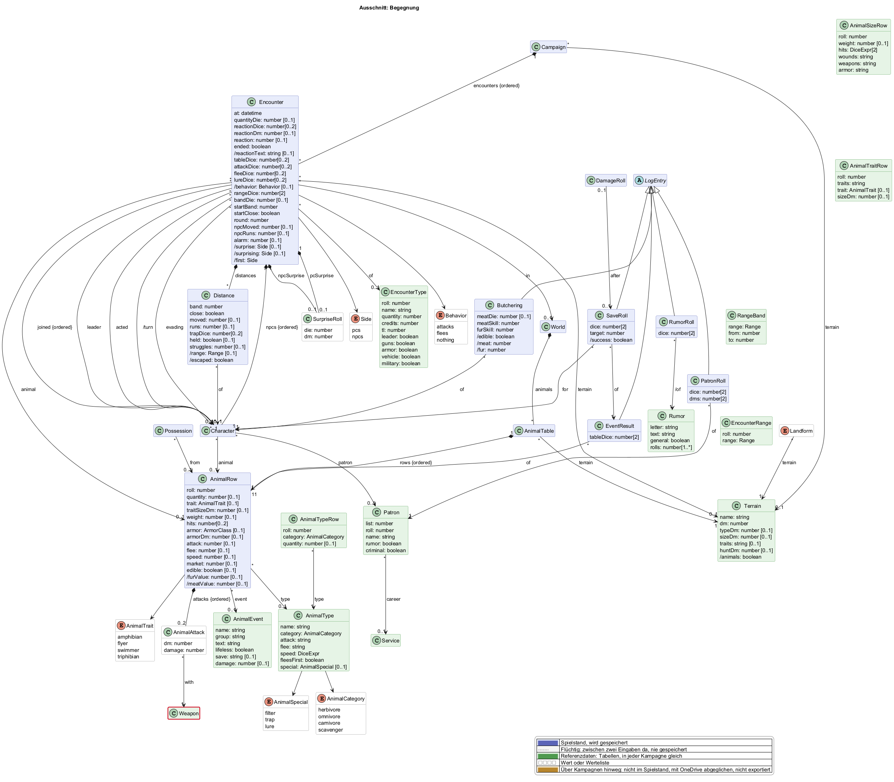

# Begegnung

Regeln des [Domänenmodells](../domain-model.md) für diesen Bereich: was das Bild nicht zeigt.
Das Diagramm führt; die Begriffe stehen im Domänenmodell unter *Begriffe*.

## Begegnung

Im Bereich Begegnung würfelt man auf dem Aufenthaltsort eine **Begegnung** (`Encounter`),
ohne weitere Eingabe; man kann die Art auch aus der Liste wählen, die Anzahl wird dann trotzdem
gewürfelt.
- *Art*: 1W6 und 1W6 auf die Random Encounter List (S. 21), z. B. 14 = 3W6 Rowdies (L). Die Zeilen
  61–66 sind leer: keine Begegnung, nichts wird angelegt.
- *Anzahl*: so viele Würfel, wie die Art angibt (mindestens 1 NSC). Nach den Regeln ist es der
  W6; zum Ausgleichen, etwa mit nur ein oder zwei SC, wählt man vor dem Würfeln W4 oder W3, dann
  kommen z. B. 3W3 statt 3W6 Rowdies. Die Wahl ist der **Würfel der Anzahl** der Kampagne
  (`Campaign.quantityDie`, 3, 4 oder 6; fehlt er, W6); sie gilt für alle folgenden Begegnungen,
  bis man sie ändert, ob man würfelt oder die Art wählt. Die Begegnung hält ihren Würfel fest
  (`Encounter.quantityDie`), damit die Übersicht z. B. „3W3“ zeigt; fehlt er (Begegnungen von
  vorher), war es W6.
- *TL der Gruppe*: TL der Welt plus die Abweichung der Art (z. B. +1 bei Soldiers), mindestens 0.
- *Jeder NSC* ist ein vollständiger Charakter (`Character`), der an der Begegnung hängt
  (`Encounter.npcs`, in der gewürfelten Reihenfolge; siehe [NSC](#nsc)). Er bekommt 2W6 je Attribut
  (`upp`), einen Namen von der Tafel NSC (Vor- und Nachname, irdisch oder spacig zufällig), als
  Herkunft (`background`) die Art der Begegnung, beim Anführer mit „· Anführer“, `npc` (er ist kein
  SC), keine Credits, keinen Lebenslauf, leere Ausrüstung und Notiz. Dazu eine Waffe und mit A eine
  Rüstung, beide im Besitz (`possessions`, je 1); die Waffe ist seine Primärwaffe (`primary`) und
  in der Hand (`wields`), die Rüstung trägt er (`wears`). Ohne G
  eine zufällige Klinge bis zum TL der Gruppe (Club, Cudgel, Spear, Dagger, Blade …, nach
  *Available Weapons by TL*), mit G eine zufällige Schusswaffe bis zum TL; mit A eine zufällige
  Rüstung bis zum TL, aber Combat Armor und Battle Dress nur, wenn die Art militärisch ist
  (`EncounterType.military`; SR 50: „only military troops and leaders will wear combat armor or
  battle dress“). Die Fertigkeit, die seine Waffe benutzt, hat er als echte Stufe (`skills`) 1.
  NSC zählen **Munition** wie SC (siehe [Munition](kampf.md#munition)): Eine Schusswaffe bekommt er geladen und dazu
  **1W4 Magazine** (`Weapon.ammo`) im Besitz (Hausregel; SR 50 sagt nichts zur Menge). Der Wurf
  gehört zum Erzeugen wie die Attribute und steht nicht im Log; was bleibt, ist die Anzahl im Besitz.
- *Anführer* (L): der erste NSC; die Begegnung verweist auf ihn (`leader`). Er bekommt die beste
  Ausrüstung bis zum TL und Fertigkeit 2: die
  beste **Schusswaffe**, auch ohne G (gibt es bis zum TL keine, die beste Klinge), und die beste
  Rüstung, auch ohne A und auch Combat Armor oder Battle Dress (SR 50). Das Beste ist das mit dem
  höchsten TL, bei Gleichstand das teuerste.
- *Fahrzeug* (V) hält die Art fest; im Kampf zählt es vorerst nicht.
- *Entfernung* wird beim Anlegen mitgewürfelt, die *Überraschung* erst zu Beginn des Kampfs (siehe
  *Kampfsimulation*).
- *Reaktion* (`reaction`): 2W6 (`reactionDice`) plus DM (`reactionDm`): +1, wenn ein lebender
  SC 5 oder mehr Terms in Army, Navy, Scouts oder Marines gedient hat (nach seinem Lebenslauf; SC
  ohne Lebenslauf zählen nicht), −1 auf einer Welt mit Bevölkerung 9+; beides zusammen ±0. Eine
  echte 2 oder 12 bleibt, sonst begrenzt auf 3 bis 12 (S. 21). Der DM wird beim Würfeln festgehalten,
  damit ein späterer Tod oder Ausblenden ihn nicht rückwirkend ändert; fehlt er (Begegnungen von
  vorher), gilt der DM der Welt. Der Text (`/reactionText`) kommt aus der Tabelle.
- Es gibt höchstens **eine laufende Begegnung**. Sie bleibt gespeichert, bis man sie beendet
  (`ended`); beendete Begegnungen bleiben in der Kampagne, weil der Log auf ihre NSC verweist,
  und werden nicht mehr gezeigt. Eine Begegnung, auf die der Log nicht verweist, wird beim Beenden
  gelöscht.
- **Dazugenommene NSC** (2026-11-14g). In der Karte Zufallsbegegnung wählt man vor dem Würfeln
  oder Wählen der Art beliebig viele **dauerhafte NSC vom Aufenthaltsort** dazu (lebend, nicht
  ausgeschieden; ohne Aufenthaltsort keine). Die Begegnung verweist auf sie (`joined`, in der
  gewählten Reihenfolge); sie bleiben in der Kampagne (`Campaign.characters`) und werden nicht
  kopiert. Die Art würfelt oder wählt man wie sonst, neu auch **„keine“**: Dann kommen nur die
  dazugenommenen NSC. Mit dazugenommenen NSC entfällt der **Test** (man stellt den Kampf mit
  Absicht zusammen, wie beim Wählen der Art); eine leere Zeile (61–66) heißt dann ebenfalls: nur
  die dazugenommenen NSC. Mindestens ein Kämpfer auf der Seite der NSC muss es geben.
  - *Seite*: Sie kämpfen immer auf der Seite der NSC, gegen die SC. Die **NSC-Gruppe** sind die
    dazugenommenen NSC, gefolgt von den gewürfelten (`npcs`); in dieser Reihenfolge stehen sie in
    der Kampfsimulation, ziehen, laufen, zählen für Überraschung, Feuerstoß-Nachbarn, Beute und
    jede Regel, die „die NSC der Begegnung“ sagt.
  - *Anführer*: Der erste dazugenommene NSC ist der Anführer (`leader`). Die gewürfelte Art bekommt
    dann keinen eigenen Anführer: Ihr erster NSC wird erzeugt wie die übrigen, ohne die beste
    Ausrüstung und mit Fertigkeit 1.
  - *Ausrüstung*: Ein dazugenommener NSC kämpft mit dem, was er hat (Primärwaffe, Waffe in der
    Hand, getragene Rüstung, Munition im Besitz); die App gibt ihm nichts dazu.
  - *Folgen*: Weil er derselbe Charakter bleibt, behält er nach der Begegnung seine Wunden, seine
    verbrauchte Munition und gegebenenfalls seinen Tod (`dead`), und der Log verweist weiter auf
    ihn. **Beute nehmen** von ihm geht wie bei jedem NSC der Begegnung; was man nimmt, verliert er.
    **Übernehmen** gilt nur für die gewürfelten NSC; ein dazugenommener ist schon in der Kampagne.
  - *Beenden*: Das Beenden löst nur den Verweis; der NSC bleibt, wie er ist. Ein NSC, auf den eine
    laufende Begegnung verweist, kann nicht zum SC gemacht werden, solange sie läuft.
  - Ein dauerhafter NSC vom Aufenthaltsort lässt sich so für die nächste Zufallsbegegnung
    vormerken; nicht, solange eine Begegnung läuft (höchstens eine laufende Begegnung).

## Test

Jede Begegnungsart beginnt mit ihrem **Test** nach der Encounter Checklist (SE, Charts
S. 20): Zufallsbegegnung täglich 5+ auf 1W6, Patron wöchentlich 5+ auf 1W6, Gerücht wöchentlich
7+ auf 2W6. Besteht er nicht, gibt es nichts, und die Karte sagt das („Test 3 (5+ nötig): diese
Woche kein Patron.“); besteht er, folgt der Wurf der Art. Wer bei der
Zufallsbegegnung die Art aus der Liste wählt, überspringt den Test.
- *Im Log* (2026-11-13d): Jeder Test ist ein Logeintrag `CheckRoll` mit Art, Würfeln und
  Zielwert, am heutigen Spieltag. Die Tiere testen 5+ auf 1W6 (SR 47) ebenso.
- *Polizei* (`legal`, 2026-11-13d): eine neue Begegnungsart im Bereich Begegnung, nur mit
  Aufenthaltsort. Einmal je Woche (Wunsch des Owners; die SE sagt „once per day“) würfelt man 2W6;
  gleich oder über der Gesetzesstufe der Welt (`target`) hat die Gruppe Ruhe. Darunter hält ein
  Polizist die Gruppe an und verlangt Ausweise; die App würfelt gleich seine Reaktion
  (`reactionDice`, `reactionDm` wie bei der Begegnung: +1 für 5 oder mehr Terms in Army, Navy,
  Scouts oder Marines, −1 bei Bevölkerung 9 oder mehr; `/reaction` 2 bis 12). Eine schlechte
  Reaktion heißt mehr Ärger, eine gute vielleicht ein Gerücht, Helfer oder Patron (SE S. 20); was
  folgt, entscheidet der Spieler. Bei Gesetz 0 gibt es keine Polizei-Begegnung, der Test entfällt.
- *Wie oft schon*: Gezählt wird, wie oft der Test jeder Art in seinem Zeitraum schon gewürfelt ist
  (heute bzw. diese Woche). Ist die Regel schon erfüllt (Zufallsbegegnung 1× am Tag, Tiere 2× am
  Tag, Patron, Gerücht und Polizei 1× in der Woche), gehen mehr Begegnungen, aber nur mit Absicht. Die Zeit vergeht dadurch nicht; Zeit und Begegnungen bleiben getrennt.

## Patron

Im Bereich Begegnung ist der **Patron** eine eigene Begegnungsart. Nach dem Test wählt
ein Würfel die Liste (Hausregel; die Regeln lassen die Spielleitung wählen): 1W6, 1 bis 3 Liste
eins, 4 bis 6 Liste zwei; der Würfel wird nicht gespeichert, die Liste schon. Das Ergebnis ist ein Logeintrag
(`PatronRoll`), kein Teil einer Begegnung; es braucht weder Aufenthaltsort noch lebenden Charakter
und geht auch, während eine Begegnung läuft.
- *Wurf*: zwei Würfel nacheinander (`dice`), der erste die Zehner-, der zweite die Einerstelle,
  jeder mit seinem DM (`dms`) und danach auf 1 bis 6 begrenzt. Das ergibt die Zeile 11 bis 66 der
  gewählten Liste; der Eintrag verweist auf sie (`of`).
- *DMs* (SE, Charts S. 20), nach den lebenden SC zum Zeitpunkt des Wurfs; ein DM gilt, sobald ein
  SC ihn erfüllt, mehrere zählen zusammen. Liste eins: 1. Würfel Merchant −1, Noble (SOC 11 oder
  mehr) +1; 2. Würfel Other −1, Army oder Marines +1. Liste zwei: 1. Würfel Navy −1, Merchant +1;
  2. Würfel Streetwise-1 oder mehr −1, Admin-1 oder mehr +1. Die Laufbahn kommt aus dem
  Lebenslauf; ein Charakter ohne Lebenslauf bringt nur die DMs aus SOC und Fertigkeiten. Der
  Eintrag hält die DMs fest, damit ein späterer Tod oder eine neue Stufe ihn nicht rückwirkend
  ändert.
- *Rumor*: Drei Zeilen der Liste eins (23, 36, 66) sind kein Patron, sondern ein Gerücht
  (`Patron.rumor`); die App zeigt das an. Nach den Regeln folgt dann ein Wurf auf die Rumors
  Matrix (siehe [Gerücht](#gerücht)).
- *Deuten*: Der Patron-Wurf ist ein Ergebnis und lässt sich deuten, z. B. mit dem Auftrag, den
  der Patron vergibt. Die Regeln geben keine Tabelle für Aufträge; die legt die Spielleitung fest.
  Festhalten lässt sich der Auftrag als Mission („Als Mission“, 2026-11-18, siehe [Missionen](mission.md#missionen)).

## Gelände

Es gibt ein Gelände für alle Begegnungsarten: Man wählt es, und es bleibt an der Kampagne (`Campaign.terrain`), bis man es ändert;
fehlt es, gilt ±0 und es gibt keine Tiere. Jede Begegnung hält das Gelände fest, mit dem sie
gewürfelt wurde (`Encounter.terrain`).
- **Vorbelegt aus dem Aufenthaltsort** (freigegeben am 15. November 2026, 2026-11-15b): Kommt die Gruppe auf ein Feld oder
  in eine Stadt (Gruppe hierher setzen, jeder Reisetag einer Fahrt, Ankunft), setzt die App das
  Gelände neu: in einer Haupt- oder Nebenstadt City, sonst das Gelände der Geländeart des Feldes
  (`Landform.terrain`). Danach kann man es wie bisher ändern, etwa auf
  River am Fluss oder Ruins; es gilt bis zum nächsten Ortswechsel. Ohne Feld (nur die Welt, nach
  einer Reise zwischen Welten, eine Orbitalstadt) bleibt das Gelände, wie es ist.
- **Die Zuordnung** (Hausregel, Owner 15. November 2026):

  | Geländeart | Gelände |
  |---|---|
  | Wasser | Maritime Surface |
  | Eis auf Wasser, Eis auf Land | Arctic |
  | Tundra | Prairie, Plain, Steppes |
  | Gebirge | Mountain |
  | Zerklüftet | Rough, Hills |
  | Wüste | Desert |
  | Dschungel | Jungle |
  | Sumpf | Swamp |
  | Offen/Wald | Forest, Woods |
  | Besiedelt | Clear, Road, Open |
  | (Stadt auf dem Feld) | City |

  Eine Kleinstadt macht aus dem Feld keine City; dort gilt die Geländeart.
- Die Liste vereint die Geländearten der Entfernung (SE 5) mit denen der Tiere (SE 18): jedes
  Gelände hat seinen DM auf die Entfernung (`dm`), und wo es Tiere gibt (`/animals`), die DMs auf
  Tierart und Größe (`typeDm`, `sizeDm`) und die Spalte der Besonderheiten (`traits`: Beach, Marsh,
  River, Sea, Swamp oder Other).
- Keine Tiere gibt es in City, Building Interior und Arctic (Hausregel für Arctic und Interior;
  in Städten nach SR 47).
- Gelände der Tiere ohne eigenen DM auf die Entfernung bekommen den des ähnlichsten (Hausregel): Marsh
  wie Swamp, Beach wie Clear, Ruins wie City, Cave und Sea Cave wie Interior, Chasm wie Broken,
  Crater wie Rough, Sargasso wie Maritime Surface, Shallows und Bottom wie Maritime Subsurface.
  Maritime Surface hat die Tier-DMs von Surface, Maritime Subsurface die von Depths.

## Tiere

Regeln und Tabellen stehen in
`regeln-kampf.md` unter *Tierbegegnungen* (SE 18–19, SR 46–49).
- *Tiertabelle*: Jede Welt hat je Gelände höchstens eine Tiertabelle (`Hex.animals`). Sie
  entsteht nicht beim Erschaffen der Welt, sondern **bei Bedarf**: beim ersten Tierwurf auf dieser
  Welt in diesem Gelände, ohne weitere Eingabe, und bleibt dann an der Welt. Das gilt auch für
  Welten, die es schon gibt. Die Tabelle speichert die Werte ihrer Tiere, nicht die Würfe (wie die
  Welt selbst). Auf einer Welt, deren Oberfläche kein Leben hat (`Surface.life`), sind alle Zeilen
  Ereignisse aus der Gruppe *Vacuum Worlds* (SR 50, `AnimalEvent.lifeless`).
- *Erzeugen* (Checklist SE 19): elf Zeilen 2 bis 12 nach der 2W6-Aufteilung der Encounter Columns
  (Zeile 10 ist ein Ereignis, zufällig aus der Liste ohne die Gruppe *Vacuum Worlds*; `AnimalRow.event`). Je Zeile: Tierart und Anzahl (2W6 + Type DM des Geländes auf die
  Spalte der Kategorie), Besonderheit (2W6 mit den DMs aus Größe und Atmosphäre der Welt, Spalte
  nach dem Gelände), Gewicht und Hits (2W6 + Size DMs; die Hits werden ausgewürfelt und stehen als
  zwei Zahlen), Waffe (2W6 + DM der Kategorie), Rüstung (2W6 + DM der Kategorie; Flieger und
  Triphibien nie) und Verhalten (je 1W6 für A, F und S). „(+6)“ würfelt noch einmal mit +6.
- *Schaden* (SR 48, die einfache Art): Der Schaden je Treffer wird beim Erzeugen einmal gewürfelt
  (die Würfel der Tierwaffe, geändert um die Wounds der Größe, mindestens 1) und steht fest im
  Tierangriff (`AnimalAttack.damage`), z. B. „11 teeth“. Hat die Zeile zwei Waffen („claws and
  teeth“), hat sie zwei Tierangriffe, jeden mit eigenem Schaden.
- *Tierbegegnung*: eine Begegnungsart im Bereich Begegnung; sie würfelt im Gelände der Kampagne.
  Test 5+ auf 1W6 (SR 47), dann 2W6 auf die Tiertabelle (`Encounter.tableDice`); man kann die
  Zeile auch wählen, dann ohne Test. Fällt der Wurf auf ein Ereignis, entsteht keine Begegnung,
  sondern ein Ereignis-Eintrag im Log (`EventResult`, siehe *Ereignisse*). Sonst entsteht eine **Begegnung** (`Encounter`), die statt auf
  eine Art (`of`) auf ihre Zeile verweist (`animal`); genau eins von beiden ist gesetzt. Die Anzahl
  wird mit dem Würfel der Anzahl gewürfelt; die Entfernung wie sonst, mit dem DM des Geländes, auf
  dem Gelände. Eine Reaktion gibt es nicht.
- *Verhalten*: Beim Anlegen 2W6 für den Angriff und 2W6 für die Flucht (`attackDice`,
  `fleeDice`). `/behavior`: Greift die Tierart zuerst an, gilt der Angriffswurf gegen A, sonst der
  Fluchtwurf gegen F; Pflanzenfresser prüfen umgekehrt (`AnimalType.fleesFirst`); trifft keiner,
  tun die Tiere nichts. Steht bei der Tierart ein Wort statt einer Zahl („if possible“, „if
  surprise“, „if surprised“, „if more“), gilt das Wort; ob es zutrifft, entscheidet man
  selbst. Das Verhalten ist wie die Reaktion eine Auskunft: Die App erzwingt es nicht.
- *Tiere im Kampf*: Jedes Tier der Begegnung ist ein Charakter (`Encounter.npcs`) wie jeder NSC,
  mit dem Namen der Tierart und einer Nummer, und verweist auf seine Zeile (`Character.animal`).
  Sein UPP ist leer (alle Werte 0) und zählt nicht; Fertigkeiten, Besitz und Rüstung hat es nicht.
  - Es greift mit den Tierangriffen seiner Zeile an (der erste ist die Primär-, der zweite die
    Sekundärwaffe): 2W6 + DM des Tierangriffs + Rüstung und Reichweite aus der Zeile der Tierwaffe
    in der Waffenmatrix ≥ 8. Fertigkeit und Attribut zählen nicht, Ausdauer hat es unbegrenzt.
  - Trifft es, ist der Schaden fest (`DamageRoll.fixed`, ohne Würfel) und geht als **ein Block**
    auf ein Attribut des Ziels; bringt er es auf 0, läuft der Rest über wie bei jedem Würfel.
  - Wer ein Tier angreift, rechnet mit dessen Rüstungsklasse und zusätzlich dessen `armorDm`.
    Der Schaden wird nicht verteilt: Er zählt als Summe (`/hurt`). Erreicht sie die erste Zahl
    der Hits, ist das Tier bewusstlos, erreicht sie beide zusammen, ist es tot.
  - Überraschung der Tiere: nur der DM „8 oder mehr −1“. Heilen und Übernehmen gibt es für Tiere
    nicht.
- *Geschwindigkeit* (SR 47): Die Tiere bewegen sich als Gruppe je Runde bis zu S Bands
  (`AnimalRow.speed`), S0 gar nicht. Laufen und dessen Kosten gibt es für sie nicht.
- *Besonderheit*: Flieger, Schwimmer, Amphibien und Triphibien haben in den Regeln keine eigene
  Kampfregel; die Besonderheit steht im Namen („Flying Grazer“) und hat die Größe verschoben.
- *Besondere Angriffe* (SR 48), nach `AnimalType.special`:
  - **Trapper** (`trap`): Haben die Tiere Überraschung, würfelt jeder SC auf Close oder Short
    2W6 (`Distance.trapDice`); bei 5+ ist er **festgehalten** (`held`). Statt zu schlagen, reißt
    er sich in seinem Zug los: 2W6 + 1 je helfendem Kameraden ≥ 9. Jeder Versuch kostet einen
    Combat-Schlag (`struggles`, zählt in `/blows`). Helfer sind die SC auf Close, die kämpfen
    können und nicht selbst festgehalten sind. Die Falle verwundet nicht.
  - **Siren** (`lure`): wie der Trapper, dazu der Köder: Beim Anlegen 2W6
    (`Encounter.lureDice`); bei 11+ wirkt er auch auf Menschen, dann beginnt die Begegnung auf
    Close in Berührung.
  - **Filter** (`filter`): In seinem Zug saugt er einen SC auf Close ein statt anzugreifen: 2W6
    ≥ 6, ohne DMs (ein Angriffsergebnis mit Zielwert 6). Gelingt es, ist der SC festgehalten und
    nimmt 1W6 je angefangene 50 kg des Filters als Schaden, ohne Wundänderung; solange er
    festgehalten ist, nimmt er das in jedem Zug des Filters von selbst wieder. Losreißen: in seinem nächsten Zug
    2W6 + 2 je Helfer ≥ 7, kostet einen Combat-Schlag.
  - **Pouncer** greifen mit Überraschung auf jeder Entfernung an; das steht beim Verhalten.
  - Wer festgehalten ist, greift nicht an, bewegt sich nicht und weicht nicht aus.
- *Ereignisse* (SR 49–50): Der Ereignis-Eintrag zeigt Namen und Text des Ereignisses und lässt
  sich deuten. Hat das Ereignis einen Rettungswurf mit Schaden (`AnimalEvent.save`, `damage`:
  Stampede 8+ sonst 2W6, Poisonous Pests DEX oder weniger sonst 3W6, Flash Flood 9+ sonst 3W6,
  Seismic Quake STR oder weniger sonst 1W6), würfelt die App ihn auf Wunsch für jeden lebenden SC
  (`SaveRoll`, mit dem Zielwert von damals); wer ihn nicht schafft, bekommt den Schaden
  (`DamageRoll.after`, statt `of`), verteilt wie jeder andere. Alles Übrige am Ereignis
  (Fahrzeuge, Umwege, ein Kampf aus Chameleon, Circling Flyers oder Lair) spielt man selbst;
  einen Kampf beginnt man, indem man die Zeile der Tiertabelle wählt.
- *Später*: Gewicht ±20 %, zerstörte Tiere (doppelte Hits), Jagd und Fleisch, Psionik, die
  1W6-Aufteilung der Tabelle, eigene Tabellen und Ereignisse.

## Beute

Die Regeln geben nur Fleisch vor (SR 48); alles
Übrige ist Hausregel nach Absprache mit dem Owner.
- *Überlebensausrüstung der NSC* (Charts S. 21: „necessary survival equipment“): Beim Anlegen
  einer Begegnung mit Personen bekommt jeder NSC, was die Welt verlangt, als Gegenstand in seinen
  Besitz: bei Atmosphäre 0, 1, B oder C einen Vacc Suit (der beste bis zum TL der Gruppe), bei 2 und
  3 ein Atemgerät (Respirator), bei 2, 4, 7 und 9 eine Filtermaske (bei 2 beides), bei A
  Sauerstoffflaschen. Sonst nichts.
- *Kredite der NSC* (Hausregel): Beim Anlegen bekommt jeder NSC 1W6 × `EncounterType.credits`
  Cr (`Character.credits`), der Anführer das Zehnfache. Die Stufen: Arm 1 (Peasants, Workers,
  Riotous Mob, Beggars, Pilgrims, Fugitives), Wenig 10 (Rowdies, Thugs, Religious Group,
  Vigilantes), Sold 20 (Soldiers, Soldiers on Patrol, Marines, Security Troops, Police Patrol,
  Guards), Beute 50 (Bandits, Ambushing Brigands, Hunters and Guides), Reisende 100 (Adventurers,
  Tourists, Researchers, Traders), Reich 200 (Merchants, Noble with Retinue).
- *Beute nehmen*: Einem NSC, der tot, bewusstlos oder schwer verwundet ist, nimmt man Gegenstände
  und Kredite ab: Die Gegenstände wandern aus seinem Besitz ins Gruppengepäck, die Kredite zu den
  `credits` eines gewählten lebenden SC. Eine Waffe, die so weggeht, entfällt beim NSC als Primär- oder
  Sekundärwaffe. Das geht während und nach der Begegnung; ein Logeintrag entsteht nicht.
- *Zerstört* (SR 47): Erreicht der Schaden eines Tiers das Doppelte seiner Hits (beide Zahlen
  zusammen), ist es zerstört (`destroyed`): tot, ohne Fleisch und Fell.
- *Ausweiden* (`Butchering`): Ein Tier, das tot oder bewusstlos ist und nicht zerstört, kann man
  einmal ausweiden; die Beute geht ins Gruppengepäck. Die Arbeit macht immer,
  wer es am besten kann (Hausregel): unter den lebenden SC, die nicht bewusstlos sind, beim Fleisch
  der mit der besten Stufe in Steward oder Medical (`meatSkill`), beim Fell der mit der besten Stufe
  in einer Klinge (Dagger, Blade, Foil, Sword, Cutlass, Broadsword, Bayonet; `furSkill`); das können
  zwei verschiedene sein. Hat keiner die Fertigkeit, zählt Stufe 0 (Jack-of-all-Trades wie bei
  Proben). Ist kein SC wach, kann keiner ausweiden. Der Eintrag hält die Stufen von damals fest,
  damit eine spätere neue Stufe die Beute nicht ändert.
  - *Essbar* (SR 48) ist eine Eigenschaft der Tierart, nicht des einzelnen Ausweidens: Beim
    Erzeugen der Tiertabelle würfelt jede Tierzeile einmal 2W6 ≥ 5, DM −3 bei verdorbener
    Atmosphäre (2, 4, 7, 9); essbar nur bei Atmosphäre 2 bis 9 und ohne Giftwaffe (Hausregel: der
    Stinger ist eine Giftwaffe). Gespeichert wird das Ergebnis (`AnimalRow.edible`), nicht der
    Wurf, wie bei allen Werten der Tabelle. `Butchering./edible` folgt aus der Zeile des Tiers.
  - *Fleisch*: Ist die Art essbar, (1W6 (`meatDie`) + `meatSkill`, höchstens 6) × 5 % seines
    Gewichts, abgerundet, mindestens 1 kg (`/meat`). Ein Mensch braucht 1 kg am Tag.
  - *Fell* (Hausregel): jedes kg Tier gibt 1 kg Fell (`/fur`), nur bei Tieren ohne Rüstung oder
    mit Jack; sonst 0. Mit `furSkill` 0 nur die Hälfte (abgerundet), weil es beim Abziehen leidet;
    ab Stufe 1 die volle Menge.
  - Fleisch und Fell kommen als Jagdbeute ins Gruppengepäck: die Gegenstände Fleisch bzw. Fell
    (Art `game`), Anzahl in kg, mit Verweis auf die Zeile der Tiertabelle (`Possession.from`).
    Jagdbeute derselben Tierart zählt zusammen.
- *Preise* (Hausregel): Beim Erzeugen der Tiertabelle bekommt jede Tierzeile einen Marktwurf
  (`market`, 3W6). Daraus:
  - `/furValue` = Marktwurf + Jagd-DM des Geländes der Tabelle + Gefahr-DM (Herbivore ±0,
    Omnivore und Scavenger +1, Carnivore +3) + Seltenheit; Preis Fell = Fellwert × 0,1 Cr je kg.
  - `/meatValue` = Marktwurf + Jagd-DM + Seltenheit; Preis Fleisch = Fleischwert × 0,5 Cr je kg.
  - *Jagd-DM* (`Terrain.huntDm`, das Gelände, in dem gejagt wurde, nicht wo man verkauft): schwer
    +2 (Mountain, Chasm, Cave, Sea Cave, Depths, Sea Bottom, Jungle, Swamp), mittel +1 (Rough,
    Broken, Forest, Marsh, Crater, Ruins, Sargasso, Desert), offen ±0 (Clear, Prairie, River,
    Beach, Shallows, Maritime Surface).
  - *Seltenheit*: nach der Zeile der Tiertabelle, Zeile 2 oder 12 +3, 3 oder 11 +2, 4 oder 10 +1,
    sonst ±0.
  - Verkauft wird Jagdbeute im Shop wie alles zum halben Preis, abgerundet, mindestens 1 Cr je kg.
    Rechenbeispiel über 4000 Tabellen: typisch rund 90 Cr Fell und 80 Cr Fleisch je Begegnung
    (Listenpreis), große Herden mehrere tausend; wie viel die Gruppe mitnehmen kann, entscheidet
    man selbst.
- *Tierbeute in älteren Tabellen*: Zeilen ohne Marktwurf oder ohne `edible` bekommen beides
  beim ersten Ausweiden einer Tierart dieser Zeile, gewürfelt wie beim Erzeugen.

## Gerücht

Eine weitere Begegnungsart im Bereich Begegnung.
Nach dem Test (7+ auf 2W6) zwei Würfel nacheinander (`RumorRoll.dice`), der erste die Zehner-, der
zweite die Einerstelle; die Rumors Matrix (SE, Charts S. 21) führt von 11 bis 66 auf eine Art von
Gerücht (`Rumor`, Buchstabe A bis Z; `rolls` sind die Würfe, die auf sie führen). DMs gibt es
keine: Die Regeln überlassen sie der Spielleitung. Der Verweis `/of` folgt allein aus den Würfeln.
- *Bestimmt und allgemein*: A bis T sind bestimmte Gerüchte (z. B. „G · Location data“), U bis Z
  allgemeine (`general`, z. B. „U · Broad background information“). Die Liste sagt nur die Art; was
  das Gerücht besagt, legt man selbst fest.
- *Deuten*: Der Gerüchte-Wurf ist ein Ergebnis und lässt sich deuten, z. B. mit dem Inhalt des
  Gerüchts.
- *Gerücht statt Patron*: Fällt ein Patron-Wurf auf eine Rumor-Zeile, würfelt die App gleich
  danach ein Gerücht, ohne Test; im Log stehen dann beide Einträge hintereinander.

## NSC

Ein NSC der Begegnung ist ein vollständiger Charakter, derselben Klasse wie die SC.
Er hängt an seiner Begegnung (`Encounter.npcs`), nicht an der Kampagne: Jeder Charakter gehört
genau einer Kampagne (`characters`) oder genau einer Begegnung (`npcs`), nie beiden. Die NSC einer
Begegnung gehören nicht zu den SC (kein Kauf, keine Probe), und der
Charakter oben (`focus`) ist nie einer von ihnen. Für Angriff, Wunden, Heilung, Ausdauer, Parade
und Zug gelten für SC und NSC dieselben Regeln; wo eine Regel sie unterscheidet, sagt sie es (SC
heißt: Charakter der Kampagne; NSC: Charakter der Begegnung).
- **Übernehmen**: Man kann einen NSC der Begegnung als SC oder als dauerhaften NSC in die Kampagne
  übernehmen. Er wird von der Begegnung in die Kampagne **umgehängt** (aus `npcs` in
  `characters`), mit allem, was er hat; als SC verliert er `npc`. Verweist die Begegnung auf ihn
  als Anführer, fällt der Verweis weg. Er ist danach nicht mehr NSC der Begegnung, kämpft also
  nicht mehr auf ihrer Seite. Weil er derselbe Charakter bleibt, verweist der Log weiter auf ihn,
  und er behält seine **Wunden** aus dem Kampf (bisher kam der Übernommene unverwundet); heilen
  lässt er sich wie jeder Charakter.
- **Dauerhafte NSC** (`Character` mit `npc`) stehen nur in der **NSC-Liste** (2026-11-14), nicht
  unter den SC, sind nie Charakter oben und kaufen nicht ein; sie lassen sich zum SC machen und
  umgekehrt. Proben und Angriffe würfelt man für SC.
- **Ort eines NSC** (2026-11-14). Ein dauerhafter NSC lebt auf höchstens einer Welt (`place`),
  einer fertigen Welt des Subsektors. Er bekommt den Aufenthaltsort, wenn er entsteht oder
  übernommen wird (dann mit der Rolle „Begegnung“); im Editor lässt er sich ändern oder leeren (ein NSC, der mit der Gruppe reist,
  hat keinen Ort). Ein SC hat keinen Ort, ihm gilt der Aufenthaltsort der Gruppe; wird ein NSC zum
  SC, fällt `place` weg. NSC von früher haben keinen Ort.
- **Rolle eines NSC** (2026-11-14). Jeder dauerhafte NSC hat genau eine Rolle (`role`) aus einer
  festen Liste (`NpcRole`), in dieser Reihenfolge: **Patron** (`patron`), **Begegnung**
  (`encounter`), **Feind** (`enemy`), **Rivale** (`rival`), **Verbündeter** (`ally`),
  **Kontakt** (`contact`), **Behörde** (`official`: Polizei, Zoll, Hafenmeister, Beamte),
  **Händler** (`merchant`), **Makler** (`broker`), **Captain** (`captain`), **Crew** (`crew`),
  **Passagier** (`passenger`), **Sonstige** (`other`). Feind, Rivale, Verbündeter und Kontakt
  folgen den Verbindungen aus Mongoose Traveller 2e (Enemy, Rival, Ally, Contact). Vorgegeben ist
  *Patron* für einen Patron-NSC, *Begegnung* für einen aus einer Begegnung übernommenen NSC und
  *Sonstige* für einen, der im Editor zum NSC gemacht wird, und für NSC von früher; im Editor
  wählt man jede andere. Ein SC hat keine Rolle; wird ein NSC zum SC, fällt sie weg, wird ein SC
  zum NSC, bekommt er *Sonstige*.
- **NSC-Liste** (2026-11-14; seit 2026-11-17 kein eigener Bereich mehr, sondern im Bereich
  *Charaktere* unter „NSC“), **vorgegeben nach dem Aufenthaltsort
  gefiltert**: Er zeigt die dauerhaften NSC, deren Ort der Aufenthaltsort ist, dazu die NSC ohne
  Ort, **immer nach Rolle gruppiert** (Gruppen in der Reihenfolge der Liste, leere weggelassen) und
  in jeder Gruppe nach Namen. **„Alle zeigen“** hebt den Filter auf: Dann stehen alle dauerhaften
  NSC **nach Welt gruppiert** (nach dem Namen der Welt, die NSC ohne Ort als eigene Gruppe am
  Ende), darin **nach Rolle** und darin **nach Namen**. Ohne Aufenthaltsort zeigt er alle so.
  Die Wahl wird nicht gespeichert. Tote und Ausgeschiedene stehen für sich.
- **Patron als NSC** (2026-11-14, Laufbahn 2026-11-14b). Zu einem Patron-Wurf, der einen Patron
  ergibt (keine Rumor-Zeile), erzeugt **„Als NSC“** einen zufälligen dauerhaften NSC **in der
  Laufbahn seines Patrons** (`Patron.career`): Die Charaktererschaffung läuft für ihn zufällig
  durch wie beim *Durchlaufen*, mit diesen Abweichungen:
  - *Laufbahn*: Er meldet sich immer bei der Laufbahn seines Patrons. Wird er dort nicht
    genommen (er würde eingezogen), oder stirbt er in einem Term, beginnt der Lauf von vorn, mit
    neuen Attributen (Hausregel), bis er in seiner Laufbahn gedient und überlebt hat.
  - *Dienstalter* (2026-11-24f): Er hat keines und will **bleiben, so lange es geht** – die
    Weiterverpflichtung wird immer mit *will bleiben* gewürfelt; überleben wie die Regel, er
    kann sterben und beginnt dann von vorn.
  - *Welten*: wie beim *Durchlaufen*, Heimatwelt eine zufällige fertige Welt des Subsektors, die
    Terms „wie zuletzt“.
  - *Name*: von der Tafel NSC, wie bei den NSC der Begegnung.
  - Er läuft für sich, neben einer offenen Charaktererschaffung der Kampagne, ohne sie zu
    berühren; gespeichert wird nur der fertige Charakter mit seinem Lebenslauf.
  Er bekommt, was die Erschaffung ergibt: UPP, Fertigkeiten, Besitz und Credits aus der
  Abmusterung, Pension in der Notiz, den Lebenslauf. Die Herkunft beginnt mit dem Beruf des
  Patrons („Smuggler · Ex-Merchants · 3 Terms · 30 Jahre“). Eine Waffe aus der Abmusterung ist
  seine Primärwaffe und in der Hand. Er verweist auf seinen Patron (`patron`), bekommt die Rolle
  „Patron“ und den Aufenthaltsort als Ort.
  - *Laufbahn je Patron* ist eine Hausregel (Referenzdaten an den Zeilen der Patron-Listen,
    Zuordnung in [`patron-nsc.md`](../patron-nsc.md)); ein Beruf, der mehrfach vorkommt, hat
    überall dieselbe. Die Rumor-Zeilen haben keine. Zur Wahl stehen alle achtzehn Laufbahnen
    (2026-11-24e, ergänzt 2026-11-25a).
- **NSC aus einer Laufbahn** (2026-11-14c). Ein neuer NSC bekommt zuerst eine **Rolle**; dann legt
  man ihn leer an oder **erzeugt ihn aus einer Laufbahn**. Erzeugt wird wie beim Patron-NSC, nur in der gewählten Laufbahn: Die
  Charaktererschaffung läuft zufällig durch (abgelehnt, ohne
  `needs`-Qualifikation oder tot: von vorn – beim Adligen also, solange der Stand unter 10 bleibt,
  2026-11-24e),
  Name von der Tafel NSC, Ort der Aufenthaltsort; danach lässt er sich nachbessern. Ohne
  Aufenthaltsort geht es nicht. Er hat keinen Patron. **Dienstalter** (2026-11-24f): „So lange er
  kann“ oder 1 bis 7 Terms – leer wählt der Lauf,
  wie lange er kommt (er will bleiben, so lange es geht, wie beim Patron-NSC), gesetzt würfelt
  er genau so viele Terms ohne Überleben und ohne Weiterverpflichtung, und nichts kann ihn
  töten. Wird er für ein Feld des Globus erzeugt (2026-11-17), lebt er stattdessen auf diesem Feld
  bzw. in der Stadt darauf (`Character.place` mit `cell` bzw. `city`) und bewaffnet sich nach dem
  Gesetz dieser Welt; dann geht es auch ohne Aufenthaltsort, und leer anlegen gibt es dort nicht.
- **Der Lauf eines NSC** (2026-11-24f). Was Patron-NSC und erzeugte NSC gemeinsam haben: Die
  Erschaffung läuft zufällig in der vorgegebenen Laufbahn, bis zum Namen.
  Der Spieler ist nie ein Schritt davon; der Würfel dahinter ist `runCareerIn`. Er
  **will bleiben, so lange es geht** – die Weiterverpflichtung wird immer mit *will bleiben*
  gewürfelt. Mit **Dienstalter** (`termsGoal`, 1 bis 7) entfallen Überleben und
  Weiterverpflichtung ganz: Der Lauf würfelt Rangwurf, Beförderung, Fertigkeiten, Altern und
  Abmusterung genau für die gewünschte Zahl Terms und **kann nicht sterben** – misslingt die
  Krise, steht das Attribut auf 1 und der nächste Term beginnt. Ohne Dienstalter bleibt die
  Regel: Er überlebt oder nicht; verworfen und von vorn wird der Lauf, wenn er abgelehnt
  würde, die Qualifikation nicht mitbringt oder stirbt.
  Wie viele Läufe verworfen wurden und warum (`/discarded`, 2026-11-24g), ist flüchtig und kommt in
  kein Log.
- **Waffen erzeugter NSC** (2026-11-14c; Patron-NSC und NSC aus einer Laufbahn, nicht die NSC
  der Begegnung, die ihre eigene Regel haben). Hausregel nach Wunsch des Owners:
  - *SOC-Stufe*: Jede Waffe hat ein Mindest-SOC (`Weapon.minSoc`): billige Nahkampfwaffen ab 0
    (Club, Cudgel, Dagger, Spear, Pike, Blade), Pistolen, Shotgun und die übrigen Klingen ab 6,
    Gewehre, Maschinenwaffen und Laser ab 10. Tierwaffen und Hände haben keins.
  - *Erlaubt* ist eine Waffe, wenn SOC des NSC ≥ ihr Mindest-SOC, ihr TL ≤ TL seines Orts und
    das Gesetz seines Orts sie nicht verbietet (`Weapon.law`, wie im Shop).
  - *Gesetz ignorieren*: Einmal je NSC 1W6 + DMs; bei 6+ gilt für ihn das Gesetz nicht.
    DM +2 mit Streetwise (Stufe 0 oder mehr), DM +2, wenn er verbrecherisch ist: ein Patron
    mit `Patron.criminal` oder die Rolle Feind.
  - *Wahl*: Seine Waffenfertigkeiten, höchste Stufe zuerst; er bekommt die Waffe der ersten,
    die erlaubt ist. Hat er keine passende, bekommt er die teuerste erlaubte Waffe seiner
    SOC-Stufe. Ist gar keine erlaubt, bleibt er ohne. Eine Waffe aus der Abmusterung behält er
    zusätzlich; Primärwaffe ist die nach dieser Regel gewählte. Schusswaffen sind geladen und
    haben 1W4 Magazine, wie bei den NSC der Begegnung.
  - *Verbrecherisch* (`Patron.criminal`, Referenzdaten): Arsonist, Assassin, Cutthroat,
    Embezzler, Hijacker, Pirate, Rogue, Smuggler, Swindler, Terrorist, Underworld Leader.
  Ohne Aufenthaltsort geht es nicht. Der Patron-Wurf selbst bleibt, wie er ist; der neue NSC
  kommt in die NSC-Liste. Ein Patron-NSC ist ein gewöhnlicher dauerhafter NSC: Man kann ihn
  bearbeiten, zum SC machen oder ausscheiden lassen; der Verweis auf den Patron bleibt.
