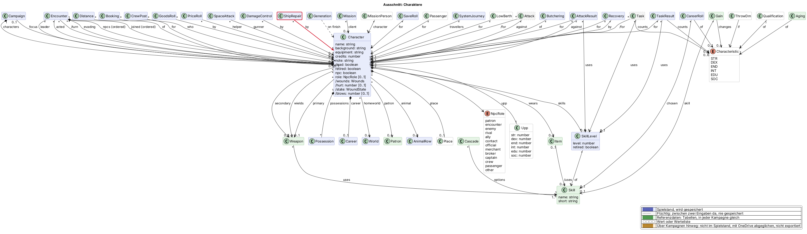

# Charaktere

Regeln des [Domänenmodells](../domain-model.md) für diesen Bereich: was das Bild nicht zeigt.
Das Diagramm führt; die Begriffe stehen im Domänenmodell unter *Begriffe*.

## Charakter

Charaktere legt man in der App an und bearbeitet sie, von Hand oder über die
Charaktererschaffung (siehe dort). Die sechs UPP-Werte liegen zwischen 0 und 15. Eine
Fertigkeit kommt bei einem Charakter höchstens einmal vor, ihre Stufe ist 0 oder mehr; Fertigkeiten
kommen nur aus der festen Liste der Referenzdaten. Jede Fertigkeit hat ein Kürzel aus genau drei Zeichen,
das in der Liste nur einmal vorkommt (Pil für Pilot, JoT für Jack-of-all-Trades). Es dient der
knappen Anzeige; der Log zeigt den vollen Namen. Ausrüstung, Herkunft (`background`, z. B.
„Ex-Scout · 4 Terms · 34 Jahre“) und Notiz sind in Version 1 freier Text, Credits eine
ganze Zahl.

## Löschen und Ausblenden

Ein Charakter oder eine Fertigkeitsstufe, auf die kein Logeintrag
verweist (bei einem Charakter auch keine Buchung der Gruppenkasse),
wird wirklich gelöscht. Verweist der Verlauf darauf, wird sie stattdessen ausgeblendet
(`retired`): Sie steht nicht mehr unter den Charakteren, ist nie Charakter oben und lässt sich nicht mehr für Proben wählen,
bleibt aber gespeichert, und der Log zeigt sie weiter. Ein ausgeblendeter Charakter lässt sich
wieder einblenden. Sind die Logeinträge gelöscht, die auf ihn verwiesen, lässt er sich auch
löschen.

## Tot

Im Editor lässt sich ein Charakter als tot markieren (`dead`) und, falls das ein Irrtum
war, wieder zurück. Ein toter Charakter bleibt in der Kampagne, aber getrennt von den Lebenden.
Für Proben ist er nicht wählbar und nie Charakter oben; war er der Charakter oben, rückt ein anderer nach
(siehe [Charakter oben](probe.md#charakter-oben)), und eine vorbereitete Probe endet. Tot und ausgeblendet sind
unabhängig: Auch einen toten Charakter kann man löschen bzw. ausblenden, nach denselben Regeln.
Der Log zeigt ihn weiter wie bisher; alte Proben ändern sich dadurch nicht, weil DM und Zielwert
festgehalten sind. Die Kampagnendatei enthält auch die Toten.
