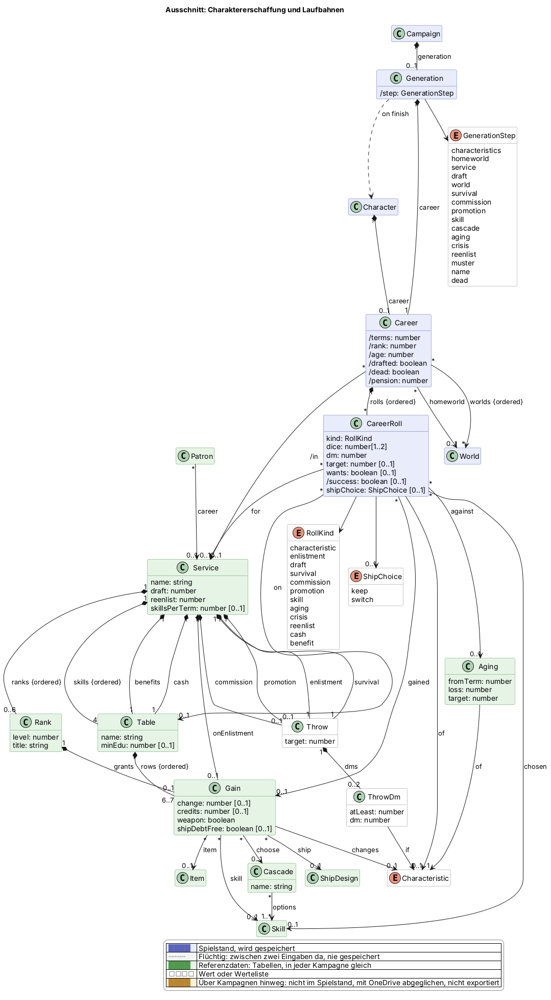

# Charaktererschaffung und Laufbahnen

Regeln des [Domänenmodells](../domain-model.md) für diesen Bereich: was das Bild nicht zeigt.
Das Diagramm führt; die Begriffe stehen im Domänenmodell unter *Begriffe*.

## Charaktererschaffung

Neben dem Anlegen von Hand lässt sich ein Charakter nach den Regeln von
Classic Traveller erschaffen (Starter Edition, *Charts and Tables* S. 2–3). Jeder Wert wird einzeln
gewürfelt, jede Entscheidung trifft der Spieler, außer er lässt die Erschaffung durchlaufen (siehe
*Durchlaufen*). Je Kampagne gibt es höchstens eine Erschaffung
(`generation`); sie wird gespeichert und übersteht einen Neustart. Wechselt man die Kampagne, bleibt
sie in ihrer Kampagne liegen.
- **Lebenslauf statt Zwischenstand.** Eine Erschaffung hält nur ihren Lebenslauf (`Career`): die
  Würfe der Reihe nach, jeder mit der Entscheidung, die zu ihm gehört. Alles andere folgt daraus:
  UPP, Fertigkeiten, Laufbahn (`/in`), Terms, Rang, Alter (18 + 4 je Term), ob eingezogen, ob tot,
  Pension, Geld, Gegenstände und welcher Schritt dran ist (`/step`). Würfe werden nur angehängt;
  nur die Wahl aus einer Kaskade kommt nach dem Wurf noch zu ihm hinzu (Schritt `cascade`).
- **Was ein Wurf festhält.** Jeder `CareerRoll` hält seine Art (`kind`), die Würfel (`dice`, einer
  oder zwei) und den DM fest, bei Würfen mit Zielwert auch den Zielwert (`target`); Erfolg
  (`/success`: Würfel + `dm` ≥ `target`) folgt allein daraus. Was er sonst braucht, je Art:

  | Art | Würfel | Verweist auf | Entscheidung |
  |---|---|---|---|
  | `characteristic` | 2 | das Attribut (`of`) | – |
  | `enlistment` | 2 | die gewählte Laufbahn (`for`) | welche Laufbahn, vor dem Wurf |
  | `draft` | 1 | die Laufbahn, in die man kommt (`for`) | – |
  | `survival`, `commission`, `promotion` | 2 | – | – |
  | `skill` | 1 | die Tabelle (`on`), die Zeile (`gained`), bei einer Kaskade die Fertigkeit (`chosen`) | welche Tabelle vor dem Wurf, welche Fertigkeit danach |
  | `aging`, `crisis` | 2 | das Attribut (`of`), beim Altern die Zeile der Aging Table (`against`) | – |
  | `reenlist` | 2 | – | ob man bleiben will (`wants`), vor dem Wurf |
  | `cash`, `benefit` | 1 | die Zeile (`gained`), bei einer Waffe die Fertigkeit (`chosen`) | Geld oder Sachwerte, vor dem Wurf; welche Waffe danach |

  Die Zeile wird festgehalten, nicht aus dem Würfel neu gesucht; so ändert eine spätere Korrektur
  der Tabellen keinen alten Lebenslauf.
- **Ablauf** (die Schritte in `GenerationStep`):
  1. *Attribute*: STR, DEX, END, INT, EDU, SOC, in dieser Reihenfolge je 2W6.
  1a. *Heimatwelt* (`homeworld`): eine fertige Welt des Subsektors, siehe *Heimatwelt und Welten
     der Terms*.
  2. *Laufbahn*: Man wählt eine Laufbahn. Hat sie eine `needs`-Qualifikation, ist die Musterung kein
     Wurf: wer das Attribut mindestens `atLeast` hat, kommt hinein, sonst gar nicht. Sonst würfelt
     man die Musterung (2W6 + DMs ≥ Zielwert). Scheitert sie, folgt bei einer Laufbahn mit `draft`
     die *Einberufung*: 1W6 bestimmt die Laufbahn; bei einer ohne `draft` (die zwölf neuen)
     **bewerbt man sich weiter**: zurück zur Laufbahnwahl, eine andere Laufbahn, eine neue Musterung.
     Wer eingezogen wurde, darf im ersten Term kein Offizierspatent versuchen. Das Alter zählt von
     18, bei einer Laufbahn mit `startAge` von diesem Wert. Was eine Laufbahn bei
     der Musterung mitgibt (Marines Cutlass-1, Army Rifle-1, Scouts Pilot-1), kommt sofort dazu.
     Nennt die Rangtafel der Laufbahn **Standesränge** (`Rank.standing`, 2026-11-24d), steht die
     Person von hier an auf dem Rang, den ihr Stand erreicht, und der Rangwurf betrifft sie nicht
     mehr. Der Adel ist die einzige Laufbahn mit Standesrängen.
  3. *Term*, jedes Mal in dieser Reihenfolge: zuerst die Welt des Terms (`world`), dann Überleben (`survival`); misslingt es, ist der
     Charakter tot und die Erschaffung zu Ende (`dead`) wie im Regelwerk. **Standesränge** zuerst
     (2026-11-24d): Nennt die Rangtafel einer Laufbahn Stände (`Rank.standing`), steht die Person
     seit der Musterung auf dem **höchsten Rang, dessen Stand ihr eigener erreicht** – der Adlige
     mit Stand 13 ist Marquis – und der Rangwurf entfällt für sie. Ohne Rang in einer Laufbahn ohne
     Standesränge gibt der *Rangwurf* (`commission`) die **unterste Rangstufe der Laufbahn**
     (`Rank.level`, 2026-11-24c: beim Barbar ist das Warrior auf Stufe 2); er heißt `commissionTitle`
     und sonst „Offizierspatent“. Mit Rang unter der höchsten Rangstufe der Laufbahn (Merchants und
     Nobles haben 5):
     Beförderung, einmal je Term, auch im Term des Patents; sie gibt die **nächste vorhandene Stufe** (beim Barbar von Warrior auf Chief). Bei einem Rang mit Standesrang gibt sie **+1 Stand**
     (2026-11-24d), der Lebenslauf führt ihn wie jeden Attributszuwachs; über 15 steigt der Stand
     nicht. Der Einstieg über den Stand gibt ihn dagegen nicht – dort ist der Stand die Grundlage.
     Gibt der *Rangwurf* einen Standesrang und liegt der Stand darunter, steigt er auf dessen Wert
     (2026-11-25a: der Adlige mit Stand 10 wird Knight mit Stand 11). Dann die Fertigkeiten: im ersten Term 2, danach 1, bei den Scouts immer 2
     (`skillsPerTerm`); +1 für Patent, +1 für Beförderung. Für jede wählt man eine Tabelle; die
     vierte (`minEdu` 8) nur mit EDU 8+, gemessen vor dem Wurf. Ein Rang bringt, was in ihm steht
     (`grants`, z. B. Navy Captain +1 SOC). Was bei der Musterung mitgeht (`onEnlistment`) und was
     ein Rang gibt, kann eine **Gruppe** sein (der Flyer: Air Craft-1, der Barbar als Warrior:
     Blade Combat-1): dann folgt sofort der Schritt `cascade` und fragt nach der genauen
     Fertigkeit, wie beim letzten Wurf einer Fertigkeit.
  4. *Altern* ab dem Ende des 4. Terms: je Attribut der Aging Table ein Wurf nach der Zeile mit dem
     größten `fromTerm`, der den Term nicht übersteigt (INT erst ab dem 12. Term);
     unter dem Zielwert sinkt das Attribut um `loss`. Fällt ein Attribut dadurch unter 1, folgt eine
     *Krise* (Schritt und Wurf `crisis`, 2W6, 8+): gelingt sie, steht das Attribut auf 1, sonst ist
     der Charakter tot. Die Krise stammt aus dem Vorbild, nicht aus den Charts.
  5. *Weiterverpflichtung*: Man sagt, ob man bleiben will (`wants`), dann wird immer gewürfelt. Ein
     NSC-Lauf sagt immer *will bleiben* (2026-11-24f), und ein Lauf **mit** Dienstalter würfelt
     diesen Schritt überhaupt nicht (siehe *Der Lauf eines NSC*). Eine
     12 heißt bleiben, egal was man wollte. Sonst bleibt, wer will und den Zielwert schafft; nach dem
     7. Term bleibt nur, wer eine 12 würfelt (aus dem Vorbild, 2026-11-24e). Eine Laufbahn ohne
     `retirement` (Barbar) gibt **keine Ruhestandsbezüge**, ihr Ende ist sonst das übliche
     (2026-11-24e; vorher blieb sie bis zum 7. Term und dann ganz). Eine ohne `freeExit` (Bürokrat)
     lässt **vor dem Ruhestand** (unter fünf Terms) nur weg, wenn die Weiterverpflichtung gelingt:
     wer bleiben will, bleibt, wer weg will, braucht den gelungenen Wurf; ab fünf Terms gilt für
     sie das Übliche (2026-11-25a).
     Wer bleibt, beginnt den nächsten Term (3.), alle anderen mustern ab.
  6. *Abmusterung*: so viele Würfe wie Terms, dazu +1 bei Rang 1–2, +2 bei Rang 3–4, +3 bei Rang
     5–6. Je Wurf wählt man Geld oder Sachwerte; Geld höchstens dreimal. DM +1 auf Geld mit
     Gambling, DM +1 auf Sachwerte ab Rang 5. Ein Gegenstand mit `once` (Travellers' Aid Society,
     Scout Ship) kommt nur einmal; ein zweites Mal bringt nichts. Eine Waffe (Blade, Gun) ist eine
     Kaskade mit `weapon`: Man wählt eine Fertigkeit daraus und bekommt den Gegenstand, der sie
     nutzt (`uses`), statt der Fertigkeit. Wählt man eine Waffe, die man schon aus der Abmusterung
     hat, steigt stattdessen die Fertigkeit darin um 1. Nach mindestens 5 Terms gibt es eine Pension (Cr 4000
     bei 5 Terms, je Term mehr Cr 2000); eine Laufbahn ohne `retirement` gibt keine (2026-11-24e).
  7. *Name*: Zum Schluss gibt man den Namen ein und schließt ab.
- **Zugewinne.** Eine Zeile (`Gain`) bringt genau eins: eine Fertigkeit +1 (`skill`), eine Wahl aus
  einer Kaskade (`choose`, mit `weapon` die Waffe statt der Fertigkeit), ein Attribut ± `change`
  (`changes`), einen Gegenstand (`item`) oder Geld (`credits`); eine leere Zeile (Scouts und Other, 7 auf der Sachwertetabelle) bringt nichts.
  Attribute bleiben zwischen 0 und 15. Eine Kaskade bietet Fertigkeiten an (`options`); die Wahl
  gehört zum Wurf (`chosen`). Vehicle bietet die einzelnen Fahrzeuge an, Aircraft und Watercraft
  sind darin schon aufgefächert.
- **Ein zweites Jack-of-all-Trades** bringt nichts, gibt aber einen weiteren Fertigkeitswurf: Der
  Wurf zählt nicht zu den Fertigkeiten des Terms, man wählt wieder eine Tabelle. So hat ein
  Charakter aus der Erschaffung JoT höchstens einmal. Lebensläufe von vor dieser Regel, in denen ein
  zweites JoT die Stufe erhöht hat, bleiben gültig: Passen ihre Würfe nur zur alten Regel, gilt für
  sie die alte.
- **Abschließen** legt einen Charakter an (`on finish`): Name, UPP und Fertigkeiten wie zuletzt,
  Credits aus dem Geld, Besitz aus den Gegenständen (gleiche zusammengezählt), Herkunft aus Laufbahn, Rang, Terms und
  Alter („Ex-Navy · Commander · 5 Terms · 38 Jahre“), die Pension in der Notiz. Der Lebenslauf zieht
  mit um (`Character.career`) und bleibt danach unverändert; den Charakter bearbeitet man wie jeden
  anderen. Von Hand angelegte Charaktere haben keinen Lebenslauf. Danach ist die Erschaffung zu.
- **Laufbahnen** sind die sechs aus dem Regelwerk (Navy, Marines, Army, Scouts, Merchants, Other)
  und die zwölf aus Supplement 4 *Citizens of the Imperium* (Pirate, Belter, Sailor, Diplomat,
  Doctor, Flyer, Barbarian, Bureaucrat, Rogue, Noble, Scientist, Hunter). Regeln, Würfe, Ränge,
  Tabellen und Sonderregeln je Laufbahn stehen in [`regeln-laufbahnen.md`](../regeln-laufbahnen.md).
  Alle sind Referenzdaten in `services.json`: eine weitere Laufbahn ist Daten, kein Code.
- **Würfe mit Gegenprobe und Termzähler**: eine `ThrowDm` mit `atMost` statt `atLeast` gilt, wenn
  das Attribut den Wert **nicht übersteigt** (Pirat Musterung +1 bei Stand 7−); beide Bedingungen
  derselben Laufbahn schließen einander aus. Eine `Throw` mit `dmPerTerm` zählt den
  **laufenden** Term (Belter Überleben +1 im ersten Term, +2 im zweiten, …, +7 im siebenten; B4 S. 6
  sagt das ausdrücklich, und der Überlebenwurf gilt dem Term, den die Person gerade dient – B1 S. 6
  „during the term“, Ablauf Schritt 3).
- **Der Rangwurf** (`commission`) heißt nach der Laufbahn (`commissionTitle`, 2026-11-24b): „Offizierspatent“
  ohne das Feld – bei Navy, Marines, Army und Merchants (deren Ränge Schiffsoffiziere sind) auch so
  gemeint –, „Gehobener Dienst“ beim Bürokraten; für Diplomat, Barbar und Adliger kommt je eigene
  Fassung, sobald sie gebaut werden.
- **Natürliche Waffenkunde** (`naturalGunSkill`): eine Laufbahn, die sie nicht hat (Barbar,
  Bürokrat, Arzt), gilt an Schusswaffen als völlig ungebildet und schießt mit DM −5 (B1 30).
- **Tabellen einer neuen Laufbahn** sind Daten: vier Fertigkeitstabellen (die vierte mit `minEdu` 8),
  Sachwerte und Geld, Ränge mit ihren Gaben, und was die Laufbahn bei der Musterung mitgibt
  (`onEnlistment`, bei den zwölf die Automatik-Fertigkeit: Pirate Brawling-1, Belter Vacc Suit-1,
  Doctor Medical-1, Diplomat Liaison-1, Flyer Air Craft-1, Barbarian Sword-1, Rogue Streetwise-1,
  Scientist Computer-1, Hunter Hunting-1).
- **Fertigkeiten aus den Tabellen**, die es vorher nicht gab, kommen in die Liste: Brawling,
  Forgery und die einzelnen Fahrzeuge der Kaskade Vehicle (Grav, Tracked und Wheeled Vehicle,
  Prop-driven und Jet-driven Fixed Wing, Helicopter, Large und Small Watercraft, Hovercraft,
  Submersible). Vehicle bleibt in der Liste für Charaktere von Hand; die Tabellen geben es nie.
- **Durchlaufen.** Statt Schritt für Schritt lässt sich die Erschaffung auch durchlaufen lassen:
  Die App würfelt jeden Schritt und trifft jede Entscheidung selbst, zufällig, bis zum Namen oder
  zum Tod. Gespeichert wird genau dasselbe wie beim Schritt für Schritt, Wurf für Wurf mit seiner
  Entscheidung. Die Entscheidungen: als Heimatwelt eine zufällige fertige Welt des Subsektors (gibt
  es keine, hält der Lauf dort an), als Welt eines Terms die vorige („wie zuletzt“), die Laufbahn
  zufällig, gewichtet nach der Chance der Musterung, Fertigkeitstabelle und Wahl aus einer Kaskade
  zufällig unter dem, was geht, bleiben wollen und Geld oder Sachwerte je zur Hälfte (Geld nur,
  solange es geht). Den Namen gibt immer der Spieler ein. Eine Weltenerschaffung lässt sich ebenso
  durchlaufen lassen, bis zum Namen; im Subsektor gehört das Vorkommen dazu.
- **Verwerfen** geht jederzeit und löscht die Erschaffung ohne Spur. Ein Toter lässt sich nur
  verwerfen, nicht übernehmen.
- Die Erschaffung steht nicht im Log; ihr Lebenslauf ist ihr Verlauf.
- Die Kampagnendatei enthält die offene Erschaffung und die Lebensläufe; beim Import wird jeder
  Lebenslauf von vorn nachgespielt und gegen diese Regeln geprüft.

## Heimatwelt und Welten der Terms

Ein Charakter kann eine Heimatwelt haben (`homeworld`): eine
fertige Welt des Subsektors seiner Kampagne. In der Charaktererschaffung kommt sie nach den
Attributen und vor der Laufbahn, und jeder Term findet auf einer Welt statt (`Career.worlds`, je
Term eine, in der Reihenfolge der Terms; dieselbe Welt darf mehrmals vorkommen). Beides ist eine
Entscheidung, kein Wurf: Man wählt eine fertige Welt, oder man erschafft sie gleich: Man wählt ein
nicht erzeugtes Feld, die Weltenerschaffung läuft dort wie im Subsektor, mit dem Vorkommen (bleibt
das Feld leer, wählt man ein anderes), und ist die Welt fertig (mit Namen), ist sie gewählt.
Solange sie entsteht, wartet die Charaktererschaffung im selben Schritt. Für einen Term gibt es
dazu „wie zuletzt“: die Welt des vorigen Terms, im ersten Term die Heimatwelt. Die Wahl hat in Version 1 keine Folgen für die Würfe. Abschließen übernimmt die
Heimatwelt an den Charakter; die Welten der Terms bleiben im Lebenslauf. Von Hand angelegte
Charaktere wählen ihre Heimatwelt im Editor, oder keine. Verwiesen wird auf ein Hexfeld über seine
Spalte und Zeile (0304). Weil der Lebenslauf und der Charakter auf
Welten verweisen, gilt wie beim Log: Eine Welt, auf die verwiesen wird, wird nie gelöscht (fertige
Welten lassen sich ohnehin nicht löschen). Lebensläufe von vor dieser Regel, ohne Heimatwelt und
ohne Welten, bleiben gültig. Während der Erschaffung lassen sich Orakel und Inspirationskarte
befragen; ihre Antworten stehen wie sonst im Log.
