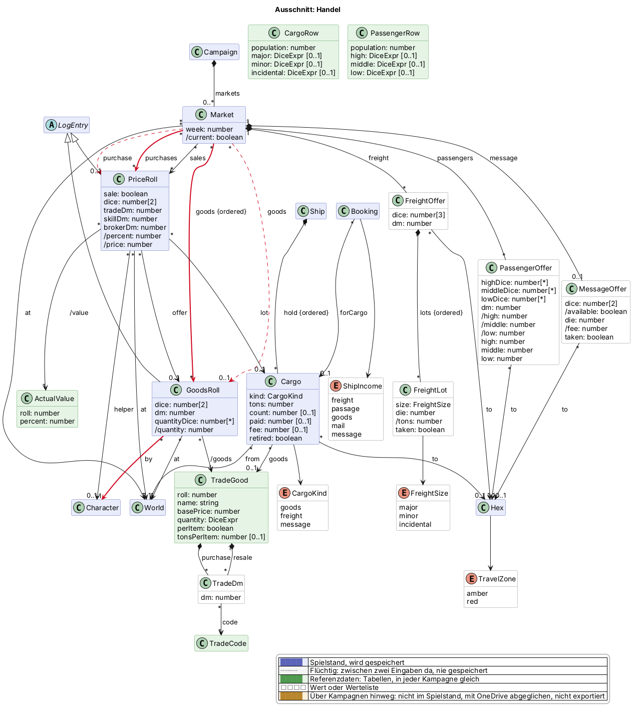

# Handel

Regeln des [Domänenmodells](../domain-model.md) für diesen Bereich: was das Bild nicht zeigt.
Das Diagramm führt; die Begriffe stehen im Domänenmodell unter *Begriffe*. Die Regeln aus den
Büchern mit allen Tabellen und die Entscheidungen zur Auslegung (E1–E11) stehen in
[`regeln-handel.md`](../regeln-handel.md).

## Handel, Schritt 1

*freigegeben am 27. November 2026, Kennzeichen 2026-11-27.* Zweiter Schritt der Schiffe (nach Basis
und Raumkampf, siehe [Schiffe](schiffe.md)). Er bringt **spekulativen Handel**, **Fracht**,
**zahlende Passagiere** und **Post** mit dem eigenen Schiff, dazu die **Reisezonen**. Gehandelt wird nur mit
dem aktiven Schiff (`Campaign./ship`), nur an einer Welt mit Raumhafen A bis E, nur wenn die Gruppe
beim Schiff ist (wie beim Abflug, siehe [Landeplatz](reise.md#reise)) und nicht unterwegs.
**Nicht in diesem Schritt:** Charter, Shuttle-Gebühren, Blinde
Passagiere und Entführung, Bumping der Middle Passage, subventionierte Schiffe (50 % der
Einnahmen an die Regierung), Verlust von Ladung im Raumkampf über die Tonnen hinaus.

### Referenzdaten

- **Waren** (`TradeGood`, SE 22): die 36 Zeilen der Trade and Speculation Table mit Wurf (11–66),
  Name, Grundpreis, Menge als Würfelausdruck und den Purchase und Resale DMs je Handelscode
  (`TradeDm`, Verweis auf `TradeCode`: Ag, Na, In, Ni, Ri, Po). Stückwaren 51–56 haben `perItem`
  und `tonsPerItem` (E7: Aircraft 5, Air/raft 4, ATV 10, Computers, Armored Vehicles und Farm
  Machinery ✱ je 1); 66 Vacc Suits zählt in Tonnen (E6).
- **Actual Value Table** (`ActualValue`, SE 22): Wurf 2–15 → Prozent; unter 2 zählt 2, über 15
  zählt 15.
- **Cargo-** und **Passagiertabelle** (`CargoRow`, `PassengerRow`, SE 9): je Bevölkerungsziffer
  0–10 die Würfelausdrücke; fehlt einer, gibt es diese Art an der Welt nicht.
- **Würfelausdruck** (`DiceExpr`) bekommt zwei Felder: `less` (so viele W6 werden abgezogen, für
  „3D−1D“) und `times` (Faktor, für „3D×5“).

### Reisezonen

`Hex.travelZone`: Amber oder Red, fehlt es, ist das System grün. Die Zone **setzt der Spieler von
Hand** an der Welt (Bearbeiten), wie die Spielleitung in Classic Traveller; die Weltenerschaffung
würfelt keine. Die Karte zeigt sie wie üblich (Kreis um das Hex, gelb bzw. rot). In diesem Schritt
wirkt sie nur auf Fracht und Passagiere.

### Markt

Ein **Markt** (`Market`) ist das, was eine Welt in einer Woche zu bieten hat: Ware, Fracht- und
Passagierangebote. `week` ist der erste Tag der Woche (Sonntag bzw. Tag 1), `/current`, solange
die Spielzeit in dieser Woche liegt. Je Welt gibt es höchstens einen laufenden Markt; er entsteht,
wenn die Gruppe dort zum ersten Mal in dieser Woche handelt. **Am Ende der Woche verfällt er** und
wird gelöscht (er ist kein Verlauf: Was gewürfelt wurde, steht in den Logeinträgen, auf die er
verweist). So gilt E3: Was in dieser Woche gewürfelt ist, bleibt bis zum Wochenende; danach wird
neu gewürfelt.

### Spekulation: Ware kaufen

1. **Warenwurf** (`GoodsRoll`, Logeintrag): zwei W6 nacheinander (`dice`), DM auf den ersten
   (`dm`: +1 bei Bevölkerung 9+, −1 bei 5−, gespeichert), der erste begrenzt auf 1–6; `/goods`
   folgt aus der Tabelle. Dazu die Würfel der Menge (`quantityDice`), `/quantity` mit `times`.
   **Wie viele Warenwürfe** (Hausregel ✱, Owner, 27. November 2026, Kennzeichen 2026-11-27b; RAW
   ist einer je Woche): Jeder lebende, nicht ausgeblendete Charakter der Gruppe darf je Markt
   **1 + Stufe in Admin oder Streetwise** würfeln (die höhere der beiden; Admin-2 heißt drei
   Würfe, ohne beide Fertigkeiten einer). Der Warenwurf weiß, wer gewürfelt hat (`by`); ein Markt
   hat so viele Warenwürfe, wie gewürfelt wurden (`Market.goods`). Jeder ist eine eigene Partie mit
   eigener Menge und eigenem Kaufpreis, auch wenn zweimal dieselbe Ware fällt.
2. **Kaufpreis** (`PriceRoll`, `sale` = false, Verweis `offer` auf den Warenwurf): 2W6 und die DMs,
   die damals galten, gespeichert: `tradeDm` (Summe der Purchase DMs der Handelscodes der Welt),
   `skillDm` (**minus** Admin oder Bribery des gewählten Charakters `helper`, die höhere der beiden
   Stufen; E1), `brokerDm` = 0 (Makler helfen nur beim Verkauf). `/percent` aus der Actual Value
   Table, `/price` = Prozent × Grundpreis je Tonne bzw. Stück. Einmal je Warenwurf
   (`Market.purchases`, je Warenwurf höchstens ein Kaufpreis).
3. **Kaufen** (E3, E5): ganz, teilweise oder gar nicht. Ein Kauf bucht `ship` mit `shipCost` goods
   (Preis × Menge) und, bei einem Teilkauf, eine zweite Buchung `handling` (1 % davon); er legt
   eine **Ladung** an oder vergrößert die gleiche Ware vom selben Markt. Gekauft werden kann
   höchstens die Menge des Warenwurfs, abzüglich dessen, was davon schon gekauft wurde, und nur so viel, wie
   Laderaum frei ist und die Kasse hergibt. Verzichten kostet nichts.

### Spekulation: Ware verkaufen

1. **Verkaufspreis** (`PriceRoll`, `sale` = true, Verweis `lot` auf die Ladung): 2W6 mit `tradeDm`
   (Resale DMs der Handelscodes der Welt), `skillDm` (**plus** Admin oder Bribery von `helper`),
   `brokerDm` (0–4, gewählter Makler). Makler und Charakter dürfen zusammen helfen (E2). Je Ladung
   und Markt einmal (`Market.sales`); nicht an der Welt, an der die Ware gekauft wurde, in derselben
   Woche (Owner, 27. November 2026: sonst wäre Kaufen und sofort Verkaufen ein Würfelspiel ohne
   Reise).
2. **Makler** (E4): Hat ein Makler geholfen, wird seine Provision (5 % je +1 vom gewürfelten Erlös)
   **gleich mit dem Wurf** gebucht (`ship`, `shipCost` broker), ob verkauft wird oder nicht.
3. **Verkaufen**: ganz oder teilweise; Buchung `ship` mit `shipIncome` goods und `forCargo`.
   Bleibt nichts übrig, wird die Ladung ausgeblendet (`retired`), denn der Verlauf verweist auf sie.
   Der Verkaufspreis bezieht sich auf den Grundpreis, nicht auf den Einkaufspreis (`paid` steht an
   der Ladung, damit die Ansicht den Gewinn zeigen kann).

### Ladung

`Ship.hold` sind die Ladungen im Laderaum (`Cargo`): Art (`goods` eigene Ware, `freight` fremde
Fracht, `message` private Botschaft mit 0 t und Honorar `fee`), Tonnen, bei Stückwaren die
Stückzahl (`count`, Tonnen = Stück × `tonsPerItem`), bei Ware der bezahlte Preis (`paid`), woher
(`from`), bei Fracht das Ziel (`to`). `Ship./cargo` ist jetzt die **Summe der Tonnen** aller nicht
ausgeblendeten Ladungen (und 5 t bei einem Postvertrag); das bisher frei einzugebende Feld `cargo`
entfällt. Freier Laderaum ist Entwurf minus Beiboote im Laderaum minus `/cargo`.
- **Über Bord geben**: Jede Ladung lässt sich ausblenden (`retired`), ohne Geld; Fracht mit Ziel
  ist dann verloren, bezahlt war sie schon.
- **Alte Stände** (Owner, 27. November 2026): Ein frei eingetragener Wert `cargo` über 0 wird beim
  Laden zu einer Ladung `freight` **ohne Ziel** (`to` fehlt) und ohne Geld, mit diesen Tonnen, von
  der Welt, an der das Schiff steht (ohne Ort: die Heimatwelt der Gruppe bzw. die erste Welt; ⚑
  `from` ist Pflicht). Sie bringt nie Geld und bleibt, bis sie über Bord geht.

### Fracht

1. **Angebot** (`FreightOffer`, je Ziel und Markt): Das Ziel ist jedes System mit Welt in
   Sprungweite des Schiffs (`ShipDesign.jump`), das der Spieler ansieht; die App würfelt erst
   dann, nicht für alle auf einmal (das Ergebnis ist dasselbe). Gespeichert: die drei Würfel der
   Zahlen (`dice`, Haupt-, Neben-, Gelegenheitsladungen) und der DM der Zielwelt (`dm`:
   Bevölkerung 4− −4, 8+ +1, TL Ursprung − TL Ziel). Red Zone: kein Angebot; Amber Zone: keine
   Hauptladungen. Je Ladung ein Größenwürfel (`FreightLot.die`), `/tons` = Würfel × 10, 5 bzw. 1.
2. **Annehmen**: einzelne Ladungen, nicht teilbar (`taken`); jede wird eine Ladung `freight` mit
   Ziel. Mit der ersten angenommenen Fracht ist das Ziel **angekündigt** (`Ship.destination`);
   danach gibt es Fracht und Passagiere nur noch für dieses Ziel, bis es aufgehoben wird (geht nur,
   solange nichts für das Ziel an Bord ist).
3. **Bezahlt** wird bei der **Abreise** (SE 9: „Collect income for all aspects of current trip“):
   Cr1.000 je Tonne Fracht für das Ziel der Reise, Buchung `ship` mit `shipIncome` freight und
   `forCargo`. **Geliefert** ist sie bei der Ankunft am Ziel: Die Ladung wird ausgeblendet.
   **Falsches Ziel** (Owner, 27. November 2026): Fliegt das Schiff anderswohin als angekündigt,
   gibt es kein Geld; die Fracht bleibt an Bord, bis sie ans Ziel kommt, und wird dort ohne weitere
   Zahlung geliefert. Der Sprung ist nicht gesperrt.

### Passagiere

1. **Angebot** (`PassengerOffer`, je Ziel und Markt, nur für das angekündigte Ziel – Passagiere
   melden sich erst, wenn Fracht für das Ziel angenommen ist): die Würfel je Klasse (`highDice`,
   `middleDice`, `lowDice`, abgezogene Würfel mitgezählt) und der DM der Zielwelt (`dm`:
   Bevölkerung 4− −3, 8+ +3, Amber −6, Red −12 und keine Middle und Low, TL Ursprung − TL Ziel),
   auf jede Klasse (E9). `/high`, `/middle`, `/low` sind die Reisewilligen, nicht unter 0.
2. **Annehmen**: wie viele je Klasse mitfliegen (`high`, `middle`, `low`), höchstens so viele wie
   Reisewillige, High und Middle zusammen höchstens die Kabinen, die die Gruppe nicht braucht, Low
   höchstens die Niedrigbetten.
3. **Abreise**: Die Zahlen gehen an die Reise (`Journey.high`, `Journey.middle`; die
   Low-Passagiere als Kojen ohne Charakter in `berths`, mit Aufwachwurf 5+, DM +1, wenn ein
   Medic mit Medic-2 oder besser auf Posten steht, SR 28). Bezahlt wird beim Abflug: Cr10.000, 8.000, 1.000 je Kopf, eine Buchung je
   Klasse (`shipIncome` passage). Lebenserhaltung: Cr2.000 je High- und Middle-Passagier und Cr100
   je Low-Passagier, wie für die Gruppe (`shipCost` lifeSupport).
4. **Low Lottery** an Bord des eigenen Schiffs: Der Kapitän (die Gruppe) zahlt Cr10 je
   Low-Passagier in den Topf; die NSC tippen wie bisher zufällig; Gewinner nach der Regel in
   [Low Lottery](reise.md#low-lottery): der nächstliegende Tipp, bei Gleichstand das Los; ist der
   Gewinner tot, behält der Kapitän den Topf (Owner, 27. November 2026: eine Regel für alle
   Schiffe, E10). Gebucht wird nur, was wirklich abfließt: Gewinnt ein NSC, zahlt der Kapitän bei
   der Ankunft den Topf aus (Buchung `ship` mit `shipCost` lottery); behält er ihn, wird nichts
   gebucht. Reist ein SC in einer der Kojen mit, gewinnt er wie bisher (`lottery` an die Kasse).
5. **Ankunft**: Die Passagiere steigen aus; Low-Passagiere, die nicht aufwachen, sind tot (keine
   Erstattung). Steward- und Medic-Pflicht prüft die App in diesem Schritt nicht.

### Post

- **Postvertrag** (`Ship.mailContract`, E12 ✱): Jedes Schiff darf einen schließen, nicht nur
  subventionierte (die App bildet Subventionen nicht ab). Abschließen und kündigen geht an jeder
  Welt mit Raumhafen A bis E. Solange er gilt, sind **5 t Laderaum** fest für die Post reserviert
  (sie zählen zu `Ship./cargo`, ohne eigene Ladung); abschließen geht nur mit 5 t frei.
- **Bezahlt** wird je Sprung mit dem eigenen Schiff beim Abflug, **Cr25.000**, unabhängig von der
  Postmenge und vom Ziel (`Journey.mail`, Buchung `shipIncome` mail) – aber nur, wenn das Schiff
  beim Abflug **bewaffnet** ist (mindestens eine Turret mit Waffe) und ein **Gunner auf Posten**
  steht (`CrewPost` gunner). Fehlt eins, fliegt die Post ohne Geld mit, und der Log sagt warum.
- **Private Botschaft** (`MessageOffer`, je Markt eine, E13): Beim ersten Blick auf den Markt
  würfelt die App 2W6 (`dice`), `/available` bei **9+**. Dann auch das Ziel (`to`: ein
  zufälliges System mit Welt in Sprungweite) und das Honorar (`die`, `/fee` = Würfel × Cr20, E11).
  Angenommen (`taken`) wird sie eine Ladung `message` mit Ziel und Honorar; bezahlt wird erst bei
  der **Ankunft am Ziel** (Buchung `shipIncome` message), dann ist sie geliefert. Dass der Bote
  beim Empfänger als verlässlich gilt, steht als Text im Log; einen Patron legt die App nicht an.

### Buchungen

- `Booking.shipIncome` sagt, wofür eine Einnahme des Schiffs ist (freight, passage, goods, mail,
  message);
  `ShipCost` bekommt goods (Wareneinkauf), handling (Teilkaufgebühr), broker (Makler) und
  lottery (ausgezahlter Topf der Low Lottery).
- **Monatsabrechnung**: Wareneinkauf (goods) zählt wie der Kaufpreis des Schiffs **nicht** zu den laufenden
  Kosten und steht nicht in `MonthEnd.costs`; handling und broker schon. Einnahmen stehen nicht in
  der Monatsabrechnung.
