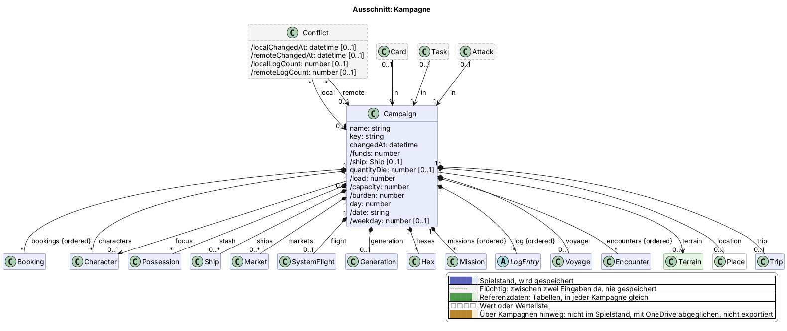

# Kampagne

Regeln des [Domänenmodells](../domain-model.md) für diesen Bereich: was das Bild nicht zeigt.
Das Diagramm führt; die Begriffe stehen im Domänenmodell unter *Begriffe*.

## Mehrere Kampagnen

Die Kampagne ist die oberste Ebene: Alles, was gespeichert wird, hängt an
genau einer Kampagne, und Kampagnen wissen nichts voneinander. Es gibt immer mindestens eine;
die letzte lässt sich nicht löschen. Jede hat einen Namen, der nicht leer ist und sich ändern
lässt; zwei Kampagnen dürfen gleich heißen. Gespielt wird immer in genau einer, der **offenen
Kampagne**. Welche das ist, merkt sich das Gerät über einen Neustart hinweg; zum Spielstand gehört
das nicht. Wechselt man die Kampagne, sind offene Karte, Probe und Angriff in Vorbereitung weg. Eine neue
Kampagne beginnt leer: ohne Charaktere (also ohne Charakter oben), ohne Log, ohne Hexfelder. Eine Kampagne löschen
löscht alles, was an ihr hängt, endgültig.

## Kampagnendatei

Eine Kampagne lässt sich als Datei exportieren und wieder importieren. Die
Datei enthält alles, was an der Kampagne hängt (Name, Charakter oben, Charaktere mit ausgeblendeten, Log,
Hexfelder), aber keine Entwürfe und keine Referenzdaten: Verweise bleiben Ids. Beim Import wird die Datei
gegen die Regeln dieses Modells geprüft, auch jeder Verweis in die Referenzdaten und auf die
eigenen Charaktere; ist etwas falsch, wird nichts importiert. Ein Import legt immer eine neue
Kampagne an, auch wenn es dieselbe schon gibt, und überschreibt nie eine bestehende.

## Abgleich mit OneDrive

*2026-11-13c.* Wer sich in der Kampagnenwahl bei
Microsoft anmeldet, hat seine Kampagnen auf jedem Gerät, auf dem er das auch tut. Ohne Anmeldung
bleibt alles wie bisher: nur auf dem Gerät.
- *Wo.* Im App-Ordner des OneDrive (`Apps/Solo RPG Engine`), je Kampagne eine Kampagnendatei, die
  nach dem Schlüssel heißt (`<key>.json`). Die App darf nur diesen Ordner lesen und schreiben.
  Die Datei dort enthält zusätzlich Schlüssel und Änderungszeit.
- *Schlüssel.* Jede Kampagne bekommt beim Anlegen einen zufälligen, weltweit eindeutigen
  `key`. Die Id einer Kampagne (`k1`, `k2`, …) gilt nur auf dem Gerät und taugt dafür nicht: Zwei
  Geräte haben beide eine `k1`. Ein Import legt weiter eine neue Kampagne an, mit neuem Schlüssel.
  Kampagnen von vor dieser Regel bekommen beim Laden einen Schlüssel; die Demo-Kampagne zweier
  Geräte sind danach zwei Kampagnen.
- *Änderungszeit.* Jede Änderung am gespeicherten Stand der Kampagne setzt `changedAt` auf jetzt
  (auch Umbenennen und der Charakter oben; Entwürfe und was sich nur das Gerät merkt nicht).
  Kampagnen von vor dieser Regel bekommen die Zeit ihres letzten Logeintrags, ohne Log die des
  Ladens. Die Änderungszeit entscheidet nie, welcher Stand gewinnt (Uhren gehen verschieden); sie
  sagt nur, ob sich hier etwas geändert hat, und der Spieler liest sie im Konflikt.
- *Abgleichsmarke.* Je Kampagne merkt sich das Gerät, mit welcher Änderungszeit und welcher
  Fassung der Datei in OneDrive es zuletzt gleich war, und ob die Kampagne seither hier gelöscht
  wurde. Zum Spielstand gehört das nicht, wie die offene Kampagne; es steht nicht im Bild. *Hier
  geändert* heißt: Die Änderungszeit ist eine andere als in der Marke. *Dort geändert* heißt:
  OneDrive hat eine andere Fassung als in der Marke.
- *Wann.* Beim Start der App, wenn sie wieder in den Vordergrund kommt, und kurz nach jeder
  Änderung. Ohne Netz spielt man weiter; der nächste Abgleich holt nach.
- *Was der Abgleich je Kampagne tut:*

  | Hier | In OneDrive | Folge |
  |---|---|---|
  | neu, ohne Marke | fehlt | hochladen |
  | fehlt, ohne Marke | neu | herunterladen |
  | geändert | unverändert | hochladen |
  | unverändert | geändert | herunterladen; der Stand hier wird ersetzt |
  | gelöscht | unverändert | in OneDrive löschen |
  | unverändert | gelöscht | hier löschen |
  | geändert oder gelöscht | geändert oder gelöscht, und nicht beide gelöscht | **Konflikt** |

  Wird die offene Kampagne ersetzt, sind offene Karte, Probe und Angriff in Vorbereitung weg, wie
  beim Wechseln. Wird sie gelöscht, öffnet sich die erste nach Namen. Die letzte Kampagne des
  Geräts wird nie gelöscht; sie bleibt und wird wieder hochgeladen.
- *Konflikt.* Der Abgleich ändert an dieser Kampagne nichts und fragt. Der `Conflict` hält beide
  Stände (`local`, `remote`; einer fehlt, wenn die Kampagne auf der Seite gelöscht ist) und zeigt
  je Stand Änderungszeit und Zahl der Logeinträge. Der Spieler wählt **„Dieses Gerät“** (der
  Stand hier gilt und wird hochgeladen) oder **„OneDrive“** (der Stand dort gilt und ersetzt den
  hier). Sind beide Stände da, gibt es als Drittes **„Beide behalten“**: Der Stand aus OneDrive
  kommt unter dem bisherigen Schlüssel herunter, und der Stand hier wird eine eigene Kampagne
  mit neuem Schlüssel und dem Namen „<Name> (Kopie)“, die hochgeladen wird. So sehen andere
  Geräte, die mit OneDrive gleich waren, keine Änderung an ihrer Kampagne, nur eine neue daneben.
  War die Kampagne offen, bleibt der Stand von hier offen, also die Kopie. Solange er nicht wählt, spielt er hier weiter, und die Kampagne wird nicht abgeglichen.
  Der Konflikt ist flüchtig: Nach einem Neustart findet ihn der Abgleich wieder.
- *Abmelden* lässt die Kampagnen auf dem Gerät und in OneDrive, wie sie sind, und löscht die
  Abgleichsmarken. Ebenso bei den Deckplänen.
- *Deckpläne* (freigegeben am 17. November 2026, Kennzeichen 2026-11-17).
  Der Abgleich bringt auch die Deckpläne (siehe [Schiffe](schiffe.md#schiffe), *Deckpläne*) auf denselben Stand, im
  selben Lauf wie die Kampagnen.
  - *Wo.* Im Unterordner `Deckplaene` des App-Ordners, je Plan eine Datei, die nach Entwurf und
    Platz heißt (`S-Deck A.json`), mit Schlüssel, Entwurf, Platz und Bild. Der Unterordner hält
    sie von den Kampagnendateien getrennt; eine ältere Fassung der App sieht ihn nicht.
  - *Schlüssel.* Jeder Plan bekommt beim Ablegen einen zufälligen, weltweit eindeutigen `key`.
    Ein Plan ändert sich nie: Wer ein anderes Bild auf den Platz will, löscht den Plan und legt
    ein neues ab, mit neuem Schlüssel. Pläne von vor dieser Regel bekommen beim Laden einen.
  - *Abgleichsmarke.* Je Platz merkt sich das Gerät, mit welchem Schlüssel und welcher Fassung
    der Datei es zuletzt gleich war. *Hier geändert* heißt: Auf dem Platz liegt ein anderer
    Schlüssel als in der Marke, oder keiner mehr. *Dort geändert* heißt: OneDrive hat eine andere
    Fassung als in der Marke, oder keine Datei mehr.
  - *Was der Abgleich je Platz tut:*

    | Hier | In OneDrive | Folge |
    |---|---|---|
    | belegt, ohne Marke | fehlt | hochladen |
    | fehlt, ohne Marke | belegt | herunterladen |
    | geändert | unverändert | hochladen, oder dort löschen, wenn der Platz hier leer ist |
    | unverändert | geändert | herunterladen, oder hier löschen, wenn die Datei dort fehlt |
    | leer | leer | die Marke vergessen |
    | auf einer Seite gelöscht | auf der anderen ein neues Bild | das neue Bild bleibt und kommt auf beide Seiten |
    | ein Bild | ein anderes Bild (auch ohne Marke) | **beide behalten** |
    | dasselbe Bild (gleicher Schlüssel) | | nur die Marke setzen |

  - *Beide behalten.* Einen Konflikt, bei dem der Spieler wählt, gibt es bei Deckplänen nicht:
    Bilder lassen sich nicht zusammenführen, und keins soll verloren gehen. Der Plan aus OneDrive
    bekommt den Platz; der von hier rückt auf den nächsten freien Platz seines Entwurfs und wird
    hochgeladen. Ist keiner der drei frei, geht es mit Deck D, Deck E … weiter: Mehr als drei
    Pläne je Entwurf entstehen so nur über den Abgleich. Der Bereich Schiff zeigt dann alle; ein neues
    Bild lässt sich erst wieder ablegen, wenn weniger als drei da sind.
  - *Wann.* Wie bei den Kampagnen: beim Start, wenn die App wieder in den Vordergrund kommt, und
    kurz nach jedem Ablegen oder Löschen eines Plans. Ohne Netz bleibt alles auf dem Gerät; der
    nächste Abgleich holt nach.

## Kampagnendatei, ältere Fassungen

- *Dateien und Spielstände von vor 2026-11-08c* (NSC der Begegnung als Charaktere) werden beim
  Laden umgeschrieben: Jeder NSC wird ein Charakter der Begegnung mit derselben Id, wie unter
  *Begegnung* beschrieben (Fertigkeit als Stufe, Waffe und Rüstung im Besitz, eine Schusswaffe
  voll geladen mit zwei Magazinen, fest, damit das Laden nicht würfelt), der Anführer zum
  Verweis `leader`. Ein schon übernommener NSC (`became`) fällt aus der Begegnung, und alle
  Verweise des Logs auf ihn zeigen auf den Charakter, der er wurde; dieser hat damit die Wunden
  aus dem Kampf, wie es jetzt beim Übernehmen ist. Im Angriffsergebnis wird `by` zu `for` und
  `victim` zu `against`, in der Heilung `npc` zu `for`.
