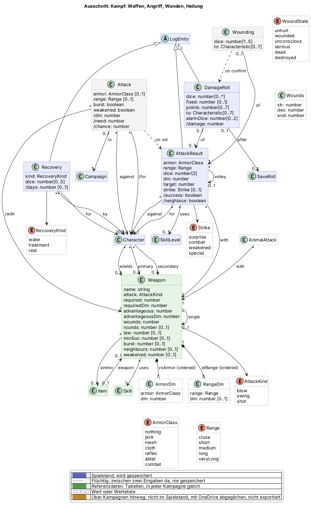

# Kampf: Waffen, Angriff, Wunden, Heilung

Regeln des [Domänenmodells](../domain-model.md) für diesen Bereich: was das Bild nicht zeigt.
Das Diagramm führt; die Begriffe stehen im Domänenmodell unter *Begriffe*.

## Waffen

Die Kampfwerte der Waffen sind Referenzdaten (`Weapon`), aus den Charts der Starter
Edition: *Weapons and Equipment* (S. 4) und *Weapons and Range Matrix* (S. 6).
- Je Waffe: die Art des Angriffs (`attack`), das nötige und das vorteilhafte Attribut mit ihren
  DMs (`required`, `requiredDm`, `advantageous`, `advantageousDm`), der Schaden in W6 (`wounds`),
  je Rüstungsklasse ein DM (`vsArmor`, sieben, in der Reihenfolge der Matrix) und je Reichweite
  ein DM (`atRange`, fünf). Steht in der Matrix „no“, hat die Reichweite keinen DM: Auf diese
  Reichweite geht mit der Waffe kein Angriff (Body Pistol auf Long, alle Klingen ab Medium).
- Bei Schlägen und Hieben (Hände, Klingen) zählt STR, bei Schüssen DEX.
- Jeder Gegenstand der Art *weapon* hat genau eine Waffe (`Item.weapon`), und jede Waffe gehört
  zu höchstens einem Gegenstand. Dazu kommen die **Hände** (*Hands*), die zu keinem Gegenstand
  gehören und die jeder hat.
- Jede Waffe nutzt genau eine Fertigkeit (`uses`): Klingen und Schusswaffen ihre eigene aus Blade
  bzw. Gun Combat, Hände und Club Brawling. Die Fertigkeit eines Gegenstands folgt aus seiner
  Waffe (`Item./uses`); die Abmusterung findet darüber weiter den Gegenstand zu einer Waffe aus
  Blade oder Gun Combat.
- Tierwaffen (Claws, Teeth, Horns, …), Zubehör (Sights, Stocks, Silencer), Länge und Munition
  kommen später.

## Rüstungsklasse und Reichweite

Die sieben Rüstungsklassen (`ArmorClass`) sind die Spalten der
Matrix: Nothing, Jack, Mesh, Cloth, Reflec, Ablat, Combat. Vacc Suit zählt als Cloth, Battle
Dress als Combat (S. 4). Die fünf Reichweiten (`Range`) sind Close (Berührung), Short (1–5 m),
Medium (6–50 m), Long (51–250 m) und Very Long (251–500 m), nach S. 7.

## Primär- und Sekundärwaffe

Im Editor legt man für jeden Charakter höchstens eine
Primärwaffe (`primary`) und höchstens eine Sekundärwaffe (`secondary`) fest. Infrage kommt nur die
Waffe eines Gegenstands aus seinem Besitz; die beiden sind verschieden, und die Hände sind keine
davon, weil man sie immer hat. Ändern lassen sie sich nur im Editor. Entfernt man den Gegenstand
aus dem Besitz (im Editor oder durch Verkauf), entfällt er als Primär- bzw. Sekundärwaffe.
Ältere Spielstände bekommen die Waffe in der Hand als Primärwaffe.

## Waffe in der Hand

Jeder Charakter führt gerade höchstens eine Waffe (`wields`); keine heißt:
Hände. Infrage kommen nur seine Primär- und seine Sekundärwaffe. Sie wird gespeichert,
übersteht also einen Neustart und steht in der Kampagnendatei. Gewechselt wird zwischen
Primärwaffe, Sekundärwaffe und Händen. Ist die Waffe in der Hand nach einer Änderung im Editor
oder einem Verkauf keine der beiden mehr, nimmt der Charakter seine Primärwaffe in die Hand; hat
er keine, die Hände.

## Beide Hände

*2026-11-26.* Eine zweihändige Waffe (`Weapon.twoHanded`) braucht beide Hände:
Wer sie als Primärwaffe hat, greift in der Kampfsimulation nur mit ihr an, Sekundärwaffe und Hände
bietet die App ihm dort nicht an – außer die zweihändige Waffe ist leer und kein Magazin mehr da,
dann wieder (Owner). Eine Sekundärwaffe darf er trotzdem haben (etwa die Blade am
Gürtel); in der Waffentabelle nimmt er sie wie bisher in die Hand.

## Angriff

Es gilt: 2W6 + DM ≥ 8 (*Basic Throw to Hit*, S. 6), mit
DM = Fertigkeit + Rüstung + Reichweite + Attribut.
- *Fertigkeit*: die Stufe in der Fertigkeit der Waffe. Ohne diese Fertigkeit zählt Stufe 0, also
  ±0: In allen Waffen hat jede Figur Stufe 0 (siehe README). „Ohne Fertigkeit“ mit −3 gibt es
  hier nicht, und Jack-of-all-Trades ändert nichts.
- *Rüstung*: der DM der Waffe gegen die Rüstungsklasse des Ziels, z. B. Rifle gegen Jack +3,
  gegen Reflec +2, gegen Combat −5.
- *Reichweite*: der DM der Waffe auf diese Reichweite. Ohne DM („no“) gibt es den Angriff nicht.
- *Attribut*: STR bzw. DEX des Angreifers unter dem nötigen Wert gibt `requiredDm`, ab dem
  vorteilhaften Wert `advantageousDm`, dazwischen ±0. Das ist nicht die Hausregel ±1 der Probe;
  die Hausregeln und die Stufe zählen beim Angriff nicht.
- Der Angriff in Vorbereitung ist ein `Attack`, flüchtig im Paket `draft` wie die Probe. Er gilt
  immer dem Charakter oben (`/for`) und seiner Waffe in der Hand (`/with`). Man wählt Rüstung
  und Reichweite des Ziels; erst mit beiden gibt es DM, nötigen Wurf (8 − DM) und Chance, exakt
  aus den 36 Kombinationen. Wechselt der Charakter oben, endet der Angriff; wechselt die Waffe in
  der Hand, bleiben Rüstung und Reichweite, außer die Reichweite geht mit der neuen Waffe nicht.
- Die **Waffentabelle** ist die klassische Tabelle der Waffe: Rüstung × Reichweite, in jeder Zelle
  der nötige Wurf mit allen DMs des Charakters; eine Zelle steht für Rüstung und Reichweite.
- Gewürfelt wird ein Angriff als `AttackResult` in den Log übernommen. Es verweist auf
  Charakter (`for`), Waffe und, wenn er sie hat, seine Fertigkeitsstufe darin; es hält Rüstung,
  Reichweite, die zwei Würfel sowie DM und Zielwert fest. Der Erfolg (`/success`: Würfel + `dm` ≥
  `target`) folgt allein daraus. Der Angriff bleibt danach offen, sodass man gleich noch einmal
  angreifen kann.
- Ein Angriffsergebnis ist ein Ergebnis wie das Probenergebnis: Man kann es deuten, und die
  Fertigkeitsstufe und der Charakter, auf die es verweist, werden nicht gelöscht, sondern
  ausgeblendet (siehe [Löschen und Ausblenden](charakter.md#löschen-und-ausblenden)).
- **Schaden.** Nach einem Treffer bietet der Kampf an, den Schaden zu würfeln: so viele W6,
  wie die Waffe `wounds` hat. Er wird ein eigener Logeintrag, der Schadenswurf (`DamageRoll`), der
  auf seinen Treffer verweist (`of`) und die Würfel einzeln festhält; `/damage` ist ihre Summe. Für
  jeden Treffer gibt es höchstens einen Schadenswurf, für einen Fehlschlag keinen. Angeboten wird
  er für den neuesten Treffer im Log, solange es dafür noch keinen gibt; der Log zeigt ihn unter
  seinem Treffer, im selben Kasten. Ein Angriffsergebnis löschen löscht seinen Schadenswurf mit,
  wie seine Deutungen; den Schadenswurf allein zu löschen lässt den Treffer stehen, und man kann
  neu würfeln. In der Kampagnendatei muss jeder Schadenswurf auf einen früheren Treffer derselben
  Datei verweisen, auf den kein anderer verweist, und so viele Würfel haben, wie die Waffe
  `wounds` hat.
- **Später**: DMs des Verteidigers (Parieren, Ausweichen, Deckung), Zubehör, Dunkelheit,
  Überraschung, geschwächte Hiebe, die eigene Rüstung eines Charakters, Angriffe
  auf Charaktere und Schaden an Attributen verteilen (Bewusstlosigkeit, Tod), Munition.

## Feuerstoß und Schrot

*Flächenschaden.* Nach Book 1 (*Full Automatic Fire*, *Group Hits by
Shotgun*), für den Feuerstoß begrenzt nach Book 4 (S. 31, *Group Hits by Automatic Fire*).
- **Waffen** (Referenzdaten): `burst` sagt, wie viele Schuss ein Feuerstoß verbraucht
  (Automatic Rifle und Submachinegun 4); eine Waffe mit `burst` schießt Feuerstöße. `single`
  verweist auf die Waffe, deren Zeile ein **Einzelschuss** nimmt (Automatic Rifle → Rifle); ohne
  `single` gibt es keinen Einzelschuss (die Submachinegun schießt nur Feuerstöße). `neighbours`
  sagt, wie viele **Nachbarn** ein Schuss bzw. Feuerstoß höchstens mit trifft: Shotgun 3,
  Automatic Rifle und Submachinegun 2.
- **Feuerstoß oder Einzelschuss** (2026-11-26, bis dahin eine Wahl am Angriff in Vorbereitung):
  Eine Waffe mit `burst` und `single` bietet **zwei Angriffe**, Feuerstoß und Einzelschuss, je mit
  eigenem nötigem Wurf; der Kämpfer wählt mit dem Angriff selbst, nicht vorher. Bei einer Waffe nur
  mit `burst` ist es immer ein Feuerstoß, sonst immer ein Einzelschuss.
- **Einzelschuss** mit `single`: DMs gegen Rüstung und nach Reichweite kommen aus der Zeile von
  `single` (Book 1: „auto rifle uses the rifle row on the table when firing single shots“);
  Fertigkeit, nötiges und vorteilhaftes Attribut, Schaden und Munition von der Waffe in der Hand.
  Ein Einzelschuss hat keine Nachbarn und verbraucht einen Schuss.
- **Feuerstoß**: zwei Würfe auf das Ziel, jeder mit dem vollen DM; dazu je ein Wurf auf bis zu
  `neighbours` Nachbarn mit **DM −3**.
- **Schrotflinte** (Shotgun): ein Wurf auf das Ziel und je einer auf bis zu `neighbours` Nachbarn,
  alle mit demselben DM (Book 1 nennt für die Nachbarn keinen Abzug). Auf jede Reichweite, auf die
  die Shotgun schießt. Ein Schuss.
- **Nachbarn** (Hausregel): Infrage kommen Kämpfer aus der Partei des Ziels, ohne das Ziel, die
  nicht tot sind; SC wie in der Kampfsimulation (lebend, nicht ausgeblendet,
  kein dauerhafter NSC). Die Partei steht als Liste: NSC in der Reihenfolge der Begegnung, SC in der
  der Kampagne.
  - *Feuerstoß*: der nächste davon **über** dem Ziel in der Liste und der nächste **darunter**
    (Tote und Übernommene dazwischen werden übersprungen). Steht das Ziel oben oder unten in der
    Liste, ist es nur einer.
  - *Schrotflinte*: Die App lost beim Würfeln bis zu `neighbours` davon aus, jeden höchstens
    einmal; sind es weniger, trifft sie alle.
- Book 1 verlangt, dass die Nachbarn in einer Gruppe stehen und nicht ausweichen: Wer ausweicht
  (`Encounter.evading`, siehe [Kampfsimulation](#kampfsimulation)), ist kein Nachbar. Die NSC stehen immer zusammen;
  ist das Ziel ein SC, kommen nur SC mit derselben Entfernung infrage (gleiches Band, gleiche
  Berührung). Bei der Shotgun verlangt es
  außerdem höchstens Menschengröße; das gilt für alle NSC, Tiere gibt es noch nicht. Ohne Ziel
  (frei gewählte Rüstung) gibt es keine Nachbarn.
- **Garbe**: Jeder Wurf ist ein eigenes `AttackResult` mit eigenem Ziel, Würfeln, DM und
  Zielwert; Rüstung ist die des jeweiligen Ziels. Der erste Wurf (auf das Ziel) steht für sich,
  die weiteren verweisen auf ihn (`volley`), in dieser Reihenfolge: der zweite Wurf auf das Ziel,
  dann die Nachbarn. Ein Wurf ist ein Nachbar (`/neighbour`), wenn er zu einer Garbe gehört und
  sein Ziel ein anderes ist als das des ersten Wurfs. Ob es ein Feuerstoß war, folgt aus der
  Waffe (`burst`) und daraus, dass die Garbe mehr als einen Wurf hat; ein Einzelschuss ist immer
  ein einzelner Wurf.
- **Schaden**: Jeder Treffer der Garbe bekommt seinen eigenen Schadenswurf, wie bisher; der
  Schaden kommt für die Treffer der neuesten Garbe der Reihe nach. Wunden wirken erst
  nach dem Würfeln aller Würfe: Wer durch den ersten Treffer bewusstlos wird, bleibt Ziel des
  zweiten.
- **Im Log** ist die Garbe eine Einheit; Nachbarn sind als solche gekennzeichnet. Einen Wurf der Garbe löschen löscht die ganze Garbe mit ihren Schadenswürfen und
  Deutungen. In der Kampagnendatei muss `volley` auf einen früheren ersten Wurf derselben Datei
  verweisen, mit demselben Angreifer und derselben Waffe, und eine Garbe darf höchstens
  2 + `neighbours` Würfe haben.
- **Zug**: In der Kampfsimulation endet der Zug, wenn der Schaden aller Treffer der Garbe verteilt
  ist.
- **Status**: freigegeben am 7. November 2026.
- **Später**: Panikfeuer, Feuerstöße mit
  Gauss-Waffen und Waffen aus Book 4, Flechettes, Splitter von HE-Munition.

## Munition

Eine Schusswaffe fasst `rounds` Schuss und lädt mit ihrem Magazin (`ammo`), nach
S. 4 und 23: Body Pistol 6, Automatic Pistol 15, Revolver 6, Carbine 10, Rifle 20, Automatic Rifle
20, Shotgun 10, Submachinegun 30 Schuss je Magazin; Laser Carbine 50 und Laser Rifle 100 Schuss je
Power Pack. Klingen und Hände haben keine.
- **Bogenwaffen ausnehmen sich** (2026-11-24c): die sechs Bogenwaffen aus Supplement 4 (B4 S. 16)
  sind Schusswaffen (`attack: shot`) **ohne Magazin** – `rounds` und `ammo` fehlen. Schleuder,
  Short Bow, Long Bow und der wiederholende Crosser laden automatisch ein Schuss je Runde; der
  Sporting und der Military Crossbow brauchen zum Spannen eine eigene Runde und gelten dabei als
  ausweichend (Military: zwei Runden, wenn man ausweicht). Der Repeating Crossbow hat zehn Bolzen
  im Magazin und lädt diese in einer Runde (zwei beim Ausweichen); Bolzen sind je Waffentyp
  nicht austauschbar.
- Wie viele Schuss eine Schusswaffe im Besitz gerade geladen hat, steht am Besitz (`rounds`, 0 bis
  `Weapon.rounds`); fehlt das Feld, ist sie voll. Hat ein Charakter dieselbe Schusswaffe mehrfach,
  gilt die Zahl für die in der Hand.
- Eine gekaufte Schusswaffe kommt leer (`rounds` 0), wenn der Charakter sie noch nicht hatte;
  Magazine kauft man dazu. Waffen aus der Abmusterung kommen geladen.
- Jeder Angriff mit einer Schusswaffe verbraucht einen Schuss. Mit 0 Schuss gibt es keinen Angriff.
- **Nachladen** im Kampf nimmt ein Magazin, bei SC aus dem Gruppengepäck, bei NSC aus ihrem
  Besitz (Anzahl − 1, beim letzten ist der
  Besitz weg) und setzt `rounds` auf voll; ein angebrochenes Magazin geht dabei verloren. Ohne
  Magazin gibt es kein Nachladen.
- Der Angriff im Log bleibt, wie er ist; welcher Schuss es war, hält er nicht fest.
- Ein **Feuerstoß** verbraucht `Weapon.burst` Schuss (4) und geht nur, wenn so viele geladen
  sind; sonst bleibt der Einzelschuss, wenn die Waffe einen hat (siehe [Feuerstoß und Schrot](#feuerstoß-und-schrot)).
- **Später**: angebrochene Magazine aufheben, Recharge der Power Packs.

## Getragene Rüstung

Jeder Charakter trägt höchstens eine Rüstung (`wears`), einen Gegenstand
mit Rüstungsklasse aus seinem Besitz; keine heißt Nothing. Wie er in der Matrix zählt, steht an
ihm (`Item.armor`): Jack, Mesh, Cloth, Reflec, Ablat, Combat Armor als Combat, Battle Dress als
Combat (S. 4), Vacc Suit als Cloth (S. 4), Protective Suit (jack) als Jack und Protective Suit
(cloth) als Cloth. NSC bekommen in Begegnungen nur Rüstungen der Art *armor*. Man legt sie wie
Primär- und Sekundärwaffe im Editor an, oder gleich nach dem Kauf (siehe [Kauf einer Rüstung](shop.md#kauf-einer-rüstung)).
Geht sie aus dem Besitz, trägt er Nothing.
Die Beispiel-Charaktere tragen ihre Rüstung von Anfang an (Kira Jack, Jonas Mesh).

## Angriff in beide Richtungen

- Angreifer (`for`) und Ziel (`against`) sind Charaktere, SC oder NSC. Im Angriff in Vorbereitung
  ist der Angreifer (`/for`) in der Kampfsimulation der Kämpfer am Zug, sonst der Charakter oben.
- *SC gegen NSC*: Ein SC greift einen NSC der laufenden Begegnung an (`against`), der nicht tot
  ist. Die Rüstung ist die, die der NSC trägt; man wählt nur die
  Reichweite. Wie bisher geht auch ein Ziel ohne NSC, mit frei gewählter Rüstung.
- *NSC gegen SC*: Ein NSC der Begegnung, der nicht bewusstlos oder tot ist, greift einen SC
  an (`for` der NSC, `against` der SC). Es zählen seine Stufe in der Waffe (`skills`), seine Waffe in
  der Hand, seine
  STR/DEX (siehe unten), die getragene Rüstung des SC und die Reichweite.
- Angreifer mit Wunden (SR 21; Errata zu *The Traveller Book*, S. 36): In der laufenden Begegnung
  zählen STR und DEX für die DMs ohne die Wunden aus dieser Begegnung, also mit den Wunden, die vor
  ihrem ersten Logeintrag bestanden (Heilungen seitdem zählen mit). Ohne laufende Begegnung und in
  jeder späteren zählen sie mit allen Wunden. Bewusstlose und Tote greifen nicht an.
- Das Angriffsergebnis verweist auf den Angreifer (`for`, immer einer) und, wenn es eines gibt,
  auf das Ziel (`against`, höchstens einer); es hält wie bisher Rüstung, Reichweite, Würfel, DM und
  Zielwert fest.

## Wunden

Nach Charts S. 7 und Regelheft S. 21 (SR 21). Der Schaden eines Treffers wird auf
STR, DEX und END verteilt; jeder Würfel geht ganz auf ein Attribut und wird nicht auf mehrere
verteilt, **außer** er bringt es auf 0.
- *Blöcke und Überlauf* (SR 21): Ein Attribut auf 0 nimmt keine Punkte mehr an. Bringt ein
  Würfel sein Attribut auf 0, geht der Rest als **neuer Block** auf ein anderes Attribut über 0;
  bringt auch dieser es auf 0, geht der Rest auf das letzte. Der Schadenswurf hält die Blöcke der
  Reihe nach fest: je Block das Attribut (`to`) und die Punkte (`points`), beide gleich lang. Die
  Blöcke eines Würfels stehen hintereinander, die Würfel in ihrer Reihenfolge. Beispiel (UPP
  777777, erster Treffer, Rifle 6, 3, 4, zufällig STR): Blöcke 6 STR, 1 STR, 2 END, 4 DEX; STR 0,
  DEX 3, END 5. Erst wenn alle drei Attribute auf 0 sind (tot), verfällt der Rest.
- Die Punkte eines Blocks sind, was sein Attribut zu dem Zeitpunkt noch aufnehmen konnte, höchstens
  der Rest des Würfels. Der Block hält sie selbst fest, damit ein Schadenswurf für sich allein
  gilt: Löscht man einen früheren Schadenswurf, ändern sich die Blöcke späterer nicht.
- *Erster Treffer* (kritisch): Der erste Schaden, den jemand in einer Begegnung bekommt (Errata
  zu *The Traveller Book*, S. 35: „in each combat“; ohne Begegnung der erste seit der letzten
  vollen Heilung), geht auf ein zufällig
  gewähltes Attribut, alle Würfel, bis es auf 0 ist. Läuft er über, gehen die übrigen Blöcke
  **zufällig** auf die anderen Attribute über 0, auch bei einem SC (SR 21: „first blood may
  immediately incapacitate or even kill“).
- *Weitere Treffer*: Bei einem NSC geht jeder Block zufällig auf ein Attribut über 0. Bei einem SC
  wählt der Spieler für jeden Block das Attribut, auch für den Rest eines Würfels, der übergelaufen
  ist (`Wounding`, flüchtig, je gewähltem Block das Attribut, bis alle Würfel verteilt sind; erst
  dann steht der Schadenswurf im Log). Ein Attribut auf 0 kann er nicht wählen; ist nur noch eins
  über 0, nimmt die App es von selbst.
- Schadenswürfe von vor dem Überlauf haben keine Punkte: Bei ihnen ist jeder Würfel ein Block mit
  seinem Attribut, und was über 0 hinausging, bleibt verfallen.
- Die Wunden (`/wounds`) folgen aus den Schadenswürfen im Log, die auf Treffer gegen diesen
  Charakter (`against`) verweisen. Ein Schadenswurf löschen nimmt seine Wunden zurück.
- Wunden senken STR, DEX und END für Proben und den Zustand; für die DMs eines Angriffs gilt die
  Ausnahme oben (in der laufenden Begegnung zählen ihre Wunden nicht).
- *Zustand* (`/state`): kein Attribut auf 0 und keine Wunde: unverletzt; Wunden, aber keins auf 0:
  verwundet; eins auf 0: bewusstlos (10 Minuten); zwei: schwer verwundet (3 Stunden
  bewusstlos); drei: tot. Stirbt ein SC so, markiert ihn die App als tot (`dead`); das lässt sich
  im Editor zurücknehmen.
- Ein Treffer ohne Ziel (frei gewählte Rüstung) würfelt seinen Schaden wie bisher, verteilt ihn
  aber nicht (`to` fehlt).
- **Später**: Medical Drugs, Wunden mit Zeit, Fahrzeuge. Moral steht unter [Moral](#moral),
  Überraschung, Entfernung und Kampfrunden unter [Kampfsimulation](#kampfsimulation).

## Begegnungsarten und zwei Modi im Kampf

Aufenthaltsort, Gelände und der Würfel der Anzahl
gelten für alle **Begegnungsarten** gleich; jede Art hat dazu ihre eigenen Einstellungen und ihren
Wurf. Nicht jede Begegnung wird ein Kampf: Gekämpft wird erst, wenn man es will. Ohne laufende
Begegnung greift man mit der **Waffentabelle** an (die Waffe in der Hand des Charakters oben,
Rüstung und Reichweite frei gewählt, siehe [Angriff](#angriff)); mit laufender Begegnung in der
**Kampfsimulation**. Gespeichert wird nur die Begegnung.

## Kampfsimulation

Gilt für die laufende Begegnung. Es kämpfen die SC (die Lebenden, nicht
ausgeblendet, ohne dauerhafte NSC) gegen die NSC der Begegnung (`npcs`).
- *Entfernung*: Beim Anlegen der Begegnung 2W6 plus DM des Geländes (`terrain`, wählbar, ohne
  Gelände ±0) auf die Encounter Ranges (S. 5): 1 Short, 2 Close, 3 Short, 4 Medium, 5 Short,
  6 Medium, 7 Medium, 8 Long, 9 Medium, 10 Very Long, 11 Long, 12 Very Long; unter 1 gilt 1, über
  12 gilt 12. Die Würfel (`rangeDice`) bleiben.
- *Range Bands* (Book 1, S. 32–33; Charts S. 7): Die Entfernung wird in Bands von etwa 25 m
  gehalten, gedacht auf einer Linie (SR 20). Die NSC stehen zusammen als **NSC-Gruppe**; sie ist
  der feste Bezugspunkt und steht immer auf Band 0. Jeder SC steht für sich, alle auf derselben
  Seite der Gruppe; bewegt werden nur die SC. Jeder SC, der kämpft, hat seine eigene
  **Entfernung** zur NSC-Gruppe (`Encounter.distances`: ein `Distance` je SC, `of`; höchstens eine
  je SC, nie eine für einen NSC) mit dem Band (`band`, 0–21). Welche Reichweite ein Band ist, sagt
  `RangeBand`: Close und Short 0, Medium 1–2, Long 3–10, Very Long 11–20. Auf Band 0 unterscheidet
  `close`, ob der SC mit den NSC in Berührung ist (Close) oder nicht (Short); auf jedem anderen
  Band ist `close` falsch. Daraus folgt die Reichweite (`/range`). Angriffe gibt es nur zwischen
  einem SC und einem NSC, also gehört zu jedem Angriff genau eine Entfernung: die des SC, ob er
  angreift oder angegriffen wird. Band 21 heißt mehr als 20 Bands: Dieser SC ist entkommen
  (`/escaped`), er hat keine Reichweite, greift nicht an und wird nicht angegriffen. Sind alle SC
  entkommen, greift keiner mehr an; die Begegnung läuft weiter, bis man sie beendet oder wieder
  näher rückt.
- *Startband* (Hausregel, gleichverteilt): Alle SC beginnen auf demselben Band, dem Startband
  (`startBand`, `startClose`); es ändert sich nach dem Würfeln nicht mehr. Ergibt der Wurf Close,
  ist es Band 0 mit Berührung, bei Short Band 0 ohne. Bei Medium, Long und Very Long bestimmt ein weiterer
  Würfel (`bandDie`) das Band innerhalb der Reichweite: Medium 1W2 (Band 1–2), Long 1W8 (Band
  2 + Würfel, also 3–10), Very Long 1W10 (Band 10 + Würfel, also 11–20). Bei Close und Short gibt
  es keinen Würfel.
  - Mit „Überraschung würfeln“ bekommt jeder SC, der kämpft, seine Entfernung mit dem Startband.
    Fehlt einem SC, der kämpft, die Entfernung (er kam später dazu, oder die Begegnung ist von vor
    dieser Regel), steht er auf dem Startband, bis er sich bewegt, die NSC-Gruppe sich bewegt oder
    man sein Band frei setzt; dann bekommt er sie.
- *Bewegen* (Charts S. 7; SR 20, *Movement*: 1 Band je Runde gehend, 2 laufend): Jeder SC bewegt
  sich für sich, die NSC als Gruppe. Ein Schritt ist ein Band: näher (von Band 0 ohne Berührung in
  die Berührung, von Band 1 auf Band 0) oder weiter weg (aus der Berührung auf Band 0 ohne, dann
  Band für Band bis 21).
  - *Ein SC* bewegt sich nur in seinem eigenen Zug; der Schritt ändert nur seine Entfernung. Wie
    viele Bands er in dieser Runde gegangen ist, steht an seiner Entfernung (`moved`; fehlt: 0).
  - *Die NSC-Gruppe* bewegt sich, wenn einer ihrer Kämpfer am Zug ist. Da sie selbst auf Band 0
    bleibt, verschiebt jeder ihrer Schritte stattdessen alle SC, die kämpfen, um ein Band in
    dieselbe Richtung (alle SC stehen auf derselben Seite). Wer schon in Berührung ist, bleibt es, wenn die NSC näher kommen; wer auf Band 21 ist,
    bleibt dort, wenn sie weiter weg gehen. Wie viele Bands die Gruppe in dieser Runde gegangen
    ist, steht an der Begegnung (`npcMoved`; fehlt: 0).
  - Bewegen ist kein Zug: Der Kämpfer am Zug greift danach noch an, lädt nach, weicht aus oder
    setzt aus. Solange die Überraschung hält, bewegt sich nur die Partei mit Überraschung. Mit der
    neuen Runde beginnen alle SC und die NSC-Gruppe wieder bei 0.
  - *Gehen*: 1 Band je Runde; danach greift man wie sonst an.
  - *Laufen*: ein zweites Band in derselben Runde. Wer läuft, greift in dieser Runde nicht an
    (Book 1: Laufen zählt wie ein Schlag); Nachladen geht. Laufen kostet einen Combat-Schlag
    (SR 20, siehe [Ausdauer](#ausdauer)).
    - *Ein SC* läuft in seinem Zug. Danach greift er nicht an: Hat er eine leere Waffe (Primär oder
      Sekundär), für die er noch ein Magazin hat, bleibt er am Zug und wählt selbst: nachladen oder
      aussetzen; sonst setzt er **von selbst** aus. Wie oft er in der Begegnung gelaufen ist, steht
      an seiner Entfernung (`runs`; fehlt: 0); das zweite Band zählt es hoch. Der Lauf kostet nur
      ihn einen Combat-Schlag.
    - *Die NSC-Gruppe* läuft nur, solange noch keiner ihrer Kämpfer in dieser Runde dran war. Dann
      setzen ihre Kämpfer in dieser Runde **von selbst** aus, gleich nach dem zweiten Band und für
      jeden weiteren, sobald er dran wäre; ein NSC mit einer leeren Waffe (Primär, dann Sekundär;
      0 Schuss geladen), für die er noch ein Magazin hat, lädt sie stattdessen nach. Wie oft die
      Gruppe in der Begegnung gelaufen ist, steht an der Begegnung (`npcRuns`; fehlt: 0); der Lauf
      kostet jeden NSC einen Combat-Schlag.
  - Mehr als 2 Bands je Runde gehen nicht.
  - *Frei setzen* (Ermessen der Spielleitung): Das Band des gewählten SC lässt sich frei setzen,
    jederzeit, ohne Grenze und ohne dass es als Bewegung zählt; z. B. um einen
    Fehler zu beheben.
- *Ausweichen* (SR 20, *Evade*): Statt anzugreifen kann der Kämpfer am Zug ausweichen, SC wie NSC,
  auf jeder Reichweite. Das ist sein Zug, wie Aussetzen. Er steht dann unter `Encounter.evading`,
  bis er wieder dran ist: Sein nächster Zug nimmt ihn heraus, gleich was er dann tut (er kann
  wieder ausweichen); mit dem Ende der Begegnung ist es vorbei.
  - Solange er ausweicht und kämpfen kann (nicht bewusstlos, schwer verwundet oder tot), bekommt
    jeder Angriff auf ihn einen DM nach der Reichweite: −1 auf Close oder Short, −2 auf Medium,
    −4 auf Long oder Very Long. Er steckt im DM des Angriffsergebnisses (`dm`).
  - Wer ausweicht, pariert nicht (siehe [Parade](#parade)) und ist kein Nachbar eines Feuerstoßes oder einer
    Schrotflinte (siehe [Feuerstoß und Schrot](#feuerstoß-und-schrot)).
  - Bewegen darf er in demselben Zug vorher wie sonst (Hausregel; SR 20 führt Evade als eigenen
    Status neben näher, weiter weg und Stand). Nach dem Laufen gibt es kein Ausweichen, weil man
    dann nur noch nachlädt oder aussetzt.
- *Überraschung* (S. 5): der **erste Wurf im Kampf**, eigens gewürfelt, bevor jemand dran ist. Bis
  dahin fehlen `pcSurprise` und `npcSurprise`, keiner ist am Zug, und keiner bewegt sich; die
  Kampfsimulation beginnt mit dem Wurf auf die Überraschung. Der Wurf ist 1W6 je Partei mit DMs, die beim
  Würfeln aus den Parteien bestimmt und festgehalten werden (`dm`):
  Battle Dress getragen +2; Leader-Fertigkeit +1 (bei NSC: ein Anführer); Tactics +1; militärische
  Erfahrung (SC aus Army oder Marines, NSC einer militärischen Art: Soldiers, Marines, Security
  Troops, Soldiers on Patrol) +1; Fahrzeug −1 (NSC mit V); 8 oder mehr in der Partei −1. Liegt
  eine Partei 3 oder mehr höher, hat sie Überraschung (`/surprise`).
  - Begegnungen, die schon gewürfelte Überraschung haben, bleiben, wie sie sind; solche ohne
    (von vor der Kampfsimulation) würfeln sie beim nächsten Kampf.
- *Überraschung bis zum Alarm* (SR 20): Die Überraschung hält Runde für Runde, bis die überraschte
  Partei Alarm gibt (`/surprising`: die Partei mit Überraschung, solange `alarm` fehlt oder die
  laufende Runde nicht nach der Runde des Alarms liegt). Solange sie hält, zieht nur die Partei mit
  Überraschung; jeder ihrer Kämpfer greift einmal je Runde an. Alle Angriffe einer Runde sind
  gleichzeitig: Wer in der Runde des Alarms noch nicht dran war, greift trotzdem noch mit
  Überraschung an; ab der nächsten Runde ziehen beide Parteien.
- *Alarm* (`alarm`, die Runde): Nach jedem Angriff mit Überraschung prüft die App:
  - Ein **Schuss** gibt Alarm, ob er trifft oder nicht, außer mit einem Laser (Laser Carbine, Laser
    Rifle). Schalldämpfer und Vakuum gibt es noch nicht.
  - Ein **Treffer**, nach dessen Schaden das Ziel noch wach ist (unverletzt oder verwundet), gibt
    Alarm: Es schreit.
  - Macht der Schaden das Ziel bewusstlos, schwer verwundet oder tot, sieht es vielleicht ein
    Kamerad fallen: Hat die Partei des Ziels noch einen Kämpfer, der kämpfen kann und in dieser
    Begegnung noch nicht angegriffen wurde, würfelt die App 2W6 (`DamageRoll.alarmDice`); bei 9+
    gibt es Alarm.
  - Ein Schlag oder Hieb, der danebengeht, gibt keinen Alarm.
- *Reihenfolge* (Hausregel nach der Überraschung): Die Partei mit dem höheren Wurf zieht in jeder
  Runde zuerst (`/first`), bei Gleichstand die SC; erst alle ihre Kämpfer, dann die der anderen.
  Innerhalb einer Partei SC in der Reihenfolge der Kampagne, NSC in der der Begegnung. Solange die
  Überraschung hält, zieht nur die Partei mit Überraschung.
- *Zug* (`/turn`): der erste Kämpfer dieser Reihenfolge, der in dieser Runde noch nicht dran war
  (`acted`) und kämpfen kann (nicht bewusstlos, schwer verwundet oder tot). Ist keiner mehr übrig,
  beginnt die nächste Runde (`round` + 1, `acted` leer), auch wenn der Letzte nicht durch seinen Zug
  wegfiel, sondern etwa übernommen oder ausgeblendet wurde.
- Im Zug wählt man nur das **Ziel** (einen Kämpfer der anderen Partei, der nicht tot ist) und
  würfelt, ein SC mit seiner **Primär- oder Sekundärwaffe** (ohne zweite Waffe mit den Händen): Der
  Angriff nimmt diese Waffe in die Hand (`wields`) und würfelt; ist sie leer, lädt er sie stattdessen
  nach. Für einen NSC am Zug gilt dasselbe (meist Primärwaffe und die Hände); hat er kein Magazin
  mehr, bleiben ihm die Hände. Mit einer zweihändigen Primärwaffe gilt *Beide Hände*. Rüstung ist die des Ziels, Reichweite die Entfernung des SC (Angreifer oder Ziel); ein
  entkommener SC ist kein Ziel. Ist ein NSC dran, schlägt die App
  einen zufälligen wachen SC als Ziel vor; man kann es ändern. Ist ein SC dran, ist er der Charakter oben.
- Der Zug endet mit dem Angriff, sobald sein Schaden verteilt ist (oder er daneben ging; bei einer
  Garbe der Schaden aller ihrer Treffer, siehe [Feuerstoß und Schrot](#feuerstoß-und-schrot)), mit **Nachladen**, mit
  **Ausweichen** oder mit **Aussetzen**. Wunden wirken sofort: Wer bewusstlos wird, ist in dieser
  Runde nicht mehr dran.
- Ist eine Partei ganz außer Gefecht (alle bewusstlos, schwer verwundet oder tot), ist der Kampf
  entschieden; die Begegnung läuft weiter, bis man sie beendet. Wann eine Partei vorher **flieht**,
  steht unter [Moral](#moral).
- **Später**: Ausweichen mit Überraschung, Bewegung je NSC statt als
  Gruppe, SC auf beiden Seiten der NSC, schneller laufen (3 und 4 Bands), Tiere mit ihrer
  Geschwindigkeit (S. 19), Deckung, mehrere Gegnergruppen, Schalldämpfer.

## Moral

*S. 5, „Morale“; SR 23, „Morale“.* Gilt für die laufende Begegnung und für **beide Parteien**; die
App würfelt die Probe auch für die SC-Seite. Für Tiere gilt sie nicht, sie fliehen nach ihrem
Verhalten (SR 47–49, siehe [Tiere](begegnung.md#tiere)).

- *Verluste* einer Partei sind ihre Kämpfer, die nicht mehr kämpfen können – bewusstlose, schwer
  verwundete und tote –, geteilt durch die Zahl ihrer Kämpfer. Parteien sind die der
  [Kampfsimulation](#kampfsimulation): die SC und die NSC-Seite mit den dazugenommenen NSC.
- *Fällig* ist die Probe, sobald eine Partei auf **25 % Verluste oder mehr** kommt. Dann würfelt die
  App **zu Beginn jeder neuen Runde** je Partei **2W6 gegen 7+**, nach dem Stand der Partei in
  dieser Runde. Der Wurf bleibt an der Begegnung: `npcMorale` und `pcMorale` halten je einen
  `MoraleRoll` mit den Würfeln (`dice`), dem DM (`dm`) und der Runde (`round`) des letzten Wurfs.
  Jede Runde wird neu gewürfelt; besteht die Partei, kämpft sie weiter.
- *DMs der NSC-Partei* (S. 5): militärische oder Söldnereinheit (`EncounterType.military`) +1; ein
  Anführer ist dabei (`leader`) +1; der Anführer hat Tactics +1 (gibt es nur, wenn er die Fertigkeit
  hat); Verluste über 50 % −2; der Anführer ist bewusstlos, schwer verwundet oder tot −2.
- *DMs der SC-Seite* wie bei der Überraschung: jemand diente in Army oder Marines +1; jemand hat
  Leader +1; jemand hat Tactics +1; Verluste über 50 % −2. ✱ Die SC-Seite hat keinen Anführer, darum
  fehlt ihr der Anführer-DM.
- *Anführer ausgefallen* (`leaderDown`): die App merkt sich die Runde, in der der Anführer
  bewusstlos, schwer verwundet oder tot wurde. Der −2 gilt in dieser Runde und in der nächsten,
  danach nicht mehr – die Partei hat einen neuen Anführer, der +1 bleibt (S. 5). Kämpft der Anführer
  wieder und fällt erneut aus, steht in dem Feld die neue Runde.
- *Durchgefallen* heißt: die Partei **flieht** (SR 23: sie bricht ab).
  - *Die NSC-Partei* (`npcFleeing`): Sie greift nicht mehr an; ihre Kämpfer sind in jeder Runde von
    selbst fertig, ohne Wurf. Zu Beginn jeder neuen Runde rückt die NSC-Gruppe **2 Bands** weiter
    weg, wie im Lauf. ✱ Das kostet sie keine Combat-Schläge, denn sie flieht, ohne zu kämpfen
    (SR 20 zählt Laufen als Combat-Schlag). Die SC dürfen ihr hinterherlaufen und sie beschießen,
    solange sie in Reichweite ist: Eine fliehende Partei ist ein Ziel wie jedes andere.
    - Über 20 Bands ist sie **entkommen** (`/npcEscaped`): dann liegt jeder SC, der kämpft, auf
      Band 21 (SR 21: das Feld verlässt man nur durch Bewegung). Der Kampf ist entschieden; die
      Begegnung läuft weiter, bis man sie beendet. Mit dem Ende der Begegnung endet die Flucht.
    - Eine Partei, die schon über 20 Bands weg ist, kann nicht mehr fliehen; sie ist es schon.
  - *Die SC-Seite* verliert nichts: Ob sie sich zurückzieht, entscheidet der Spieler allein. Die App
    sagt es ihm, solange die verlorene Probe aus der laufenden Runde ist (`/retreat`: „Rückzug
    empfohlen“). Zurückziehen ist Bewegung wie sonst: Wer sich über 20 Bands bringt, ist entkommen
    (`/escaped`).
- *Vor dem Kampf* ist die Moral nicht fällig; S. 5 nennt sie erst ab 25 % Verlusten. Entkommen und
  Ausweichen vor dem ersten Schuss sind eigene Würfe und stehen in
  [`regeln-kampf.md`](../regeln-kampf.md) unter *Entkommen und Ausweichen* (noch offen, `TODO.md`).
- **Später**: Moral nach Book 4 (B4 28–31) mit Erfahrungspunkten, Moralzahl und Moralbonus für
  Einheiten ab Zuggröße; Moral für Tiere.

## Ausdauer

*SR 22, *Endurance*.* Gilt für Schläge (Faust, `blow`) und Hiebe (Klingen und
Stangenwaffen, `swing`) in der laufenden Begegnung; Schüsse zählen nicht.
- *Schlagart* (`AttackResult.strike`, nur bei Schlägen und Hieben): **Überraschung** (`surprise`),
  solange die Partei des Angreifers Überraschung hat; **Special** (`special`) gegen ein Ziel, das
  bewusstlos oder schwer verwundet ist (Stärke zählt dort nicht); **geschwächt** (`weakened`), wenn
  der Angreifer keine Combat-Schläge mehr hat; sonst **Combat** (`combat`). Freiwillig schwächen geht
  nicht (Hausregel, 2026-11-26; SR 22 erlaubt es, um END zu sparen).
- *Combat-Schläge* (`/blows` an SC und NSC): END zu Beginn der Begegnung, also die END mit den
  Wunden, die vor dem ersten Logeintrag der Begegnung (nach `Encounter.at`) bestanden, minus die
  Angriffe dieses Kämpfers in der Begegnung mit der Schlagart Combat und minus die Läufe (beim SC
  seine, `Distance.runs`; beim NSC die der Gruppe, `npcRuns`), nie unter 0. Wunden in der Begegnung senken die Zahl nicht.
  Laufen geht auch ohne Combat-Schläge (Hausregel; die Regel sagt dazu nichts). Fehlt ohne laufende Begegnung und bei Battle Dress (unbegrenzte Ausdauer,
  S. 4).
- *Geschwächt*: DM `Weapon.weakened` aus der Waffentabelle (Charts S. 4, *Weakened Blow or Swing*:
  Hands −2, Club −1, Dagger −2, Blade −2, Foil −2, Cutlass −4, Sword −3, Broadsword −4, Bayonet −2,
  Spear −3, Halberd −3, Pike −3, Cudgel −1). Er steckt im DM des Angriffsergebnisses (`dm`).
- Ein Schlag oder Hieb je Runde gilt schon: Jeder Kämpfer hat einen Zug je Runde.
- Eine neue Begegnung beginnt mit der END, die der Kämpfer dann hat; die 30 Minuten Rast der Regel
  hält die App nicht fest.

## Parade

*SR 22, *Parrying*.* Greift jemand mit einem Schlag oder Hieb an und führt das Ziel selbst
eine Faust- oder Nahkampfwaffe (`blow` oder `swing`, auch die Hände) oder ein langes Gewehr (Rifle,
Carbine, Automatic Rifle, Shotgun, als Cudgel; keine Pistole, keine SMG, kein Laser), pariert es:
Seine Stufe in dieser Waffe (beim Gewehr in Cudgel) geht als negativer DM in den Angriff; sie zählt
wie beim Angriff (ohne die Fertigkeit Stufe 0), bei SC und NSC gleich. Ein NSC mit Gewehr hat
Cudgel nicht und pariert damit also mit 0. Wer
bewusstlos, schwer verwundet oder tot ist oder ausweicht (`Encounter.evading`), pariert nicht. Angreifen und parieren geht in derselben
Runde. Die Parade steckt im DM des Angriffsergebnisses (`dm`).

## Heilung

Nach S. 7. Eine Heilung ist ein Logeintrag (`Recovery`) für einen verwundeten Charakter
(`for`), einen SC oder einen NSC der laufenden Begegnung, nie für einen Toten. Die Wunden (`/wounds`)
folgen aus Schadenswürfen und Heilungen im Log, der Reihe nach; eine Heilung löschen nimmt sie
zurück.
- **Leicht oder schwer** (`/severity`): Eine Wunde ist *schwer*, wenn seit der letzten vollen
  Heilung zwei Attribute zugleich auf 0 standen, sonst *leicht*. Aufwachen macht eine schwere
  Wunde nicht leicht.
- **Aufwachen** (`wake`): nur für Bewusstlose und schwer Verwundete. Bei einem Attribut auf 0 (10
  Minuten bewusstlos) steht jedes verwundete Attribut danach in der Mitte zwischen verwundetem und
  vollem Wert, abgerundet. Bei zwei auf 0 (3 Stunden bewusstlos) bleiben die Werte verwundet, aber
  mindestens 1.
- **Behandlung** (`treatment`): Ein lebender SC, der nicht bewusstlos ist (`by`, auch der Patient
  selbst, wenn er wach ist), heilt alle Wunden ganz. Bei einer leichten Wunde braucht er Medical-1
  und ein Medical Kit im Gruppengepäck; es dauert 30 Minuten. Bei einer schweren Wunde braucht er
  Medical-3 und eine medizinische Einrichtung (Krankenstation, Sick Bay eines Schiffs); ob es eine
  gibt, bestätigt der Spieler. Die Dauer sind 5W6 Tage (`dice`, `/days`).
- **Ruhe** (`rest`): heilt eine leichte Wunde ganz nach 3 Tagen, ohne Behandelnden. Eine schwere
  Wunde heilt ohne Behandlung nicht.
- Nach einer vollen Heilung (Behandlung oder Ruhe) zählt der nächste Treffer wieder als erster
  (er geht ganz auf ein zufälliges Attribut).
- Die App führt keine Spielzeit; Dauern stehen nur im Log.
- Ob eine Wunde leicht oder schwer war, entscheidet beim Heilen und steht in der Heilung: Eine
  Behandlung mit Tagen (`dice`) war die einer schweren Wunde. Die Kampagnendatei prüft das nicht
  nach, denn ein später gelöschter Schadenswurf oder geänderte Attribute ändern rückwirkend, was
  der Log ergibt; sie prüft nur, dass Tage zu einer Behandlung gehören und 5W6 sind.
