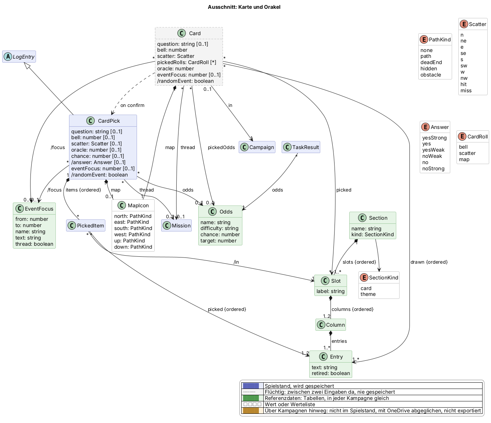

# Karte und Orakel

Regeln des [Domänenmodells](../domain-model.md) für diesen Bereich: was das Bild nicht zeigt.
Das Diagramm führt; die Begriffe stehen im Domänenmodell unter *Begriffe*.

## Orakel auf der Karte

*2026-11-14d.* Ersetzt die Ja/Nein-Frage mit der Stufe der Kampagne.
- Jede `Card` würfelt beim Ziehen einmal 1 bis 100 (`oracle`). Das **Orakelfeld** der Karte zeigt
  daraus die Antwort für alle drei Stufen nebeneinander, wie die *Likely Odds* des GMA. Weil es
  ein Wurf ist, widersprechen sich die Stufen nie: Sagt Gering Ja, sagen es auch Mittel und Hoch.
- Man wählt die Stufe, die zur Frage passt (`pickedOdds`), höchstens eine. Beim Bestätigen
  steht die Antwort **in der Kartenauswahl** (`CardPick`): der Wurf (`oracle`), die Stufe
  (`odds`) und ihre Chance von damals (`chance`). Eine Frage, ein Logeintrag, eine Deutung:
  Antwort und gewählte Felder stehen im selben Kasten. Eine Kartenauswahl braucht mindestens
  eines: ein Feld, ein Wurffeld oder die Antwort. Die Antwort folgt allein aus Wurf und
  festgehaltener Chance, nie aus dem heutigen Stand der Stufe.
- **Sechs Antworten** (`/answer`), allein aus `roll` und `chance`: Ja, wenn `roll` ≤ `chance`.
  **Ja!** (ja, und mehr als erhofft) und **Nein!** (nein, und schlimmer) folgen der Fate Chart von
  Mythic bei Chaosfaktor 5: Hoch entspricht *Very Likely* (15/75/96), Mittel *50/50* (10/50/91),
  Gering *Very Unlikely* (5/25/86). Das ist je ein Fünftel der Ja- bzw. Nein-Spanne, am äußeren
  Rand. **Ja?** (ja, aber mit Haken) und **Nein?** (nein, aber nicht ganz) kennt Mythic nicht; sie
  sind das Fünftel am inneren Rand, also gespiegelt (Hausregel). Einen Chaosfaktor führt die App
  weiterhin nicht, er steht fest auf 5.

  | Stufe | Ja! | Ja | Ja? | Nein? | Nein | Nein! |
  |---|---|---|---|---|---|---|
  | Hoch (75 %) | 1–15 | 16–60 | 61–75 | 76–80 | 81–95 | 96–100 |
  | Mittel (50 %) | 1–10 | 11–40 | 41–50 | 51–60 | 61–90 | 91–100 |
  | Gering (25 %) | 1–5 | 6–20 | 21–25 | 26–40 | 41–85 | 86–100 |

- **Eine eigene Ja/Nein-Frage gibt es nicht mehr**, auch nicht in der Charaktererschaffung: Wer
  das Orakel fragt, zieht eine Karte. Die Frage gehört zur offenen Karte (`Card.question`,
  freiwillig, wie bisher).
- **Die gewählte Stufe der Kampagne (`Campaign.odds`) gilt nur noch für Proben.** Seit
  2026-11-27 gibt es sie nicht mehr; die Probe wählt die Stufe beim Würfeln (siehe
  [Die Stufe der Proben](probe.md#die-stufe-der-proben)).
- **Alte Antworten** (die frühere `OracleAnswer`, vor 2026-11-14d) werden beim Laden und beim
  Import zu Kartenauswahlen ohne Felder: Frage, Wurf, Stufe und Chance bleiben, ihre Stelle im Log
  auch, also auch ihre Deutungen. Ja bleibt Ja, Nein bleibt Nein; weil `/answer` aus Wurf und
  Chance folgt, zeigen sie nun auch das Ausrufe- oder Fragezeichen (Entscheidung des Owners).
- Ein veränderlicher Chaosfaktor und Szenen nach Mythic kommen erst nach Version 1.

## Zufallsereignis

*2026-11-14f.* Nach Mythic GME 2e bei Chaosfaktor 5.
- Ist der Orakelwurf der Karte ein **Pasch bis 55** (11, 22, 33, 44, 55; `/randomEvent`), passiert
  etwas Unerwartetes, unabhängig von der Antwort. Die Karte würfelt dann gleich beim Ziehen, nach
  dem Orakelwurf, den **Ereignisfokus** 1–100 (`eventFocus`); ohne Pasch gibt es keinen.
- Wie bei Mythic gilt es nur für eine Frage: **Erst wenn eine Stufe im Orakelfeld gewählt ist**,
  gibt es das Ereignis mit seinem Fokus (etwa „NSC handelt“); das Feld *Zufallsereignis* (Aktion,
  Beschreibung) der Karte sind schon Mythics Bedeutungstabellen dafür, man wählt daraus wie aus
  jedem Feld. Vorher gibt es kein Ereignis (Entscheidung des Owners).
- In den Log kommt das Ereignis ebenso nur mit gewählter Stufe: Die Kartenauswahl hält den
  Fokuswurf fest (`eventFocus`), und der Fokus (`/focus`) folgt aus den Referenzdaten. Der Log zeigt „Zufallsereignis: NSC handelt“
  im Kasten der Antwort.
- **Ereignisfokus** (`EventFocus`, Referenzdaten, Mythic GME 2e, übersetzt, CC BY-NC wie die
  übrigen Mythic-Daten): 1–5 Fernes Ereignis · 6–10 Unklares Ereignis · 11–20 Neuer NSC ·
  21–40 NSC handelt · 41–45 NSC: Nachteil · 46–50 NSC: Vorteil · 51–55 Auf einen Handlungsfaden zu ·
  56–65 Von einem Handlungsfaden weg · 66–70 Ein Handlungsfaden endet · 71–80 SC: Nachteil ·
  81–85 SC: Vorteil · 86–100 Aktuelle Lage. Jeder Eintrag hat dazu einen kurzen Text, was er
  bedeutet. Eine Liste der NSC für den Fokus führt die App nicht; der Fokus ist ein Anstoß. Die
  Handlungsfäden sind die offenen Missionen (2026-11-18, siehe [Missionen](mission.md#missionen)).
- Die Bereiche des Ereignisfokus sind aus dem Gedächtnis nach Mythic GME 2e übernommen; beim
  nächsten Blick ins Buch abgleichen (steht in der To-do).

## Deutungen und Notizen

Beide sind ein `Note` mit Text, der nicht leer ist (Leerraum am Rand
fällt weg). Die Frage gehört zur Karte, nicht in eine Notiz.
- Eine **Deutung** verweist auf genau ein Ergebnis (`interprets`): eine Orakelantwort, einen Wurf,
  eine Kartenauswahl, eine Probe, einen Angriff oder einen Schadenswurf, nie auf eine Notiz oder Deutung, und immer auf einen
  früheren Eintrag, das man dafür auswählt. Ein Ergebnis kann mehrere Deutungen haben.
- Eine **Notiz** verweist auf nichts; sie steht für sich im Log.
- Wie jeder Logeintrag wird ein `Note` angehängt. Seit 2026-11-14e lässt sich
  sein **Text ändern**: Das ersetzt den Text und setzt `editedAt` (der Zeitpunkt der Änderung).
  Zeitpunkt, Stelle im Log und das gedeutete Ergebnis bleiben; ein leerer Text geht nicht (dafür
  gibt es Löschen). Alle anderen Logeinträge bleiben unveränderlich.
- Eine Deutung behält ihre eigene Zeit; die Reihenfolge im Log bleibt die der Ereignisse, auch
  wenn die Anzeige sie bei ihrem Ergebnis zeigt.
- **Ein Ergebnis löschen löscht seine Deutungen mit.** Eine Deutung allein lässt sich löschen, ihr
  Ergebnis bleibt. Außer
  dem Schadenswurf (siehe [Angriff](kampf.md#angriff)) ist das die einzige Stelle, an der ein Logeintrag auf einen
  anderen verweist; die Regel *Worauf der
  Log verweist, wird nie gelöscht* gilt für Charaktere und Referenzdaten, nicht für den Log selbst.
- Die **Kampagnendatei** enthält Deutungen und Notizen; beim Import muss jede Deutung auf ein
  früheres Ergebnis derselben Datei verweisen, sonst wird nichts importiert.
- Auch in der Charaktererschaffung gibt es Deutungen und Notizen; eine Deutung gilt dort immer dem
  neuesten Ergebnis.

## Karte ziehen

Ziehen legt eine `Card` an: für jedes Feld aller Bereiche aus jeder seiner
Spalten einen nicht ausgeblendeten Eintrag zufällig (`drawn`), die Themen-Tafeln eingeschlossen,
in der Reihenfolge der Bereiche, Felder und Spalten. Ein Feld mit zwei Spalten zieht so ein
**Paar**. Ausgeblendete Felder übergeht es (siehe [Einträge austauschen](#einträge-austauschen)).
Eine gestellte Frage geht auf die Karte über. Die Namen stehen auf der Themen-Tafel *NSC* in
sechs Feldern; jedes zieht ein Paar aus Vor- und Nachname (siehe [Namen](#namen)).

## Die Karte ist offen, bis man sie bestätigt oder verwirft

Man nimmt ein gezogenes Feld
in die Auswahl (`picked`) auf oder wieder heraus, mit allem, was es gezogen hat: Ein Paar nimmt
man immer ganz, nie einen Begriff allein. Ausgewählt sein kann nur ein Feld, das gezogen wurde. *Verwerfen* schließt die Karte ohne Logeintrag. *Neu ziehen* ersetzt sie durch eine neue;
die Auswahl geht verloren, die Frage bleibt.

## Bestätigen

geht erst, wenn mindestens ein Feld oder eine Stufe im Orakelfeld ausgewählt ist;
ohne Auswahl bleibt nur Verwerfen. Es legt einen `CardPick` mit der Frage der Karte an, mit der
Antwort, falls eine Stufe gewählt ist, und darin je ausgewähltem Feld
ein `PickedItem`, in der Reihenfolge der Karte; danach ist die Karte zu. Das `PickedItem` verweist
auf die gezogenen Einträge des Feldes, beim Paar auf beide in der Reihenfolge der Spalten; das
Feld (`/in`) folgt daraus, weil jeder Eintrag zu genau einer Spalte und jede Spalte zu genau
einem Feld gehört. Ältere `PickedItem`s mit nur einem Eintrag bleiben gültig.

## Paare aus Mythic

Mythic zieht aus seinen Bedeutungstabellen immer zwei Begriffe, die man
zusammen deutet. Jede Mythic-Tabelle ist deshalb ein Feld mit zwei Spalten:
- *Actions* und *Descriptions* haben selbst zwei Spalten. Im Zufallsereignis werden sie zu den
  Feldern *Aktion* (Verb · Substantiv) und *Beschreibung* (Adverb · Adjektiv).
- Eine *Elements*-Tabelle hat eine Spalte, aus der Mythic zweimal zieht. Ihr Feld hat zwei
  Spalten mit demselben Inhalt, jede mit eigenen Einträgen, sodass jeder Eintrag zu genau einer
  Spalte gehört. Die beiden Begriffe können gleich ausfallen.

In den Daten steht jede Tabelle nur einmal (`src/data/mythic-tables.json`); die Spalten entstehen
beim Laden.

## Namen

Die Namen gehören zur Themen-Tafel *NSC*. Sie hat sechs Namensfelder, je weiblich,
männlich und neutral wie auf der GMA-Karte, und jedes zweimal: **irdisch** (Namen aus allen
Weltgegenden der Erde) und **spacig** (erfunden und fremd klingend, angelehnt an den Klang der
Vilani). Auf der Tafel stehen sie in zwei Reihen: oben irdisch, unten spacig, jeweils weiblich,
männlich, neutral. Jedes Feld hat zwei Spalten, Vornamen und Nachnamen; irdische Vornamen bekommen
irdische Nachnamen, spacige spacige. Die Nachnamen einer Klangart kommen aus einer gemeinsamen
Liste; jedes Feld hat sie als eigene Spalte mit eigenen Einträgen, sodass jeder Eintrag zu genau
einer Spalte gehört, wie bei den Elements-Tabellen. Die Namen sind eigene Inhalte. In den Daten
steht jede Liste nur einmal (`src/data/names.json`), je Name mit seiner Klangart; die Spalten
entstehen beim Laden.
- Der frühere Bereich *Namen* mit drei Feldern bleibt mit allen Einträgen ausgeblendet in den
  Daten, damit alte Logeinträge ihre Namen behalten; auf der Karte fehlt er. Die sechs neuen Felder
  haben neue Ids.

## Name von der Karte

Wo man einen Namen eintippt, für einen Charakter (letzter Schritt der
Charaktererschaffung, Charakter-Editor) oder für eine Welt (letzter Schritt der
Weltenerschaffung), kann man ihn von der Karte ziehen, mit Vornamen und Nachnamen getrennt:
Jedes der sechs Namensfelder der Tafel NSC wird zweimal gezogen,
nach denselben Regeln wie *Karte ziehen*, mit zwei verschiedenen Vornamen und zwei verschiedenen
Nachnamen je Feld (derselbe Nachname zählt nur einmal). Man wählt höchstens einen Vornamen und
höchstens einen Nachnamen; der Name wird „Vorname Nachname“, oder nur der eine, wenn nur einer
gewählt ist. Das gilt für
Charakter und Welt gleich: Wer will, nimmt für eine Welt nur einen Namen. Danach lässt sich der
Text wie getippt ändern; neu ziehen oder abbrechen geht jederzeit.
Gespeichert wird nur der Name, so wie er am Ende im Feld steht; die Wahl selbst ist kein
Logeintrag und verweist auf nichts.

## Einträge austauschen

Ein Eintrag, der nicht mehr gezogen werden soll, wird nicht gelöscht und
seine Id nicht neu vergeben, sondern ausgeblendet (`retired`): Ziehen übergeht ihn, alte
Logeinträge zeigen ihn weiter mit seinem Text. Ob ein Log auf ihn verweist, weiß nur das jeweilige
Gerät; deshalb wird jeder ausgetauschte Eintrag ausgeblendet. Hat eine Spalte nur ausgeblendete
Einträge, ist ihr Feld ausgeblendet: Ziehen übergeht es, die Karte zeigt es nicht, und ein
Bereich ohne sichtbares Feld fehlt auf der Karte ganz. Der Log zeigt alte Einträge daraus weiter.
Mindestens ein Feld hat einen Eintrag, der nicht ausgeblendet ist.

## Wurffelder der Karte

Neben den Feldern mit Einträgen hat jede Karte drei Wurffelder, wie die
GMA2e-Karte. Sie ziehen keinen Eintrag aus einer Liste, sondern würfeln einen Wert; deshalb sind
sie keine `Slot`s, haben keine Einträge und werden nie ausgeblendet. Die Werte und die Gewichte
sind eigene, nicht die der GMA2e-Karten.
- **Glockenzahl** (`bell`): 1 bis 10 mit diesen Gewichten (von 200): 1 · 6 · 16 · 30 · 47 · 47 ·
  30 · 16 · 6 · 1. Also 4–7 in 77 % der Fälle, 1 und 10 je 0,5 %. Gedacht für zwischendurch:
  Reaktion eines NSC (1 sehr freundlich, 10 feindselig), Spannung, wie schwer etwas ist.
- **Streuwürfel** (`scatter`): jeder der zehn Werte gleich wahrscheinlich (10 %): die acht
  Richtungen, Volltreffer und Fehlschlag. Norden ist oben, wie auf der Sektorkarte.
- **Kartensymbol** (`map`): ein Raum, von oben gesehen, mit sechs Richtungen: Norden, Osten,
  Süden, Westen auf der Ebene, dazu oben und unten (Treppe, Schacht, Leiter, Lift). Je Richtung
  eine Wegart:

  | Wegart | Code | N, O, S, W (von 20) | Oben, unten (von 20) | Als Ortskarte | Als Beziehungskarte |
  |---|---|---|---|---|---|
  | Kein Weg | `none` | 7 | 15 | Kein Weg in diese Richtung | Keine Beziehung |
  | Weg | `path` | 7 | 2 | Klarer Weg | Neutrale oder gute Verbindung |
  | Sackgasse | `deadEnd` | 2 | 1 | Weg endet bald | Scheinbar gute Option, beendete Beziehung |
  | Verborgen | `hidden` | 2 | 1 | Geheimgang | Versteckte Möglichkeit oder Beziehung |
  | Hindernis | `obstacle` | 2 | 1 | Versperrt, bewacht | Option mit Hürden, angespannte Beziehung |

  Ein Kartensymbol hat mindestens zwei Richtungen mit einer Wegart außer *kein Weg*; hat es
  weniger, wird es ganz neu gewürfelt.
- Ziehen würfelt alle drei, *Neu ziehen* ebenso. Die Wurffelder stehen auf der Karte unter den
  Sinneseindrücken, wo bisher die Namen standen, in der Reihenfolge Glockenzahl, Streuwürfel,
  Kartensymbol (auf der Karte knapp „Wege“ beschriftet). In der Reihenfolge der Karte (für den Log) kommen sie vor allen Feldern.
- Damit die ganze Karte weiter auf einen Bildschirm passt, fallen auf der Tafel *Handlung* die
  Mythic-Tabellen *Gegenstand* (`plot.object`) und *Fund* (`plot.salvage`) weg: Ihre Einträge
  werden ausgeblendet (siehe [Einträge austauschen](#einträge-austauschen)), alte Logeinträge zeigen sie weiter. Die
  Tafel *Handlung* hat danach eine Reihe: Wendung, Stimmung, Botschaft.
- Ein Wurffeld nimmt man in die Auswahl (`pickedRolls`) auf oder wieder heraus, wie ein Feld.
  Bestätigen geht, sobald ein Feld oder ein Wurffeld ausgewählt ist. Der `CardPick` hält den Wert
  jedes ausgewählten Wurffelds selbst (`bell`, `scatter`, `map`), weil es nichts gibt, worauf er
  verweisen könnte; nicht ausgewählte bleiben leer. Ein `CardPick` hat also mindestens einen
  `PickedItem` oder einen Wert eines Wurffelds. Ältere `CardPick`s ohne Wurffelder bleiben gültig.
