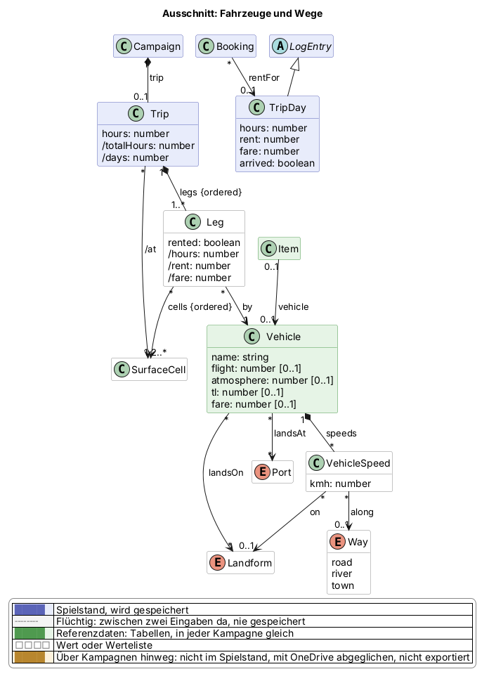

# Fahrzeuge und Wege

Regeln des [Domänenmodells](../domain-model.md) für diesen Bereich: was das Bild nicht zeigt.
Das Diagramm führt; die Begriffe stehen im Domänenmodell unter *Begriffe*.

## Fahrzeuge

*freigegeben am 15. November 2026, 2026-11-15.* Grundlage der Logistik auf der Oberfläche: Die App findet
die schnellste Route zwischen zwei Orten einer Welt, auch wenn man dafür ein ATV oder einen
Hubschrauber mieten muss, und die Gruppe fährt sie Tag für Tag ab.
- Ein **Fahrzeug** (`Vehicle`) ist Referenzdaten, wie die Waffe: Ein Gegenstand der Art vehicle
  verweist auf sein Fahrzeug (`Item.vehicle`), so wie eine Waffe auf `Weapon`. **Zu Fuß** ist ein
  Fahrzeug ohne Gegenstand, mit eigener Tabelle; die Gruppe hat es immer.
- **Fahren oder nicht fahren.** Jedes Fahrzeug hat eine Tabelle (`speeds`). Eine Zeile nennt eine
  Geländeart (`on`) **oder** einen Weg (`along`), nie beides, und die Geschwindigkeit in km/h.
  Steht für ein Feld keine passende Zeile, kann das Fahrzeug dort nicht fahren. Mehr Abstufung
  gibt es nicht.
- **Wege.** Straße (`road`): zwei benachbarte Felder derselben Straße (`Road.cells`). Fluss
  (`river`): zwei benachbarte Felder desselben Flusses. Siedlung (`town`): ein Feld mit Stadt oder
  Kleinstadt. Ein Weg kann schneller machen (das Auto auf der Straße) oder ein Feld erst befahrbar
  machen (das Boot auf dem Fluss durchs Land).
- **Anlegen:** Boot und U-Boot haben eine Zeile für Siedlungen (20 km/h, der Hafen): So legen sie in
  einem Küstenort an, und dort steigt man um. Ein reines Wasserfahrzeug (keine Zeile für eine
  Geländeart an Land) fährt aber nie von Land zu Land, also nicht von Ort zu Ort über Land.
- **Ein Schritt** geht von einem Feld zum Nachbarfeld, etwa 250 km. Führt eine Straße bzw. ein Fluss
  über beide Felder und hat das Fahrzeug eine Zeile dafür, gilt diese. Sonst muss es auf beiden
  Feldern fahren können (Geländeart oder Siedlung), und es gilt die langsamere der beiden; auf einem
  Feld gilt jeweils die schnellste passende Zeile. Dauer des Schritts: 250 km / Geschwindigkeit.
- **Atmosphäre:** Manche Fahrzeuge gehen nur ab einer Atmosphäre der Welt (`atmosphere`):
  Flugzeuge, Hubschrauber und Hovercraft brauchen 4+ (SR 55, 57). Auf anderen Welten stehen sie
  nicht zur Wahl, weder gemietet noch eigene.
- **Werte:** Die Reisegeschwindigkeiten stehen im Regelheft (SR 55–57); welche Geländeart welche
  Geschwindigkeit bekommt, ist ein Vorschlag als Hausregel in `regeln-kampf.md` unter *Fahrzeuge
  und Reisen über Land*. Die Tabelle wird Referenzdaten im Repository.
- **Beispiele:** Ground Car nur auf Straße, Siedlung
  und `settled`; Wheeled und Tracked ATV fast überall an Land, auf der Straße schneller; Motor Boat
  nur auf `water` und Fluss; Hovercraft auf Wasser und flachem Land.
- **Fluggeräte** haben eine Fluggeschwindigkeit (`flight`) und ihre **Landepunkte**, je nach Art
  (Owner, 15. November 2026): Geländearten, auf denen sie überall landen können (`landsOn`;
  Hubschrauber: alles Land), und/oder Hafenklassen (`landsAt`): Sie landen in einer Stadt, deren
  Hafen (`City.port`, Raumhafen A–E, Landeplatz F–H) in der Liste steht (Linienmaschine nur an
  großen Häfen, Doppeldecker auch auf einem einfachen Landeplatz). Sie fliegen gerade von einem
  Landepunkt zum nächsten, ohne Rücksicht auf das Gelände dazwischen; Dauer: Entfernung / `flight`.
  Ein Fahrzeug kann fahren und fliegen (Air/Raft, Grav Belt); dann gilt jeweils das Schnellere.
- **Mieten** (Owner, 15. November 2026): Fahrzeuge mietet man in einer Siedlung, nur bis zum TL der
  Welt. Die Miete je Tag ist **1 % des Kaufpreises** (Hausregel), je angefangenem Reisetag, an dem
  ein gemieteter Abschnitt gefahren wird. Gemietete Fahrzeuge gibt man am Ende ihres Abschnitts
  ab, wo man will.
- **Linienverkehr** (freigegeben am 15. November 2026, 2026-11-15c; ersetzt die frühere Regel „wie Miete, nur für die
  Fahrstunden“): ein Fahrzeug **ohne Gegenstand** mit **Fahrpreis** (`fare`) in Cr je Person und
  Fahrstunde; man kauft und mietet es nicht, sondern bezahlt die Fahrt. Zurzeit gibt es nur den
  **Linienflug** (Owner, 15. November 2026):
  - fliegt mit 600 km/h (wie das Fixed Wing Aircraft) zwischen zwei Städten, deren Hafen Raumhafen
    A, B, C oder Landeplatz F ist (`landsAt`), nie in die Pampa;
  - gibt es ab TL 6 (`tl`, weil kein Gegenstand den TL trägt) und ab Atmosphäre 4;
  - kostet **Cr100 je Person und Flugstunde**, für alle lebenden SC (`Leg./fare`); gebucht als
    Fahrpreis (`fare`) am Reisetag, an dem der Flug beginnt (`TripDay.fare`, die Buchung verweist
    wie die Miete auf den Reisetag); reicht die Kasse nicht, geht der Tag nicht;
  - hat keinen Fahrplan: Man fliegt sofort, der Flug ist ein Abschnitt der Fahrt wie jeder andere;
  - erscheint bei den Varianten als „Linienflug“, auch gemischt (Auto zum Flughafen, Linienflug,
    Auto). In der Suche zählt der Fahrpreis wie die Miete gegen die Zeit.
  Bus, Bahn und Fähre kommen vielleicht später.

## Fahrt

*freigegeben am 15. November 2026, 2026-11-15.* Eine Fahrt (`Trip`) ist gespeicherter Stand, weil sie über
mehrere Tage läuft und dazwischen anderes passiert (Rasten, Begegnungen, Ausspielen); sie
übersteht einen Neustart.
- **Planen:** Die Gruppe braucht einen Aufenthaltsort mit Feld oder Stadt. Man wählt auf dem Globus
  ein Ziel auf derselben Welt; die App sucht die schnellste Route aus Abschnitten (`legs`), je mit
  einem Fahrzeug: zu Fuß, eigene Fahrzeuge aus dem Gruppengepäck, gemietete (`rented`) oder
  Linienverkehr. Ein Fahrzeugwechsel geht nur dort, wo man es mieten kann bzw. wo das Fluggerät
  landet. **Varianten wie bei einer Karten-App** (Owner, 15. November 2026): Die App zeigt mehrere
  Routen, je die schnellste ohne Miete (zu Fuß und eigene Fahrzeuge), je mietbarem Fahrzeug die
  schnellste damit (Ground Car mieten, ATV mieten, Hubschrauber mieten …) und **gemischte**, die
  mehrere Mietfahrzeuge nacheinander nehmen, wo sich das lohnt (Auto zum Hafen, Boot, Auto; Auto
  zum Flugplatz, Flug, Auto). Die gemischten wägen Zeit gegen Miete ab, mit vier Gewichten (eine
  Fahrstunde ist 3, 30, 300 bzw. 3000 Cr wert). Je Fahrzeugfolge bleibt die schnellste Variante.
  **Varianten mit eigenen Fahrzeugen stehen immer oben** (Owner, 15. November 2026), darunter die
  übrigen, je die schnellste zuerst. **Bleibt ein eigenes Fahrzeug zurück** (die Gruppe wechselt
  auf ein anderes, siehe *Eigene Fahrzeuge bleiben stehen*), muss das vor dem Losfahren klar sein;
  ebenso bei der laufenden Fahrt für den Rest der Strecke. Jede Variante hat eine Dauer in Tagen
  (`/days`), Fahrstunden und Miete; erst die gewählte wird gespeichert (`Campaign.trip`), die
  Varianten davor nicht.
- **Abschnitt:** Jeder Abschnitt hat seine Felder in Reihenfolge (`cells`; bei einem Flug nur Start
  und Landepunkt), daraus folgen seine Fahrstunden (`/hours`) und seine Miete je Tag (`/rent`). Das
  letzte Feld eines Abschnitts ist das erste des nächsten.
- **Tag für Tag** (wie Zeit vergehen lassen): **Weiterfahren** (siehe *Ein Tag*) fährt die Fahrstunden je Tag
  (Hausregel: **8 Stunden** für alle Fahrzeuge; *Mission on Mithril* rechnet 10 auf einem
  20-Stunden-Tag) oder den Rest bis zur Ankunft, nie weniger. Das ist ein
  Logeintrag `TripDay` mit den gefahrenen Stunden, der Miete des Tages und ob die Gruppe
  angekommen ist; `Campaign.day` wächst um 1, `Trip.hours` um die Stunden. Die Miete geht als
  Buchung `rent` aus der Kasse (`rentFor`). Reicht die Kasse nicht, geht der Tag nicht.
- **Wo die Gruppe ist:** Das Feld der Fahrt (`/at`) ist das letzte ganz erreichte Feld. Nach jedem
  Reisetag ist es der Aufenthaltsort; der Reisetag bekommt es als Ort. Bei der Ankunft ist der
  Aufenthaltsort das Ziel (Feld oder Stadt) und die Fahrt fällt weg.
- **Begegnungen am Boden** (Owner, 15. November 2026): Hat ein Reisetag Strecke am Boden (nicht nur
  einen Flug), würfelt Weiterfahren danach Pflicht den Begegnungstest am erreichten Ort: in der **Wildnis** (ein Feld ohne Stadt und Kleinstadt, nicht besiedelt, dessen
  Gelände Tiere hat) den Test auf **Tiere**, sonst den auf eine **Zufallsbegegnung** (je 5+ auf 1W6,
  wie im Bereich Begegnung). Er steht als Test im Log und zählt als Test des Tages. Besteht er, folgt
  gleich der Wurf auf die Tiertabelle bzw. die Random Encounter List; daraus wird eine Begegnung,
  ein Tierereignis steht im Log. Solange die Begegnung läuft,
  fährt man nicht weiter.
- **Wo ich war:** Reisetage und ihre Tests gelten nicht als Ereignisse eines Ortes, außer man will
  den gereisten Weg sehen (Owner, 15. November 2026); diese Wahl wird nicht gespeichert.
- **Dazwischen:** Zwischen zwei Reisetagen kann man alles tun: Begegnungen würfeln, ausspielen,
  **rasten** mit *Zeit vergehen lassen* (dann vergehen Tage, die Gruppe bewegt sich nicht). Während
  einer laufenden Begegnung fährt man nicht. Stunden innerhalb eines Tages rechnet die App nicht.
- **Abbrechen:** Die Fahrt fällt weg, die Gruppe bleibt auf dem erreichten Feld. Setzt man den
  Aufenthaltsort von Hand oder reist zu einer anderen Welt, fällt die Fahrt ebenfalls weg.
- **Log:** Reisetage lassen sich nicht löschen, wie vergangene Zeit und Reisen.
- **Eigene Fahrzeuge bleiben stehen** (Owner, 15. November 2026): Ein eigenes Fahrzeug fährt
  nur in den Abschnitten mit, in denen es das Fahrzeug ist. Wechselt die Gruppe auf ein anderes
  (sie fliegt, nimmt ein Boot, geht zu Fuß weiter), bleibt es am Anfang des neuen Abschnitts stehen
  (`Possession.parked`, mit Feld bzw. Stadt). Abgestellte Fahrzeuge gehören weiter zum
  Gruppengepäck, fahren aber nicht mit, bis die Gruppe an ihrem Ort ist; dort kann ein Abschnitt
  mit ihnen beginnen, dann fällt `parked` weg. Hat die Gruppe mehrere gleiche und stellt nur einen
  Teil ab, wird der Besitz geteilt (je Ort ein Eintrag mit Anzahl). Reist die Gruppe zu einer
  anderen Welt (`Journey`), bleiben alle Fahrzeuge, die nicht abgestellt sind, am Aufenthaltsort
  stehen. Der Shop zählt abgestellte Fahrzeuge beim Abzeichen mit; der Globus zeigt sie.
