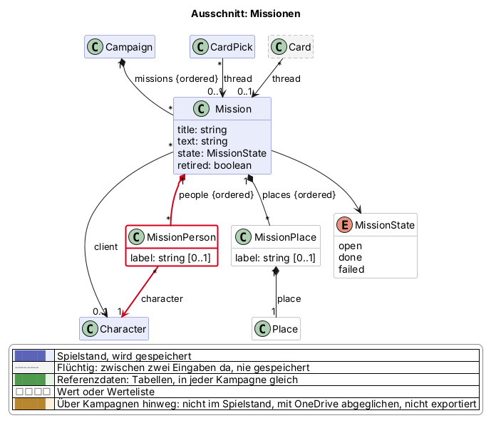

# Missionen

Regeln des [Domänenmodells](../domain-model.md) für diesen Bereich: was das Bild nicht zeigt.
Das Diagramm führt; die Begriffe stehen im Domänenmodell unter *Begriffe*.

## Missionen

*freigegeben am 18. November 2026, 2026-11-18.* Eine **Mission** (`Mission`) ist ein Auftrag
oder Ziel, das die Gruppe verfolgt, z. B. „Fracht nach Regina schmuggeln“. Sie gehört zur
Kampagne (`missions`, in der Reihenfolge, in der sie angelegt wurden).
- *Inhalt*: ein Titel (`title`, nicht leer, Leerraum am Rand fällt weg), ein freier Text (`text`,
  darf leer sein), der Zustand (`state`), wahlweise ein Auftraggeber und beliebig viele Orte.
  Belohnung und Frist hat eine Mission nicht (Entscheidung des Owners): Eine Belohnung bucht man
  von Hand in der Kasse, eine Frist schreibt man in den Text. Wie bei der Notiz eines Charakters
  zieht „Karte ziehen“ unter dem Text die Inspirationskarte; die Auswahl hängt sich an den Text an
  und kommt nicht in den Log.
- *Zustand* (`MissionState`): **offen** (`open`), **erledigt** (`done`), **gescheitert**
  (`failed`). Eine neue Mission ist offen; im Editor wechselt man frei, auch zurück auf offen.
- *Auftraggeber* (`client`): höchstens ein dauerhafter NSC (`Character` mit `npc`), meist mit der
  Rolle Patron, aber jede Rolle geht; einen SC kann man nicht wählen. Der Verweis bleibt, wenn der
  NSC stirbt oder später zum SC wird; die Mission zeigt ihn dann so. Ein NSC, auf den eine Mission
  verweist, wird nicht gelöscht, sondern ausgeblendet, wie bei Logeinträgen (siehe *Löschen und
  Ausblenden*).
- *Orte* (`places`, je ein `MissionPlace`): beliebig viele, in der Reihenfolge, in der man sie
  hinzufügt. Jeder ist ein Ort (`Place`, siehe [Orte](oberflaeche.md#orte)) mit einem kurzen freien **Etikett**
  (`label`, z. B. „Treffpunkt“, „Ziel“; darf fehlen). Ein Missionsort ist **immer ein Feld der
  Oberfläche** (`cell`) oder eine Stadt auf einem Feld (`city`), nie eine ganze Welt und keine
  Orbitalstadt (Entscheidung des Owners): Eine Mission spielt an einer Stelle, die man auf dem
  Globus findet. Die Welt braucht dafür ihre Oberflächenkarte. Derselbe Ort darf mehrmals vorkommen, mit verschiedenen Etiketten. Wie ein Logeintrag
  sperrt ein Missionsort mit Feld oder Stadt die Oberflächenkarte (siehe [Orte](oberflaeche.md#orte), *Karte gesperrt*).
- *Beteiligte* (`people`, je ein `MissionPerson`; freigegeben am 18. November 2026, 2026-11-18b): beliebig viele
  Charaktere der Kampagne, **NSC oder SC**, in der Reihenfolge, in der man sie hinzufügt, je mit einem
  freien **Etikett** (`label`, z. B. „Opfer“, „Fahrer“, „Informant“; darf fehlen). Ein Charakter kommt
  in einer Mission höchstens einmal als Beteiligter vor; der Auftraggeber kann zusätzlich Beteiligter
  sein, nötig ist das nicht. Gewählt wird aus den Charakteren, die nicht ausgeblendet sind, auch aus
  toten (das Opfer). Der Verweis bleibt, wenn der Charakter stirbt oder zwischen SC und NSC wechselt;
  ein Charakter, auf den eine Mission als Beteiligten verweist, wird nicht gelöscht, sondern
  ausgeblendet, wie ein Auftraggeber. Zu einem Charakter lässt sich ablesen, in welchen Missionen er
  vorkommt, als Auftraggeber oder mit seinem Etikett.
- *Löschen und Ausblenden*: Eine Mission, auf die keine Kartenauswahl verweist
  (`CardPick.thread`), wird wirklich gelöscht. Sonst wird sie ausgeblendet (`retired`): Sie
  zählt nicht mehr zu den Missionen und wird nicht mehr ausgelost, der Log zeigt sie
  weiter; einblenden lässt sie sich wieder.
- *Neue Mission*: Sie ist offen, mit dem Aufenthaltsort als erstem Ort, wenn er ein Feld oder eine
  Stadt auf einem Feld ist. Ein Ort kommt hinzu als Aufenthaltsort (ebenso nur mit Feld) oder als
  beliebiges Feld eines Globus; liegt dort eine Stadt, wird der Ort die Stadt.
- *Auf der Karte*: Zu jedem Feld lässt sich ablesen, welche offenen Missionen dort einen Ort haben
  (auch in einer Stadt darauf), mit Etikett; zu einem NSC, welche Missionen er vergibt.
- *Vom Patron zur Mission*: Aus einem Patron-Wurf lässt sich neben dem Patron-NSC auch gleich eine
  **Mission** machen: der Patron-NSC wie bei „Als NSC“ und dazu eine offene Mission mit ihm als
  Auftraggeber, dem Beruf des Patrons als Titel (z. B. „Smuggler“) und dem Aufenthaltsort als
  erstem Ort, wenn er ein Feld hat. Bei einer Rumor-Zeile geht das nicht.
- *Handlungsfäden*: Die offenen, nicht ausgeblendeten Missionen sind die **Handlungsfäden** des
  Orakels, wie die Thread-Liste in Mythic. Drei Einträge des Ereignisfokus sind **Fadenfokusse**
  (`EventFocus.thread`): Auf einen Handlungsfaden zu, Von einem Handlungsfaden weg, Ein
  Handlungsfaden endet. Würfelt die Karte beim Ziehen einen Fadenfokus und gibt es offene
  Missionen, lost sie gleich eine davon aus, alle gleich wahrscheinlich (`Card.thread`). Die
  Mission gilt wie der Fokus erst mit gewählter Stufe („Auf einen Handlungsfaden zu: Fracht nach
  Regina schmuggeln“). Die Kartenauswahl hält sie fest
  (`CardPick.thread`), damit der Log auch später zeigt, welcher Faden gemeint war, selbst wenn die
  Mission inzwischen erledigt ist. Ohne offene Mission bleibt es beim Fokus allein. „Ein
  Handlungsfaden endet“ ändert den Zustand nicht von selbst; wie es ausgeht, entscheidet man per
  Deutung und stellt es an der Mission ein.
