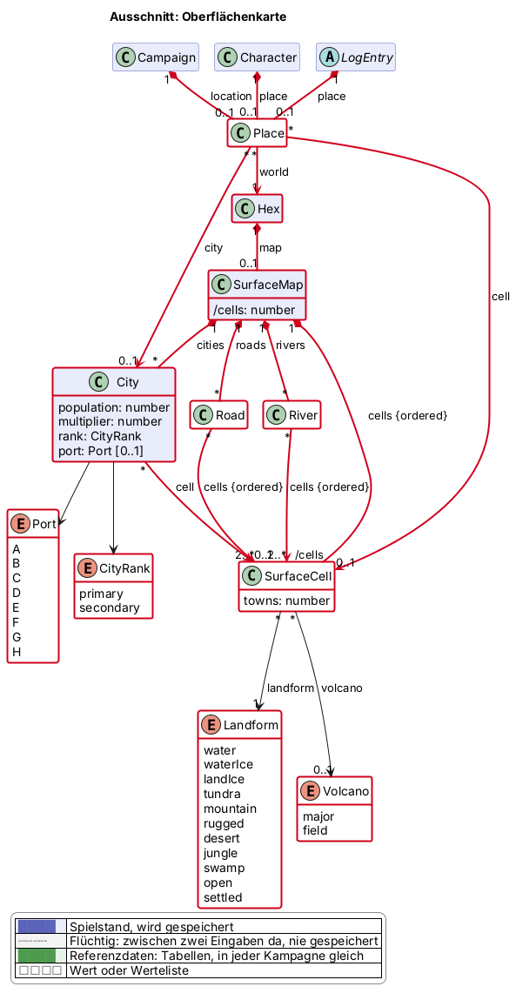

# Oberflächenkarte

Regeln des [Domänenmodells](../domain-model.md) für diesen Bereich: was das Bild nicht zeigt.
Das Diagramm führt; die Begriffe stehen im Domänenmodell unter *Begriffe*.

## Oberfläche

nach dem *World Builder's Handbook* (DGP, 1989; *Hydrosphere Related Details*
S. 69–70 und *Native Life* S. 68), als Vorarbeit für eine spätere Oberflächenkarte. Es gibt noch
keine Karte: Gespeichert werden nur Zahlen, nichts wird platziert. Alle Werte entstehen in einem
Zug, in dieser Reihenfolge; Ergebnisse unter 0 gelten als 0:
1. *Wasseranteil* (`water`, in %): Hydrographie × 10 + (2W6 − 7); eine 12 auf 2W6 wird neu
   gewürfelt (die Abweichung liegt so zwischen −5 und +4). Begrenzt auf 0 bis 100. Bei Größe 0
   kein Wurf und 0.
2. *Tektonische Platten* (`plates`): Größe + Hydrographie − 2W6, mindestens 1. Bei Größe 0 kein
   Wurf und 0. Vereinfachung: Das Buch gibt nur Welten mit geschmolzenem oder schwerem Kern
   mehrere Platten und würfelt dafür den Kerntyp; den lassen wir weg.
3. *Land- und Wassermassen*: Bei einem Wasseranteil von 50 bis 99 % die Kontinente-Tabelle, bei 1
   bis 49 % die Ozeane-Tabelle, jeweils mit 1W6 + Hydrographie × 3 (`/row`); die Zeile sagt, mit
   welchem Würfelausdruck (`DiceExpr`) jede Menge gewürfelt wird:
   - Kontinente-Tabelle: große Kontinente (`major`), kleine Kontinente (`minor`), große Inseln
     (`small`) und Archipele (`scattered`). Ozeane gibt es dann keine. **Hausregel: höchstens 6
     große Kontinente**, denn jeder hat mindestens 15 % der Landfläche; was die Tabelle darüber
     ergibt (sie würfelt bis 2W6 + 1), zählt zu den kleinen Kontinenten.
   - Ozeane-Tabelle: große Ozeane (`major`), kleine Ozeane (`minor`), kleine Meere (`small`) und
     verstreute Seen (`scattered`). Kontinente gibt es dann keine.
   - Sagt die Zeile *nur* Archipele bzw. *nur* verstreute Seen (`onlyScattered`), ist alles Land
     bzw. alles Wasser in dieser Form: (100 − Wasseranteil) × 5 × 2 Archipele bzw.
     Wasseranteil × 5 × 2 Seen, weil die Karte 500 Hexe hat und jedes davon ein halbes Hex ist.
   - Bei 0 % gibt es kein Wasser, bei 100 % kein nennenswertes Land: Alle Mengen sind 0.
4. *Einheimisches Leben* (`life`): 2W6, Leben bei 10+. DMs: Atmosphäre 0 −3, Atmosphäre 4–9 +4,
   Hydrographie 0 −2, Hydrographie 2–8 +1, Temperatur nicht *Gemäßigt* −1 (das Buch zieht 1 ab
   unter −20 °C und über 30 °C; die Stufen der Temperatur liegen in der Mitte so). Die DMs nach
   dem Sterntyp entfallen, weil es noch kein Sternsystem gibt.

Was das Buch sonst noch würfelt, kommt erst mit der Oberflächenkarte (Größe der Platten, ihre
Bewegung, Gebirge, Flüsse, Wüsten, Dschungel, Vergletscherung, die Temperatur je Hexreihe) oder
braucht ein Sternsystem (Vulkane über den Seismik-Faktor, Achsneigung, Umlauf). Die Weltkarte
zeigt die Oberfläche an der Stelle, wo bisher die Würfe standen, in Worten, z. B. „59 % Wasser ·
6 Platten · 1 großer und 4 kleine Kontinente · 5 große Inseln · 7 Archipele · Leben“. Ist alles
Land Archipel bzw. alles Wasser verstreuter See (die Zahl ist die ganze Fläche in halben Hexen,
und es gibt keine anderen Land- bzw. Wassermassen), schreibt sie „Land nur als Archipele“ bzw.
„Wasser nur als verstreute Seen“ statt einer Zahl wie 150.

## Oberflächenkarte

*freigegeben am 14. November 2026, 2026-11-14i.* Die Regeln stehen vollständig, mit allen Tabellen und
Hausregeln, im [Konzept Oberflächenkarte](../konzept-oberflaechenkarte.md); sie gelten als Teil
dieses Modells. Das Wichtigste für das Bild:
- Eine fertige Welt ab Größe 1 mit Oberfläche (`Surface`) kann eine Oberflächenkarte haben
  (`map`). Sie entsteht in einem Zug und ersetzt sich nur ganz (neu würfeln). Von Hand ändern
  lässt sie sich nicht. Größe 0 hat keine. Geändert 2026-11-20d (Owner): Sie entsteht nur auf
  ausdrücklichen Wunsch („Globus erzeugen“). Das gilt für jede Welt, Hauptwelt wie Nebenwelt. Ergänzt am 21. November 2026 (Owner): Kommt die Gruppe auf einer Welt an (Reise im
  System, Sprung, „Gruppe platzieren“, Wahl im Bereich Begegnung), entstehen dabei ihre Oberfläche
  und ihr Globus, falls sie fehlen; „Globus erzeugen“ bleibt für alle anderen Welten. Eine
  Hauptwelt ohne Temperatur bekommt so keine Oberfläche (die Temperatur würfelt man von Hand).
  Geändert am 21. November 2026 (Owner, „Oberfläche erzeugen sollte einfach immer mit der Welt
  passieren“): Die **Oberfläche** (die Zahlen nach dem World Builder's Handbook, nicht die Karte)
  entsteht von selbst. Eine Nebenwelt ab Größe 1 bekommt sie im Schritt „Sternsystem
  würfeln“ mit ihren übrigen Werten, die Temperatur aus ihrer Zone gespeichert; Systeme und ältere
  Hauptwelten (mit Temperatur) von davor bekommen sie beim Öffnen der Kampagne nachgewürfelt, mit
  Würfen aus Schlüssel und Feld. Nur der Globus entsteht weiter auf Wunsch oder bei Ankunft.
- Das Raster folgt aus der Größe und wird nicht gespeichert: ein Ikosaeder, jede Kante in
  n = 4 × Größe Abschnitte geteilt, jeder Eckpunkt ein Oberflächenfeld (`/cells` = 10 × n² + 2).
  Die Felder (`cells`) stehen in einer festen Reihenfolge, jedes hat eine Nummer ab 0.
- Gespeichert werden nur Ergebnisse: je Feld Geländeart, Kleinstädte und Vulkan, dazu Flüsse und
  Straßen als Folgen benachbarter Felder und die Haupt- und Nebenstädte (`cities`). Platten, ihre
  Grenzen, die Temperatur je Feld und das Rauschen dienen nur dem Erzeugen bzw. werden aus Größe
  und Temperatur der Welt gerechnet. Der Startwert des Zufalls beim Erzeugen wird nicht
  gespeichert: Die Karte hängt nur an ihren Werten, nicht am Programm, das sie erzeugt hat.
- **Gepackt gespeichert.** Eine Karte hat bis zu 16 002 Felder; als einzelne Objekte würde sie
  jede Speicherung, jede Exportdatei und jeden Abgleich etwa 30-mal größer machen. Deshalb stehen
  die Felder im Spielstand gepackt: die Geländeart als Text mit einem Zeichen je Feld in der
  Reihenfolge des Rasters, Kleinstädte und Vulkane nur für die Felder, die welche haben (Nummer und
  Wert), Flüsse, Straßen und Städte mit Feldnummern statt Verweisen. Die Felder als Objekte gibt
  es nur in der Anzeige. Bei Größe 8 sind das etwa 10 KB je Karte.
- Eine Stadt ist ein eigener Gegenstand (blau): Sie hat einen Namen, und Orte verweisen auf sie
  (siehe [Orte](#orte)).
- **Städtenamen** (freigegeben am 14. November 2026, 2026-11-14k): Jede Haupt- und Nebenstadt bekommt beim Erzeugen der
  Karte einen Namen aus den Referenzdaten *Städtenamen*, auf der ganzen Kampagne ohne Doppel. Die
  Hauptstadt (die erste Stadt) trägt bei 1–2 auf 1W6 den Namen der Welt. Den Namen kann man im
  Feld unten auf dem Globus ändern; ein leerer Name geht nicht. Karten von vor dieser Änderung
  bekommen beim Laden „Stadt 1“, „Stadt 2“ usw. Die Stadt verweist auf ihr Feld, nicht das Feld
  auf seine Stadt.
- **Höchstens eine Siedlung je Feld** (Owner, 14. November 2026): auf jedem Oberflächenfeld
  entweder eine Stadt oder eine Kleinstadt (`towns` ist dann 1), nie mehr. Das Buch erlaubt ab TL 10
  mehrere Städte auf einem Hex; auf 250-km-Feldern ist eine je Feld übersichtlicher. Kleinstädte,
  für die kein Feld mehr frei ist, leben auf dem Land. Karten von davor dürfen mehr haben. Eine Stadt ohne Feld (`cell`) ist eine Orbitalstadt. `population` ist ihre Bevölkerungsziffer,
  `multiplier` die erste Ziffer ihrer Einwohnerzahl (Einwohner = multiplier × 10^population).
- Der Bevölkerungsmultiplikator (`populationMultiplier`) wird beim Erzeugen der Karte gewürfelt,
  falls die Welt noch keinen hat, und bleibt beim Neu würfeln der Karte erhalten. Bei
  Bevölkerung 0 gibt es keinen.
- Beim Import wird geprüft: die Zahl der Felder passt zur Größe, alle Feldnummern liegen im
  Raster, Flüsse und Straßen bestehen aus benachbarten Feldern, Städte und Kleinstädte nur bei
  Bevölkerung ab 1.

## Orte

*freigegeben am 14. November 2026, 2026-11-14j.* Ein Ort (`Place`) ist immer eine Welt (`world`, ein Hexfeld mit
Welt, nicht leer). Genauer kann er ein Oberflächenfeld (`cell`) oder eine Stadt (`city`) sein, nie
beides: Das Feld einer Stadt ist ihr Feld (`City.cell`) und wird nicht noch einmal gespeichert.
Feld und Stadt gehören zur Oberflächenkarte derselben Welt; eine Orbitalstadt hat kein Feld.
- **Wer einen Ort hat:** die Gruppe (`Campaign.location`, ihr Aufenthaltsort), jeder dauerhafte NSC
  (`Character.place`), wahlweise jeder Logeintrag (`LogEntry.place`) und jeder Missionsort
  (`MissionPlace.place`, 2026-11-18). Spielercharaktere sind
  immer bei der Gruppe und haben keinen eigenen Ort.
- **Logeinträge bewegen sich nicht.** Der Ort eines Logeintrags hält fest, wo es damals passiert
  ist. Gruppe und NSC wechseln ihren Ort, alte Einträge bleiben, wo sie waren. Den Ort eines
  Eintrags kann man von Hand ändern oder entfernen, wie man eine Notiz ändert.
- **Neue Logeinträge bekommen den Aufenthaltsort.** Jeder neu angelegte Logeintrag bekommt den
  Aufenthaltsort der Gruppe, falls sie einen hat. Eine Reise (`Journey`) bekommt das Ziel. Einträge
  von vor dieser Änderung haben keinen Ort.
- **Bewegen:** Auf dem Globus wählt man ein Feld oder eine Stadt und dann „Gruppe hierher setzen“ bzw.
  „NSC hierher“. Das kostet keine Zeit und steht nicht im Log; eine Reise über die Oberfläche mit
  Tagen ist die *Fahrt*. Zwischen Welten reist die Gruppe weiter mit `Journey`; danach ist
  ihr Ort die neue Welt ohne Feld.
- **Was hier geschah** ist abgeleitet: die Logeinträge mit diesem Ort, auf einer Welt alle mit
  dieser Welt, auf einem Feld alle mit diesem Feld oder einer Stadt darauf.
- **Karte gesperrt:** Zeigt ein Ort auf ein Feld oder eine Stadt der Oberflächenkarte, lässt sie
  sich nicht mehr neu würfeln. Sonst stünde, was in einer Stadt passiert ist, plötzlich im Ozean.
- **Städte haben eine Nummer** in der Reihenfolge ihrer Liste; darüber verweist ein Ort auf sie.
  Gespeichert wird ein Ort gepackt: das Hexfeld, dazu die Feldnummer oder die Nummer der Stadt.
- Zu jedem Ort lässt sich ablesen, was dort geschah (die Logeinträge mit diesem Ort) und welche
  NSC dort leben.
- **Bestehende Kampagnen:** Ein bisheriger Aufenthaltsort bzw. Ort eines NSC wird ein Ort mit
  dieser Welt, ohne Feld und Stadt.
