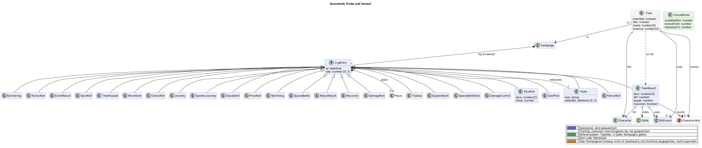

# Probe und Verlauf

Regeln des [Domänenmodells](../domain-model.md) für diesen Bereich: was das Bild nicht zeigt.
Das Diagramm führt; die Begriffe stehen im Domänenmodell unter *Begriffe*.

## Die Stufe der Proben

Die drei Stufen sind Referenzdaten: Hoch (75 %, 6+), Mittel (50 %, 8+), Gering (25 %, 10+). Bei
Proben heißen sie nach ihrer **Schwierigkeit** (`difficulty`): Leicht, Mittel, Schwer.
*2026-11-27.* Die Kampagne merkt sich **keine Stufe** mehr: Bei der Probe wählt man sie erst
**beim Würfeln**, mit einem der drei Knöpfe Leicht, Mittel, Schwer (je mit Zielwert); jeder würfelt sofort. Das
Orakel wählt sie je Frage auf der Karte (siehe [Orakel auf der Karte](karte.md#orakel-auf-der-karte)).
Kampagnen und Kampagnendateien von vorher tragen noch eine gewählte Stufe; sie wird beim Laden und
beim Import übergangen.

## Probe

Es gilt: 2W6 + Fertigkeit + gewählte Attribute ≥ Zielwert.
- Zuerst wählt man die Fertigkeit: eine Fertigkeitsstufe des Charakters (DM = Stufe) oder „ohne
  Fertigkeit“ (DM aus den Hausregeln, −3). Solange keine gewählt ist, gibt es keine Probe zu
  würfeln.
- **Jack-of-all-Trades** zählt in jeder Probe als Stufe 0: DM ±0, egal welche Stufe der Charakter
  darin hat. Wer es hat (nicht ausgeblendet), nimmt es für alles, wofür ihm die Fertigkeit fehlt;
  „ohne Fertigkeit“ gibt es für ihn nicht. Weil seine Stufe nichts ändert, zeigt die App sie
  nicht.
- Erst danach lassen sich Attribute dazuwählen. Ein gewähltes Attribut gibt +1 ab `bonusFrom` (9),
  −1 bis `malusUpTo` (5), sonst ±0. Attribute mit ±0 sind nicht wählbar.
- Der Zielwert kommt aus der Stufe, mit der man würfelt. Solange die Probe vorbereitet wird, rechnet
  sie den nötigen Wurf und die Chance **für alle drei Stufen** (`/need`, `/chance`, je in der
  Reihenfolge Leicht, Mittel, Schwer). Der nötige Wurf ist Zielwert minus DM, die
  Wahrscheinlichkeit wird exakt aus den 36 Kombinationen von 2W6 gezählt: Bis 2 ist sie sicher,
  über 12 unmöglich. Auch eine unmögliche Probe darf man würfeln; sie misslingt immer und steht
  trotzdem im Log.
- Die Probe in Vorbereitung ist eine `Task`. Sie gilt immer dem Charakter oben (`/for`, siehe
  *Charakter oben*) und verweist auf eine seiner Fertigkeitsstufen (`uses`) oder ist `unskilled`,
  nie beides; keins von beiden heißt: noch keine Fertigkeit gewählt. Wechselt der Charakter oben,
  endet die Probe; für den neuen beginnt keine, bis man eine Fertigkeit wählt.
- Gewürfelt wird eine Probe als `TaskResult` in den Log übernommen. Es verweist auf Charakter,
  Fertigkeitsstufe (keine heißt „ohne Fertigkeit“), die gewählten Attribute und die Stufe, mit der
  gewürfelt wurde, und es
  hält die zwei Würfel sowie DM (`dm`) und Zielwert (`target`) zum Zeitpunkt des Wurfs fest. Der
  Erfolg (`/success`: Würfel + `dm` ≥ `target`) folgt allein daraus, nie aus dem heutigen Stand von
  Charakter, Hausregeln oder Stufe. Die Verweise sagen, wer und womit gewürfelt hat.
- Bei `Task` und `TaskResult` gehört die Fertigkeitsstufe (`uses`) immer dem Charakter, auf den sie
  verweisen (`for`), und der Charakter immer zur Kampagne.

## Charakter oben

Ein Charakter der Kampagne ist der **Charakter oben** (`focus`); für ihn
würfelt man Proben. Infrage kommen nur Lebende, die nicht ausgeblendet sind, in der Reihenfolge
der Charaktere der Kampagne.
- Die Kampagne speichert ihn, er übersteht also einen Neustart und steht in der Kampagnendatei.
  Er verweist immer auf einen Charakter derselben Kampagne, der lebt und nicht ausgeblendet ist.
  Keinen gibt es nur, wenn es keinen solchen Charakter gibt.
- Stirbt der Charakter oben, wird er ausgeblendet oder gelöscht, rückt der nächste Lebende nach,
  hinter dem letzten der vorige. Ein neuer Charakter, von Hand angelegt oder aus der Erschaffung
  übernommen, wird zum Charakter oben. Wird ein Toter wieder lebendig oder ein Ausgeblendeter
  wieder eingeblendet, bleibt der Charakter oben, wie er ist; nur wenn es keinen gab, wird es
  dieser.
- Kampagnen und Kampagnendateien von vor dieser Regel haben keinen Charakter oben; sie bekommen
  den ersten Lebenden, der nicht ausgeblendet ist.
