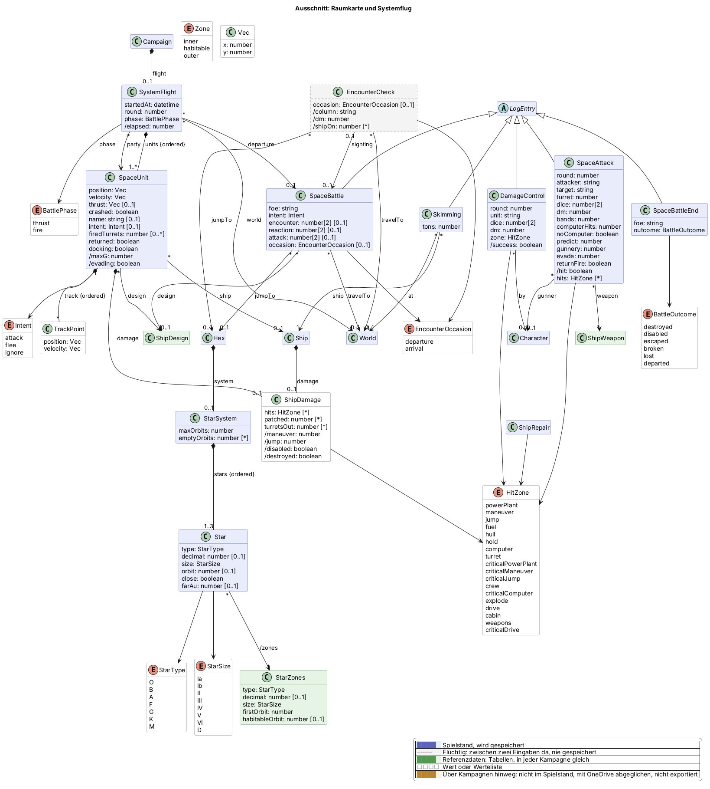

# Raumkarte und Systemflug

Regeln des [Domänenmodells](../domain-model.md) für diesen Bereich: was das Bild nicht zeigt.
Das Diagramm führt; die Begriffe stehen im Domänenmodell unter *Begriffe*.

## Systemflug

*Stufe 1 des Raumkampfs; freigegeben am 18. November 2026, Kennzeichen 2026-11-18c.* Nach dem
[Konzept Raumkarte und Raumkampf](../konzept-raumkampf.md): Man fliegt mit dem eigenen Schiff um eine
Welt und lernt die Bahnen, noch ohne Gegner und Waffen. Was auf der Raumkarte läuft, heißt
**Systemflug** (`SystemFlight`; Owner, 18. November 2026), auch wenn später gekämpft wird. Regeln aus SR 39–42, *Mayday* und SE 12,
zusammengefasst in [`regeln-schiffe.md`](../regeln-schiffe.md); Abweichungen tragen ⚑, Entscheidungen
des Owners vom 18. November 2026 sind als solche genannt; die übrigen Hausregeln hat er am selben
Tag angenommen.
- **Raumkarte.** Der Raum um eine Welt, in 2D (Owner): die Welt in echter Größe, die
  Sprunggrenzen und die Einheiten mit Spur und Bahnvorschau.
- **Beginnen und beenden** (Owner). „Systemflug beginnen“ geht nur auf der Raumkarte der Welt, auf
  der die Gruppe ist, und nur mit dem eigenen Schiff (`Campaign./ship`); es legt einen
  `SystemFlight` mit Raumrunde 1 und einer Einheit für das Schiff an. Liegegebühr und Ort des
  Schiffs ändern sich dadurch nicht. Das Schiff startet auf einer Kreisbahn mit dem doppelten
  Weltradius, gegen den Uhrzeigersinn (Owner); bei Größe 0 (Asteroidengürtel) ruhend in 20.000 km
  Abstand. „Systemflug beenden“ entfernt ihn wieder. Es gibt höchstens einen.
- **Die Raumrunde** dauert 1.000 Sekunden (SR 39). Jede Runde: Schubvektoren setzen, „Runde
  ausführen“, die Simulation rechnet die 1.000 Sekunden für alle Einheiten zugleich (Owner:
  gleichzeitig), die Karte spielt sie in etwa zwei Sekunden ab. Danach wird für jede Einheit der
  alte Ort mit Geschwindigkeit an die Spur gehängt, der Schubvektor geleert und die Raumrunde um
  eins erhöht.
- **Zeit** (Owner). Je volle 24 Stunden Dauer (also wenn `/elapsed` ein Vielfaches von 86.400
  Sekunden überschreitet, nach jeweils 86,4 Raumrunden) vergeht ein Tag, genau wie mit „Tage
  vergehen“ im Bereich Begegnung, mit allem, was daran hängt: Logeintrag, Begegnungstests,
  Monatsende. ⚑ Angebrochene Tage verfallen beim Beenden. Sonst schreibt der Systemflug in Stufe 1
  nichts ins Log.
- **Schubvektor** (Owner): einer je Raumrunde, fest im Raum, stufenlos in 0,1 G, höchstens
  `/maxG`; jede Raumrunde beginnt ohne Schub. Ohne Schubvektor fliegt die Einheit ballistisch.
- **Zieleingabe** (Owner, 22. November 2026, wie in *Mayday*): Den Schub gibt man über den Ort, an
  dem die Einheit nach der Runde stehen soll, ausgehend vom Punkt **„ohne Schub“** (wo sie ohne
  Schub stünde); daraus rechnet die App den Schubvektor (mit der echten Schwerkraft angenähert).
  Höchster Schub verschiebt den Endpunkt um ⚑ 5.000 km je G (½ · 10 m/s² · (1.000 s)², weil der
  Schub die ganze Runde gleichmäßig wirkt; in *Mayday* rückt 1 G den Zukunftsmarker um ein Feld,
  10.000 km). Die Geschwindigkeit ändert sich um 10 km/s je G.
- **Physik.** Gespeichert sind Ort (km) und Geschwindigkeit (km/s) in der Ebene, die Welt in der
  Mitte. Die Simulation rechnet in festen Schritten von 10 Sekunden mit *Velocity Verlet*, ohne
  Zufall: gleicher Stand und gleiche Schubvektoren ergeben auf jedem Gerät dieselbe Bahn. 1 G =
  10 m/s² (Supplement 3). Der Schub wirkt während der ganzen Runde gleichmäßig; 1 G ändert die
  Geschwindigkeit je Runde um 10 km/s, wie in SE 12. ⚑ Kein Treibstoffverbrauch für den Schub.
- **Himmelskörper** werden nicht gespeichert, sondern aus der Welt abgeleitet: Radius = Größe ×
  800 km (Durchmesser Größe × 1.600 km), Schwerkraft an der Oberfläche g = Größe ÷ 8 G (SR 22, mit
  Dichte K = 1, Owner), Masse daraus (G·M = g · R²). Die Welt steht still in der Mitte. Größe 0 hat
  keinen Körper und keine Schwerkraft. Monde und Gasriesen kommen mit dem Sternsystem.
- **Aufschlag** (Owner). Kommt eine Einheit unter die Oberfläche der Welt, wird `crashed` gesetzt;
  sie bewegt sich nicht mehr und bekommt keinen Schub. In Stufe 1 hat das keine Folgen für das
  Schiff; Schaden und Verlust kommen mit Stufe 2.
- **Landen** (Owner, 21. November 2026). Trifft eine Einheit mit höchstens 5 km/s (Owner, 21. November 2026; zuerst 1 km/s) gegenüber der
  Oberfläche auf (bei einem Mond mitbewegt gemessen), ist sie gelandet, nicht aufgeschlagen: Der
  Systemflug endet, und die Gruppe ist auf dieser Welt, wie mit „Gruppe platzieren“ (Ankunft:
  Oberfläche und Globus entstehen, falls sie fehlen; das Schiff liegt dort). So erreicht man auch
  einen Mond oder eine Nebenwelt der Raumkarte. Gespeichert wird dafür nichts Neues. An einem Gasriesen landet niemand;
  dort ist langsames Auftreffen Schöpfen (siehe *Treibstoff schöpfen*, 2026-11-21f).
- **Landeautomatik** (Owner, 21. November 2026: von Hand war Landen bei Raumrunden von 1000 s
  kaum zu schaffen). Führt die Bahn eines Schiffs auf die Oberfläche eines Körpers (der tiefste
  Punkt der Bahn um ihn liegt unter der Oberfläche, das Schiff ist höchstens drei Radien über
  ihr) und ist der Weg bis dorthin gerade so lang wie der Bremsweg mit dem höchsten Schub des
  Schiffs, bremst es selbst mit vollem Schub gegen seine Bewegung gegenüber dem Körper; der
  eingestellte Schub ruht so lange. Sinkt es langsamer als 1 km/s, lässt die Automatik es weiter
  sinken, so setzt es sicher unter der Landegeschwindigkeit auf. Reicht der Schub nicht (zu schnell,
  zu schwach gegen die Schwerkraft), schlägt es auf. Gespeichert wird dafür nichts.
- **Treibstoff schöpfen** (freigegeben am 21. November 2026, Kennzeichen 2026-11-21f; Owner, 21. November
  2026). Nach SR 32 kann ein stromlinienförmiges Schiff an einem Gasriesen Treibstoff schöpfen
  (*skimming*), unraffiniert und kostenlos (SR 30 nennt Cr100 je Tonne nur für gekauften).
  - *Eintauchen statt landen*: Ein Gasriese hat keine Oberfläche; die Wolkendecke (sein Radius)
    gilt wie eine. Trifft ein Schiff mit stromlinienförmigem Entwurf (`ShipDesign.streamlined`)
    dort mit höchstens 5 km/s auf (wie beim Landen, auch mit der Landeautomatik), schöpft es:
    Der Tank wird voll (`Ship.fuel` = Tank des Entwurfs), die geschöpften Tonnen kommen zu
    `Ship.unrefined`, und ein Logeintrag `Skimming` hält sie mit Gasriese (`at`) und Schiff fest.
    Ist der Tank schon voll, schöpft es 0 t, und der Logeintrag entfällt.
  - *Danach* fliegt es weiter, der Systemflug endet nicht: ⚑ Das Schöpfen dauert 22 Raumrunden
    (gut 6 Stunden, Hausregel; die SR nennen keine Dauer), um die `round` steigt (damit vergehen
    auch Tage wie sonst), und das Schiff steht danach auf einer Kreisbahn mit doppeltem Radius
    des Gasriesen, gegen den Uhrzeigersinn, über der Stelle, an der es eintauchte. Die Spur
    bekommt einen Punkt an der Stelle des Eintauchens.
  - *Ohne Stromlinie* taucht kein Schiff ein: Am Gasriesen fliegt die Landeautomatik dann nicht
    mit, und jedes Auftreffen ist ein Aufschlag (`crashed`). Die Bahnvorschau zeigt Schöpfen
    (wie die Landung) bzw. den Aufschlag vorher an.
  - *Gekaufter Treibstoff* (Tanken im Bereich Schiff) ist raffiniert und ändert `unrefined` nicht.
  - *Stromlinienform der Standardentwürfe* (Owner, 21. November 2026: aus Book 2 nach Kenntnis
    von Claude, der Owner prüft): Scout/Courier, Free Trader, Subsidized Merchant, Yacht, Patrol
    Cruiser, Safari Ship ja; Subsidized Liner, Mercenary Cruiser, Laboratory Ship nein. Landen
    dürfen vorerst weiter alle Schiffe (SR 32 erlaubt es nur stromlinienförmigen; dafür fehlen
    noch Beiboote).
- **Spur** (`track`): je vergangene Raumrunde ein `TrackPoint` mit Ort und Geschwindigkeit.
  Gespeichert, damit sie einen Neustart übersteht.
- **Demo-Kampagne** (Owner): Sie beginnt mit einem Scout/Courier (Type S) der Gruppe,
  schuldenfrei wie aus dem Ship-Vorteil der Scouts, mit vollem Tank, damit man den Systemflug
  gleich ausprobieren kann (siehe *Demo-Kampagne*).
- **Später** (eigene Änderungen): Raketen, Sand, Small Craft, Ortung, Raumkampf aus einer
  Schiffsbegegnung beim Ankommen; siehe den Stufenplan im Konzept.

## Raumkampf, Stufe 2: Gegner und Laser

(freigegeben am 21. November 2026, Kennzeichen
2026-11-21h). Nach dem
[Konzept](../konzept-raumkampf.md) (Abschnitte 4, 6, 7) und SR 39–42, SE 12–13. Hausregeln tragen ⚑;
der Owner entscheidet sie mit dem Ausprobieren.
- **Ein fremdes Schiff.** Im Systemflug würfelt „Schiffsbegegnung“ auf der *Starship Encounter
  Table* (SE 13, Spalte nach dem Raumhafen der Hauptwelt, DM +2 Marinebasis, +1 Scoutbasis); ohne
  Ergebnis kommt keins. Ein Pirat (P) greift an; sonst entscheidet die Reaktion (2W6, SE 21): 2
  greift an, 3 greift bei 5+ an, 4 bei 8+ (ein weiterer Wurf auf 2W6, `attack`), sonst ⚑ ignoriert
  es die Gruppe. Alles steht im Logeintrag `SpaceBattle` (Würfe, Entwurf, Name, Absicht). ⚑ Zum
  Ausprobieren und als Spielleiter lässt sich ein Schiff auch von Hand wählen (Entwurf und
  Absicht), dann ohne Würfe. Höchstens ein fremdes Schiff zugleich (Stufe 2).
- **Wo es auftaucht** ⚑: 2W6 Raumbänder vom eigenen Schiff entfernt, in der Richtung 1W6 × 60°,
  mit derselben Geschwindigkeit wie das eigene Schiff (von Hand gewählt: 7 Raumbänder voraus). Es
  ist eine Einheit ohne `ship`, mit `design`, `name` (der Name des Entwurfs) und `intent`; seine
  Turrets sind die seines Entwurfs.
- **Wie es fliegt** (Konzept, Abschnitt 6) ⚑: Vor jeder Raumrunde probiert die App 49 Schübe aus
  (ohne Schub sowie 16 Richtungen × ⅓, ⅔ und volle Stärke), rechnet je zwei Raumrunden voraus
  (das eigene Schiff mit seinem gesetzten Schub) und nimmt den besten: *Angreifen* hält 5
  Raumbänder Abstand mit freier Sichtlinie; *Fliehen* möglichst weit weg vom eigenen Schiff;
  *Ignorieren* gibt keinen Schub. Aufschläge sind verboten. Ohne Zufall: gleicher Stand, gleicher
  Schub. Fremde Schiffe landen nicht und schöpfen nicht; trifft eines eine Oberfläche, ist es ein
  Aufschlag.
- **Feuer auslösen** (geändert am 23. November 2026, Kennzeichen 2026-11-23a; vorher 2026-11-21i
  mit dem Flag `fired`; vorher setzte man mit `aim` ein Ziel, und gefeuert wurde beim Ausführen der
  Raumrunde). Die Raumrunde hat im Raumkampf zwei Phasen (`SystemFlight.phase`): **Schub**
  (`thrust`) und **Feuer** (`fire`). Am Ende der Schubphase (**Bewegen**) bewegen sich alle
  Einheiten – die Raumrunde rückt *nicht* weiter, es folgt die Feuerphase; an deren Ende (**End
  Turn**) feuern erst die fremden Schiffe, dann rückt die Raumrunde weiter und jeder Hardpoint darf
  wieder. Ohne Raumkampf
  ist die Raumrunde – wie in Stufe 1 – mit der Bewegung zu Ende (`phase` bleibt `thrust`).
  - In der **Feuerphase** feuert jeder **Hardpoint** jedes eigenen Schiffs, sobald man ihn auslöst,
    sofort auf das gewählte Ziel; der Schaden wirkt gleich. Jeder Hardpoint feuert je
    Raumrunde einmal (`firedTurrets`); andere Hardpoints desselben Schiffs bleiben frei.
  - **Ziel** ist das gewählte fremde Schiff, sonst das erste, das kämpft. Die Zielwahl ist kein
    Spielstand.
  - Ein **angreifendes fremdes Schiff** feuert am Ende der Raumrunde („End Turn“) auf das eigene
    Schiff, wenn es in dieser Raumrunde noch nicht gefeuert hat.
  - **Rückfeuer** (SR 40): Ein fremdes Schiff, auf das gefeuert wird und das in dieser Raumrunde
    noch nicht gefeuert hat, feuert gleich zurück, wenn es noch kann. ⚑ Greift es nicht an, greift
    es ab dann an, wenn es Laser hat, sonst flieht es. Das **eigene Schiff** erwidert Feuer von
    selbst nur mit dem Programm *Return Fire* (`returned`, einmal je Raumrunde); ohne das Programm
    feuert die Gruppe selbst.
- **Laserfeuer**. Jeder Laser jedes Turrets, das nicht ausgefallen ist, würfelt
  einzeln 2W6 + DM, **8+** trifft (SR 40). DM: Pulse Laser −1; Entfernung über 25 Raumbänder −2,
  über 50 −5 (Raumband = Entfernung ÷ 10.000 km, aufgerundet); ⚑ je Computer-Treffer −1. Kein
  Schuss ohne freie Sichtlinie (ein Körper dazwischen) und ⚑ über 90 Raumbänder (Tracking). Dazu die
  Programme in der CPU des Schützen und des Ziels (Stufe 2b, 2026-11-23a): ohne **Target** kein Schuss
  eines Turrets, **Predict** und die Fertigkeit des Gunners (**Gunner Interact**) als DM des Schusses,
  das Ausweichprogramm des Ziels als sein Verteidigungs-DM. Missile Racks und
  Sandcaster feuern noch nicht (Stufe 3). Der Schaden einer Salve wirkt erst nach allen ihren
  Würfen.
- **DMs erklären** (freigegeben am 21. November 2026, Kennzeichen 2026-11-21i). Zu jedem Hardpoint
  gehört der Zielwert auf 2W6 (8 − DM) und jeder DM mit seinem Grund (Entfernung mit Raumbändern,
  Pulse Laser, Computer-Treffer, Predict, Gunner, Ausweichen). Jeder Schuss hält
  fest, woraus sein DM kam: `bands` (Entfernung in Raumbändern), `computerHits` (Computer-Treffer
  des Schützen), `predict`, `gunnery`, `evade` und ob es Rückfeuer war (`returnFire`); so erklären
  Würfe und Log den DM auch später noch, wenn sich Schaden und Entfernung geändert haben.
- **Treffer**: Ein Beam Laser macht einen Schadenswurf, ein Pulse Laser zwei; jeder ist 2W6 auf die
  Trefferzone für Starships (SE 12), bei 12 ein kritischer Treffer mit 1W6. Jeder Schuss ist ein
  Logeintrag `SpaceAttack` mit Raumrunde, Schütze, Ziel, Turret, Waffe, Würfeln, DM und den
  Trefferzonen. ⚑ Die Würfe der Trefferzonen stehen nicht im Log, nur ihre Zonen.
- **Schaden** (`ShipDamage`, SR 41) ⚑ ohne Antriebsbuchstaben (die Referenzdaten haben keine):
  jeder Treffer auf Maneuver oder Power Plant senkt `/maneuver` (die G des Antriebs) um 1, auf
  Jump `/jump` um 1, jeweils nicht unter 0; ein kritischer Treffer auf eines davon setzt es auf 0.
  Fuel: das eigene Schiff verliert 10 t Treibstoff (zuerst unraffinierten); Hold: 10 t Fracht.
  Hull: Dekompression, ⚑ ohne Folgen in Stufe 2. Computer: DM −1 auf das eigene Feuer; kritisch:
  keine Laser mehr. Turret: ⚑ ein zufälliges (1W6) Turret, das noch arbeitet, fällt aus
  (`turretsOut`); arbeitet keins mehr, zählt der Treffer wie Hull. Crew (kritisch): die Crew ist
  handlungsunfähig, das Schiff gibt keinen Schub und feuert nicht. Explode (kritisch): das Schiff
  ist zerstört (`/destroyed`). `/disabled`: zerstört, Crew handlungsunfähig, oder ohne Antrieb und
  ohne arbeitenden Laser. Der Höchstschub einer Einheit (`SpaceUnit./maxG`) ist `/maneuver`; ⚑
  eine Reise mit eigenem Schiff springt höchstens `/jump` Parsec.
- **Ende des Raumkampfs** (`SpaceBattleEnd`): das fremde Schiff ist zerstört (*destroyed*, es
  verschwindet) oder kampfunfähig (*disabled*, es treibt als Wrack weiter, Entern kommt mit Stufe
  4); es ist über 90 Raumbänder entfernt (*escaped*, es verschwindet); der Systemflug endet durch
  Landen oder Beenden (*broken*); das eigene Schiff ist zerstört (*lost*). ⚑ Landen und Schöpfen
  sind auch im Raumkampf erlaubt (das Konzept schlug „kein Landen im Kampf“ vor); Landen beendet
  ihn. ⚑ Wird das eigene Schiff zerstört, endet der Systemflug, das Schiff wird ausgeblendet, und
  was aus der Gruppe wird, entscheidet der Owner im Spiel.
- **Demo-Kampagne** ⚑: Ihr Schiff (seit 2026-11-21b eine Yacht) hat auf seinem Hardpoint einen Double Turret mit einem Beam Laser, damit man den Raumkampf
  gleich ausprobieren kann (die Kasse der Demo reicht für keinen Laser).
- **Reparatur** ⚑ (SR 42 nennt 10–120 % des Neuwerts der Baugruppe, die Referenzdaten haben keine
  Baugruppen): in der Werft an einem Raumhafen A oder B, Cr 100.000 je Treffer und Cr 1.000.000 je
  kritischem Treffer, je ausgewähltem Treffer (seit 2026-11-27d auf der Detailseite *Schaden*, siehe
  [Reparatur außerhalb des Kampfs](schiffe.md#reparatur-außerhalb-des-kampfs); Buchung mit
  `shipCost` repair). Ist alles repariert, ist `Ship.damage` leer; ausgefallene Turrets arbeiten wieder.
