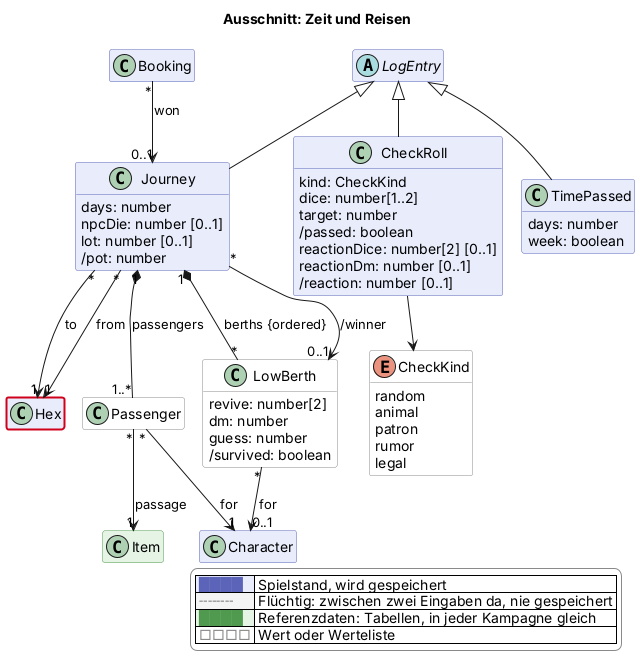

# Zeit und Reisen

Regeln des [Domänenmodells](../domain-model.md) für diesen Bereich: was das Bild nicht zeigt.
Das Diagramm führt; die Begriffe stehen im Domänenmodell unter *Begriffe*.

## Aufenthaltsort

Die Gruppe, also alle Charaktere der Kampagne, ist immer an höchstens einem
Ort (`location`): einer fertigen Welt des Subsektors. Man setzt ihn auf der Weltkarte („Gruppe ist
hier“); die Karte zeigt ihn. Eine neue Kampagne hat keinen. Ohne Aufenthaltsort gibt es keinen
Einkauf. Wird die Welt verworfen (das geht heute nicht), fällt er weg.

## Spielzeit

*2026-11-13d.* Die Kampagne hat einen heutigen Tag (`day`), gezählt im
Imperialen Kalender: 365 Tage im Jahr, `day` = Jahr × 365 + Tag des Jahres − 1. Angezeigt wird das
Datum `/date` als „Tag-Jahr“ mit drei Stellen für den Tag (123-1105) und dem Wochentag. Eine neue
Kampagne beginnt am 001-1105; Spielstände und Dateien von vorher ebenso. Das Startdatum lässt sich
ändern, solange kein Logeintrag einen Tag hat; danach geht die Zeit nur vorwärts.
- *Wochentage* (Hausregel nach dem Imperialen Kalender): Tag 001 ist der Feiertag, er hat keinen
  Wochentag. Ab Tag 002 folgen die Wochentage Montag bis Sonntag; Tag 008 ist der erste
  Sonntag, Tag 365 der 52. Sonntag. Eine **Woche** (für die wöchentlichen Tests) beginnt mit dem
  Sonntag, auf den „Woche beenden“ springt, und reicht bis zum Samstag; die erste Woche des
  Jahres beginnt mit dem Feiertag (Tag 001 bis 007). Bei der Umsetzung am 13. November 2026
  korrigiert: vorher endete die Woche mit dem Sonntag, dann hätte „Woche beenden“ keine neue Woche
  begonnen.
- *Tag im Log*: Jeder neue Logeintrag hält den Spieltag fest, an dem er entsteht (`LogEntry.day`).
  Der Log zeigt beim ersten Eintrag eines neuen Tages das Datum als Trenner.

## Zeit vergehen lassen

*2026-11-13d.* Zeit vergeht auf zwei Arten: **Tage** (1 bis 6 Tage)
und **Woche beenden** (bis zum nächsten Sonntag; am Sonntag sieben Tage weiter). Beides ist ein Logeintrag `TimePassed` mit der Zahl der Tage und ob
es die Woche beendet hat; `Campaign.day` wächst um die Tage. Während einer laufenden Begegnung
vergeht keine Zeit.
- *Erinnerung* (am 14. November 2026 auf Wunsch des Owners geändert): **Tage** vergehen ohne
  Erinnerung. Nur **Woche beenden** sagt einmal, was diese Woche fehlt, statt gleich
  weiterzuschalten: bei Gesetz 1 oder mehr die Polizei, wenn sie diese Woche nicht getestet ist;
  die Zufallsbegegnung und, wenn das Gelände Tiere hat, die Tiere, wenn sie diese
  Woche gar nicht getestet sind. Man kann trotzdem weiterschalten, ohne Begegnung: je
  nach Lage will man mehr oder weniger Begegnungen. An Patron und Gerücht erinnert nichts: Die
  will man haben, man würfelt sie von selbst. Die Tests würfelt die Zeit nie selbst. Die
  Tests zählen weiter je Tag bzw. Woche (siehe [Test](begegnung.md#test)).
- **Ein Tag** (Owner, 22. November 2026): Ein Tag vergehen lassen geht auch aus dem Log, ohne den
  Bereich zu wechseln, etwa für Reisen. Während einer *Fahrt* ist es **Weiterfahren**, während
  einer Reise *unterwegs* **Weiterreisen**, sonst **1 Tag**; es gelten dieselben Sperren (etwa
  während einer laufenden Begegnung).

## Reise

*2026-11-13d.* Die Gruppe reist mit **Passagen** (High, Middle, Low; SE S. 8 f.) oder
mit dem **eigenen Schiff** (2026-11-16d, siehe *Eigenes Schiff*), je nachdem, was verfügbar ist.
- *Wohin*: Zu einer anderen fertigen Welt reist die Gruppe, wenn sie
  einen Aufenthaltsort hat, beide Welten einen Raumhafen A bis E haben und das Ziel höchstens
  **2 Parsec** entfernt ist (Sprung 2). Weiter geht es nur über Zwischenhalte, je Halt eine Reise.
  Mit eigenem Schiff gilt diese Grenze nicht (siehe *Eigenes Schiff*).
  Während einer laufenden Begegnung reist man nicht.
- *Wer*: Es reisen alle lebenden, nicht ausgeblendeten Charaktere der Kampagne, je mit einer
  Passage (`Passenger`): man wählt je Charakter High, Middle oder Low Passage, vorgeschlagen ist
  die letzte Wahl. Die Passage kommt aus dem Gruppengepäck (ein Stück weniger); fehlt sie dort,
  kauft die App sie zum Preis der Charts (Buchung `purchase` auf dem Abflugort). Reicht die Kasse
  nicht, geht die Reise nicht.
- *Dauer*: Jede Reise dauert **eine Woche** (`days` = 7), egal wie weit (SE S. 8). Der Logeintrag
  `Journey` steht am Abflugtag. Seit 2026-11-22c vergehen die 7 Tage nicht mehr auf einmal: Die
  Gruppe ist *unterwegs* und lässt sie mit „Weiterreisen“ selbst vergehen; nach dem siebten ist der
  Aufenthaltsort das Ziel (`to`), siehe [Unterwegs](#unterwegs). Die Zeit vergeht dabei ganz normal: 7 Tage, der Wochentag bei der Ankunft ist der
  der Abreise, und ein Sonntag dazwischen beendet die Woche wie sonst auch (die Zähler der Tests
  beginnen neu). Nur gibt es **keine Pflicht-Begegnungen**: Die Reise erinnert nicht an fehlende
  Tests, weder vor der Abreise noch für die Tage im Sprung, und würfelt keine. Wer unterwegs eine
  Begegnung will, würfelt sie wie sonst von Hand.
- *Eigenes Schiff* (2026-11-16d). Hat die Gruppe ein Schiff, kann sie in diesem
  reisen statt mit Passagen.
  - *Wohin*: Das Ziel liegt höchstens so viele Parsec entfernt, wie der Entwurf Sprung kann
    (`ShipDesign.jump`). Raumhäfen sind beide keiner nötig – das Schiff landet überall. Es
    reisen alle lebenden Charaktere mit; niemand kauft eine Passage, niemand liegt in
    Kälteschlaf-Lotterie. `Journey.ship` verweist auf das Schiff; `passengers` und `berths`
    sind leer.
  - *Treibstoff*: Jeder Sprung verbraucht `ShipDesign./jumpFuel` Tonnen – Hausregel: Tankinhalt
    geteilt durch Sprungzahl, gerundet (die SR-30-Formel braucht Energiewerks-Ratings, die die
    Referenzdaten nicht haben). Der Verbrauch zieht `Ship.fuel` ab; reicht der Treibstoff nicht,
    geht die Reise nicht. Unraffinierter Treibstoff (`Ship.unrefined`, 2026-11-21f) wird zuerst
    verbraucht: `unrefined` sinkt um den Verbrauch, nicht unter 0.
  - *Fehlsprung* (SR 28): Pro Sprung würfelt die App **2W6** (`Journey.jump`); `/misjump`
    folgt daraus: Summe plus `jumpDm` **13 oder mehr**. Die SR-DMs kommen erst ins Spiel, wenn
    die App sie abbildet (Entscheidung des Owners, 16. November 2026): seit 2026-11-21f **+1**,
    wenn der Sprung unraffinierten Treibstoff verbraucht (dann ist mit einer 12 ein Fehlsprung
    möglich); seit 2026-11-22b **+5/+15** nahe an einem Himmelskörper beim Sprung aus dem
    Systemflug (siehe [Schiffsbegegnungen bei Abreise und Ankunft](schiffe.md#schiffsbegegnungen-bei-abreise-und-ankunft)). Der DM steht an der Reise
    (`jumpDm`), damit ein alter Wurf nicht rückwirkend kippt; Passagen haben 0. Der Wurf steht an
    der Reise im Log. Was ein Fehlsprung folgt, entscheidet der Owner – die App würfelt nur,
    sie würfelt keinen Zielort und zerstört kein Schiff.
  - *Dauer*: ebenfalls **eine Woche**; sonst gilt wie bei der Passage.
  - *Lebenserhaltung* (2026-11-17b): siehe [Schiffe](schiffe.md#schiffe), *Laufende Kosten und Monatsabrechnung*.
  - Kommen später: zahlende Passagiere und Fracht.
- *Reise im System* (freigegeben am 20. November 2026, 2026-11-20d; Owner, 20. November 2026). Zwischen Welten
  desselben Systems (SE S. 27, Charts S. 8).
  - *Wohin*: Zu jeder anderen Welt des Systems, in dem die Gruppe ist, wie beim Sprung. Ziele sind Welten, kleine
    Welten, Gürtel und Monde, keine Gasriesen und Ringe. Nicht während einer laufenden Begegnung,
    einer Fahrt oder eines Systemflugs.
  - *Entfernung* (`/distance`, Owner: Abstand der Bahnen): Zwischen zwei Welten um den Stern der
    Unterschied ihrer Abstände vom Stern (B6 28, Zwischenbahnen eingefangener Welten dazwischen);
    für einen Mond zählt dabei die Bahn der Welt, um die er kreist. Zwischen einem Mond und seiner
    Welt sein Bahnabstand (Radien × Radius der Welt), zwischen zwei Monden derselben Welt der
    Unterschied ihrer Bahnabstände. Die Lage auf der Bahn spielt keine Rolle.
  - *Dauer* (`hours`): T = 2 · √(D ÷ A) (Charts S. 8: beschleunigen bis zur Mitte, dann abbremsen),
    D in m, A in m/s² (1 G = 10 m/s²), in Stunden aufgerundet. A ist mit Ticket 1 G, mit eigenem
    Schiff die G seines Manöverantriebs. `/days` = Stunden ÷ 24, aufgerundet, mindestens 1 Tag
    (Owner); so viele Tage vergehen wie bei der Reise, ohne Pflicht-Begegnungen, seit 2026-11-22c
    Tag für Tag mit „Weiterreisen“ (siehe [Unterwegs](#unterwegs)).
  - *Ticket* (Hausregel, Owner): je Reisendem Cr 25 je Stunde Flugzeit (der Satz der Middle Passage
    je Tag), als Buchung `ticket` auf dem Abflugort mit Verweis auf die Reise (`ticketFor`). Nur
    wenn Start oder Ziel einen Raumhafen hat (Starport A–E bzw. Spaceport F–H). Reicht die Kasse
    nicht, geht die Reise nicht.
  - *Eigenes Schiff*: wie bei der Reise mit eigenem Schiff (`ship`), ohne Preis und ohne
    Treibstoff (der Manöverantrieb verbraucht im Classic Traveller keinen nennenswerten).
  - *Wer*: wie bei der Reise alle lebenden, nicht ausgeblendeten Charaktere (`travellers`). Danach
    ist der Aufenthaltsort die Zielwelt (ohne Stadt und Feld).
  - Im Log wie die Reise: nicht löschbar.
- *Landeplatz* (freigegeben am 21. November 2026, 2026-11-21; Owner, 21. November 2026: „egal wie ich auf eine
  Welt komme, ich muss immer zuerst ein Feld für die Landung auswählen“).
  - *Wann*: Ist die Gruppe auf einer Welt mit Globus, aber ohne Feld und ohne Stadt (nach einer
    Reise, einer Reise im System, einer Landung aus dem Systemflug oder „Gruppe platzieren“), wählt
    sie zuerst ihren **Landeplatz**; vorher geht nichts anderes. Welten ohne Globus
    (Asteroidengürtel) haben keine Felder: Dort ist die Gruppe einfach auf der Welt.
  - *Was*: Infrage kommt jede Stadt der Welt mit Hafen (A–E Starport, F–H Spaceport, Owner:
    alle Häfen) und, wenn die Gruppe mit dem eigenen Schiff kam, **ein anderer Ort**: ein beliebiges
    Feld des Globus. ⚑ Hat eine Welt keine Stadt mit Hafen (selten, etwa dünn besiedelt), geht ein
    anderer Ort auch ohne eigenes Schiff. Der **Highport** (2026-11-28b;
    [Oberfläche](oberflaeche.md#highport)) steht als Stadt mit Hafen in der Auswahl, mit
    „Andocken“ statt „Landen“.
  - *Folge*: Die Gruppe steht in dieser Stadt bzw. auf diesem Feld (`Campaign.location`). Kam sie mit
    dem eigenen Schiff (Reise mit eigenem Schiff, Reise im System mit eigenem Schiff, Landung aus
    dem Systemflug), steht auch das Schiff dort (`Ship.place`).
  - *Abflug mit eigenem Schiff* (Sprung, Reise im System, Systemflug beginnen) geht nur, wenn die
    Gruppe beim Schiff ist: auf seiner Welt und, hat es ein Feld oder eine Stadt, dort. Das Schiff

  - *Abflug mit Passage oder Ticket* geht nur aus einer Stadt mit Hafen, nicht „aus der Pampa“; am
    Ziel landet das fremde Schiff an einem Hafen (als Landeplatz kommen dann nur Häfen infrage).
  - *Schiffe ohne Ort* (alte Stände, gerade gekauft): Sie stehen dort, wo die Gruppe ist, bis die
    Gruppe ihren nächsten Landeplatz wählt; dann steht das Schiff dort, ohne neue Liegegebühr bei
    der Ankunft (es lag schon auf dieser Welt).
  - ⚑ *Liegegebühren*: Das Schiff liegt dort, wo es steht (nicht mehr, wo die Gruppe ist). Steht es
    in einer Stadt mit Hafen, kostet es wie bisher Cr100 bei der Ankunft und Cr100 je weiteren Tag;
    an einem beliebigen Ort kostet es nichts. Ohne Feld (Welt ohne Globus) gilt wie bisher der
    Raumhafen der Welt.
- *Ohne Reise*: „Gruppe platzieren“ auf der Weltkarte und die Wahl im Bereich Begegnung setzen den
  Aufenthaltsort weiter ohne Reise und ohne Zeit, etwa zu Beginn einer Kampagne oder für eine
  Reise außerhalb der Regeln.
- *Log*: Vergangene Zeit und Reisen lassen sich nicht löschen, weil sie den Stand geändert haben
  (Tag, Aufenthaltsort, Tote, Lotterie). Ein Lotteriegewinn verweist im Code auf die Stelle der
  Reise im Log; wird davor etwas gelöscht, rückt der Verweis nach.
- Gepäckgrenzen (High 1000 kg, Middle 100 kg, Low 10 kg), Bumping der Middle Passage, Hijacking
  und Working Passage kommen später.

## Unterwegs

*freigegeben am 22. November 2026, Kennzeichen 2026-11-22c; Owner, 22. November 2026.* Jede Reise
läuft wie eine *Fahrt*: Sie beginnt beim Abflug und endet erst, wenn ihre Tage vergangen sind. Das
ändert die *Dauer* unter *Reise* und *Reise im System*: Die Zeit springt nicht mehr um die Dauer
weiter. Entscheidungen des Owners vom 22. November 2026 sind als solche genannt; Hausregeln tragen ⚑.
- **Für alle Reisen** (Owner): Sprung mit Passage oder eigenem Schiff (`Journey`, 7 Tage) und Reise
  im System mit Ticket, eigenem Schiff oder Beiboot (`SystemJourney`, `/days` Tage).
- **Abflug.** Was die Reise beim Abflug tut, tut sie wie bisher am Abflugtag: Logeintrag `Journey`
  bzw. `SystemJourney` mit allen Würfen (Sprungwurf, Kälteschlaf, Lotterie), Passagen, Tickets und
  Lebenserhaltung bezahlt, Treibstoff verbraucht. Neu ist **`Campaign.voyage`**: eine Reise
  unterwegs (`Voyage`) mit `days` = 0, die auf ihren Logeintrag verweist (`jump` bzw. `inSystem`,
  genau einer). Der Tag bleibt, und die Gruppe ist **an keinem Ort** (Owner): `Campaign.location`
  fehlt, bis sie ankommt. Das eigene Schiff, mit dem sie reist, hat keinen Ort (es ist bei der Gruppe),
  ein zurückgelassenes bleibt, wo es steht. Es gibt höchstens eine Reise unterwegs.
- **Weiterreisen** (Owner: wie bei der Fahrt). Unterwegs tritt **Weiterreisen** an die Stelle von
  „Tage vergehen“ (siehe *Ein Tag*): Es lässt **einen Tag** vergehen, genau wie „1 Tag vergehen“, mit
  allem, was daran hängt (Logeintrag, laufende Kosten, Monatsende), und zählt `days` um eins hoch.
  `/left` = Dauer − `days`. Wie bisher gibt es unterwegs **keine Pflicht-Begegnungen**: Die Reise
  erinnert nicht an fehlende Tests. ⚑ „Woche beenden“ ist unterwegs gesperrt (die Woche endet mit
  den Reisetagen, wenn ein Sonntag dazwischen liegt, wie sonst auch).
- **Ankunft**, wenn `days` die Dauer erreicht (nach dem letzten „Weiterreisen“): `Campaign.voyage`
  fällt weg, der Aufenthaltsort ist das Ziel (ohne Feld, also *Landeplatz*), das eigene Schiff kommt
  dort an (Liegegebühr ab dem Ankunftstag). Erst jetzt wirkt der **Kälteschlaf** (Owner: Aufwachwurf
  und Lotterie bei der Ankunft): Wer nicht aufwacht, ist tot, und der Lotteriegewinn wird gebucht. ⚑
  Gewürfelt wird beides weiter beim Abflug (die Würfel stehen an der Reise, damit ein Neustart nichts
  neu würfelt), bekannt wird es erst bei der Ankunft: beim Abflug nur Ziel, Dauer und Sprungwurf,
  bei der Ankunft Kälteschlaf und Lotterie. Danach folgt mit eigenem
  Schiff die Begegnungsprüfung der Ankunft (siehe [Schiffsbegegnungen bei Abreise und Ankunft](schiffe.md#schiffsbegegnungen-bei-abreise-und-ankunft)).
- **Unterwegs möglich** (Owner: Begegnungen an Bord): die Würfe im Bereich Begegnung, die keinen Ort
  brauchen (Zufallsbegegnung, Patron, Gerücht), von Hand; ⚑ eine Zufallsbegegnung an Bord nimmt TL
  und Bevölkerung der Abflugwelt, und die Begegnung steht dort (`Encounter.in`); Karte und Orakel, Proben, Charaktere.
  Gesperrt, weil die Gruppe an keinem Ort ist: Tiere, Polizei, Shop, Werft, Tanken, Landeplatz,
  Systemflug, eine weitere Reise, Fahrten, „Gruppe platzieren“.
- **Abbrechen** geht nicht (Owner): Die Reise läuft bis zur Ankunft.
- **Weiterreise aus dem Systemflug** (2026-11-22b) beginnt die Reise ebenso; die Prüfung der Ankunft
  kommt nach ihren Tagen.
- **Reisen von vorher** sind sofort angekommen und haben keine `Voyage`.

## Low Passage

*2026-11-13d.* Jeder Low-Passagier würfelt beim Aufwachen **5+ auf 2W6**
(SE S. 9). DMs: +1, wenn ein mitreisender Charakter in High oder Middle Passage Medical-2 oder
besser hat (er hilft dem Schiffsmedic; Hausregel, die Regeln sagen „attending medic“); −1 bei END 6
oder weniger. Wer es nicht schafft, stirbt (`dead`). Jede Koje (`LowBerth`) hält Würfel und DM fest
(`revive`, `dm`); `/survived` ist Summe + DM ≥ 5. Low-Passagiere altern nicht; die App führt
zurzeit kein Alter im Spiel.

## Low Lottery

*2026-11-13d; SE S. 9.* Reist mindestens ein SC in Low Passage, gibt es
die Lotterie.
- *Mitreisende* (Hausregel, die Passagiertabelle fehlt noch): 1W6 weitere Low-Passagiere als NSC
  (`npcDie`); jeder hat eine Koje ohne Charakter, würfelt 5+ ohne DM zum Aufwachen und tippt
  zufällig eine Zahl von 0 bis zur Zahl aller Low-Passagiere. Den Würfel würfelt die App schon
  beim Öffnen der Reise, damit die SC wissen, wie viele mitreisen, wenn sie tippen; bis zur
  Abreise hält ihn der Controller.
- *Tipp*: Vor dem Aufwachen tippt jeder SC in Low Passage, wie viele Low-Passagiere überleben
  (`guess`, 0 bis zur Zahl aller Low-Passagiere).
- *Topf* (`/pot`): Cr 10 je Low-Passagier, vom Kapitän.
- *Gewinner* (`/winner`): der Tipp, der der Zahl der Überlebenden am nächsten ist; bei Gleichstand
  lost die App unter den Gleichauf (`lot`, die Nummer in der Reihenfolge der Kojen). Hat der
  Gewinner nicht überlebt, behält der Kapitän den Topf. Gewinnt ein SC, kommt der Topf als Buchung
  `lottery` in die Gruppenkasse, mit `for` (der SC) und `won` (die Reise).
