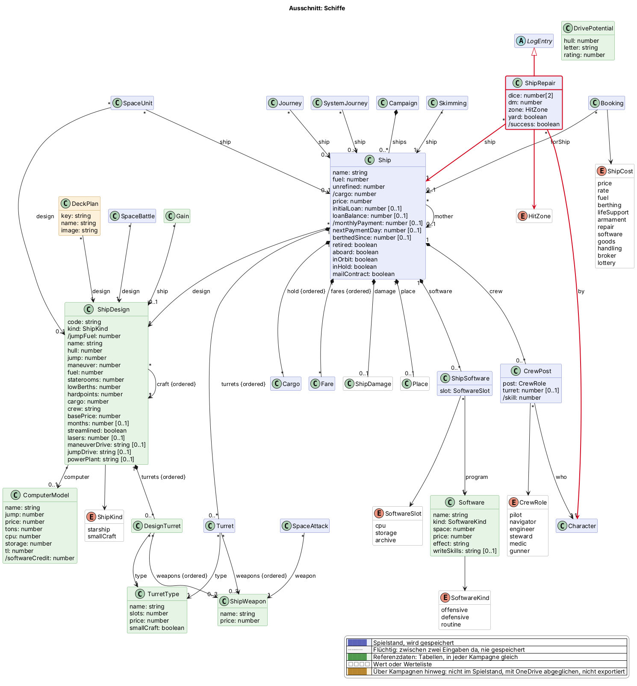

# Schiffe

Regeln des [Domänenmodells](../domain-model.md) für diesen Bereich: was das Bild nicht zeigt.
Das Diagramm führt; die Begriffe stehen im Domänenmodell unter *Begriffe*.

## Schiffe

*freigegeben am 16. November 2026, Kennzeichen 2026-11-16.* Erster
Schritt von dreien (Basis der Gruppe; später Handel, dann Raumkampf; der Owner hat am
18. November 2026 entschieden, den Raumkampf vor dem Handel zu bauen), RAW-Regeln vollständig in
[`regeln-schiffe.md`](../regeln-schiffe.md). Die Gruppe hat **höchstens ein Schiff** (`Campaign.ship`),
wie das Gruppengepäck.
- **Schiff und Entwurf.** `Ship` ist der gespeicherte Stand (Name, Treibstoff und Fracht in Tonnen,
  der tatsächlich gezahlte Preis, Restschuld); `ShipDesign` sind Referenzdaten für die
  Standardentwürfe aus SR 35–37 (Scout/Courier, Free Trader, Subsidized Merchant, Subsidized
  Liner, Yacht, Mercenary Cruiser, Patrol Cruiser, Laboratory Ship, Safari Ship) mit Rumpf,
  Antrieben, Treibstofftank, Computer, Kabinen, Niedrigbetten, Hardpoints, Laderaum, Crewbedarf als
  Text und Bauzeit. Treibstoff und Fracht sind zunächst nur Zahlen in Tonnen, ohne einzelne Güter;
  was wirklich im Laderaum liegt, kommt erst mit dem Handel. Ebenso bleiben die Hardpoints
  vorerst unbewaffnet (Zahl aus dem Entwurf); Waffen und Turrets kommen erst mit dem Raumkampf.
  **Noch nicht in diesem Schritt:** welcher SC welche Schiffsposition (Pilot, Navigator, Engineer,
  Steward, Medic, Gunner) ausfüllt (dafür reicht vorerst der Crewbedarf-Text am Entwurf); mehrere
  Schiffe gleichzeitig; eigene (Custom-)Entwürfe statt der Standardentwürfe; Small Craft (Launch,
  Ship's Boat, …) bleiben einfache Gegenstände der Art `ship` wie bisher, ohne eigenen
  `ShipDesign`.
- **Grundpreis am Entwurf, tatsächlicher Preis am Schiff** (Owner, 16. November 2026, nach einem
  Missverständnis richtiggestellt): `ShipDesign.basePrice` ist schlicht der in SR 35–37 genannte
  Preis eines neuen Schiffs dieses Standardentwurfs (z. B. Free Trader Cr37.080.000) – **ein
  gespeicherter Wert, nicht abgeleitet**, denn die Tabellen aus *Charts and Tables*, aus denen
  sich Rumpf, Antriebe, Energiewerk und Computer einzeln bepreisen ließen, fehlen (siehe
  `regeln-schiffe.md` unter *Lücken*); eine Formel daraus vorzutäuschen wäre nur ein Umweg um
  denselben festen Wert. Käme später ein eigener (Custom-)Entwurf aus echten Bauteilpreisen
  hinzu, ist das ein eigener Schritt, der die fehlenden Tabellen erst besorgt.
  `Ship.price` ist der **tatsächlich gezahlte Preis dieses einen Schiffs**: beim Erwerb gleich
  `design.basePrice` gesetzt, aber ein eigenes, gespeichertes Feld, weil er später davon abweichen
  kann und soll – etwa für ein **gebrauchtes Standardschiff** (SR 31: 10–40 Jahre alt, 10–40 %
  günstiger). Ein solcher Preisnachlass ist **nicht Teil dieses Schritts** (offene Frage, siehe
  unten), aber das Feld ist schon da, damit `price` nicht rückwirkend am Entwurf hängt, sobald es
  ihn gibt.
- **Erwerb.** Drei Wege (die Abmusterung würfelt in der Charaktererschaffung); in allen dreien wird
  `Ship.price` zunächst auf `design.basePrice` gesetzt (kein Nachlass in diesem Schritt):
  1. **Bar aus der Kasse:** der volle Preis (`price`) wird sofort gebucht (`BookingKind.ship`),
     das Schiff entsteht ohne Restschuld, mit vollem Tank und leerem Laderaum.
  2. **Bankfinanzierung** (SR 29, voll nach RAW): 20 % Anzahlung sofort aus der Kasse gebucht
     (`BookingKind.ship`). Die **Kreditsumme** (`initialLoan`) wird beim Abschluss einmal auf
     **200 % von `price`** festgelegt und bleibt so stehen, auch wenn sich `price` oder der Entwurf
     später ändern (480 Monatsraten à ein Vierhundertachtzigstel der Kreditsumme ergeben zusammen
     mit der Anzahlung die 220 % aus SR 29); die **Restschuld** (`loanBalance`) beginnt gleich der
     Kreditsumme und sinkt mit jeder bezahlten Rate; ist sie auf 0 (bezahlt oder durch den
     Merchant-Vorteil), entfällt `nextPaymentDay`. Die **Monatsrate** (`/monthlyPayment`) folgt
     daraus (`initialLoan / 480`), nicht noch einmal aus `price`. Fällig wird sie an einem
     **Monatsende** (2026-11-17b, vorher alle 30 Tage ab dem Kauf): `nextPaymentDay` ist das
     erste Monatsende, das mindestens vier Wochen nach dem Erwerb liegt, danach jedes folgende.
     Erreicht die Spielzeit ein Monatsende, an dem oder nach dem `nextPaymentDay` liegt, wird die
     Rate automatisch aus der Kasse gebucht (Buchung der Art `ship` mit `shipCost` rate und
     `forShip` auf das Schiff) und die Restschuld
     sinkt; reicht die Kasse nicht, bleibt die Rate offen (Buchung mit Hinweistext „Rate nicht
     bezahlt“) und `nextPaymentDay` rückt trotzdem zum nächsten Monatsende weiter. **✱
     Hausregel/offener Punkt:** Die Pfändung bei Zahlungsverzug (SR 28, Distanz-DM zur Heimatwelt
     des Schiffs) ist damit **nicht** nachgebaut; eine unbezahlte Rate hat vorerst keine Folge
     außer dem Hinweis in der Kasse und in der Monatsabrechnung. Das holt ein späterer Schritt nach, wenn Pfändung wirklich gebraucht
     wird.
  3. **Ship-Vorteil der Abmusterung** (SR, Mustering-out Benefits; Hausregel-Zuordnung wie bisher
     bei `scout-ship`/`free-trader`): Eine Zeile der Benefits-Tabelle verweist jetzt über `Gain.ship`
     auf einen `ShipDesign` statt über `Gain.item` auf einen Gegenstand. Hat die Kampagne **noch
     kein Schiff**, legt der Vorteil es an (`price` = `design.basePrice`): beim Scout schuldenfrei
     (`Gain.shipDebtFree`, `initialLoan` und `loanBalance` fehlen), beim Merchant mit `initialLoan`
     und `loanBalance` auf 100 % von `price` (der halbe Kredit; ein zweiter Merchant-Ship-Vorteil
     für denselben Entwurf zahlt die Restschuld auf 0, ohne `initialLoan` zu ändern). Hat die
     Kampagne schon ein
     **anderes** Schiff, entscheidet der Spieler (`CareerRoll.shipChoice`): **behalten** (der
     Vorteil bleibt ohne Wirkung, steht aber im Lebenslauf) oder **wechseln** (das alte Schiff
     samt seiner Restschuld wird mit `retired` ausgeblendet, statt ersatzlos zu entfallen;
     „Kredit kündigen“ bleibt die Vereinfachung, kein Verkaufserlös (freigegeben).
     Die alten Gegenstände `scout-ship` und `free-trader` (Art `ship`) entfallen
     aus `items.json`, sobald der Code folgt; ihre Preise stehen jetzt als `basePrice` an
     `ShipDesign`.
- **Laufende Kosten und Monatsabrechnung** (freigegeben am 17. November 2026, Kennzeichen 2026-11-17b;
  RAW in [`regeln-schiffe.md`](../regeln-schiffe.md) unter *Laufende Kosten* und
  *Hafengebühren und Handelsbräuche*).
  - *Monat* (Owner, 17. November 2026): Ein Monat sind **4 Wochen**. Der Imperiale Kalender kennt
    keine Monate; mit 52 Wochen hat ein Jahr damit genau **13 Monate**. Der erste beginnt mit dem
    Feiertag (Tag 001–028), jeder weitere mit einem Sonntag (Tag 029, 057, …, 337); der
    dreizehnte hat zusätzlich Tag 365. Weil ein Monat immer mit einer Woche beginnt, beendet
    „Woche beenden“ am Monatsende auch den Monat. Ein Monat ist keine gespeicherte Größe, sondern
    folgt aus `Campaign.day`, wie der Wochentag.
  - *Monatsende*: Wann immer Spielzeit vergeht (Tage, Woche beenden, Reise, Fahrt) und dabei ein
    Monatsende erreicht wird, passiert in dieser Reihenfolge: erst die fälligen **Raten** buchen
    (siehe *Erwerb*), dann die **Monatsabrechnung** in den Log schreiben. Überspringt die Zeit
    mehrere Monatsenden, geschieht das je Monatsende. Steht die Monatsabrechnung hinter einer
    Reise, ist ihr Tag (`LogEntry.day`) das Monatsende, nicht der Abflugtag.
  - *Monatsabrechnung* (`MonthEnd`, Owner: eine Abrechnung, nicht nur die Monatskosten): Der
    Eintrag **verweist** auf die Buchungen mit laufenden Kosten (`costs`): alle Buchungen der Art
    `ship`, deren `shipCost` nicht `price` ist, seit der letzten Monatsabrechnung, die Rate dieses
    Monatsendes eingeschlossen. Kauf und Anzahlung gehören nicht dazu. Er kopiert keine Beträge;
    `/total` ist die Summe der Buchungen, `/month` die Nummer des abgerechneten Monats (1–13),
    aus dem Tag gefolgt. Eine offene Rate (0 Cr mit Hinweis) steht darin mit ihrem Hinweis. Die
    Ansicht zeigt je Art eine Zeile (Rate, Treibstoff, Liegegebühren, Lebenserhaltung) und die
    Summe. Eine Monatsabrechnung entsteht nur, wenn die Kampagne ein aktives Schiff hat oder
    seit der letzten Abrechnung laufende Kosten gebucht sind. Sie lässt sich wie *Vergangene
    Zeit* nicht löschen: Worauf sie verweist, sind Buchungen, und die verschwinden nie.
  - *Schiffskosten an der Buchung* (`Booking.shipCost`): Jede neue Buchung der Art `ship` sagt,
    wofür sie ist. Buchungen von vor dieser Regel haben keine; sie erscheinen in keiner
    Monatsabrechnung.
  - *Liegegebühren* (SR 31): Hausregel, solange Schiffe keinen eigenen Ort haben: **Das Schiff
    liegt dort, wo die Gruppe ist.** `Ship.berthedSince` ist der Tag, an dem es dort angekommen
    ist: gesetzt beim Erwerb, bei jeder Ankunft einer Reise (auch mit Passagen) und bei „Gruppe
    platzieren“ an einer anderen Welt; fehlt es (alte Stände), gilt der Tag, an dem zum ersten
    Mal danach Zeit vergeht. Hat die Welt einen Raumhafen A bis E, kostet das Liegen **Cr100**
    bei der Ankunft (für die ersten sechs Tage) und **Cr100 je weiteren Tag**, gebucht, wenn die
    Zeit diesen Tag erreicht (Buchung `ship`, `shipCost` berthing; je Zeitschritt eine Buchung
    mit der Zahl der Tage im Hinweistext). Ohne Raumhafen und ohne Aufenthaltsort kostet es
    nichts. Reicht die Kasse nicht, bleibt die Gebühr offen wie eine Rate (0 Cr, „Liegegebühr
    nicht bezahlt“), ohne weitere Folge. Örtlich niedrigere oder erlassene Gebühren (SR 31)
    bildet die App nicht ab.
  - *Kabinen* (Owner, 17. November 2026): Eine Reise mit dem eigenen Schiff geht nur, wenn alle
    Reisenden eine Kabine haben (`ShipDesign.staterooms`). Die Gruppe darf zur Not
    **Doppelbelegung** machen (Hausregel, für jeden Entwurf; RAW nur bei Forschungs-, Militär- und
    Privatschiffen): höchstens zwei Reisende der Gruppe je Kabine, also höchstens doppelt so
    viele Reisende wie Kabinen. Sonst sagt die App, wie viele Kabinen das Schiff hat und wie
    viele reisen. **Gäste** (später: zahlende Passagiere) brauchen je eine Kabine für sich; die
    Gruppe teilt sich, was übrig bleibt. Einen dauerhaften NSC nimmt man mit, indem er
    vorübergehend zur Gruppe gehört; das kommt mit den Hirelings. Bis dahin reisen nur die SC.
  - *Lebenserhaltung* (SR 30): Bei jeder Reise mit dem eigenen Schiff **Cr2.000 je Reisendem**,
    gebucht am Abflugtag (Buchung `ship`, `shipCost` lifeSupport). SR 30 rechnet je besetzter
    Kabine und Reise; weil Doppelbelegung die Kosten verdoppelt, kommt das auf Cr2.000 je Person
    hinaus. Reicht die Kasse nicht, geht die Reise nicht (wie beim Treibstoff). Cr100 je belegter Kälteschlafkoje fällt erst an, wenn auf dem eigenen
    Schiff jemand in Kälteschlaf reist (zahlende Passagiere, später).
  - *Treibstoff* (SR 30): Tanken bucht wie bisher, jetzt mit `shipCost` fuel; Kauf und Anzahlung
    mit `shipCost` price.
  - **Später**: die **Heuer der Crew** (SE 11: Pilot Cr6.000, Navigator 5.000, Engineer 4.000,
    Steward 3.000, Medic 2.000, Gunner 1.000 im Monat) kommt mit angeheuerten NSC (Hirelings),
    einem eigenen Schritt; dann gehört sie in dieselbe Monatsabrechnung. Ebenso später: die
    **Jahreswartung** (0,1 % des Barpreises, SR 30) und ein eigener Ort für das Schiff.
- **Ausblenden statt Löschen** (freigegeben am 16. November 2026). Beim **Wechseln** nach dem
  Ship-Vorteil (und später beim Verkauf) bleibt das alte Schiff mit `retired` in der
  Kampagne und wird nur ausgeblendet: Buchungen mit `forShip` und alte Logeinträge zeigen
  es weiter. `Campaign.ship` und der Bereich Schiff kennen nur das nicht ausgeblendete
  Schiff. Die Regel *Worauf der Log verweist, wird nie gelöscht* gilt damit auch für
  Schiffe.
- **Von Hand ausblenden** (Owner, 22. November 2026: „Ich sollte als GM auch das Schiff manuell
  retire können, z. B. um ein alleiniges Small Craft kaufen zu können“). Die Spielleitung kann das
  aktive Schiff ausblenden: Es und alle seine Beiboote bekommen
  `retired`, gelöscht wird nichts. Danach hat die Gruppe kein Schiff; ein gekauftes Small Craft
  gehört ihr eigenständig. ⚑ Eine Restschuld bleibt am ausgeblendeten Schiff stehen, Raten werden
  keine mehr eingezogen (wie beim Wechsel nach dem Ship-Vorteil). Nicht während eines Systemflugs.
  Zurückholen lässt sich ein ausgeblendetes Schiff noch nicht. Im Bild ändert sich nichts
  (`Ship.retired` gibt es seit 2026-11-16b).
- **Alle Schiffe bleiben in der Kampagne** (Kennzeichen 2026-11-16c, Inhalt mit 16b
  freigegeben). Die Kampagne hält eine Liste aller ihrer Schiffe (`ships`, Ids s1, s2, …,
  wie bei Charakteren nicht gezeichnet); das aktive ist abgeleitet: das nicht
  ausgeblendete (`/ship`), wie `focus` beim Charakter. Ein neues Schiff – Kauf oder
  Wechseln nach dem Ship-Vorteil – kommt hinzu, das alte bleibt mit `retired` stehen.
  Buchungen der Art `ship` verweisen mit `forShip` auf die Id und bleiben so auch für
  ausgeblendete Schiffe lesbar.
- **Software, Rechner, was an Bord ist** (freigegeben am 16. November 2026). Nach SE 10 und 13:
  `ComputerModel` hält die neun Rechnermodelle (Preis, Tonnen, CPU und Storage in Space,
  TL; die Modellzahl ist die höchste Sprungzahl – Jump-4 braucht Modell/4 – und der Wert
  des Softwarepakets `/softwareCredit` in MCr; „bis“-Modelle zählen beim Paketwert als die
  untere Stufe). `Software` hält alle 36 Programme der Software-Liste (Name, Art, Space,
  Preis, Wirkung; `writeSkills` nur für selbstgeschriebene Programme, ein späterer
  Schritt). Was ein konkretes Schiff dabeihat, ist Spielstand: `ShipSoftware` verweist je
  Programm auf `Software`; beim Kauf wählt der Käufer Programme bis zum Wert des Pakets
  (kein Bargeld). Der Entwurf verweist über `computer` auf ein `ComputerModel` statt auf
  den bisherigen Text. Welche Programme gerade in der CPU laufen, ist taktisch und kommt
  erst mit dem Raumkampf.
- **Deckpläne** (freigegeben am 16. November 2026; Abgleich mit OneDrive freigegeben am 17. November
  2026, Kennzeichen 2026-11-17). Bis zu drei eigene Pläne je Entwurf:
  Bilder, als PNG hochgeladen oder mit der Kamera fotografiert, je auf einem Platz (Deck A, B, C),
  der ihm den Namen gibt. Große Fotos werden vor dem Ablegen auf höchstens 2048 Pixel verkleinert.
  `DeckPlan` ist orange, **über Kampagnen hinweg**: Das Gerät hält sie in einem eigenen
  Repository, nicht im Spielstand einer Kampagne – ein anderes Schiff desselben Entwurfs sieht
  dieselben Pläne, auch in einer anderen Kampagne. Ist der Spieler bei OneDrive angemeldet,
  gleicht der Abgleich sie ab, sodass jedes seiner Geräte sie hat (siehe [Abgleich mit OneDrive](kampagne.md#abgleich-mit-onedrive),
  *Deckpläne*); ohne Anmeldung bleiben sie auf dem Gerät. Export und Import nehmen sie nicht mit
  (die Kampagnendatei würde um Megabytes größer). Am `Ship` wird nichts davon gespeichert: ein
  Schiff hat die Pläne seines Entwurfs. Gelöscht verschwindet ein Plan aus allen Kampagnen und mit
  dem Abgleich von allen Geräten.
- **Bewaffnung** (freigegeben am 21. November 2026, Kennzeichen 2026-11-21g; Owner, 21. November 2026). Nach
  SE 10 und SR 32: ein Hardpoint je 100 t Rumpf, jeder trägt ein Turret, ein Single, Double oder
  Triple Turret fasst 1, 2 oder 3 Waffen.
  - *Was gespeichert ist*: Das Schiff hält seine Turrets in der Reihenfolge der Hardpoints
    (`Ship.turrets`, höchstens `ShipDesign.hardpoints`), jedes mit Turmart (`type`) und Waffen
    (`weapons`, höchstens `TurretType.slots`). Die Hardpoints selbst stecken schon im Grundpreis
    des Entwurfs (Cr100.000 je Hardpoint, SR 32); zusätzliche lassen sich nicht nachrüsten.
    ⚑ Die Tonne Feuerleitung je Turret ist im Entwurf schon eingeplant; der Laderaum ändert sich
    durch Turrets nicht.
  - *Turmarten und Waffen* sind Referenzdaten mit den Preisen aus SE 10: Single Turret Cr200.000,
    Double Cr500.000, Triple Cr1.000.000; Pulse Laser Cr500.000, Beam Laser Cr1.000.000, Missile
    Rack Cr750.000, Sandcaster Cr250.000 (in `src/data/ships.json`).
  - *Ab Werft*: Ein neues Schiff (Kauf, Bank oder Abmusterung) bekommt die Turrets seines
    Entwurfs (`ShipDesign.turrets`, SR 35–37): Scout/Courier und Safari Ship je einen leeren
    Double Turret, Mercenary Cruiser acht leere Triple Turrets, Patrol Cruiser zwei Triple Turrets
    mit je zwei Beam Lasern und einem Missile Rack (⚑ SR 37 sagt nur „Laser“), alle übrigen
    keine. Sie stecken im Grundpreis.
  - *Umrüsten in der Werft* (nur das eigene Schiff, `Campaign./ship`): Auf einem freien Hardpoint
    ein Turret einbauen, einen freien Platz mit einer Waffe bestücken oder ein Turret durch eine
    andere Turmart ersetzen (seine Waffen ziehen mit um, soweit Plätze da sind; die übrigen sind
    ausgebaut). Jeder Einbau bucht den Preis aus der Kasse (Buchung der Art `ship` mit
    `shipCost` armament, `forShip` auf das Schiff und einem Text wie „Beam Laser in Turret 1“);
    reicht die Kasse nicht, geht er nicht. Kein Kredit.
  - *Ausbauen* (Owner): eine Waffe oder ein Turret samt seiner Waffen; Geld gibt es dafür nicht
    zurück, und es wird nichts gebucht.
  - *Wo* (Owner): nur, wenn das Schiff in einer Stadt mit Raumhafen A oder B steht (SR 29: nur
    dort gibt es Werften) und die Gruppe bei ihm ist, nicht während eines Systemflugs. Ansehen kann
    man die Bewaffnung überall.
  - *Später*: Raketen und Sand als Vorrat (Stufe 3 des Raumkampfs), Gunner je bestücktem Turret
    (mit den Schiffspositionen), Feuern (Stufe 2).
- **Offene Fragen für einen späteren Schritt:**
  - Wie die Gruppe mit dem eigenen Schiff zwischen Sternen springt (ergänzt die gekaufte
    Passage, ersetzt sie nicht, siehe Owner-Entscheidung vom 16. November 2026) – das braucht
    eine eigene Reise-Mechanik mit Treibstoffverbrauch pro Sprung (Formel `0,1 × Jn × M +
    10 × Pn`, SR 32; dafür fehlen am Entwurf noch das Rating des Energiewerks und die
    Antriebsbuchstaben, `jump` und `maneuver` halten nur die Ergebnisse) und ist bewusst
    nicht Teil dieses Schritts.
  - **Subventionierte Entwürfe** (Subsidized Merchant, Subsidized Liner) stehen da wie die
    anderen; die Subventionsregeln (SR 29: feste Route, Regierung zahlt 50 % der Monatsrate,
    schuldenfrei nach 20 Jahren, Mobilmachung im Notfall) sind nicht modelliert.
  - Wer beim Schiffkauf das **Softwarepaket** wählt (Wert = Modellzahl in MCr): vorerst
    ein Standard-Set je Entwurf (Owner, 16. November 2026); eine
    Auswahl in der Werft, der Einbau später gekaufter Programme und der Rechner-Tausch
    (SE 10) folgen mit dem Software-Handel.
  - Ebenso offen: Pfändung bei Zahlungsverzug (siehe oben), Verkauf eines Schiffs, mehrere
    Schiffe, Custom-Entwürfe, Small Craft als eigene `ShipDesign`, und der **Preisnachlass
    für ein gebrauchtes Standardschiff** (SR 31: 10–40 % je nach Alter) über `Ship.price`.

## Crew und Programme

(Stufe 2b des Raumkampfs; freigegeben am 23. November 2026, Kennzeichen 2026-11-22d; Owner,
22. November 2026). Bis hierhin vereinfachte Stufe 2 den Laserkampf (keine Programme, keine
Schiffspositionen, Antriebsschaden als −1 G). Jetzt gelten die SR (SR 33, 38–42; SE 10–13,
zusammengefasst in [`regeln-schiffe.md`](../regeln-schiffe.md)). Entscheidungen des Owners vom
22. November 2026 sind als solche genannt, Hausregeln tragen ⚑.
- **Schiffspositionen** (`Ship.crew`, `CrewPost`). Jedes eigene Schiff hat die Posten aus SR 33
  (Owner: alle): **Pilot**, **Navigator**, **Engineer**, **Steward**, **Medic** und je Turret
  einen **Gunner** (`turret` ist dann die Stelle des Turrets in `Ship.turrets`). Besetzen kann sie
  jeder lebende, nicht ausgeblendete Charakter der Kampagne, **SC wie NSC** (Owner). ⚑ Jeder Posten
  hat höchstens einen Charakter; mehrere Engineers, Stewards oder Medics, wie große Schiffe sie
  brauchen, kommen mit der Heuer.
  - *Zwei Posten*: Ein Charakter darf höchstens **zwei** Posten haben, über alle Schiffe der
    Kampagne zusammen. Mit zweien zählt seine Fertigkeit auf beiden **um 1 niedriger** (SE 11).
  - *Fertigkeit* (`/skill`): Pilot → Pilot (auf einem Small Craft das bessere von Ship's Boat und
    Pilot − 1, SR 33), Navigator → Navigation, Engineer → Engineering, Steward → Steward, Medic →
    Medical, Gunner → Gunnery. Ohne die Fertigkeit zählt ⚑ 0; die Mindeststufen der SR sind ein
    Hinweis, verboten wird nichts.
  - *Wirkung in Stufe 2b*: nur Pilot, Gunner und Engineer (siehe unten). Navigator, Steward und
    Medic stehen da und wirken später (Sprung, Passagiere, Heuer).
  - Ein **leerer Posten** sperrt nichts: Der Rechner fliegt und feuert ohne Crew, es fehlen nur die
    DMs. Ohne Engineer gibt es keine Schadenskontrolle.
  - Stirbt ein Charakter oder wird er ausgeblendet, verliert er seine Posten; wer **gelöscht**
    wird, ebenfalls. Eine Datei, die einen gelöschten Charakter noch auf einem Posten nennt, gibt
    den Posten beim Lesen frei (23. November 2026) – sonst wäre der Stand nicht mehr zu laden.
    Wird ein Turret
    ausgebaut, entfällt sein Gunner-Posten.
  - ⚑ **Fremde Schiffe** haben keine Posten: Für sie zählt jede Fertigkeit als 1.
- **Programme in CPU, Speicher oder Archiv** (`ShipSoftware.slot`). Nach SR 38: Was in der **CPU**
  liegt, läuft. Der **Speicher** hält bereit, was man umstecken kann. Ein Schiff kann mehr
  Programme besitzen, als hineinpassen (SE 12, *Suleiman*); der Rest liegt im **Archiv**. Die
  Summe der Space aller Programme in der CPU ist höchstens die CPU des Rechners, die im Speicher
  höchstens sein Storage (Model/1: 2 und 4; Model/1bis: 4 und 0). Jedes Programm liegt höchstens
  einmal an Bord.
  - *Umstecken* (Owner): außerhalb des Raumkampfs frei. Im Raumkampf nur zwischen CPU und Speicher,
    und nur, solange das eigene Schiff in dieser Raumrunde noch nicht gefeuert hat (die
    Reprogramming-Phase der SR); ⚑ Archiv ↔ Speicher geht im Raumkampf nicht.
  - Ein Small Craft hat keinen Rechner und keine Programme; es fliegt und feuert ohne sie, mit DM −1
    (2026-11-22).
- **Pflichtprogramme** (Owner: streng). Ohne **Maneuver** in der CPU gibt der Maneuver Drive keinen
  Schub (`SpaceUnit./maxG` ist 0). Ohne **Target** in der CPU feuert kein Turret. Fällt der Rechner
  aus (kritischer Computer-Treffer), läuft nichts mehr.
- **Wirkende Programme** in Stufe 2b, je nur in der CPU:
  - **Predict-1 bis -5**: DM +1, +2, +2, +3, +3 auf jeden eigenen Laserschuss (`SpaceAttack.predict`).
  - **Gunner Interact**: die Fertigkeit des Gunners dieses Turrets als DM (`SpaceAttack.gunnery`,
    `gunner`); ohne Gunner 0.
  - **Maneuver/Evade-1 bis -6** und **Auto-Evade**: Verteidigungs-DM gegen jeden Laserschuss auf
    die Einheit, −¼, −½, −¾, −1, −1 × Pilot (⚑ abgerundet) bzw. −5, Auto-Evade −2 (`SpaceAttack.evade`,
    beim Schützen gespeichert). Laufen mehrere, zählt ⚑ nur das beste. Solange eines läuft
    (`/evading`), hat das Schiff **1 G weniger** (Owner, 18. November 2026, nach Mayday; ⚑ auch bei
    Auto-Evade). Der Schubkreis wird entsprechend kleiner.
  - **Return Fire**: Wird die Einheit beschossen, feuert sie gleich zurück, einmal je Raumrunde
    (`returned`), auch wenn sie schon gefeuert hat (`SpaceAttack.returnFire`). Das eigene Schiff
    feuert dann von selbst. Ohne Return Fire bleibt es wie in Stufe 2: Wer
    noch nicht gefeuert hat, darf es jetzt tun.
  - Select, Multi-Target, Launch, Double Fire, Anti-Missile und ECM liegen an Bord, wirken aber
    noch nicht (Stufe 3 und später). Jump und Navigation prüft der Sprung ⚑ noch nicht.
  - ⚑ **Fremde Schiffe** haben Maneuver und Target in der CPU, sonst nichts, wie ein neues Schiff
    der Gruppe.
- **DMs am Schuss**. Jeder Schuss hält fest, woraus sein DM kam (wie `bands` und `computerHits`
  seit 2026-11-21i): `predict`, `gunnery`, `evade` und ob es Rückfeuer war. So lässt sich der DM
  auch später noch erklären.
- **Software kaufen** (Owner). In der Werft an einem Raumhafen A oder B,
  wie die Bewaffnung: jedes Programm der Software-Liste zum Listenpreis (SE 13), bar aus der
  Kasse (Buchung `ship` mit `shipCost` software). Ein gekauftes Programm kommt in den Speicher,
  wenn dort Platz ist, sonst ins Archiv. Löschen geht überall, ohne Erstattung. ⚑ Das
  Softwarepaket beim Schiffskauf bleibt das Standard-Set; ein Schiff mit Turret bekommt dazu
  Target.
- **Antriebsbuchstaben** (SE 10). Die Standardentwürfe tragen die Buchstaben aus SR 35–37
  (Scout A/A/A, Yacht A/A/A, Patrol Cruiser F/H/H usw.); Small Craft haben keine. Die Leistung
  kommt aus `DrivePotential` (Rumpf, Buchstabe → G, Sprungzahl oder Energiewerkszahl; für
  Zwischengrößen die nächstgrößere Zeile; fehlt die Zeile, arbeitet der Antrieb nicht).
  - Jeder Treffer auf Maneuver, Jump oder Power Plant senkt dessen Buchstaben um eine Stufe
    (SR 41, ersetzt das −1 aus Stufe 2). `/maneuver` = das kleinere aus der Leistung des Maneuver
    Drive und der des Power Plant; ebenso `/jump`. Ein kritischer Treffer darauf setzt es auf 0.
  - Small Craft bleiben wie 2026-11-22: ein Drive-Treffer legt sie still.
- **Schadenskontrolle** (`DamageControl`, SR 42). Einmal je Raumrunde und Schiff, solange das
  eigene Schiff einen Engineer hat: einen ungeflickten, nicht kritischen Treffer wählen,
  2W6 + Engineering (`dm`), **9+** flickt ihn (`ShipDamage.patched` hält die Stelle in `hits`).
  Ein geflickter Treffer wirkt nicht mehr (Antrieb, Turret, Computer), ⚑ kostet in der Werft aber
  weiter (provisorisch, SR 42). Kritische Treffer lassen sich nicht flicken. ⚑ Ein fremdes Schiff
  versucht es nach dem Feuer von selbst, mit Engineering 1, zuerst Maneuver und Power Plant, dann
  Turret, dann den Rest.
- **Was bleibt wie in Stufe 2**: Hull-Treffer ohne Folgen (Dekompression später), Computer-Treffer
  DM −1 auf das eigene Feuer statt des Betriebswurfs.
- **Bestand** ⚑. Beim Laden kommen die Programme vorhandener Schiffe in die CPU, solange Platz ist
  (zuerst Maneuver, dann Target), dann in den Speicher, der Rest ins Archiv. Jedes vorhandene
  Schiff mit Turret und Rechner bekommt **Target** geschenkt (Owner), auch die Yacht der
  Demo-Kampagne, die damit Maneuver und Target in der CPU hat. Posten sind zunächst leer; die
  Demo-Kampagne setzt Kira Vant als Pilot und Jonas Reyl als Gunner des Turrets ein.

## Reparatur außerhalb des Kampfs

*Vorschlag 2026-11-27d, noch nicht freigegeben (Owner, 27. November 2026).* Regeln: SR 28
(Reparatur 10+ je Techniker und Woche) und SR 42 (*Repair Parts*: unterwegs nur provisorisch, voll
nur an einer Werft), zusammengefasst in [`regeln-schiffe.md`](../regeln-schiffe.md). Bisher gab es nur
„Alles reparieren“ in der Werft.

- **Detailseite Schaden.** Ein Tipp auf die Kachel *Schaden* im Bereich Schiff öffnet sie: alle
  Treffer des Schiffs (geflickte mit „geflickt“) und seiner Beiboote an Bord, und je nachdem, wo das
  Schiff steht, die Wege unten. Dieselbe Seite öffnet die Werft statt des Abschnitts *Reparatur*.
- **Reparaturversuch** (`ShipRepair`, Logeintrag). Ein Charakter (`by`) versucht an einem Treffer
  der Zone `zone` von Schiff `ship`: 2W6 + Engineering (`dm`; ⚑ ohne Fertigkeit 0). `yard` sagt, ob
  es in der Werft war. `/success`: unterwegs 10+, in der Werft 8+. Gewählt wird der Treffer auf der
  Detailseite; wie bei der Schadenskontrolle hält der Eintrag die Zone, `ShipDamage` die Stelle.
- **Unterwegs flicken** (Owner: geflickt, 1× je Woche, 10+). Nicht im Systemflug und nicht in der
  Werft; die Gruppe ist beim Schiff. Je Charakter **ein Versuch je Spielwoche** (Woche wie bei
  „Woche beenden“), ⚑ egal an welchem Treffer. Gelingt er, ist der Treffer geflickt
  (`ShipDamage.patched`) wie nach der Schadenskontrolle: Er wirkt nicht mehr, die Werft berechnet ihn
  weiter. Kritische Treffer lassen sich unterwegs nicht flicken. Kosten keine. Die Zeit läuft dafür
  nicht von selbst weiter.
- **In der Werft selbst reparieren** (Owner: der eigene Engineer gegen Material). An einem
  Raumhafen A oder B, wie Umrüsten. Nur wer **Engineering-1** oder mehr hat. Je Charakter **ein
  Treffer je Tag** oder **ein kritischer Treffer je Woche** (Owner). Auch geflickte und kritische
  Treffer. Gelingt der Wurf (8+), ist der Treffer **ganz repariert** (er verschwindet aus
  `ShipDamage`), und das **Material** kostet die Hälfte des Werftpreises: Cr 50.000, kritisch
  Cr 500.000. Misslingt er, kostet es eine **Gebühr** von Cr 10.000, kritisch Cr 20.000 (Owner).
  Gebucht wird wie die Reparatur (`shipCost` repair, `forShip`, Hinweis mit Zone und Erfolg). Reicht
  die Kasse für das Material nicht, geht der Versuch nicht.
- **Die Werft repariert, was man auswählt** (Owner). Auf der Detailseite die Treffer anhaken; die
  Werft repariert genau diese zum bisherigen Preis (Cr 100.000, kritisch Cr 1.000.000), eine
  Buchung für alle. „Alles auswählen“ bleibt als Abkürzung.
- **Ein Treffer verschwindet** (Werft oder selbst): Die übrigen Treffer behalten ihre Reihenfolge;
  `patched` und `turretsOut` werden mitgezogen (ein Turret-Treffer nimmt sein ausgefallenes Turret
  mit, das wieder arbeitet). Ist kein Treffer mehr übrig, entfällt `Ship.damage`.

## Schiffsbegegnungen bei Abreise und Ankunft

(freigegeben am 22. November 2026, Kennzeichen 2026-11-22b; Owner,
22. November 2026). Teil von Stufe 5 des [Konzepts](../konzept-raumkampf.md), vorgezogen, weil im
normalen Spiel bisher gar keine Schiffsbegegnungen vorkamen. Nach SR 42 wird beim Eintritt in ein
System und beim Verlassen auf der *Starship Encounter Table* gewürfelt
([`regeln-schiffe.md`](../regeln-schiffe.md), *Schiffsbegegnungen im System*). Entscheidungen des
Owners vom 22. November 2026 sind als solche genannt; Hausregeln tragen ⚑.
- **Wann** (Owner). Gewürfelt wird bei jeder **Reise mit eigenem Schiff** (`Journey` mit `ship`)
  und jeder **Reise im System mit eigenem Schiff** (`SystemJourney` mit `ship`), je zweimal:
  beim **Start von der Welt**, bevor die Reise beginnt, und bei der **Ankunft**, gleich nachdem
  sie endet (nach dem Sprung: beim Auftauchen). Reisen mit Passage oder Ticket würfeln nicht
  (Owner, ⚑ die Gruppe reist nur mit). „Systemflug beginnen“ würfelt nicht; dafür bleibt die
  Schiffsbegegnung von Hand. Während einer laufenden Begegnung, Fahrt oder eines Systemflugs reist
  man wie bisher nicht ab (außer mit der Weiterreise, siehe unten).
- **Der Wurf** ist derselbe wie bei der Schiffsbegegnung von Hand (siehe *Raumkampf, Stufe 2*): SE 13,
  Spalte nach dem Raumhafen der Hauptwelt des Systems, von dem man abreist bzw. in dem man
  ankommt, DM +2 Marinebasis, +1 Scoutbasis; danach Pirat oder Reaktion (SE 21). Bei einer Reise
  im System sind Start und Ziel im selben System. ⚑ Das \* (zusätzliches Small Craft) bleibt
  weiter ohne Folgen.
- **Prüfung vor dem Wurf** (Owner, 22. November 2026: „Damit kann ich den Wurf weg-GM-en“). Vor
  jedem Wurf bei Abreise oder Ankunft entsteht eine flüchtige **Begegnungsprüfung**
  (`EncounterCheck`) mit dem Anlass (`occasion`) und, beim Start, dem Ziel der Reise (`jumpTo`
  bzw. `travelTo`). Sie kennt Spalte (`/column`), DM (`/dm`, mit Grund: Marinebasis, Scoutbasis)
  und als **Zielwert** die Summen auf 2W6, bei denen ein Schiff kommt (`/shipOn`: jede Summe, deren
  Ergebnis mit DM, höchstens 15, in der Spalte kein Strich ist).
  - **Würfeln** ergibt Wurf, Schiff oder keins und Reaktion.
  - **Auslassen** (die Spielleitung, mit Absicht): Der Wurf fällt aus, als wäre kein Schiff
    gekommen, und die Reise geht weiter. Dann steht kein Wurf an der Reise (`departureRoll` bzw. `arrivalRoll` fehlt) und kein
    `SpaceBattle` im Log. ⚑ Ein ausgelassener Wurf ist also im Log nicht von einer Reise von
    vor dieser Änderung zu unterscheiden.
  - Geht die App zu, solange die Prüfung offen ist, ist sie verloren wie eine offene Karte:
    Beim Start fand keine Reise statt; bei der Ankunft steht die Gruppe am Ziel ohne Wurf.
- **Von Hand auslösen** (Owner, 22. November 2026: „man sollte auch über Begegnung manuell den
  Wurf triggern können“). Die **Schiffsbegegnung** von Hand geht, wenn die Gruppe ein eigenes
  Schiff hat und bei ihm ist (wie bei „Systemflug beginnen“) und keine Begegnung läuft: dieselbe
  Prüfung, ohne Anlass (`occasion` fehlt) und ohne Ziel. Ein Angreifer beginnt einen neuen
  Systemflug an der Welt der Gruppe, das eigene Schiff startet wie bei „Systemflug beginnen“; bei
  einer Sichtung geht es in den Systemflug oder weiter (dann nur der Logeintrag). Läuft schon ein
  Systemflug, wird dort gewürfelt; ein fremdes Schiff taucht dort auf wie bisher. Das Wählen von Hand (Entwurf und Absicht)
  bleibt im Systemflug.
- **Ohne Schiff** (Strich in der Tabelle) geht die Reise weiter wie bisher. Die Würfel stehen an
  der Reise: `departureRoll` für den Start, `arrivalRoll` für die Ankunft. Kam ein Schiff, fehlt
  das Feld dort, und die Würfel stehen am `SpaceBattle` (`encounter`), nie an beiden. Reisen von
  vorher und Reisen mit Passage oder Ticket haben keins von beiden.
- **Der Logeintrag** `SpaceBattle` hält den Anlass fest (`occasion`: `departure` oder `arrival`;
  ohne bei der Schiffsbegegnung von Hand). Beim Start trägt er auch das Ziel der unterbrochenen Reise: das Hexfeld des
  Sprungs (`jumpTo`) oder die Welt der Reise im System (`travelTo`), genau eins davon; bei der
  Ankunft und von Hand keins.
- **Angriff** (Pirat oder Reaktion „greift an“): Ein neuer Systemflug beginnt von selbst, das
  fremde Schiff taucht auf wie von Hand (2W6 Raumbänder, 1W6 × 60°,
  gleiche Geschwindigkeit wie das eigene Schiff).
  - *Beim Start* auf der Raumkarte der Welt, von der man abreist; das eigene Schiff startet wie bei
    „Systemflug beginnen“ (Kreisbahn mit doppeltem Weltradius). Die Reise findet noch nicht statt:
    kein Logeintrag `Journey` bzw. `SystemJourney`, keine Zeit, kein Treibstoff. Der Systemflug
    verweist auf den Raumkampf, aus dem er entstand (`departure`).
  - *Bei der Ankunft* (Owner) auf der Raumkarte der Zielwelt (bei einem Mond: auf der seiner
    Welt, ⚑), das eigene Schiff **an der Sprunggrenze**: 100 Durchmesser der Zielwelt von ihr
    entfernt, ⚑ ruhend gegenüber der Welt, ⚑ in Richtung 1W6 × 60°; bei Größe 0 wie beim Beginn in
    20.000 km. Die Reise hat stattgefunden (Tage, Treibstoff, Aufenthaltsort wie bisher).
    ⚑ Die Wahl des **Landeplatzes** wartet, solange der Systemflug läuft; landet das Schiff im
    Systemflug oder endet er, kommt sie wie sonst.
- **Sichtung** (Owner: fragen). Ignoriert das fremde Schiff die Gruppe, hält die Begegnungsprüfung
  den noch nicht gespeicherten `SpaceBattle` als Sichtung (`sighting`), und die Gruppe entscheidet:
  **in den Systemflug** wie beim Angriff, mit dem fremden Schiff, das ignoriert (`intent` ignore),
  oder **weiter** mit der Reise (beim Start: sie findet statt;
  bei der Ankunft: weiter zum Landeplatz). In beiden Fällen kommt der `SpaceBattle` ins Log, bei
  weiter ohne Systemflug („Free Trader *Name* in Sicht“). ⚑ Geht die App vor der Antwort zu,
  ist die Sichtung verloren wie eine offene Karte: Beim Start fand dann keine Reise statt, bei der
  Ankunft steht die Gruppe am Ziel, ohne dass die Sichtung im Log steht.
- **Weiterreise aus dem Systemflug** (Owner). Hat der Systemflug einen `departure`, geht die
  unterbrochene Reise weiter (**Springen nach …** bei `jumpTo`, **Reisen nach …** bei `travelTo`),
  jederzeit, auch mitten im Kampf, wie sonst eine Reise,
  mit denselben Bedingungen (Sprungweite höchstens `ShipDamage./jump`, Treibstoff) und **ohne
  neuen Wurf beim Start** (der kam schon); bei der Ankunft wird gewürfelt wie sonst.
  - *Fehlsprung* (SR 28, Owner): Beim Sprung aus dem Systemflug kommt zu `Journey.jumpDm` **+5**,
    wenn das Schiff innerhalb 100 Durchmesser eines Himmelskörpers der Raumkarte ist, **+15**
    innerhalb 10 Durchmesser (der höchste zählt, nicht beide). Das ist auch die **Flucht per
    Sprung**. Beim gewöhnlichen Sprung bleibt es wie bisher (das Schiff fliegt dort
    gedanklich bis zur Sprunggrenze).
  - Der Systemflug endet damit. War ein fremdes Schiff noch da, endet der Raumkampf mit
    `SpaceBattleEnd` und dem Ausgang **abgereist** (`departed`). Der Ort des Schiffs ist danach
    der der Reise (am Ziel ohne Feld, also wieder *Landeplatz*).
  - Endet der Systemflug anders (Landen, Beenden), verfällt die unterbrochene Reise; wer weiter
    will, reist neu und würfelt beim Start neu.
- **Später**: Ortung und Schatten, fremde Small Craft (das \*), Begegnungen bei Reisen mit
  Passage (Piraten entern das Passagierschiff, braucht das Entern).

## Bewaffnung der Small Craft

(freigegeben am 22. November 2026, Kennzeichen 2026-11-22; Owner, 22. November
2026: „Die Small Craft kommen mit Lasern. Der Rest existiert ja auch noch nicht in der App“). Ein
Teil von Stufe 4b des [Konzepts](../konzept-raumkampf.md). Regeln aus SR 33–35, übertragen in
[`regeln-schiffe.md`](../regeln-schiffe.md) unter *Kleine Schiffe (Small Craft)* und in
[`regeln-kampf.md`](../regeln-kampf.md) unter *Bewaffnung von Small Craft*; Trefferzonen aus SE 12.
Abweichungen tragen ⚑.
- **Bewaffnung statt Turrets** (SR 34). Ein Small Craft hat keine Hardpoints; es darf eine Tonne
  für Bewaffnung abzweigen und darin bis zu drei Waffen einbauen. Im Modell ist das ein `Turret`
  der Turmart **Small Craft Weaponry** (`weaponry`, 3 Plätze, Preis 0, `smallCraft` gesetzt), so
  feuert und fällt sie im Raumkampf wie ein Turret. Turmarten mit `smallCraft` gibt es nur auf
  Small Craft (höchstens eine), die übrigen nur auf Schiffen; die Werft bietet sie Schiffen nicht an.
- **Laser je Typ** (`ShipDesign.lasers`, nur bei Small Craft, SR 34–35): Launch 0, Ship's Boat 1,
  Slow Boat 1, Pinnace 2, Slow Pinnace 1, Modular Cutter 2, Shuttle 2, Fighter 1. Mit Computer
  sinkt die Zahl (Model/3: Pinnace, Cutter, Shuttle 1, die übrigen 0; Model/4: 0; der Fighter darf
  nur eine Waffenart tragen); ⚑ die Standardentwürfe der Small Craft haben keinen Computer, und
  nachrüsten lässt er sich noch nicht, deshalb gilt vorerst die Zahl ohne Computer.
- **Ab Werft mit Lasern** (Owner). Jeder Small-Craft-Entwurf außer der Launch hat als Turret des
  Entwurfs eine Small Craft Weaponry mit so vielen Lasern, wie er tragen darf: ⚑ **Beam Laser**
  (er trifft leichter; die SR sagen nicht, welcher), ⚑ im Grundpreis enthalten. Die Launch kommt
  ohne Bewaffnung (keine Laser erlaubt, Raketen und Sand gibt es noch nicht). Das gilt für Beiboote
  der Standardentwürfe wie für einzeln gekaufte.
- **Umrüsten** ⚑ gibt es für Small Craft noch nicht (Owner: der Rest existiert noch nicht): Ist das
  aktive Schiff ein eigenständiges Small Craft, geht die Werft nicht. Raketen und
  Sandcaster kommen mit Stufe 3.
- **Ohne Computer** (SE 13): Ein Small Craft ohne Computer schießt mit **DM −1** und kann nicht
  zwei Waffen zugleich einsetzen: Je Raumrunde feuert nur ein Laser (der erste, der noch arbeitet).
  Der Schuss hält fest, dass der DM daher kam (`SpaceAttack.noComputer`). ⚑ Der DM −1 für einen Piloten, der ohne Gunner schießt
  (SR 34), kommt erst mit den Schiffspositionen.
- **Trefferzonen der Small Craft** (SE 12, Spalte *Small Craft*). Wird ein Small Craft getroffen,
  würfelt die Trefferzone 2W6: 2–5 Drive (`drive`), 6 und 8–9 Cabin (`cabin`), 7 Computer, 10–11
  Weapons (`weapons`), 12 kritisch mit 1W6: 1–3 Drive (`criticalDrive`), 4 Crew, 5 Computer,
  6 Explode. Ohne Computer zählt ein Computer-Treffer als Drive; gespeichert wird dann gleich
  `drive` bzw. `criticalDrive`. Wirkung (SR 41): *Drive*: das Small Craft kann sich nicht mehr
  bewegen, beschleunigen und feuern (`/maneuver` 0, kampfunfähig); *Cabin* wie Hull (Dekompression,
  ⚑ ohne Folgen); *Weapons*: die Bewaffnung ist zerstört (ihr Turret fällt aus, `turretsOut`);
  *Crew* und *Explode* wie beim Schiff. Fremde Small Craft gibt es noch nicht; getroffen wird ein
  Small Craft, wenn die Gruppe damit fliegt.
- **Reparatur** wie beim Schiff: Cr 100.000 je Treffer, Cr 1.000.000 je kritischem. ⚑ Die Werft
  repariert das aktive Schiff samt seinen Beibooten an Bord in einem Zug (vorher nur das aktive
  Schiff; ein beschädigtes Beiboot ließ sich nicht reparieren). Ein eigenständiges Small Craft wird
  repariert wie ein Schiff, obwohl es nicht umgerüstet werden kann.
- **Spielstände von vorher** ⚑: Ein Small Craft ohne Turrets bekommt beim Laden die Turrets seines
  Entwurfs (vorher konnte keines bewaffnet sein).
- **Modular Cutter** mit 4 G statt 2 G (SR 34; die Referenzdaten hatten einen Übertragungsfehler).
- **Später** (Stufe 4b): fremde Small Craft (das \* der Starship Encounter Table), Rotten,
  Brennstufen nach Mayday, Computer nachrüsten, Gunner.

## Small Craft

*freigegeben am 21. November 2026, Kennzeichen 2026-11-21b; Owner, 21. November 2026.* Der friedliche
Teil von Stufe 4 des [Konzepts](../konzept-raumkampf.md) (Owner: „nur friedlich“), vorgezogen, weil
er mit Systemflug und Reise im System schon spielbar ist. Regeln aus SR 33–35, übertragen in
[`regeln-schiffe.md`](../regeln-schiffe.md) unter *Kleine Schiffe (Small Craft)*. Ersetzt die Regel
unter *Schiff und Entwurf*, dass Small Craft einfache Gegenstände der Art `ship` bleiben. Abweichungen
tragen ⚑.
- **Entwürfe** (Owner: als `ShipDesign` mit Art). Die acht Small Craft aus SR 33–35 (Launch,
  Ship's Boat, Slow Boat, Pinnace, Slow Pinnace, Modular Cutter, Shuttle, Fighter) kommen als
  `ShipDesign` mit `kind` = `smallCraft` zu den Standardentwürfen (`kind` = `starship`): Rumpf,
  Beschleunigung als `maneuver`, Treibstoff, Exzess-Tonnage als `cargo`, Preis als `basePrice`,
  alle `streamlined`, `jump` 0, keine Kabinen, Niedrigbetten und Hardpoints, Crew „Pilot + Rider“
  (Fighter: „Pilot“). Small Craft brauchen keinen Computer (SE 13), daher ist `computer` optional;
  ⚑ die Standardentwürfe der Small Craft haben keinen (Waffen kommen erst mit dem Kampf). Die SR
  nennen für Small Craft keine Bauzeit, daher ist `months` optional. `code` ist für Small Craft ein
  sprechendes Kürzel (`launch`, `boat`, …), kein Buchstabe. Die Brennstufen nach Mayday (*6G9* usw.)
  kommen erst mit dem Kampf ins Modell.
- **Beiboote der Standardentwürfe** (`ShipDesign.craft`, aus der Spalte *Fahrzeuge* der
  Standardentwürfe): Subsidized Merchant, Subsidized Liner und Safari Ship je ein Launch, Yacht ein
  Ship's Boat (das „30-t-Boot“), Laboratory Ship eine Pinnace, Mercenary Cruiser zwei Modular
  Cutter (ohne Module). Air/Raft und ATV sind Fahrzeuge, keine Small Craft, und bleiben außen vor.
- **Erwerb.** Kommt ein Schiff in die Kampagne (Kauf, Ship-Vorteil, Demo), bekommt es für jedes
  Beiboot seines Entwurfs ein eigenes `Ship` (eigene Id, Name „Beiboot 1“ usw., umbenennbar) mit
  `mother` auf das neue Schiff, `aboard` gesetzt, vollem Tank, Preis 0 (im Grundpreis enthalten)
  und ohne Kredit. Wird das Mutterschiff ausgeblendet (`retired`), werden es seine Beiboote auch.
  Einzeln kaufen kann man Small Craft seit 2026-11-21c (siehe *Small Craft einzeln kaufen*);
  chartern oder verkaufen vorerst nicht.
- **Das aktive Schiff** `Campaign./ship` ist jetzt das nicht ausgeblendete Schiff **ohne
  Mutterschiff**. Der Bereich Schiff zeigt darunter seine Beiboote mit Ort (an Bord, Welt und Feld,
  in der Umlaufbahn).
- **An Bord** (`aboard`). Ein Small Craft an Bord hat keinen eigenen Ort (`place` leer); es ist,
  wo sein Mutterschiff ist, und fliegt bei Sprung, Reise im System und Systemflug mit. Ein Small
  Craft, das nicht an Bord ist, hat einen eigenen Ort wie ein Schiff (gelandet, oder in der
  Umlaufbahn).
- **Umlaufbahn** (`inOrbit`). ⚑ Endet ein Systemflug (Landung der Gruppe, „Systemflug beenden“),
  während ein Schiff oder Small Craft ohne Gruppe noch fliegt (weder gelandet noch aufgeschlagen),
  ist es danach **in der Umlaufbahn** der Welt des Systemflugs: `place` ist diese Welt ohne Feld und
  Stadt, `inOrbit` gesetzt. Ort, Geschwindigkeit und Spur gehen verloren. In der Umlaufbahn kostet
  es keine Liegegebühr. Landet es später, wird `inOrbit` gelöscht.
- **Einheit der Gruppe** (`SystemFlight.party`). Die Gruppe sitzt im Systemflug immer in genau
  einer Einheit, ⚑ alle zusammen (die Gruppe wird nicht geteilt). Beim Beginnen ist das die
  Einheit, bei der die Gruppe steht.
- **Systemflug beginnen** geht wie bisher auf der Raumkarte der Welt, auf der die Gruppe ist, mit
  dem eigenen Schiff oder jetzt auch mit einem Small Craft, bei dem die Gruppe steht (gelandet am
  Ort der Gruppe). Ist das Mutterschiff in der Umlaufbahn dieser Welt, kommt es als zweite Einheit
  hinzu, ⚑ auf einer Kreisbahn mit dem dreifachen Weltradius (die Einheit der Gruppe wie bisher
  beim doppelten). Small Craft an Bord sind keine Einheiten.
- **Aussetzen** (im Systemflug, an der Einheit der Gruppe, wenn sie ein Mutterschiff mit einem
  Beiboot an Bord ist): Das Beiboot wird eine neue Einheit mit Ort und Geschwindigkeit des
  Mutterschiffs, `aboard` wird gelöscht, und ⚑ die Gruppe steigt mit um (`party` zeigt auf das
  Beiboot). Das Mutterschiff fliegt mit seiner Crew weiter; seinen Schubvektor setzt man weiter
  selbst. ⚑ Ein Beiboot je Raumrunde (wie zivile Schiffe nach dem Konzept).
- **Andocken** (Hausregeln 2026-11-23, seit 2026-11-23c ein Flug statt einer Nahgrenze): Zwei
  Bedingungen muss ein Small Craft erfüllen, damit die Karte „Andocken“ anbietet. **Platz** beim
  Mutterschiff: einer der Liegeplätze, für die es gebaut ist (`ShipDesign.craft`), oder, wenn alle
  belegt sind, freier Laderaum für seinen Rumpf. Und **Schub**: Das Small Craft muss den
  **Andockpunkt** der nächsten Bewegung erreichen – den Ort, an dem sein Mutterschiff nach dieser
  Bewegung steht. Erreichbar heißt, was mit dem Schub erreichbar ist: 5.000 km je G vom Punkt
  „ohne Schub“ aus, mit der echten Schwerkraft gerechnet. Nähe und Geschwindigkeit für sich sind
  keine Bedingung mehr: Wer weit weg ist oder schnell vorbeifliegt, braucht nur mehr G. Reicht der
  Schub nicht, geht es nicht; dann ist klar, wie viel G fehlen.
- **Andockflug** (`SpaceUnit.docking`, 2026-11-23c): „Andocken“ heißt nicht immer „sofort andocken“.
  Steht das Mutterschiff schon näher als 100 km (`DOCK_KM`), dockt die Einheit an. Ist sie weiter
  weg, beginnt der **Andockflug**: In der nächsten Bewegung steuert die Einheit mit vollem
  Schub den Andockpunkt an (der eigene Schubpunkt ist damit hinfällig; wer selbst zieht, gibt den
  Andockflug auf) und dockt an, wenn sie dort näher als 100 km steht. Reichte der Schub nicht,
  fliegt sie dem Mutterschiff nach und behält den Andockflug für die nächste Bewegung. Angedockt:
  Die Einheit entfällt, `aboard` wird gesetzt, und war die Gruppe darin, sitzt sie jetzt im
  Mutterschiff. Andocken geht in beiden Phasen der Raumrunde. ⚑ „Andocken“ heißt nie „Landen“: **Landen** bleibt das Aufsetzen auf einer
  Welt.
- **Landen** geht wie bisher (Landeautomatik eingeschlossen), aber nur mit der Einheit der Gruppe
  (Owner, 21. November 2026: nur mit Gruppe). Erreicht eine andere Einheit die Oberfläche, schlägt
  sie auf; die Landeautomatik gilt für sie nicht. Das gelandete
  Schiff oder Small Craft bekommt den Landeplatz als Ort.
- **Reise im System mit dem Small Craft** (Owner: „auch Reise im System“). Neben Ticket und eigenem
  Schiff reist die Gruppe auch mit jedem Small Craft, bei dem sie ist (gelandet an ihrem Ort,
  oder an Bord des Mutterschiffs, bei dem die Gruppe steht; dann verlässt es das Mutterschiff).
  Dauer nach T = 2·√(D/A) mit A = seine G (Launch 1 G: bis zu Tagen), `SystemJourney.ship` zeigt auf
  das Small Craft. ⚑ Wie beim Schiff ohne Treibstoff, mit Lebenserhaltung wie bei der Reise im
  System mit eigenem Schiff. Am Ziel wählt die Gruppe einen Landeplatz wie mit eigenem Schiff.
- **Mutterschiff auf Reisen.** ⚑ Ein Sprung geht nur, wenn alle Beiboote an Bord sind (sonst
  blieben sie im alten System zurück). Eine Reise im System mit dem Mutterschiff geht auch ohne sie;
  nicht angedockte Beiboote bleiben, wo sie sind, und die Gruppe kann sie später mit Ticket oder
  Schiff abholen.
- **Liegegebühren** ⚑: Ein Small Craft, das nicht an Bord ist, zahlt wie ein Schiff, wenn es in
  einer Stadt mit Hafen steht; an Bord und in der Umlaufbahn zahlt es nichts.
- **Small Craft einzeln kaufen** (freigegeben am 21. November 2026, Kennzeichen 2026-11-21c; Owner, 21. November 2026).
  - *Wo und wie* (Owner: Werft, bar oder Bank): In der Werft stehen unter den Standardentwürfen
    auch die acht Small Craft. Bezahlt wird wie beim Schiff bar oder über die Bank (20 % Anzahlung,
    die doppelte Preissumme als Kredit, 480 Monatsraten, SR 29); Preis ist der Grundpreis des
    Small Craft. Raten und Restschuld stehen am Small Craft selbst.
  - *Mit Schiff ein Beiboot* (Owner): Hat die Gruppe ein aktives Schiff, wird das gekaufte Small
    Craft dessen Beiboot (`mother`), an Bord, mit vollem Tank, Name „Beiboot n“ (die nächste freie
    Nummer).
  - *Im Laderaum* (`inHold`, Owner): Die Beiboote des Entwurfs haben ihren eigenen Hangar; ein
    zugekauftes liegt im Laderaum und belegt dort so viele Tonnen wie sein Rumpf (SR: Fahrzeuge an
    Bord brauchen eigene Tonnage), auch wenn es gerade ausgesetzt ist oder anderswo steht (sein
    Platz bleibt frei). Der freie Laderaum ist damit Laderaum des Entwurfs minus Fracht minus die
    Rümpfe der Beiboote im Laderaum. Passt der Rumpf nicht mehr hinein, geht der Kauf nicht; ebenso
    lässt sich die Fracht nicht über den freien Laderaum hinaus erhöhen.
  - *Ohne Schiff eigenständig* (Owner): Hat die Gruppe kein Schiff, gehört ihr das Small Craft
    allein, ohne Mutterschiff; es ist dann ihr aktives Schiff (`Campaign./ship`, das nicht
    ausgeblendete ohne Mutterschiff). Es liegt von heute an im Hafen, wo die Gruppe ist, und kann
    alles, was ein Schiff ohne Sprungantrieb kann: Systemflug, Reise im System, Landen. Springen
    kann es nicht (Jump 0). Ein Small Craft ohne Mutterschiff war bisher nicht erlaubt.
  - *Danach ein Schiff* (Owner): Kommt zu einem eigenständigen Small Craft ein Schiff hinzu (Kauf,
    Ship-Vorteil), wird das Small Craft dessen Beiboot im Laderaum, wenn sein Rumpf in den Laderaum
    passt: Es behält Ort, Restschuld und Raten; stand es bei der Gruppe ohne eigenen Ort, ist es an
    Bord. Passt es nicht, wird es wie ein altes Schiff ausgeblendet.
  - *Ausblenden* wie bisher: Wird ein Mutterschiff ausgeblendet, werden es alle seine Beiboote auch,
    die zugekauften eingeschlossen.
- **Demo-Kampagne** (Owner: anderes Demo-Schiff). Statt des Scout/Courier, der kein Small Craft
  tragen kann (nur Air/Raft, 3 t Laderaum), beginnt sie mit einer **Yacht** (Owner, 21. November 2026) (Type Y, 1 G,
  Jump-1) mit ihrem Ship's Boat (6 G), schuldenfrei, vollem Tank, im Hafen von Kessra. Bestehende
  Kampagnen bekommen nichts nachgetragen.
