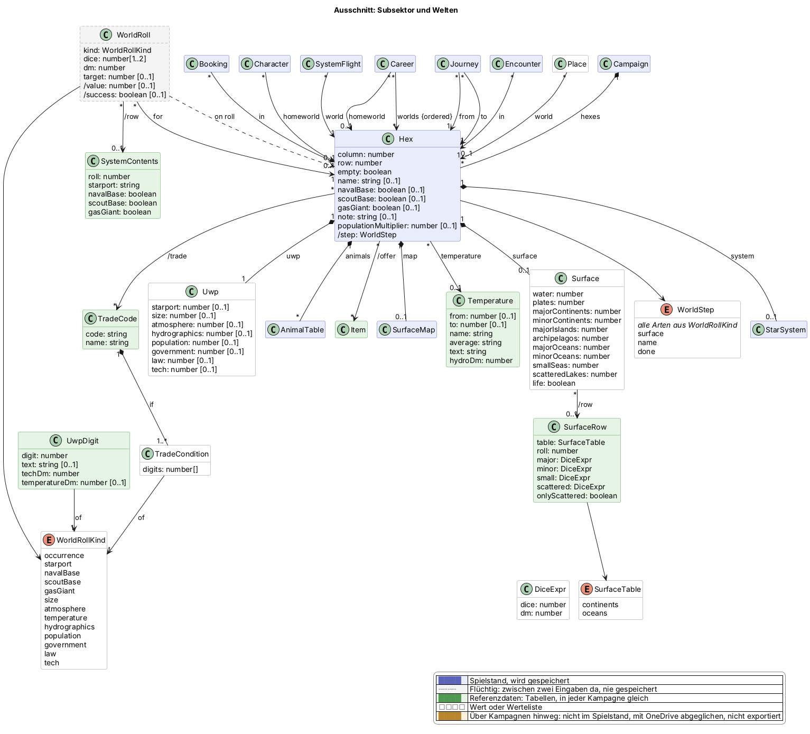

# Subsektor und Welten

Regeln des [Domänenmodells](../domain-model.md) für diesen Bereich: was das Bild nicht zeigt.
Das Diagramm führt; die Begriffe stehen im Domänenmodell unter *Begriffe*.

## Subsektor

Jede Kampagne hat einen Subsektor aus 8 Spalten und 10 Zeilen wie TAS Form 6
(Charts S. 26): 0101 links oben, die Spalten mit gerader Nummer eine halbe Zeile tiefer. Ein
Hexfeld (`Hex`) gibt es erst, wenn für es gewürfelt wurde; je Spalte und Zeile höchstens eins.
Ein Feld ist also **nicht erzeugt** (kein `Hex`), **in Erschaffung** (`/step` vor `done`),
**leer** (`empty`) oder hat eine **Welt**. Nur ein nicht erzeugtes Feld lässt eine neue
Weltenerschaffung zu: Ihr erster Wurf, das Vorkommen, wird im Subsektor selbst gewürfelt, die
übrigen danach. Mehrere Felder dürfen zugleich in Erschaffung sein. Die Kampagnendatei enthält die
Hexfelder; eine neue Kampagne beginnt mit einem Subsektor ohne Hexfelder.

## Weltenerschaffung

nach der *World Generation Checklist* (Charts S. 15), jeder Wert einzeln
gewürfelt wie bei der Charaktererschaffung. **Gespeichert werden die Werte, nicht die Würfe:** Das
Hexfeld hält, ob es leer ist, die Stellen des UWP (`Uwp`), die Basen, den Gasriesen und den Namen,
jedes, sobald es feststeht. Der nächste Schritt (`/step`) folgt daraus, welche Werte schon da sind;
die Handelscodes folgen aus dem UWP. Ein Wurf (`WorldRoll`) ist flüchtig: Er hält Art, Würfel und
DM, beim Vorkommen den Zielwert, und trägt sein Ergebnis ins Hexfeld ein (`on roll`); danach wird
er nicht gespeichert. Die Weltkarte zeigt nur die Werte, keine Liste der Würfe: Den gerade
gemachten Wurf zeigt die Würfelbühne unten, darüber die Welt; an der Stelle der früheren Liste
steht die Oberfläche. Der Ablauf, in dieser Reihenfolge:
1. *Vorkommen* (`occurrence`): 1W6, Welt bei 4+. Sonst ist das Feld **leer** und fertig. Mit
   diesem Wurf entsteht das Hexfeld (`empty`).
2. *Systeminhalt*, je eine Spalte der System Contents Table mit 2W6 (`/row`, Summe + DM, auf 2
   bis 12 begrenzt): Raumhafen; Marinebasis nur bei Raumhafen A oder B; Scoutbasis nicht bei E
   oder X, mit DM −1 bei C, −2 bei B, −3 bei A; Gasriese. Eine Basis, für die nicht gewürfelt
   wird, steht sofort auf „nein“.
3. *Größe und Atmosphäre*: Größe 2W6 − 2; Atmosphäre 2W6 − 7 + Größe, bei Größe 0 kein Wurf
   und 0.
4. *Temperatur* (`temperature`), nach Mongoose Traveller 2e (Core Rulebook, S. 251): 2W6 plus
   den Temperatur-DM der Atmosphäre (`UwpDigit.temperatureDm`): 0 oder 1 kein DM, 2 oder 3 −2,
   4, 5 oder E −1, 6 oder 7 ±0, 8 oder 9 +1, A, D oder F +2, B oder C +6. Die Summe wählt die
   Zeile der Tabelle `Temperature` (`from` bis `to`, an den Enden offen): bis 2 *Gefroren*
   (−51 °C oder kälter), 3–4 *Kalt* (−51 bis 0 °C), 5–9 *Gemäßigt* (0 bis 30 °C), 10–11 *Heiß*
   (31 bis 80 °C), ab 12 *Kochend* (81 °C und mehr). Gespeichert wird die Zeile, nicht die Summe.
   Bei Atmosphäre 0 oder 1 sagt die Weltkarte dazu, dass die Temperatur zwischen glühender Hitze
   am Tag und Frost in der Nacht schwankt. Die Texte der Tabelle sind eigene, deutsche
   Beschreibungen, keine Übersetzung des Regeltexts. Den wahlweisen DM für den heißen oder kalten
   Rand der habitablen Zone (+4 bzw. −4) gibt es vorerst nicht; er kommt später mit dem
   Sternsystem.
5. *Rest des UWP*: Hydrographie 2W6 − 7 + Größe, DM −4 bei Atmosphäre 0, 1 oder A+, dazu der
   Wasser-DM der Temperatur (`Temperature.hydroDm`, nach Mongoose S. 252): −2 bei *Heiß*, −6 bei
   *Kochend*, sonst 0. Er gilt nicht bei Atmosphäre D (dicht, nur in der Höhe atembar), die das
   Wasser auch bei großer Hitze hält. Mongoose nimmt auch eine panthalassische Atmosphäre F aus;
   in Classic Traveller ist F aber dünn und tief liegend (*Thin, Low*), dort gilt der DM.
   Bei Größe 0 oder 1 kein Wurf und 0. Bevölkerung 2W6 − 2; Regierung
   2W6 − 7 + Bevölkerung; Gesetz 2W6 − 7 + Regierung; TL 1W6 plus die DMs der Tech Level Table
   (`UwpDigit.techDm`) von Raumhafen, Größe, Atmosphäre, Hydrographie, Bevölkerung und
   Regierung. Über die Hydrographie wirkt die Temperatur so auch auf TL und Handelscodes.
   Der DM eines Wurfs ist alles außer den Würfeln, also bei der Atmosphäre −7 + Größe. Ein Wert
   unter 0 gilt als 0, die Hydrographie höchstens als A. Sonst begrenzt nichts: Atmosphäre D–F,
   Regierung E–F und Gesetz über A haben in den Charts keinen Text (`UwpDigit.text` fehlt), die
   App zeigt dann nur die Ziffer (Ziffern über F in eHex ohne I und O, der Raumhafen X ist so die
   Ziffer 31).
6. *Oberfläche* (`surface`): Steht der TL fest, würfelt die App die ganze Oberfläche auf einmal,
   ohne eigenen Schritt (siehe [Oberfläche](oberflaeche.md#oberfläche)). Sie ist kein einzelner Wurf (`WorldRoll`).
7. *Sternsystem* (`system`, 2026-11-20): Steht die Oberfläche fest, kommt ein
   eigener Schritt „Sternsystem würfeln“. Er würfelt das ganze Sternsystem auf
   einmal nach Book 6 (siehe [Sternsystem, Monde und Gasriesen](#sternsystem-monde-und-gasriesen)): Sterne, Bahnen, Gasriesen,
   Monde und Ringe. Wie die Oberfläche ist das kein einzelner Wurf (`WorldRoll`) (Owner,
   20. November 2026).
8. *Name*: Zum Schluss gibt man den Namen ein (nicht leer); dann ist die Welt fertig (`done`).

**Welten ohne Temperatur.** Welten, deren Hydrographie vor diesem Schritt gewürfelt wurde, haben
keine Temperatur. Das ist erlaubt: Ihre Erschaffung geht ohne Temperatur weiter, und ist die Welt
fertig, lässt sich die Temperatur nachträglich würfeln. Die
Hydrographie bleibt dann, wie sie ist; der Wasser-DM gilt nur, wenn die Temperatur vorher
feststand.

**Welten ohne Oberfläche.** Ebenso dürfen Welten, die vor diesem Schritt den TL bekamen, ohne
Oberfläche sein. Ihre Erschaffung geht mit dem Namen weiter; ist die Welt fertig, lässt sich die
Oberfläche nachträglich würfeln, nach der Temperatur, falls auch die fehlt (die Oberfläche
braucht sie für das Leben).

**Welten ohne Sternsystem** (2026-11-20). Fertige Welten von vor diesem
Schritt haben kein Sternsystem. Beim Öffnen der Kampagne würfelt die App es für jede solche Welt
nach, einmal, und speichert es (Owner, 20. November 2026). Fehlt der Welt die Temperatur, gelten
ihre Monde in der bewohnbaren Zone als gemäßigt. Eine Welt in Erschaffung ohne Sternsystem kommt
an dem Schritt von selbst vorbei.

**Verwerfen** geht, solange die Welt in Erschaffung ist, und macht das Feld wieder zu einem nicht
erzeugten. Ein leeres Feld und eine fertige Welt bleiben, wie sie sind. Die Weltenerschaffung
steht nicht im Log und hat keinen Verlauf. Beim Import wird jedes Hexfeld gegen diese Regeln
geprüft: Werte nur in der Reihenfolge des Ablaufs, jeder in dem Bereich, den sein Wurf ergeben
kann, und die Werte ohne Wurf so, wie die Regeln sie setzen (Atmosphäre 0 bei Größe 0, keine
Marinebasis bei Raumhafen C). Ausnahmen von der Reihenfolge: Eine Welt mit Hydrographie
darf ohne Temperatur sein (siehe *Welten ohne Temperatur*); dann gilt für ihre Hydrographie der
Bereich ohne Wasser-DM. Eine Welt mit Namen darf ohne Oberfläche sein; hat sie eine, hat sie
auch die Temperatur, und die Oberfläche muss zu den Regeln unter *Oberfläche* passen. Hexfelder aus der Zeit, als die Würfe gespeichert wurden, werden
beim Laden nachgespielt und als Werte übernommen.

## Notiz zur Welt

Eine fertige Welt (mit Namen, nicht leer) kann eine Notiz haben (`note`):
freier Text, auch über mehrere Zeilen. Anders als ein Logeintrag lässt sie sich jederzeit ändern,
wie die Notiz eines Charakters; Leerraum am Rand fällt weg, eine leere Notiz gibt es nicht (dann
fehlt das Feld). Eine Welt in Erschaffung und ein leeres Feld haben keine Notiz. Die Weltkarte
zeigt die Notiz unter der Oberfläche zum Bearbeiten; die Liste der Welten im Sektor zeigt ihre
erste Zeile.

## Handelscodes

folgen aus dem UWP (`/trade`): Ein Code gilt, wenn jede seiner Bedingungen
(`TradeCondition`: Stelle des UWP und erlaubte Ziffern) erfüllt ist. Es sind die elf aus den
Charts (S. 15): Agricultural, Non-Agricultural, Industrial, Non-Industrial, Rich, Poor, Water
World, Desert World, Vacuum World, Asteroid Belt, Ice-capped. Subsector Capital vergibt die
Spielleitung; das kommt später.

## Die Darstellung auf der Karte

ist die übliche aus Classic Traveller und Sache der Anzeige:
oben die Nummer des Feldes, darunter der Raumhafen, in der Mitte die Welt (gefüllter Kreis mit
Wasser, leerer Kreis ohne, Punkte für einen Asteroidengürtel), Stern für die Marinebasis, Dreieck
für die Scoutbasis, kleiner Kreis rechts oben für den Gasriesen, darunter der Name, in
Großbuchstaben ab Bevölkerung 9. Ist die Karte groß genug gezoomt, kommen darunter das UWP und
die Handelscodes dazu, jedes erst, wenn es lesbar ist.

## Später

, nicht in diesem Schritt: der Rand der habitablen Zone beim Temperaturwurf, Reisezonen (Amber, Red), Verbindungen
(communications routes), Subsector Capital, ein Name für den Subsektor, mehrere Subsektoren zu
einem Sektor und eine fertige Welt wieder löschen.

## Sternsystem, Monde und Gasriesen

*freigegeben am 18. November 2026, Kennzeichen 2026-11-18d.* Damit die
Raumkarte nicht leer ist (Wunsch des Owners, 18. November 2026), mit Stern und Bahnen (Owner:
„den Stern bestimmen und speichern“). Regeln aus Book 6 *Scouts*, übertragen in
[`regeln-sternsystem.md`](../regeln-sternsystem.md); Abweichungen tragen ⚑, der Owner hat sie alle
am 18. November 2026 angenommen. Dass die Hauptwelt Mond eines Gasriesen sein kann, ist Regel
(B6 35, 37), keine Hausregel.
- **Wann gewürfelt** (geändert und freigegeben am 20. November 2026, Kennzeichen 2026-11-20;
  vorher: beim ersten Öffnen der Raumkarte). In der Weltenerschaffung als eigener Schritt nach
  der Oberfläche („Sternsystem würfeln“), alles auf einmal (siehe
  *Weltenerschaffung*, Schritt 7); fertige Welten ohne Sternsystem bekommen es beim Öffnen der
  Kampagne (siehe *Welten ohne Sternsystem*). Gespeichert an der Welt (`Hex.system`), danach nie
  wieder gewürfelt (Werte, nicht Würfe). Leere Hexfelder haben keins.
- **Sterne** (B6 26–28): Art des Systems (einzeln, doppelt, dreifach), Hauptstern mit Typ,
  Zehntel und Größe (DM +4, wenn die Hauptwelt Atmosphäre 4–9 oder Bevölkerung 8+ hat), Begleiter
  mit Typ, Größe und Bahn (nah, Bahnnummer oder fern mit 1D × 1.000 AU). ⚑ Ferne Begleiter
  bekommen keinen eigenen Begleiter und keine eigenen Bahnen.
- **Bahnen und Zonen** (B6 27–31): höchste Bahn mit den DMs nach Größe und Typ; Begleiter sperren
  Bahnen; die Zone jeder Bahn folgt aus `StarZones` des Hauptsterns (erste verfügbare und
  bewohnbare Bahn).
- **Gasriesen** (B6 28, 34–35): nur, wenn das UWP einen hat (`Hex.gasGiant`); wie viele, nach der
  Tabelle *System Features*. Jeder kommt zufällig in eine freie Bahn der bewohnbaren oder äußeren
  Zone (sonst eine neue in der äußeren). Größe 1D (3 oder weniger groß), ⚑ Radius groß 50.000 +
  1D × 10.000 km, klein 13.000 + 1D × 7.000 km (Book 6 nennt nur die Spannen).
- **Hauptwelt** (B6 35): in die bewohnbare Bahn. Liegt dort ein Gasriese, wird sie sein Mond
  (`host`): Bahn und Startwinkel wie bei einem Mond des Gasriesen; sie hat dann selbst keine
  Monde. ⚑ Auch mit Atmosphäre 0, 1 oder A und mehr kommt sie in die bewohnbare Bahn (Book 6
  erlaubt eine andere). Ein Asteroidengürtel kommt in eine zufällige freie Bahn. ⚑ Hat der Stern
  keine bewohnbare Bahn (M5 V, weiße Zwerge außer DB …), kommt die Hauptwelt in die erste
  verfügbare Bahn.
- **Monde** (B6 24, 36–37): je Planet 1D − 3, kleiner Gasriese 2D − 4, großer 2D; keine bei Größe
  0 und S und bei Monden. Größe Welt − 1D (Gasriese 2D − 6 bzw. 2D − 4); 0 ergibt einen Ring,
  weniger eine kleine Welt mit (2D + 3) × 100 km Durchmesser. Bahn: 2D, 7 oder weniger nah, 8
  oder mehr fern, beim Gasriesen 12+ extrem fern, je weiterer Mond DM −1 mehr; Abstand nach der
  Tabelle in Radien des Körpers, Ringe 1D auf die Spalte *Ring*; dieselbe Bahn zweimal: neu
  würfeln. Atmosphäre, Hydrographie und Bevölkerung nach Book 6 mit den DMs der Zone des Körpers,
  um den sie kreisen; wo Kapitel und Checklist verschiedene DMs nennen, gilt das Kapitel.
  Regierung, Gesetz, Tech-Level, Raumhafen und Einrichtungen wie bei weiteren Welten (siehe
  *Nebenwelten*, 2026-11-20c). Für das Weltsymbol: ⚑ die
  Temperatur folgt aus der Zone (innen heiß, bewohnbar wie die Hauptwelt, außen gefroren).
- **Schwerkraft** (B6 43, SR 22): Mond g = Größe ÷ 8 G (K = 1); kleine Welt g = Durchmesser ÷
  12.800 km G; Ring keine; Gasriese g = 0,2 × Durchmesser ÷ 12.800 km G (K = 0,2). Die Masse
  folgt daraus (G·M = g · R²). Die Tabelle *World Data* (B6 48) weicht an einigen Stellen ab; es
  gilt die Formel.
- **Auf der Raumkarte der Welt**: Monde laufen auf festen Kreisbahnen gegen den Uhrzeigersinn
  (2D); ihr Ort ergibt sich aus Startwinkel, Umlaufzeit (T = 2π · √(r³ ÷ G·M)) und der Zeit seit
  Kampagnentag 0 (Tag × 86.400 s plus Dauer des Systemflugs). Monde haben Schwerkraft, man kann
  auf ihnen aufschlagen, und sie verdecken die Sichtlinie; gezeichnet mit dem Weltsymbol (kleine
  Welten wie Größe 1, nur kleiner). ⚑ Ein Ring ist ein flaches Band von (Bahn + 0,2) bis
  (Bahn + 0,8) Radien, ohne Schwerkraft, man fliegt hindurch. ⚑ Das Licht kommt weiter von links,
  in der Farbe des Hauptsterns.
- **Hauptwelt als Mond**: Ihre Raumkarte ist die Raumkarte des Gastgebers: der Gasriese in der
  Mitte, die Hauptwelt und die übrigen Monde auf ihren Bahnen. Der Systemflug beginnt dann auf
  einer Kreisbahn um die Hauptwelt mit doppeltem Weltradius, mitbewegt mit ihr.
- **Raumkarte am Gasriesen** (`SystemFlight.at`): Eine Raumkarte gibt es um jede Welt des Systems,
  auch um eine Nebenwelt, einen Mond oder einen Gasriesen (nicht um einen Ring; geändert am
  21. November 2026, Owner), und der Systemflug darf an der Hauptwelt und jedem Gasriesen
  beginnen. Am Gasriesen steht er in der Mitte, seine Monde kreisen um ihn,
  Sprunggrenzen nach seinem Durchmesser. Der Systemflug beginnt wie an der Welt (Aufenthaltsort,
  eigenes Schiff, Kreisbahn mit doppeltem Radius). ⚑ Wie das Schiff von der Welt zum Gasriesen
  kommt (eine Reise im System, Tage bei 1 G), bleibt offen; bis dahin darf der Systemflug am
  Gasriesen von der Welt aus beginnen, auf der die Gruppe ist.
- **Asteroidengürtel** (Größe 0): keine Monde; die Raumkarte zeigt ein Asteroidenfeld aus dem
  Weltschlüssel, nicht gespeichert, ohne Schwerkraft.
- **Weitere Welten** (freigegeben am 20. November 2026, Kennzeichen 2026-11-20b; Owner, 20. November 2026;
  vorher wurden Planetoidengürtel, leere und eingefangene Bahnen und weitere Welten nicht
  gewürfelt). Im selben Zug wie Sterne und Gasriesen, in dieser Reihenfolge (B6 28–29, 34–36;
  Regeln in [`regeln-sternsystem.md`](../regeln-sternsystem.md)):
  1. *Planetoidengürtel*: ob und wie viele nach *System Features* (DM − Zahl der Gasriesen),
     bevorzugt in die Bahn direkt innerhalb eines Gasriesen, sonst in freie Bahnen.
  2. *Leere Bahnen* und *eingefangene Welten* nach B6 29 (DM +1 bei Sterntyp B oder A); leere
     Bahnen in `emptyOrbits`, eingefangene als Welt mit Zwischenbahn (`captured`).
  3. *Hauptwelt* in die bewohnbare Bahn (wie oben).
  4. *Weitere Welten*: jede übrige verfügbare, nicht leere Bahn und jede eingefangene Welt
     bekommt eine Welt mit Größe (2D − 2 mit den DMs nach Bahn und Sterntyp; 0 oder weniger
     ergibt eine kleine Welt S mit (2D + 3) × 100 km), Atmosphäre, Hydrographie und Bevölkerung
     nach Book 6 mit den DMs ihrer Zone, die Bevölkerung höchstens Hauptwelt − 1. Wo Kapitel und
     Checklist verschiedene DMs nennen, gilt das Kapitel.
  5. *Monde* für jede Welt und jeden Gasriesen wie oben (Gürtel, kleine Welten, Monde und Ringe
     haben keine).
  6. *Nebenwelten* (2026-11-20c): Regierung, Gesetz, Einrichtungen, Tech-Level und Raumhafen für
     jede weitere Welt und jeden Mond außer Ringen (siehe *Nebenwelten*).
  Nur um den Hauptstern (Owner): Begleitsterne haben keine eigenen Bahnen und Welten. Auf die
  Raumkarte kommen die weiteren Welten nicht: Sie
  liegen Millionen Kilometer entfernt. Die Weltkarte zeigt sie in einer Übersicht des Systems;
  besuchen kann man sie später mit einer Reise im System.
- **Nebenwelten mit Weltkarte und Globus** (freigegeben am 20. November 2026, 2026-11-20d; Owner, 20. November
  2026). Jede Welt des Systems hat ihre Weltkarte wie die Hauptwelt; Weltkarte und Globus hängen
  dafür an der Welt, nicht am Hexfeld. Nebenwelten bekommen einen Namen, eine Notiz und auf Wunsch
  einen Globus (die Oberfläche haben sie seit
  21. November 2026 schon mit dem Sternsystem, die Temperatur aus der Zone gespeichert, damit das
  Leben dazu passt); danach haben sie Tiertabellen, Orte und Begegnungen wie die Hauptwelt.
  Keine Oberfläche und keinen Globus haben Größe 0 (Gürtel), Ringe und Gasriesen. Kleine Welten
  (S) bekommen seit 21. November 2026 (Owner) beides: die Oberfläche nach den Regeln für Größe 0
  (kein Wasser, keine Platten; Book 6 behandelt sie wie Größe 0) und einen Globus mit dem kleinsten
  Raster (wie Größe 1, `gridSize`), dessen Felder nach ihrem echten Durchmesser gemessen werden. ⚑ Auf der Oberflächenkarte einer Nebenwelt bekommt die erste Hauptstadt den
  Spaceport als Hafen (Y: keinen), die übrigen Städte wie bei Starport X.
  Geändert am 21. November 2026 (Owner, „wo die Party ist, sollte die UI beeinflussen“): Im System
  der Gruppe steht die Welt, auf der sie ist, an erster Stelle.
- **Nebenwelten** (freigegeben am 20. November 2026, Kennzeichen 2026-11-20c). Nach B6 38–39 mit den Tabellen
  S. 29, übertragen in [`regeln-sternsystem.md`](../regeln-sternsystem.md) (*Nebenwelten*). Für jede
  Welt außer der Hauptwelt, Gasriesen und Ringen, im selben Zug wie das übrige System, nach den
  Monden und in dieser Reihenfolge; die Hauptwelt behält ihren Starport (A–E, X), die übrigen
  haben einen Spaceport (Owner, 20. November 2026: Kapitel bei Widersprüchen, die Zusätze der
  Tabelle S. 29 übernehmen, Gürtel wie Welten, Basen im ganzen System mitwürfeln):
  0. *Basen im System* (`bases`, B6 37; eine Wahlregel der Spielleitung, Owner: mitwürfeln):
     Die Marine richtet 1W6 − 3 Stützpunkte ein, je einen auf einer zufälligen Welt oder einem
     Mond mit Bevölkerung 3+; die Scouts 1W6 − 4 Scoutbasen, je eine auf einer zufälligen Welt
     oder einem Mond mit Bevölkerung 2+. ⚑ Höchstens ein Stützpunkt je Welt und Art; gibt es zu
     wenige solche Welten, entsprechend weniger. Die Basen der Hauptwelt bleiben am Hexfeld
     (`navalBase`, `scoutBase`).
  1. *Regierung* (im UWP): 1W6 auf die Tabelle (1 → 0, 2 → 1, 3 → 2, 4 → 3, 5+ → 6); hat die
     Hauptwelt Regierung 6, ist sie 6, bei 7+ DM +2 (Kapitel und Checklist; die Tabelle S. 29
     sagt DM + Bevölkerung bzw. DM +1). Ohne Bevölkerung 0.
  2. *Gesetz* (im UWP): 1W6 − 3 + Gesetz der Hauptwelt, mindestens 0; ohne Bevölkerung 0.
  3. *Einrichtungen* (`facilities`), jede, deren Bedingung gilt: Farming (bewohnbare Zone,
     Atmosphäre 4–9, Hydrographie 4–8, Bevölkerung 2+), Mining (Hauptwelt industriell, Bevölkerung
     2+), Colony (Regierung 6, Bevölkerung 5+), Research Laboratory (2W6 11+, DM +2 bei TL der
     Hauptwelt 10+; keins bei TL der Hauptwelt 8 oder weniger oder ohne Bevölkerung), Military Base
     (2W6 12+, DM +1 bei Bevölkerung der Hauptwelt 8+, DM +2 bei gleicher Atmosphäre wie die
     Hauptwelt, DM +1 bei Scout- oder Marinebasis im System (Hexfeld oder Schritt 0, nur Tabelle
     S. 29); keine ohne Bevölkerung oder bei armer Hauptwelt).
  4. *Tech-Level* (im UWP): TL der Hauptwelt − 1, gleich ihrem TL bei Research Laboratory oder
     Military Base; unter 7 bei Atmosphäre nicht 5, 6 oder 8 wird er 7 (nur Tabelle S. 29).
  5. *Raumhafen* (`spaceport`): 1W6 (1–2 Y, 3 H, 4–5 G, 6 F), DM +2 bei Bevölkerung 6+, −2 bei
     Bevölkerung 1, −3 bei Bevölkerung 0 (nur Tabelle S. 29; das Kapitel sagt −2 bei 0 und 1).
  Auch Planetoidengürtel, die nicht die Hauptwelt sind, bekommen diese Werte (Book 6 sagt „jeder
  Planet“, Owner).
  **Bestehende Systeme** bekommen die Werte beim Öffnen der Kampagne nachgewürfelt, mit Würfen
  aus Schlüssel der Kampagne und Feld wie das Sternsystem; alles andere am System bleibt. Die
  Übersicht der Weltkarte zeigt das UWP der Nebenwelt (z. B. `G552531-8`) und ihre
  Einrichtungen.

## Welten und Hexfeld

(freigegeben am 20. November 2026, Kennzeichen 2026-11-20b; Owner, 20. November
2026: „Welten sollten aus dem Hexfeld getrennt werden. Monde sind auch Welten, die als Mond an
einer anderen Welt hängen. Eine Welt ist die Hauptwelt.“).
- **Das Hexfeld ist das System.** Es hält Spalte und Zeile, ob es leer ist, die Basen (Marine,
  Scout) und ob es im System einen Gasriesen gibt, den Schritt der Erschaffung (`/step`), das
  Sternsystem (`system`) und alle Welten des Systems (`worlds`, in der Reihenfolge ihrer
  Entstehung). Eine davon ist die **Hauptwelt** (`main`).
- **Jede Welt ist eine `World`** mit ihrer Art (`WorldKind`): Welt, kleine Welt, Gürtel, Gasriese
  oder Ring. Zu ihr gehören jetzt, was bisher am Hexfeld hing: UWP (bei Nebenwelten und Monden ohne
  Raumhafen, der als `spaceport` getrennt steht, 2026-11-20c), Name, Notiz, Temperatur, Bevölkerungs-
  multiplikator, Oberfläche, Oberflächenkarte, Tiertabellen, Angebot (`/offer`) und Handelscodes
  (`/trade`). Dazu ihre Lage: Bahn, Startwinkel (nur Monde), eingefangen; bei kleinen Welten der
  Durchmesser, bei Gasriesen groß/klein und Radius. Zone und Schwerkraft sind abgeleitet.
- **Monde sind Welten** mit `moonOf`: der Welt, die sie umkreisen; ihre Bahn zählt dann in deren
  Radien. Ohne `moonOf` kreist eine Welt um den Hauptstern; ihre Bahn ist die Nummer nach Book 6.
  Liegt die Hauptwelt in der Bahn eines Gasriesen, ist sie dessen Mond (`moonOf` statt bisher
  `StarSystem.host`) und hat selbst keine Monde. `Satellite`, `SatelliteKind`, `GasGiant` sowie
  `worldOrbit`, `hostOrbit`, `hostAngle` und `/worldZone` am `StarSystem` entfallen.
- **Die Weltenerschaffung erzeugt die Hauptwelt.** Vorkommen, Basen und Gasriese gehören dem
  Hexfeld; der Raumhafen steht im UWP der Hauptwelt (Book 6: nur die Hauptwelt hat den Starport,
  Nebenwelten haben Spaceports, 2026-11-20c); ab der Größe entstehen die übrigen Werte der
  Hauptwelt. Der Name der
  Hauptwelt ist der Name, den die Sektorkarte zeigt. Die übrigen Welten entstehen mit dem Schritt
  „Sternsystem würfeln“ (2026-11-20). Namen bekommen Nebenwelten und Monde auf ihrer Weltkarte
  (2026-11-20d).
- **Verweise auf eine Welt.** Orte (`Place.world`, also auch Aufenthaltsort, Orte von NSC,
  Missionsorte), Heimatwelt und Welten der Terms, Buchungen und Begegnungen (`in`) und der
  Systemflug (`world`, die Welt in der Mitte der Raumkarte; ersetzt auch `SystemFlight.at`) zeigen
  jetzt auf eine Welt statt auf ein Hexfeld. Reisen (`Journey.from`, `to`) gehen weiter von System
  zu System, also von Hexfeld zu Hexfeld; man kommt an der Hauptwelt an.
- **Bestehende Kampagnen**: Beim Laden wird aus jedem Hexfeld mit Welt eine Hauptwelt mit den
  bisherigen Werten; jeder Verweis auf das Hexfeld zeigt danach auf seine Hauptwelt.
