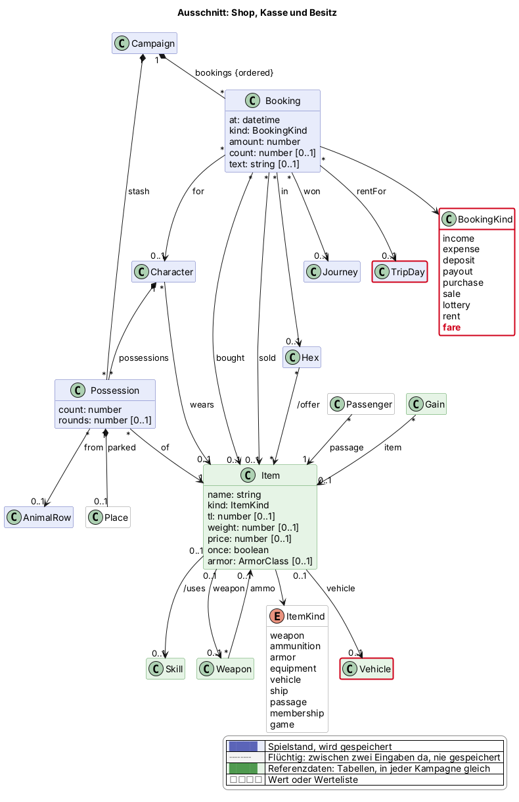

# Shop, Kasse und Besitz

Regeln des [Domänenmodells](../domain-model.md) für diesen Bereich: was das Bild nicht zeigt.
Das Diagramm führt; die Begriffe stehen im Domänenmodell unter *Begriffe*.

## Gruppengepäck und Traglast

Die Gruppe hat ein gemeinsames Gepäck
(`Campaign.stash`), Besitz wie bisher am Charakter: je Gegenstand höchstens ein Eintrag mit
Anzahl.
- **Am SC bleibt nur, was er ausgerüstet hat**: seine Primärwaffe, seine Sekundärwaffe und die
  Rüstung, die er trägt, je mit Anzahl 1. Alles andere liegt im Gepäck: Magazine, Werkzeug,
  Medical Kit, Passagen, Fahrzeuge, Beute, Jagdbeute, abgelegte Waffen und Rüstungen. NSC behalten
  ihren eigenen Besitz (man nimmt ihn als Beute).
- **Ausrüsten und ablegen**: Eine Waffe aus dem Gepäck oder von einem anderen SC wird Primär- oder
  Sekundärwaffe eines SC, eine Rüstung seine getragene Rüstung. Sie wandert dabei an ihn (Anzahl im
  Gepäck − 1); was er an dieser Stelle vorher hatte, kommt ins Gepäck. Ablegen legt sie ins Gepäck.
  Für die Waffe in der Hand gilt die Regel unter *Waffe in der Hand*. In der Ansicht geht das per
  Ziehen auf die Stelle (Maus oder Finger) oder per Auswählen.
- **Schuss**: Eine Schusswaffe nimmt ihre Schuss mit (`rounds`). Liegt dieselbe Schusswaffe
  mehrfach im Gepäck, gilt die Zahl für die zuletzt abgelegte; rüstet man eine aus, hat sie diese
  Zahl.
- **Last** (`/load`, kg): das Gewicht von allem im Gepäck und aller ausgerüsteten Waffen der
  lebenden SC. Nicht dazu zählen Rüstungen (außer dem Vacc Suit, getragen oder im Gepäck), der
  Dagger, Fahrzeuge, Small Craft, Schiffe, Passagen und Mitgliedschaften (SR 22, SE 5); Gegenstände
  ohne Gewicht zählen 0.
- **Traglast** (`/capacity`, kg): die Summe der STR (UPP, ohne Wunden) aller lebenden SC, mal dem
  Anteil für die Größe des Aufenthaltsorts (SE 5: Größe 8 = 100 %, je Stufe darunter +12,5 %,
  darüber −12,5 %); ohne Aufenthaltsort oder ohne Welt 100 %.
- **Belastung** (`/burden`, Hausregel nach SE 5 und SR 22, für die ganze Gruppe statt je Person):
  0 bis zur Traglast; 1 bis zum Doppelten; 2 darüber. Belastete SC zählen STR, DEX und END um die
  Belastung niedriger (mindestens 1), wie verwundete Werte, für Wunden und Bewusstlosigkeit; die Ansicht zeigt
  Last und Traglast als Balken. Wer tot ist oder ausgeschieden, trägt nichts.
- **Ältere Spielstände**: Alles, was ein SC besitzt und nicht ausgerüstet hat, kommt ins Gepäck;
  gleiche Gegenstände zählen zusammen.

## Kauf einer Waffe

Kauft man eine Waffe für einen SC, wird sie seine
Primärwaffe und er nimmt sie in die Hand; seine bisherige Primärwaffe kommt ins Gepäck, die
Sekundärwaffe bleibt. Weitere Stück derselben Waffe gehen ins Gepäck.

## Kauf einer Rüstung

Kauft man eine Rüstung für einen SC, trägt er sie
gleich (`wears`); seine bisherige Rüstung kommt ins Gepäck. Die Frage „anlegen?“ entfällt.
Weitere Stück gehen ins Gepäck.

## Gruppenkasse

Die Gruppe hat ein gemeinsames Konto. Sein Stand (`/funds`) ist die Summe aller
Buchungen (`bookings`), in der Reihenfolge, in der sie entstanden sind; eine neue Kampagne beginnt
mit Cr 0 und ohne Buchung.
- Jede Buchung hält Zeitpunkt, Art (`kind`) und Betrag (`amount`, ganze Cr, positiv für Geld in
  die Kasse, negativ für Geld hinaus) fest, dazu freiwillig einen Text (`text`, z. B. „Belohnung
  von Dr. Halvek“).
- *Einnahme* (`income`) und *Ausgabe* (`expense`) gibt man frei ein, mit Betrag und Text.
- *Einzahlung* (`deposit`) nimmt Credits eines Charakters (`for`) in die Kasse, *Auszahlung*
  (`payout`) gibt Geld aus der Kasse an einen Charakter; seine `credits` ändern sich um denselben
  Betrag. Ein Charakter zahlt nie mehr ein, als er hat.
- *Kauf* (`purchase`) und *Verkauf* (`sale`) siehe [Shop](#shop).
- Die Kasse wird nie negativ: Ausgabe, Auszahlung und Kauf gehen nur bis zum Stand. Einnahme,
  Einzahlung und Verkauf bringen Geld in die Kasse.
- Buchungen werden nur angehängt, nie geändert oder gelöscht; einen Fehler bucht man zurück
  (eine Gegenbuchung mit dem umgekehrten Betrag).
- Die Kampagnendatei enthält Aufenthaltsort und Buchungen; beim Import muss jede Buchung zu ihrer
  Art passen und die Kasse nach keiner Buchung negativ sein.

## Shop

Im *Shop* kauft die Gruppe auf ihrem Aufenthaltsort ein, aus der Gruppenkasse,
und zwar nur in einer **Stadt** auf der Welt der Gruppe (2026-11-17). Das Angebot ist gegliedert in
Waffen, Rüstung, Fahrzeuge, Sonstiges (Ausrüstung, Passagen); dazu Verkauf.
- **Angebot** (`/offer`): jeder Gegenstand aus der Liste mit Preis, dessen TL höchstens der TL der
  Welt ist (S. 23: „TL is the minimum technological level at which the item is available“), ohne
  Schiffe und Mitgliedschaften. Auch Waffen, die auf der Welt verboten sind, kann man kaufen, aber
  der Shop warnt: Eine Waffe ist verboten, wenn das Gesetz der Welt mindestens `law` ist (S. 14);
  ihr Magazin ebenso. Der Shop zeigt das bei der Waffe („verboten ab Gesetz 5“) und fragt beim Kauf
  nach.
- Die Verbote nach S. 14: ab 1 Body Pistol; ab 2 Laser Carbine und Laser Rifle; ab 3 Automatic
  Rifle; ab 4 Submachinegun; ab 5 Automatic Pistol und Revolver; ab 6 alle übrigen Schusswaffen
  außer der Shotgun (Carbine, Rifle); ab 7 Shotgun; ab 8 alle Klingen außer dem Dagger; ab 9
  (Waffen außerhalb der eigenen Wohnung verboten) auch Dagger, Club und Cudgel. Rüstungen und alles
  andere verbietet das Gesetz nicht.
- **Preis** ist der Preis aus den Charts, ohne Aufschlag: Classic Traveller kennt für Ausrüstung
  keine Preisänderung je Welt; die Preis-DMs auf S. 22 gelten nur für Handelsgüter in Tonnen.
- **Kaufen**: Man wählt einen Gegenstand, eine Anzahl (1 oder mehr; mit `once` genau 1) und den
  Charakter, der ihn bekommt (einen Lebenden). Der Kauf ist eine Buchung `purchase` mit
  `amount` = −Preis × Anzahl, `bought` (Gegenstand), `count` (Anzahl), `for` (Charakter) und
  `in` (die Welt). Er geht nur, wenn die Kasse reicht. Waffen und Rüstungen rüstet der gewählte
  SC aus (siehe [Kauf einer Waffe](#kauf-einer-waffe), [Kauf einer Rüstung](#kauf-einer-rüstung)), `for` ist er; alles andere kommt ins
  Gruppengepäck, `for` fehlt.
- **Verkaufen**: Auf dem Aufenthaltsort verkauft ein Lebender Gegenstände aus seinem Besitz, die
  einen Preis haben (ohne Schiffe und Mitgliedschaften), auch verbotene und solche über dem TL der
  Welt. Man wählt Charakter, Gegenstand und Anzahl (höchstens, was er hat) und den Erlös je Stück:
  vorgeschlagen ist der halbe Preis der Charts, abgerundet auf ganze Cr; man kann ihn ändern
  (ganze Cr, mindestens 1). Der Verkauf ist eine Buchung `sale` mit `amount` = +Erlös × Anzahl,
  `sold`, `count`, `for` und `in`; der Gegenstand geht aus dem Besitz (beim letzten Stück ist der
  Besitz weg). Verkauft wird aus dem Gruppengepäck (`for` fehlt) oder was ein SC ausgerüstet hat
  (`for` ist er). Verkauft er eine Waffe ganz, entfällt sie als Primär- bzw. Sekundärwaffe; war sie
  in der Hand, gilt die Regel unter *Waffe in der Hand*. Eine geladene Schusswaffe geht mit ihren
  Schuss.
- **Später**: Preisänderungen nach Hausregel, die Industrie einer Welt, Schiffe kaufen,
  Leistungen (Recharge, Refill) und Zubehör.

## Gegenstände

Was ein Charakter besitzt, steht als Besitz (`possessions`) an ihm: je Gegenstand
aus der festen Liste höchstens ein Eintrag, mit einer Anzahl von 1 oder mehr (3 × Low Passage,
2 × Free Trader für zwei abbezahlte Raten). Ein Gegenstand mit `once` hat immer die Anzahl 1. Im
Editor lässt sich Besitz hinzufügen, zählen und entfernen wie Fertigkeiten; entfernt wird er
wirklich, weil der Log nicht auf ihn verweist.
- **Die Liste** kommt aus den Charts der Starter Edition: *Personal Equipment and Vehicles* (S. 23:
  Ausrüstung, Kommunikatoren, Geräte, Sichthilfen, Werkzeug, Unterkünfte, Fahrzeuge, Small Craft,
  Waffen mit Munition und Energiezellen, Rüstungen), dazu die Passagen (Ship Revenues, S. 9: High
  Cr 10.000, Middle Cr 8.000, Low Cr 1.000), die Schiffe aus der Abmusterung (Standard Ship
  Designs, S. 11: Scout MCr 29,43, Free Trader MCr 37,08) und die Travellers' Aid Society. Jede
  Klinge und Schusswaffe hat ihre Kampfwerte als Waffe (siehe [Waffen](kampf.md#waffen)) und nutzt über sie genau
  ihre Fertigkeit (`/uses`).
- **TL, Gewicht und Preis** (`tl`, `weight`, `price`) stehen, wie in den Charts angegeben. Das
  Gewicht ist immer in kg (S. 4 nennt Gramm, S. 23 bei Fahrzeugen Tonnen = 1000 kg), der Preis
  immer in Cr (KCr und MCr umgerechnet). Steht im Chart ein offensichtlicher Druckfehler (Grav Belt
  „10 tons“), gilt trotzdem das Chart; die Daten vermerken es. Was die Charts nicht angeben, fehlt (Club und die
  Travellers' Aid Society haben keinen Preis, Passagen und Mitgliedschaft kein Gewicht). Bei Schiffen und Small Craft sind „tons“
  Verdrängung, kein Gewicht; sie haben deshalb keins. Gibt es einen Gegenstand in mehreren TL
  (Vacc Suit TL 8 bis 13), ist jede Zeile ein eigener Gegenstand mit eigener Id. Keine Gegenstände sind
  Accessories („10 % of price“) und Recharge (eine Leistung).
- **Später**, mit Handel: Verkaufen, die Rüstungsklasse einer Rüstung als Gegenstand, Länge der Waffen,
  Kaufen und Verkaufen, Gesamtgewicht. Schiffe sind vorerst nur ein
  Gegenstand; Schiffskarten kommen später. Alles, was nicht in der Liste steht, bleibt freier Text
  in der Ausrüstung (`equipment`).
